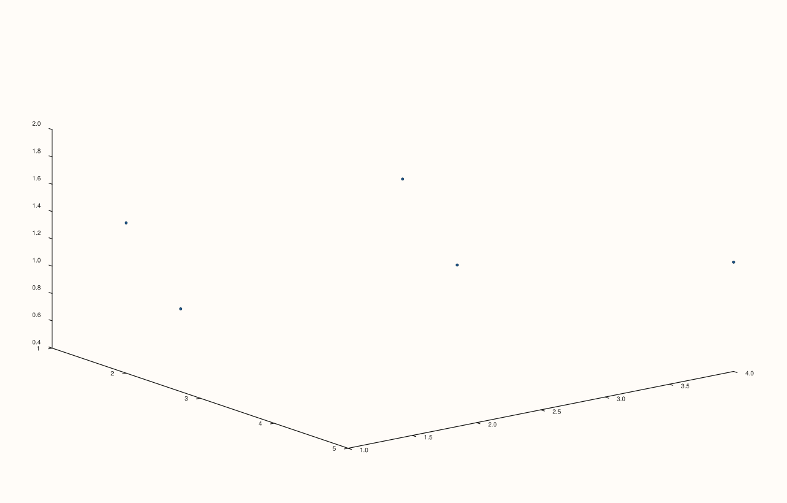
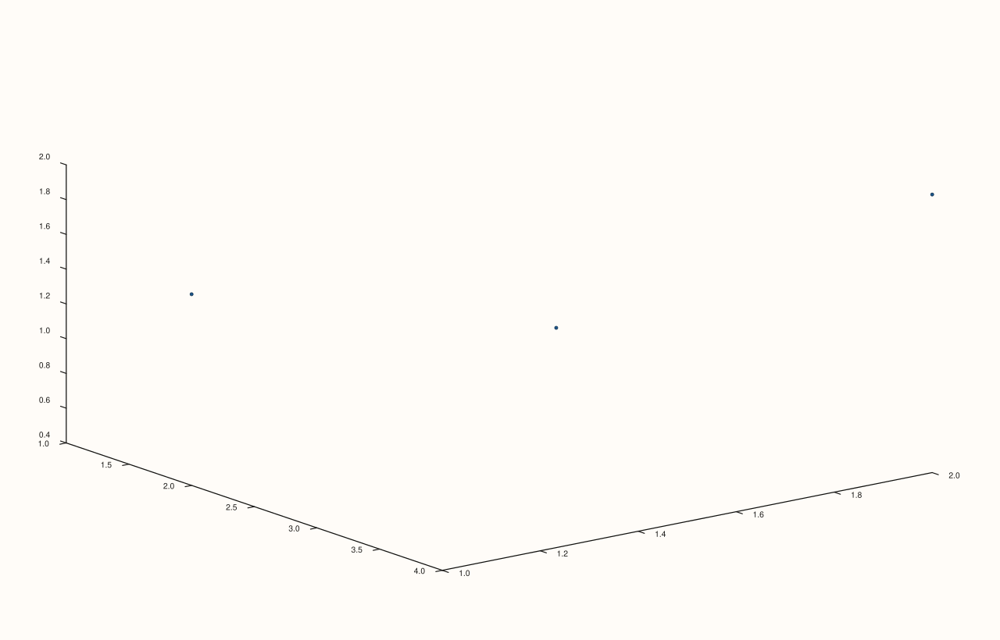

<!-- pluss-hand-authored -->

# flash::cloud4

[Back to flash API Reference](../../flash_api_reference)

## Signatures

```cpp
template <class X, class Y, class Z, class W>
Trace& flash::cloud4(Pane& pane, X&& x, Y&& y, Z&& z, W&& w,
                      const HyperPlotOptions& options = {})

template <class X, class Y, class Z, class W>
Trace& flash::cloud4(Studio& studio, X&& x, Y&& y, Z&& z, W&& w,
                      const HyperPlotOptions& options = {}, std::string title = {})
```

## What It Does

The point-cloud sibling of [`flash::path4`](path4.md): projects a 4D `(x, y, z, w)` point
set down to 3D using the exact same rotation/projection/slice logic (see
[`flash::path4`](path4.md)'s own documentation for the full mechanics of
`HyperPlotOptions`), then draws the projected points as a [`Pane::cloud3`](../pane/cloud3.md)
scatter instead of a connected path — unlike `path4`, point order/adjacency has no
rendering consequence here, only which points survive the (optional) `w_slice` filter.

Two overloads: a `Pane`-taking form, and a `Studio`-taking convenience form that creates
a new [`Volumetric`](../studio/pane3.md) pane for you.

```{important} point_size sets a UNIFORM marker size for every point -- not read from w or any projected value
Unlike a genuine per-point size series (as flash::cloud3's own size overload accepts),
cloud4 always passes a single, uniform size -- max(1.0, options.point_size) -- for
EVERY projected point, via Series::full(...). There is no way to vary marker size by
the original w coordinate or by projected depth through this function alone; every
point in the cloud renders at the same size regardless of options.
```

## Parameters

**pane** (`Pane&`, Pane overload)
    The target pane. Must be `Volumetric`.

**studio** (`Studio&`, Studio overload)
    The figure to create a new `Volumetric` pane in.

**x**, **y**, **z**, **w** (series-convertible, must each be rank ≤ 3 and identical
lengths)
    The 4D point coordinates. Unequal lengths throw
    `std::invalid_argument("flash::cloud4: x, y, z, w must have identical lengths")`.

**options** (`const HyperPlotOptions&`, optional)
    See [`flash::path4`](path4.md)'s field table — identical struct, shared between both
    functions. `point_size` is the one field that's genuinely consumed here (see the
    important callout above); it is inert on `path4`.

**title** (`std::string`, default `{}`, Studio overload only)
    Forwarded to `Studio::pane3` as the new pane's title.

## Returns

`Trace&`
    A reference to the newly created trace, for chaining.

## Examples

Example 1. `Pane` overload, default options.

```cpp
using namespace pluss::pl;

auto fig = studio("flash_cloud4_pane");
auto& pane = fig.pane3();
std::vector<double> x{1.0, 2.0, 3.0, 4.0, 5.0};
std::vector<double> y{2.0, 1.0, 3.0, 2.0, 4.0};
std::vector<double> z{0.5, 1.5, 1.0, 2.0, 1.2};
std::vector<double> w{0.1, 0.4, 0.7, 0.3, 0.9};
flash::cloud4(pane, x, y, z, w);
fig.show();
```


Example 2. `Studio` overload — no explicit `pane3()` call needed.

```cpp
using namespace pluss::pl;

auto fig = studio("flash_cloud4_studio");
std::vector<double> x{1.0, 2.0, 3.0, 4.0, 5.0};
std::vector<double> y{2.0, 1.0, 3.0, 2.0, 4.0};
std::vector<double> z{0.5, 1.5, 1.0, 2.0, 1.2};
std::vector<double> w{0.1, 0.4, 0.7, 0.3, 0.9};
flash::cloud4(fig, x, y, z, w);
fig.show();
```



Example 3 (verification, not a distinct rendering). `w_slice = {0.0, 0.5}` renders
genuinely differently from the unsliced default, confirmed via direct SVG comparison —
some points are dropped entirely.

```cpp
using namespace pluss::pl;

std::vector<double> x{1.0, 2.0, 3.0, 4.0, 5.0};
std::vector<double> y{2.0, 1.0, 3.0, 2.0, 4.0};
std::vector<double> z{0.5, 1.5, 1.0, 2.0, 1.2};
std::vector<double> w{0.1, 0.4, 0.7, 0.3, 0.9};

auto fig1 = studio("flash_cloud4_no_slice_cmp");
auto& pane1 = fig1.pane3();
flash::cloud4(pane1, x, y, z, w);

auto fig2 = studio("flash_cloud4_slice");
auto& pane2 = fig2.pane3();
flash::HyperPlotOptions opts;
opts.w_slice = Range1d{0.0, 0.5};
flash::cloud4(pane2, x, y, z, w, opts);

std::cout << "cloud4 no-slice vs w_slice(0,0.5) differ: " << (fig1.to_svg() != fig2.to_svg()) << "\n";
fig2.show();
```

Output:

```text
cloud4 no-slice vs w_slice(0,0.5) differ: 1
```



## Notes

- Not `noexcept`.
- `point_size` is clamped to at least `1.0` before use.
- Same `w_slice`-excludes-every-point edge case as [`flash::path4`](path4.md) applies
  here too, with a `cloud4`-specific message
  (`"flash::cloud4: no points remain after projection/slice"`).
- See the important callout above: no per-point size variation is possible through this
  function — every point renders at the same size.

## See Also

- [`flash::path4`](path4.md): the connected-line sibling, sharing the exact same
  `HyperPlotOptions` and rotation/projection/slice mechanics.
- [`Pane::cloud3`](../pane/cloud3.md): what the projected 3D result is ultimately drawn
  through.
- [`Studio::pane3`](../studio/pane3.md): what the `Studio` overload calls internally.

<div class="pluss-inline-prev-next">
  <a class="prev-link" href="path4.html">
    <span class="label">Previous</span>
    <span class="title">path4</span>
  </a>
  <a class="next-link" href="hyper_animation_sequence.html">
    <span class="label">Next</span>
    <span class="title">hyper_animation_sequence</span>
  </a>
</div>
