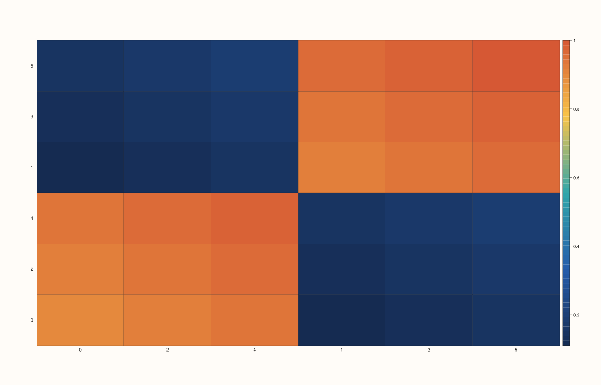
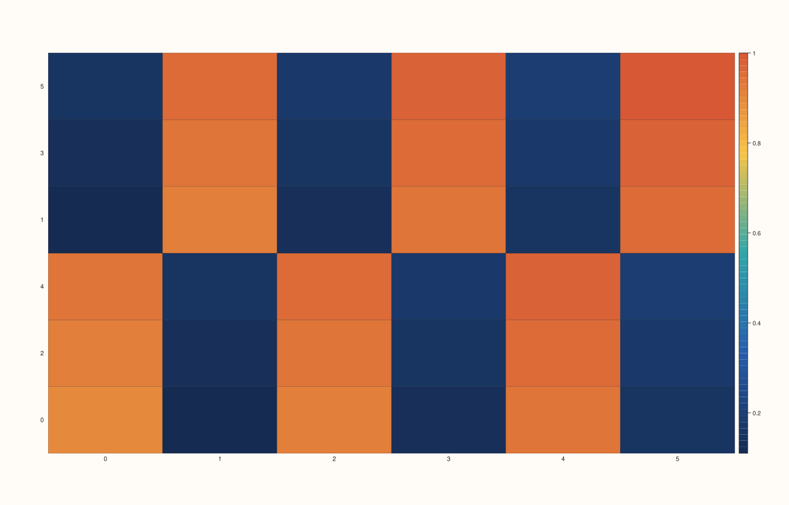

<!-- pluss-hand-authored -->

# flash::clustermap

[Back to flash API Reference](../../flash_api_reference)

## Signatures

```cpp
Trace& flash::clustermap(Pane& pane, Series x, Series y, Series z)

Trace& flash::clustermap(Pane& pane, Series x, Series y, Series z, const ClusterMapOptions& options)
```

## What It Does

Reorders a grid's rows and/or columns so that similar ones sit next to each other, then draws it via
[`flash::heatmap`](heatmap.md). Two overloads: default options, or explicit `ClusterMapOptions`.

The order comes from hierarchical clustering: rows are clustered by the Euclidean distance between them
with average linkage (each merge joins the two clusters whose members are closest on average), and columns the
same way, on the columns of `z`. The rows then follow the leaves of the resulting tree, so a block of similar rows
stays together and the blocks themselves are ordered by how near they are to one another. Non-finite cells
count as `0` when distances are measured.

No dendrogram is drawn beside the map: the figure is the reordered grid and nothing else.

The cells sit at positions `0 .. n-1` in the clustered order. The axes show the labels you gave in `x` and `y`, so each
tick still names the row or column it belongs to; a map with more than 24 rows or columns labels evenly spaced ones so
that the text stays readable.

## `ClusterMapOptions` fields

| Field | Type and default | Description |
|---|---|---|
| `cluster_rows` | `bool`, default `true` | Whether to reorder rows by average-linkage clustering. When `false`, rows keep their original order. |
| `cluster_cols` | `bool`, default `true` | Whether to reorder columns by average-linkage clustering. When `false`, columns keep their original order. |
| `heatmap` | `HeatmapOptions`, default-constructed | Passed straight through to the underlying [`flash::heatmap`](heatmap.md) call after reordering — every field documented there (`vmin`, `vmax`, `mask`, `annotate_levels`, `scale_guide`, `borderless`) applies here too, against the *reordered* grid. |

## Parameters

**pane** (`Pane&`)

The target pane. Must be `Planar` (2D).

**x**, **y** (series-convertible)

The labels of the columns and rows. They move with the columns and rows they name, so the tick text
always matches its (moved) row or column; the cells themselves sit at positions `0 .. n-1`.

**z** (series-convertible, must be rank-2)

The field values to reorder and plot. `x`'s length must equal `z`'s column count,
`y`'s length must equal `z`'s row count — a mismatch throws
`pluss::Error("flash::clustermap x/y extents must match z cols/rows")`. `z`
itself must be rank-2 — a flat input throws
`pluss::Error("flash::clustermap requires rank-2 z")`.

**options** (`const ClusterMapOptions&`, optional)

See the field table above.

## Returns

`Trace&`
    A reference to the newly created (fieldmap) trace — whatever
    [`flash::heatmap`](heatmap.md) itself returns.

## Examples

Every example uses the same grid: rows and columns `0, 2, 4` form one block and `1, 3, 5` the other, interleaved, so
that a cell is high when its row and column share a block.

Example 1. Default options: rows and columns are both reordered, and the two blocks come together.

```cpp
using namespace pluss::pl;

auto fig = studio("flash_clustermap_default");
auto& pane = fig.pane2();
std::vector<double> labels{0.0, 1.0, 2.0, 3.0, 4.0, 5.0};
// Rows and columns 0, 2, 4 form one block and 1, 3, 5 the other, interleaved: a cell is high when row and column share a block.
std::vector<double> z;
for (int i = 0; i < 6; ++i)
  for (int j = 0; j < 6; ++j) z.push_back((i % 2 == j % 2 ? 0.9 : 0.1) + 0.01 * (i + j));
auto zs = pluss::make_series(z).reshape({6, 6});
flash::clustermap(pane, labels, labels, zs);
fig.show();
```



Example 2. `cluster_cols = false`: only the rows are reordered, so the columns keep their order and the blocks
separate only vertically.

```cpp
using namespace pluss::pl;

auto fig = studio("flash_clustermap_rows_only");
auto& pane = fig.pane2();
std::vector<double> labels{0.0, 1.0, 2.0, 3.0, 4.0, 5.0};
// Rows and columns 0, 2, 4 form one block and 1, 3, 5 the other, interleaved: a cell is high when row and column share a block.
std::vector<double> z;
for (int i = 0; i < 6; ++i)
  for (int j = 0; j < 6; ++j) z.push_back((i % 2 == j % 2 ? 0.9 : 0.1) + 0.01 * (i + j));
auto zs = pluss::make_series(z).reshape({6, 6});
flash::ClusterMapOptions opts;
opts.cluster_rows = true;
opts.cluster_cols = false;
flash::clustermap(pane, labels, labels, zs, opts);
fig.show();
```



Example 3. Nested `heatmap` options: `annotate_levels = true` writes each value on the reordered grid.

```cpp
using namespace pluss::pl;

auto fig = studio("flash_clustermap_annotate");
auto& pane = fig.pane2();
std::vector<double> labels{0.0, 1.0, 2.0, 3.0, 4.0, 5.0};
// Rows and columns 0, 2, 4 form one block and 1, 3, 5 the other, interleaved: a cell is high when row and column share a block.
std::vector<double> z;
for (int i = 0; i < 6; ++i)
  for (int j = 0; j < 6; ++j) z.push_back((i % 2 == j % 2 ? 0.9 : 0.1) + 0.01 * (i + j));
auto zs = pluss::make_series(z).reshape({6, 6});
flash::ClusterMapOptions opts;
opts.heatmap.annotate_levels = true;
flash::clustermap(pane, labels, labels, zs, opts);
fig.show();
```


Example 4 (a comparison, not a new picture). The reordered grid is not the original grid.

```cpp
using namespace pluss::pl;

std::vector<double> labels{0.0, 1.0, 2.0, 3.0, 4.0, 5.0};
// Rows and columns 0, 2, 4 form one block and 1, 3, 5 the other, interleaved: a cell is high when row and column share a block.
std::vector<double> z;
for (int i = 0; i < 6; ++i)
  for (int j = 0; j < 6; ++j) z.push_back((i % 2 == j % 2 ? 0.9 : 0.1) + 0.01 * (i + j));
auto zs = pluss::make_series(z).reshape({6, 6});

auto unclustered = studio("flash_clustermap_unclustered");
flash::ClusterMapOptions no_cluster;
no_cluster.cluster_rows = false;
no_cluster.cluster_cols = false;
flash::clustermap(unclustered.pane2(), labels, labels, zs, no_cluster);

auto clustered = studio("flash_clustermap_clustered");
flash::clustermap(clustered.pane2(), labels, labels, zs);

std::cout << "clustered vs unclustered differ: " << (unclustered.to_svg() != clustered.to_svg()) << "\n";
```

Output:

```text
clustered vs unclustered differ: 1
```

Example 5 (edge case). A flat (rank-1) `z` throws.

```cpp
using namespace pluss::pl;

auto fig = studio("flash_clustermap_bad_rank");
auto& pane = fig.pane2();
std::vector<double> x{0.0, 1.0, 2.0, 3.0};
std::vector<double> y{0.0, 1.0, 2.0};
std::vector<double> flat_z{1.0, 2.0, 3.0};
try {
  flash::clustermap(pane, x, y, flat_z);
} catch (const pluss::Error& e) {
  std::cout << "threw: " << e.message() << "\n";
}
```

Output:

```text
threw: flash::clustermap requires rank-2 z
```

## Notes

- Not `noexcept`.
- Distances are measured between whole rows (and whole columns), so a map with a few very different rows is
  ordered by those differences, not by the row averages.
- The clustering needs one distance per pair of rows and per pair of columns, so its memory grows with the square of
  the larger side; for a matrix of several thousand rows or columns, aggregate or sample first.
- The order is deterministic: the same input always gives the same order.

## See Also

- [`flash::heatmap`](heatmap.md): the underlying function, and the full
  `HeatmapOptions` field reference (nested here via `ClusterMapOptions::heatmap`).

<div class="pluss-inline-prev-next">
  <a class="prev-link" href="heatmap.html">
    <span class="label">Previous</span>
    <span class="title">heatmap</span>
  </a>
  <a class="next-link" href="FacetGrid.html">
    <span class="label">Next</span>
    <span class="title">FacetGrid</span>
  </a>
</div>
