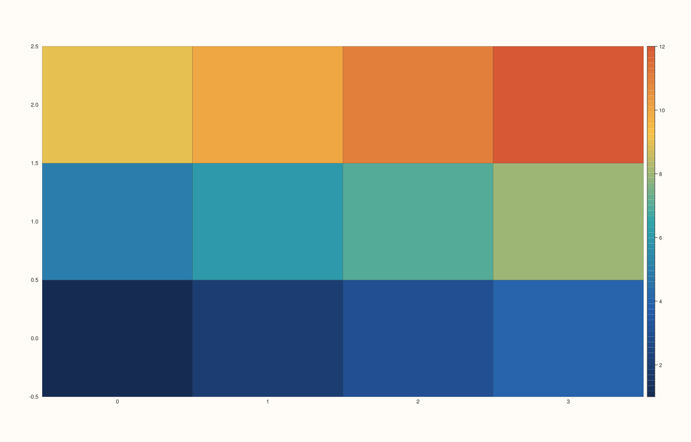

<!-- pluss-hand-authored -->

# flash::clustermap

[Back to flash API Reference](../../flash_api_reference)

## Signatures

```cpp
Trace& flash::clustermap(Pane& pane, Series x, Series y, Series z)

Trace& flash::clustermap(Pane& pane, Series x, Series y, Series z, const ClusterMapOptions& options)
```

## What It Does

Reorders a grid's rows and/or columns, then draws it via [`flash::heatmap`](heatmap.md).
Two overloads: default options, or explicit `ClusterMapOptions`.

```{important} Not hierarchical clustering -- rows/columns are sorted by mean, no dendrogram
The name might suggest clustermap() performs hierarchical agglomerative clustering (computing a linkage tree and drawing
dendrograms alongside the heatmap). It does not -- the reordering algorithm
is a single, simple pass: compute each row's (and each column's) mean value
across all finite cells, then sort rows/columns in ASCENDING order of that
mean. There is no dendrogram, no linkage matrix, no distance metric choice,
and no hierarchical structure of any kind -- just an ascending-mean sort.
Reordering a grid whose row means were arranged in
descending order (row 0 highest, row 2 lowest) produces different output
with cluster_rows=true than with it false, confirming the reordering is
real, but it is a simple sort, not a clustering algorithm.
```

## `ClusterMapOptions` fields

| Field | Type and default | Description |
|---|---|---|
| `cluster_rows` | `bool`, default `true` | Whether to reorder rows by ascending row-mean. When `false`, rows keep their original order. |
| `cluster_cols` | `bool`, default `true` | Whether to reorder columns by ascending column-mean. When `false`, columns keep their original order. |
| `heatmap` | `HeatmapOptions`, default-constructed | Passed straight through to the underlying [`flash::heatmap`](heatmap.md) call after reordering — every field documented there (`vmin`, `vmax`, `mask`, `annotate_levels`, `scale_guide`, `borderless`) applies here too, against the *reordered* grid. |

## Parameters

**pane** (`Pane&`)
    The target pane. Must be `Planar` (2D).

**x**, **y** (series-convertible)
    The grid's axis coordinates — reordered alongside the rows/columns they label, so the
    displayed tick text always matches its (moved) row/column.

**z** (series-convertible, must be rank-2)
    The field values to reorder and plot. `x`'s length must equal `z`'s column count,
    `y`'s length must equal `z`'s row count — a mismatch throws
    `pluss::Error("flash::clustermap x/y extents must match z cols/rows")`. `z`
    itself must be rank-2 — a flat input throws
    `pluss::Error("flash::clustermap requires rank-2 z")`.

**options** (`const ClusterMapOptions&`, optional)
    See the field table above.

## Returns

`Trace&`
    A reference to the newly created (fieldmap) trace — whatever
    [`flash::heatmap`](heatmap.md) itself returns.

## Examples

Example 1. Default options — both rows and columns reordered by ascending mean.

```cpp
using namespace pluss::pl;

auto fig = studio("flash_clustermap_default");
auto& pane = fig.pane2();
std::vector<double> x{0.0, 1.0, 2.0, 3.0};
std::vector<double> y{0.0, 1.0, 2.0};
std::vector<double> z{1.0, 2.0, 3.0, 4.0, 5.0, 6.0, 7.0, 8.0, 9.0, 10.0, 11.0, 12.0};
auto zs = pluss::make_series(z).reshape({3, 4});
flash::clustermap(pane, x, y, zs);
fig.show();
```



Example 2. `cluster_cols = false` — only rows are reordered.

```cpp
using namespace pluss::pl;

auto fig = studio("flash_clustermap_rows_only");
auto& pane = fig.pane2();
std::vector<double> x{0.0, 1.0, 2.0, 3.0};
std::vector<double> y{0.0, 1.0, 2.0};
std::vector<double> z{1.0, 2.0, 3.0, 4.0, 5.0, 6.0, 7.0, 8.0, 9.0, 10.0, 11.0, 12.0};
auto zs = pluss::make_series(z).reshape({3, 4});
flash::ClusterMapOptions opts;
opts.cluster_rows = true;
opts.cluster_cols = false;
flash::clustermap(pane, x, y, zs, opts);
fig.show();
```


Example 3. Nested `heatmap` options — `annotate_levels = true` on the reordered grid.

```cpp
using namespace pluss::pl;

auto fig = studio("flash_clustermap_annotate");
auto& pane = fig.pane2();
std::vector<double> x{0.0, 1.0, 2.0, 3.0};
std::vector<double> y{0.0, 1.0, 2.0};
std::vector<double> z{1.0, 2.0, 3.0, 4.0, 5.0, 6.0, 7.0, 8.0, 9.0, 10.0, 11.0, 12.0};
auto zs = pluss::make_series(z).reshape({3, 4});
flash::ClusterMapOptions opts;
opts.heatmap.annotate_levels = true;
flash::clustermap(pane, x, y, zs, opts);
fig.show();
```


Example 4 (a comparison, not a new picture). A grid with descending row means —
confirming the ascending-mean sort reorders rows, verified via a direct SVG
diff against the unclustered version.

```cpp
using namespace pluss::pl;

std::vector<double> x{0.0, 1.0, 2.0, 3.0};
std::vector<double> y{0.0, 1.0, 2.0};
std::vector<double> z{9.0, 10.0, 11.0, 12.0,
                      5.0, 6.0, 7.0, 8.0,
                      1.0, 2.0, 3.0, 4.0};
auto zs = pluss::make_series(z).reshape({3, 4});

auto fig1 = studio("flash_clustermap_unclustered");
auto& pane1 = fig1.pane2();
flash::ClusterMapOptions no_cluster;
no_cluster.cluster_rows = false;
no_cluster.cluster_cols = false;
flash::clustermap(pane1, x, y, zs, no_cluster);

auto fig2 = studio("flash_clustermap_clustered");
auto& pane2 = fig2.pane2();
flash::clustermap(pane2, x, y, zs);

std::cout << "clustered vs unclustered differ: " << (fig1.to_svg() != fig2.to_svg()) << "\n";
```

Output:

```text
clustered vs unclustered differ: 1
```

Example 5 (edge case). A flat (rank-1) `z` throws.

```cpp
using namespace pluss::pl;

auto fig = studio("flash_clustermap_bad_rank");
auto& pane = fig.pane2();
std::vector<double> x{0.0, 1.0, 2.0, 3.0};
std::vector<double> y{0.0, 1.0, 2.0};
std::vector<double> flat_z{1.0, 2.0, 3.0};
try {
  flash::clustermap(pane, x, y, flat_z);
} catch (const pluss::Error& e) {
  std::cout << "threw: " << e.message() << "\n";
}
```

Output:

```text
threw: flash::clustermap requires rank-2 z
```

## Notes

- Not `noexcept`.
- Rows/columns containing only non-finite (`NaN`/`Inf`) values contribute a mean of `0.0
  / 0.0` count, which the implementation maps to `+infinity` — such rows/columns sort to
  the very end regardless of `cluster_rows`/`cluster_cols`.
- See the important callout above: this is a simple ascending-mean sort, not
  hierarchical clustering — there is no dendrogram and no linkage computation anywhere in
  `flash`.

## See Also

- [`flash::heatmap`](heatmap.md): the underlying function, and the full
  `HeatmapOptions` field reference (nested here via `ClusterMapOptions::heatmap`).

<div class="pluss-inline-prev-next">
  <a class="prev-link" href="heatmap.html">
    <span class="label">Previous</span>
    <span class="title">heatmap</span>
  </a>
  <a class="next-link" href="FacetGrid.html">
    <span class="label">Next</span>
    <span class="title">FacetGrid</span>
  </a>
</div>
