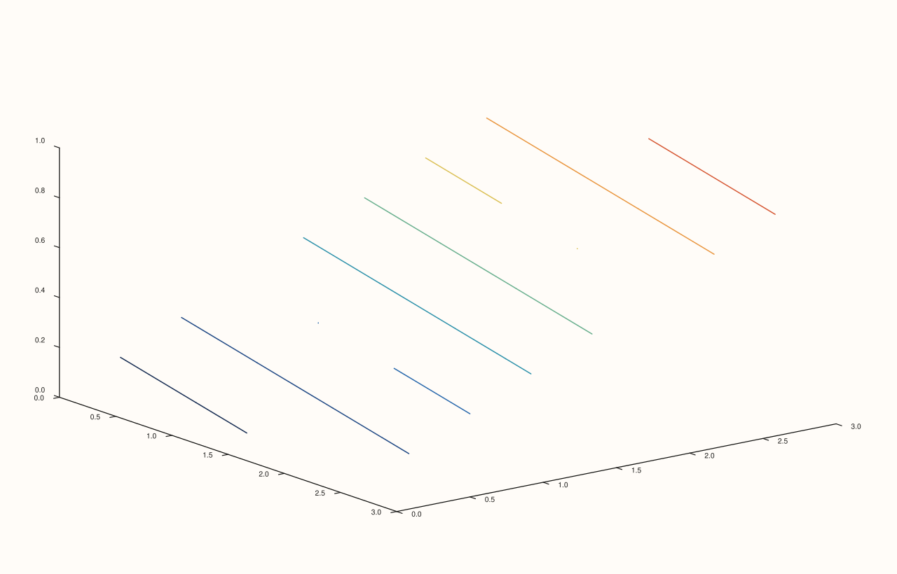
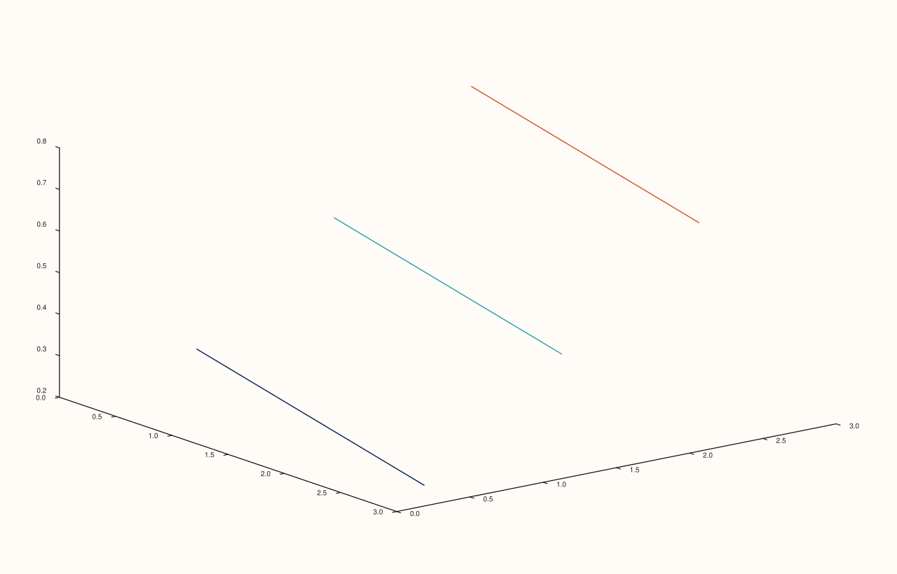

<!-- pluss-hand-authored -->

# flash::contour3D

[Back to flash API Reference](../../flash_api_reference)

## Signature

```cpp
template <class X, class Y, class Z>
Trace& flash::contour3D(Pane& pane, X&& x, Y&& y, Z&& z, int level_count = 8)
```

## What It Does

A pure, one-line rename of [`flash::ridge3`](ridge3.md)'s `level_count`-taking overload —
`contour3D(pane, x, y, z, level_count)` is exactly `ridge3(pane, x, y, z, level_count)`,
nothing more, with `level_count` additionally defaulted to `8` here (matching
`ridge3`'s own default when its `level_count` argument is omitted). Exists purely to
offer a shorter, more familiar name some callers already expect. Directly
verified byte-identical. Note only the `level_count`-taking overload is aliased —
[`flash::ridge3`](ridge3.md)'s explicit-`levels` overload has no `contour3D` equivalent.

## Parameters

**pane** (`Pane&`)
    The target pane. Must be `Volumetric`.

**x**, **y**, **z** (series-convertible, must each be rank ≤ 3, and `z` rank-2 to satisfy
[`Pane::ridge3`](../pane/ridge3.md)'s own deeper requirement)
    The scalar field to contour — identical requirements to
    [`flash::ridge3`](ridge3.md)'s `level_count` overload.

**level_count** (`int`, default `8`)
    Automatic, evenly-spaced level count. Note the default of `8` matches
    [`Pane::contour`](../pane/contour.md)/[`Pane::isoband`](../pane/isoband.md), *not*
    [`flash::isoshell`](isoshell.md)'s `4`.

## Returns

`Trace&`
    A reference to the newly created trace, for chaining.

## Examples

Example 1. Default `level_count = 8` — same data as [`flash::ridge3`](ridge3.md)'s own
first example.

```cpp
using namespace pluss::pl;

auto fig = studio("flash_contour3D_default");
auto& pane = fig.pane3();
std::vector<double> x{0.0, 1.0, 2.0, 3.0};
std::vector<double> y{0.0, 1.0, 2.0, 3.0};
auto z = pluss::series::linspace(0.0, 1.0, 16, pluss::ScalarType::Float64).reshape({4, 4});
flash::contour3D(pane, x, y, z);
fig.show();
```



Example 2. Explicit `level_count = 3`.

```cpp
using namespace pluss::pl;

auto fig = studio("flash_contour3D_levels3");
auto& pane = fig.pane3();
std::vector<double> x{0.0, 1.0, 2.0, 3.0};
std::vector<double> y{0.0, 1.0, 2.0, 3.0};
auto z = pluss::series::linspace(0.0, 1.0, 16, pluss::ScalarType::Float64).reshape({4, 4});
flash::contour3D(pane, x, y, z, 3);
fig.show();
```



Example 3 (verification, not a distinct rendering). `flash::contour3D`'s default
(`level_count = 8`) renders byte-identical to `flash::ridge3(pane, x, y, z, 8)`.

```cpp
using namespace pluss::pl;

std::vector<double> x{0.0, 1.0, 2.0, 3.0};
std::vector<double> y{0.0, 1.0, 2.0, 3.0};
auto z = pluss::series::linspace(0.0, 1.0, 16, pluss::ScalarType::Float64).reshape({4, 4});

auto fig1 = studio("flash_contour3D_cmp1");
auto& pane1 = fig1.pane3();
flash::contour3D(pane1, x, y, z);

auto fig2 = studio("flash_contour3D_cmp2");
auto& pane2 = fig2.pane3();
flash::ridge3(pane2, x, y, z, 8);

std::cout << "contour3D(default=8) == ridge3(...,8): " << (fig1.to_svg() == fig2.to_svg()) << "\n";
```

Output:

```text
contour3D(default=8) == ridge3(...,8): 1
```

## Notes

- Not `noexcept`.
- No explicit-`levels` equivalent overload — use [`flash::ridge3`](ridge3.md) directly
  for explicit threshold values instead of an automatic count.

## See Also

- [`flash::ridge3`](ridge3.md): the function this is a pure rename of (`level_count`
  overload only).
- [`flash::plot3D`](plot3D.md), [`flash::scatter3D`](scatter3D.md),
  [`flash::plot_surface`](plot_surface.md), [`flash::plot_wireframe`](plot_wireframe.md),
  [`flash::bar3d`](bar3d.md): the other familiar-naming aliases in this family.

<div class="pluss-inline-prev-next">
  <a class="prev-link" href="plot_wireframe.html">
    <span class="label">Previous</span>
    <span class="title">plot_wireframe</span>
  </a>
  <a class="next-link" href="bar3d.html">
    <span class="label">Next</span>
    <span class="title">bar3d</span>
  </a>
</div>
