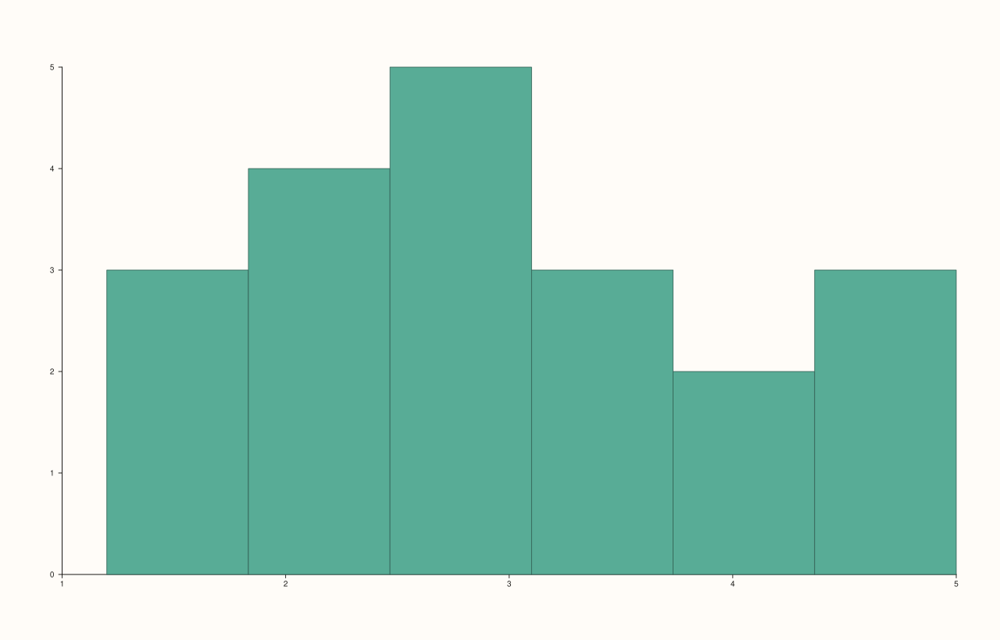
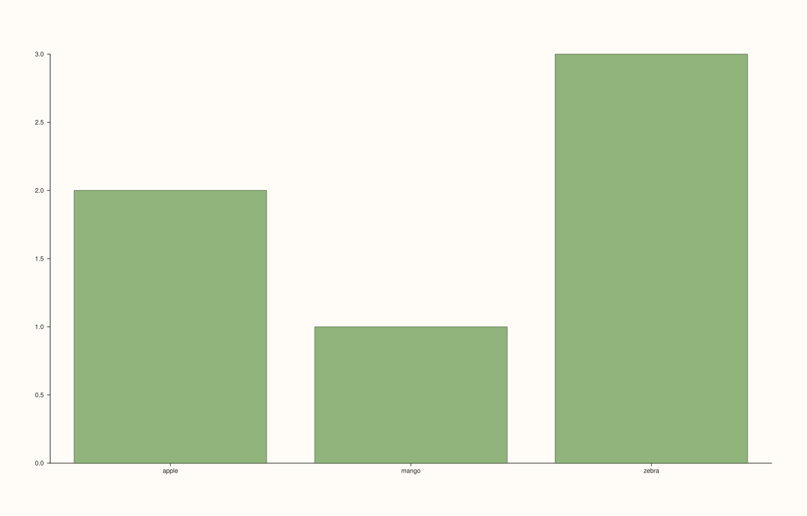

<!-- pluss-hand-authored -->

# flash::countplot

[Back to flash API Reference](../../flash_api_reference)

## Signatures

```cpp
template <class Values>
Trace& flash::countplot(Pane& pane, Values&& values, int bins = 12)

Trace& flash::countplot(Pane& pane, const Note& categories)
```

## What It Does

Draws an occurrence-count bar chart. The two overloads implement **genuinely different
algorithms**, not just different input types:

- **`countplot(pane, values, bins = 12)`** where `values` is any non-`Note`
  series-convertible value — is a **pure alias for
  [`flash::histplot`](histplot.md)**, literally `histplot(pane, values, bins)`. Continuous
  numeric data is binned into a histogram, not tallied by exact value.
- **`countplot(pane, categories)`** where `categories` is a
  [`Note`](../pane/x_categories.md) — tallies the **exact occurrence count of each
  distinct label** (a real `std::map`-based count, one bar per distinct string), and sets
  real text tick labels on the x-axis.

```{important} The numeric overload bins; the Note overload tallies exact matches
These are not the same algorithm applied to different input types -- they are
two different statistics. countplot(pane, numeric_values, bins) produces a
binned histogram (adjacent numeric ranges collapsed together, exactly like
flash::histplot). countplot(pane, note_categories) produces exact per-label
counts (each distinct string gets its own bar, no binning/collapsing
possible). If you have numeric data representing discrete categories (e.g.
small integer codes) and want one bar per exact value rather than a binned
histogram, wrap it in a Note first via pluss::note::make(), or use
flash::barplot() with precomputed counts instead.
```

```{important} The Note overload orders labels alphabetically, not first-seen
Every other Note-taking function in this family (flash::stripplot,
flash::boxplot, flash::violinplot, flash::barplot) orders distinct labels by
first appearance in the data, via the shared encode_categories() helper.
flash::countplot(pane, categories) does not use that helper -- it accumulates
counts into a std::map<std::string, double>, whose iteration order is
lexicographic. Directly verified: input labels appearing in the order
zebra, apple, zebra, mango, apple, zebra produced x-axis tick labels in the
order apple, mango, zebra -- alphabetical, not first-seen (which would have
been zebra, apple, mango).
```

## Parameters

**pane** (`Pane&`)
    The target pane. Must be `Planar` (2D).

**values** (series-convertible, first overload only)
    The raw numeric observations to bin.

**bins** (`int`, default `12`, first overload only)
    The number of histogram bins — forwarded directly to `flash::histplot`.

**categories** (`const Note&`, second overload only)
    The categorical values to tally.

## Returns

`Trace&`
    A reference to the newly created trace — a histogram (bucket) trace for the numeric
    overload, a bar (columns) trace for the `Note` overload.

## Examples

Example 1. Numeric data — a binned histogram, identical in kind to `flash::histplot`.

```cpp
using namespace pluss::pl;

auto fig = studio("flash_countplot_numeric");
auto& pane = fig.pane2();
std::vector<double> values{1.2, 1.5, 1.8, 2.1, 2.3, 2.5, 2.6, 2.8, 3.0, 3.2, 3.5, 3.9,
                           4.1, 4.4, 4.8, 5.0, 2.0, 2.2, 2.9, 3.1};
flash::countplot(pane, values, 6);
fig.show();
```



Example 2. `Note`-based categories — exact per-label tallies, labels in alphabetical
order (verified directly, not the input's first-seen order).

```cpp
using namespace pluss::pl;

auto fig = studio("flash_countplot_note");
auto& pane = fig.pane2();
auto cats = pluss::note::make({"zebra", "apple", "zebra", "mango", "apple", "zebra"});
Trace& t = flash::countplot(pane, cats);
const auto& ticks = pane.x_axis().ticks;
std::cout << "countplot(Note) x_categories (alphabetical order, not first-seen): ";
if (ticks.has_value()) {
  for (const auto& lbl : ticks->labels) std::cout << lbl << " ";
}
std::cout << "\n";
const auto& d = std::get<ColumnsData>(t.payload());
std::cout << "countplot(Note) counts: " << d.y.to(pluss::ScalarType::Float64).host<double>().size() << " bars\n";
fig.show();
```

Output:

```text
countplot(Note) x_categories (alphabetical order, not first-seen): apple mango zebra 
countplot(Note) counts: 3 bars
```



## Notes

- Not `noexcept`.
- The numeric overload's `bins` parameter has no counterpart in the `Note` overload —
  category tallying is always exact, never binned.
- See the important callouts above for both the algorithmic split (bin vs. tally) and the
  label-ordering divergence (alphabetical vs. first-seen) from the rest of this family.

## See Also

- [`flash::histplot`](histplot.md): the exact function the numeric overload aliases.
- [`flash::barplot`](barplot.md): a related bar-per-category view using first-seen label
  ordering instead.
- [`Pane::x_categories`](../pane/x_categories.md): what the `Note` overload calls
  internally.

<div class="pluss-inline-prev-next">
  <a class="prev-link" href="barplot.html">
    <span class="label">Previous</span>
    <span class="title">barplot</span>
  </a>
  <a class="next-link" href="pieplot.html">
    <span class="label">Next</span>
    <span class="title">pieplot</span>
  </a>
</div>
