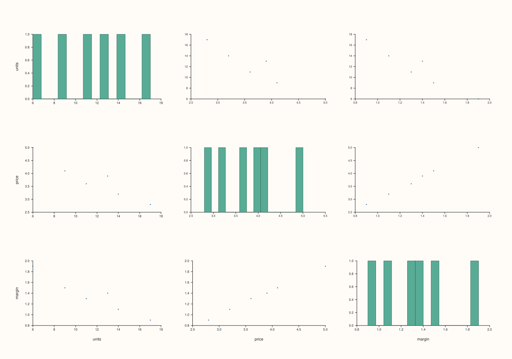
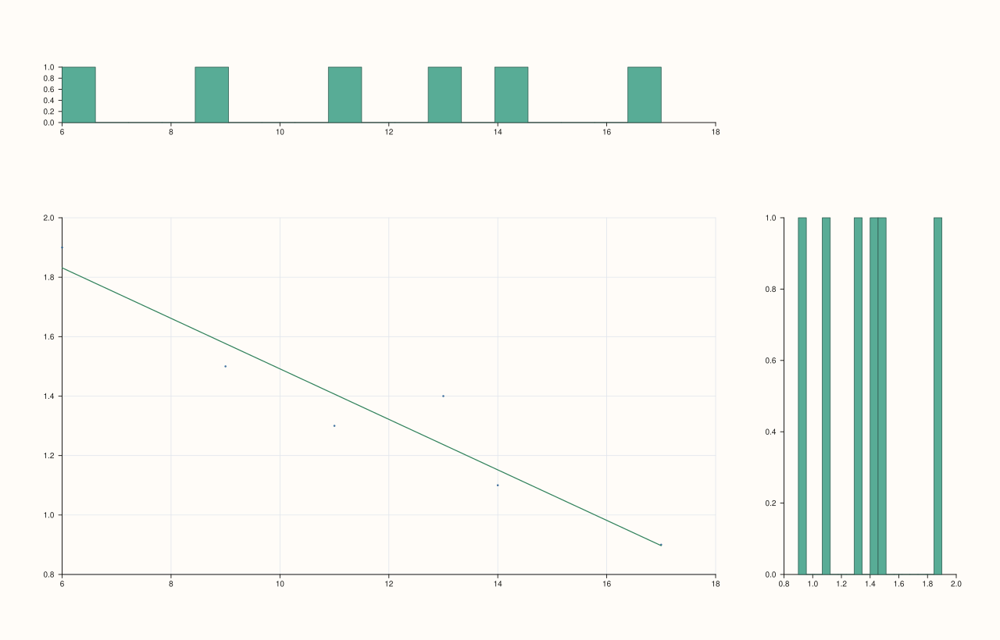

<!-- pluss-hand-authored -->

# flash::Dataset::from_frame

[Back to flash API Reference](../../flash_api_reference)

## Signature

```cpp
static flash::Dataset flash::Dataset::from_frame(
    const pluss::table::DataFrame& frame,
    const FromFrameOptions& options = {})
```

## What It Does

Builds a flash `Dataset` from a rectangular PlussMic `DataFrame`.

This is the `DataFrame -> flash::Dataset` bridge. It does not render a plot. Instead,
it exports selected `DataFrame` columns into flash’s grouped dataset families so the
result can feed dataset-aware flash views like `pairplot`, `triplot`, `parallelplot`,
`andrews_curves`, `radviz`, and `jointplot`.

The bridge preserves:

- selected feature order in `feature_order`
- selected feature kind labels in `feature_kinds`
- numeric columns in `numeric_values`
- text columns in `text_values`
- temporal columns in `temporal_values`
- per-column validity masks when missing values are present

`TimeIndex` is accepted only through an explicit policy toggle. When it is allowed, it
is exported into the temporal family as `Timeline`.

## Parameters

**frame**
    The source `DataFrame` to export.

    `frame` must be defined. At least one selected feature must also be exportable under
    the current options.

**options**
    Export policy for feature selection and kind filtering.

    `FromFrameOptions` contains:

    - `features`

      Limits export to the named features and preserves the exact order you pass here.
      Leave it empty to export every feature in the `DataFrame`’s current order.

    - `include_series`

      When `true`, numeric `Series`-backed columns are allowed through the bridge.
      When `false`, selecting a numeric feature raises an error.

    - `include_text`

      When `true`, text `Note`-backed columns are allowed through the bridge.
      When `false`, selecting a text feature raises an error.

    - `include_timeline`

      When `true`, `Timeline`-backed columns are exported into the temporal family.
      When `false`, selecting a timeline feature raises an error.

    - `include_timeindex_as_timeline`

      Controls whether `TimeIndex` is accepted by first converting it to its underlying
      timeline payload.

      When `true`, a `TimeIndex` column becomes a temporal dataset feature.

      When `false`, selecting a `TimeIndex` feature raises an error instead of folding
      it into the temporal family.

## Returns

`flash::Dataset`
    A grouped flash dataset preserving the selected feature order, family labels,
    values, and missingness.

## Notes

- This method belongs to the flash/DataFrame interop layer. In normal user code, use a
  unified Pluss include such as `<pluss/pluss.h>` so the PlussMic bridge definitions
  are present.
- No plotting occurs here. The result is an intermediate dataset object.
- The bridge supports `ThreadKind::Series`, `ThreadKind::Note`, `ThreadKind::Timeline`,
  and optionally `ThreadKind::TimeIndex`.
- `TimeIndex` is exported into the temporal family, not preserved as a separate index
  family.
- Columns with no missing values do not allocate a redundant all-true validity mask.

## Examples

Example 1. Export a mixed frame and inspect the preserved order, family labels, and
validity-mask presence.

```cpp
using namespace pluss;
using namespace pluss::table;

auto mask = Series::zeros({3}, ScalarType::Bool);
auto* ptr = reinterpret_cast<bool*>(mask.raw_data());
ptr[0] = true;
ptr[1] = false;
ptr[2] = true;

auto grades = DataFrame({
    {"city", Thread(make_note({"Accra", "", "Kumasi"}), mask)},
    {"score", Thread(make_series(std::vector<double>{91.5, 0.0, 88.0}), mask)},
    {"stamp", Thread(make_timeline({
        "2026-01-01T00:00:00Z",
        "2026-01-02T00:00:00Z",
        "2026-01-03T00:00:00Z",
    }), mask)},
}).title("grades");

auto data = pluss::pl::flash::Dataset::from_frame(grades);
```

Output:

```text
order=city,score,stamp
kinds=text,numeric,temporal
counts=1,1,1
city_valid=1
score_valid=1
stamp_valid=1
```

Example 2. Export only selected features and preserve the explicit selection order.

```cpp
using namespace pluss;
using namespace pluss::table;

auto frame = DataFrame({
    {"city", make_note({"Accra", "Tema", "Kumasi"})},
    {"score", make_series(std::vector<double>{91.5, 84.0, 88.0})},
    {"stamp", make_timeline({
        "2026-01-01T00:00:00Z",
        "2026-01-02T00:00:00Z",
        "2026-01-03T00:00:00Z",
    })},
});

auto data = pluss::pl::flash::Dataset::from_frame(
    frame,
    {.features = {"stamp", "city"}, .include_series = false});
```

Output:

```text
order=stamp,city
kinds=temporal,text
counts=0,1,1
```

Example 3. `TimeIndex` is accepted by default and exported into the temporal family.

```cpp
using namespace pluss;
using namespace pluss::table;

auto frame = DataFrame({
    {"event_idx", make_timeindex({
        "2026-01-01T09:00:00Z",
        "2026-01-01T10:00:00Z",
        "2026-01-01T11:00:00Z",
    })},
});

auto data = pluss::pl::flash::Dataset::from_frame(frame);
```

Output:

```text
order=event_idx
kinds=temporal
temporal_present=1
```

Example 4. Turn off `include_timeindex_as_timeline` when you want `TimeIndex` export to
fail loudly.

```cpp
using namespace pluss;
using namespace pluss::table;

auto frame = DataFrame({
    {"event_idx", make_timeindex({
        "2026-01-01T09:00:00Z",
        "2026-01-01T10:00:00Z",
    })},
});

try {
  (void)pluss::pl::flash::Dataset::from_frame(
      frame,
      {.include_timeindex_as_timeline = false});
} catch (const pluss::Error& err) {
  std::cout << err.what() << "\n";
}
```

Output:

```text
error=flash::Dataset::from_frame: timeindex feature 'event_idx' requires include_timeindex_as_timeline=true
```

Example 5. Turn off `include_text` when you want text features rejected explicitly.

```cpp
using namespace pluss;
using namespace pluss::table;

auto frame = DataFrame({
    {"city", make_note({"Accra", "Tema"})},
    {"score", make_series(std::vector<double>{91.5, 84.0})},
});

try {
  (void)pluss::pl::flash::Dataset::from_frame(
      frame,
      {.include_text = false});
} catch (const pluss::Error& err) {
  std::cout << err.what() << "\n";
}
```

Output:

```text
error=flash::Dataset::from_frame: text feature 'city' was selected but text export is disabled
```

Example 6. Convert a `DataFrame` into a flash dataset, then hand that dataset straight
to `pairplot(...)`. `pairplot` consumes only the dataset's numeric family, so the text
feature is preserved in the dataset but ignored by this particular plot.

```cpp
using namespace pluss;
using namespace pluss::table;
using namespace pluss::pl;

auto frame = DataFrame({
    {"city", make_note({"Accra", "Tema", "Kumasi", "Tamale", "Takoradi", "Cape Coast"})},
    {"units", make_series(std::vector<double>{14.0, 9.0, 17.0, 6.0, 11.0, 13.0})},
    {"price", make_series(std::vector<double>{3.2, 4.1, 2.8, 5.0, 3.6, 3.9})},
    {"margin", make_series(std::vector<double>{1.1, 1.5, 0.9, 1.9, 1.3, 1.4})},
}).title("sales");

auto data = flash::Dataset::from_frame(
    frame,
    {.features = {"units", "price", "margin", "city"}});

Studio fig("dataset_from_frame_pairplot", Theme::paper());
flash::pairplot(fig, data);
fig.save_svg("/tmp/dataset_from_frame_pairplot.svg");
std::cout << "saved /tmp/dataset_from_frame_pairplot.svg\n";
```

Output:

```text
saved /tmp/dataset_from_frame_pairplot.svg
```



Example 7. Convert the same `DataFrame`, then drive a dataset-aware `jointplot(...)`
by naming the two numeric features to compare. This is the more explicit pattern when
you want one focused analytic view rather than a whole numeric grid.

```cpp
using namespace pluss;
using namespace pluss::table;
using namespace pluss::pl;

auto frame = DataFrame({
    {"city", make_note({"Accra", "Tema", "Kumasi", "Tamale", "Takoradi", "Cape Coast"})},
    {"units", make_series(std::vector<double>{14.0, 9.0, 17.0, 6.0, 11.0, 13.0})},
    {"price", make_series(std::vector<double>{3.2, 4.1, 2.8, 5.0, 3.6, 3.9})},
    {"margin", make_series(std::vector<double>{1.1, 1.5, 0.9, 1.9, 1.3, 1.4})},
}).title("sales");

auto data = flash::Dataset::from_frame(
    frame,
    {.features = {"units", "price", "margin", "city"}});

Studio fig("dataset_from_frame_jointplot", Theme::paper());
flash::jointplot(fig, data, "units", "margin", "reg");
fig.save_svg("/tmp/dataset_from_frame_jointplot.svg");
std::cout << "saved /tmp/dataset_from_frame_jointplot.svg\n";
```

Output:

```text
saved /tmp/dataset_from_frame_jointplot.svg
```



## See Also

- [`flash::Dataset::frame`](dataset_frame.md): rebuilds a rectangular `DataFrame` from
  a flash dataset.
- [`flash::load_dataset`](load_dataset.md): loads a persisted flash dataset directly.

<div class="pluss-inline-prev-next">
  <a class="prev-link" href="Dataset.html">
    <span class="label">Previous</span>
    <span class="title">Dataset<br>overview</span>
  </a>
  <a class="next-link" href="dataset_frame.html">
    <span class="label">Next</span>
    <span class="title">Dataset<br>frame</span>
  </a>
</div>
