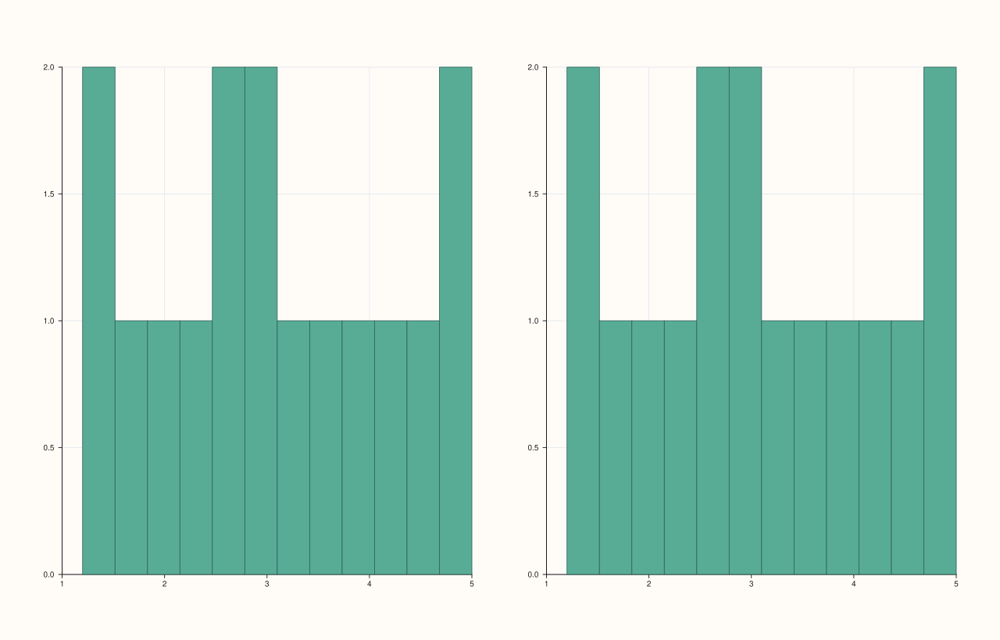
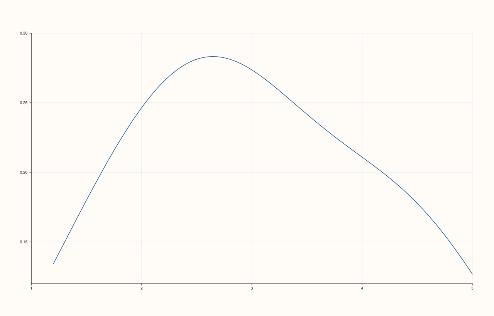
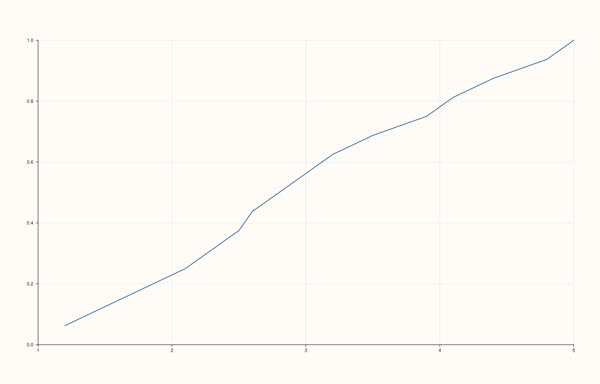
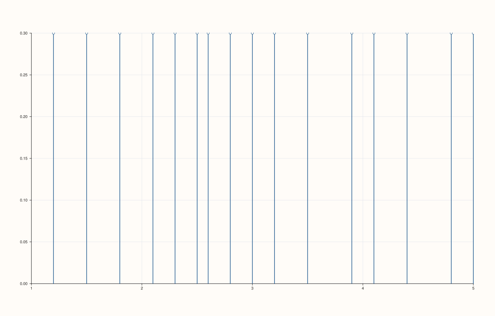
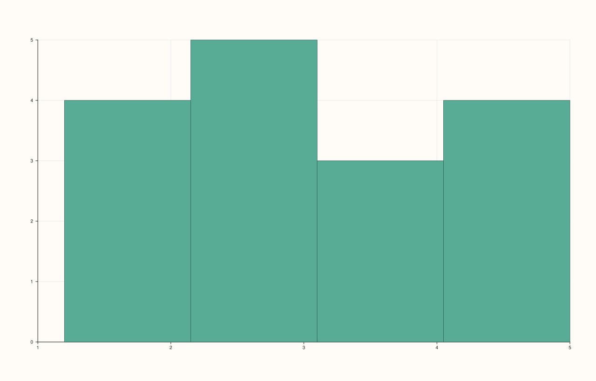
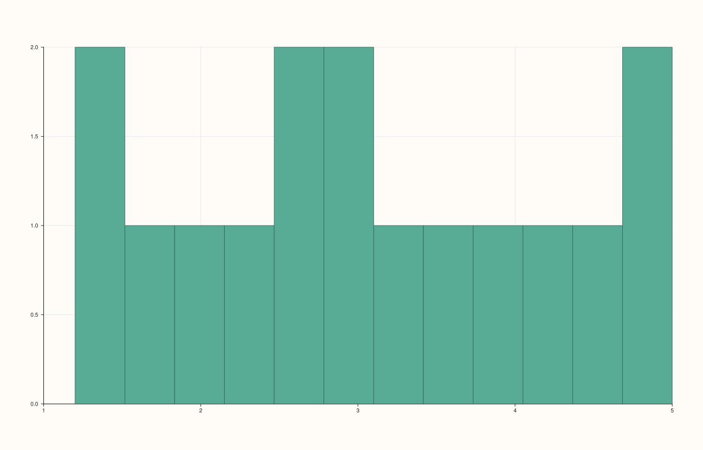

<!-- pluss-hand-authored -->

# flash::disgridplot

[Back to flash API Reference](../../flash_api_reference)

## Signatures

```cpp
enum class DisGridKind : std::uint8_t { Hist, Density, Ecdf, Rug };

DisGridKind flash::disgrid_kind(std::string_view kind);

struct DisGridPlotOptions {
  DisGridKind kind{DisGridKind::Hist};
  std::int64_t rows{0};
  std::int64_t cols{0};
  double grid_gap_x{16.0};
  double grid_gap_y{16.0};
  bool show_grid{true};
  std::vector<std::string> titles{};
  std::vector<std::string> x_labels{};
  std::vector<std::string> y_labels{};
  std::int64_t bins{12};
  std::int64_t density_points{96};
  double rug_height{0.06};
};

Studio& flash::disgridplot(Studio& studio, pluss::msharp::RangeView::Series values,
                            const DisGridPlotOptions& options = {})

Studio& flash::disgridplot(Studio& studio, pluss::msharp::RangeView::Series values,
                            std::string_view kind)

Studio& flash::disgridplot(Studio& studio, std::initializer_list<Series> values,
                            const DisGridPlotOptions& options = {})

Studio& flash::disgridplot(Studio& studio, std::initializer_list<Series> values,
                            std::string_view kind)
```

## What It Does

Draws one univariate distribution plot per facet across an auto- or explicitly-shaped
grid — the distribution sibling of [`flash::relgridplot`](relgridplot.md) and
[`flash::catgridplot`](catgridplot.md), built the same way: lay out a
[`flash::FacetGrid`](FacetGrid.md), then dispatch each cell to
[`flash::histplot`](histplot.md), [`flash::kdeplot`](kdeplot.md),
[`flash::ecdfplot`](ecdfplot.md), or [`flash::rugplot`](rugplot.md) according to
`options.kind`. Unlike `catgridplot`, it shares `relgridplot`'s kind-string convenience
overload — four overloads total, covering "options struct vs. bare kind string" crossed
with "`RangeView::Series` vs. `std::initializer_list<Series>`" input.

The grid-shape auto-resolution, the `titles`/`x_labels`/`y_labels` positional-and-
short-vector-tolerant behavior, and the overflow-cell-hiding behavior are identical to
[`flash::relgridplot`](relgridplot.md) — see that page's important callouts for the full
mechanics.

## `DisGridPlotOptions` fields

**kind** (`DisGridKind`, default `DisGridKind::Hist`)
    Which flash function draws each panel: `Hist` → [`histplot`](histplot.md) (using
    `bins`), `Density` → [`kdeplot`](kdeplot.md) (using `density_points`), `Ecdf` →
    [`ecdfplot`](ecdfplot.md), `Rug` → [`rugplot`](rugplot.md) (using `rug_height`). The
    kind-string overloads resolve this via `flash::disgrid_kind("hist"|"density"|"ecdf"|
    "rug")`, which throws `std::invalid_argument("flash::disgridplot unknown kind: " +
    kind)` for any other string.

**rows**, **cols** (`std::int64_t`, default `0` each)
    Explicit grid shape hints; `0` means "auto" — resolved identically to
    `RelGridPlotOptions::rows`/`cols` on the [`flash::relgridplot`](relgridplot.md) page.

**grid_gap_x**, **grid_gap_y** (`double`, default `16.0` each)
    Forwarded to the internal [`flash::FacetGrid`](FacetGrid.md) call as its `gx`/`gy`
    gutter.

**show_grid** (`bool`, default `true`)
    Whether each panel gets `GridStyle::Major` gridlines (`true`) or `GridStyle::None`
    (`false`).

**titles** (`std::vector<std::string>`, default empty)
    Per-facet panel titles, applied positionally — short vectors leave the remaining
    panels untitled.

**x_labels**, **y_labels** (`std::vector<std::string>`, default empty)
    Per-facet axis labels, applied positionally, same short-vector tolerance.

**bins** (`std::int64_t`, default `12`)
    Forwarded to [`flash::histplot`](histplot.md) as its bin count when `kind ==
    DisGridKind::Hist`. Clamped to at least `1` internally
    (`std::max<std::int64_t>(1, options.bins)`) before being cast to `int`. Unused for
    other kinds.

**density_points** (`std::int64_t`, default `96`)
    Forwarded to [`flash::kdeplot`](kdeplot.md) as its evaluation-point count when `kind ==
    DisGridKind::Density`. Unused for other kinds.

**rug_height** (`double`, default `0.06`)
    Forwarded to [`flash::rugplot`](rugplot.md) as its tick height when `kind ==
    DisGridKind::Rug`. Unused for other kinds.

## Parameters

**studio** (`Studio&`)
    The figure to lay out and populate.

**values** (`pluss::msharp::RangeView::Series` or `std::initializer_list<Series>`)
    One entry per facet — `values[i]` is that facet's complete sample series. Must be
    non-empty, or `disgridplot` throws
    `std::invalid_argument("flash::disgridplot requires at least one facet series")`.
    Unlike `relgridplot`/`catgridplot`, there is no second series to align against, so
    this is the only shape check.

**kind** (`std::string_view`, kind-string overloads only)
    `"hist"`, `"density"`, `"ecdf"`, or `"rug"` — resolved via `flash::disgrid_kind`.

**options** (`const DisGridPlotOptions&`, optional, options overloads only)
    See the field table above.

## Returns

`Studio&`
    A reference to the same figure, for chaining.

## Examples

Example 1. Default options — two facets, `Hist` kind (default `bins = 12`).

```cpp
using namespace pluss::pl;

auto fig = studio("flash_disgridplot_hist");
std::vector<double> sample{1.2, 1.5, 1.8, 2.1, 2.3, 2.5, 2.6, 2.8, 3.0, 3.2, 3.5, 3.9, 4.1, 4.4, 4.8, 5.0};
std::vector<pluss::Series> values{pluss::make_series(sample, {static_cast<std::int64_t>(sample.size())}),
                                   pluss::make_series(sample, {static_cast<std::int64_t>(sample.size())})};
flash::disgridplot(fig, pluss::msharp::RangeView::Series(values));
fig.show();
```



Example 2. Kind-string overload — `"density"`.

```cpp
using namespace pluss::pl;

auto fig = studio("flash_disgridplot_density");
std::vector<double> sample{1.2, 1.5, 1.8, 2.1, 2.3, 2.5, 2.6, 2.8, 3.0, 3.2, 3.5, 3.9, 4.1, 4.4, 4.8, 5.0};
std::vector<pluss::Series> values{pluss::make_series(sample, {static_cast<std::int64_t>(sample.size())})};
flash::disgridplot(fig, pluss::msharp::RangeView::Series(values), "density");
fig.show();
```



Example 3. Kind-string overload — `"ecdf"`.

```cpp
using namespace pluss::pl;

auto fig = studio("flash_disgridplot_ecdf");
std::vector<double> sample{1.2, 1.5, 1.8, 2.1, 2.3, 2.5, 2.6, 2.8, 3.0, 3.2, 3.5, 3.9, 4.1, 4.4, 4.8, 5.0};
std::vector<pluss::Series> values{pluss::make_series(sample, {static_cast<std::int64_t>(sample.size())})};
flash::disgridplot(fig, pluss::msharp::RangeView::Series(values), "ecdf");
fig.show();
```



Example 4. `Rug` kind with a non-default `rug_height`, set via the options overload
(the kind-string overload cannot set `rug_height`, only `kind`).

```cpp
using namespace pluss::pl;

auto fig = studio("flash_disgridplot_rug");
std::vector<double> sample{1.2, 1.5, 1.8, 2.1, 2.3, 2.5, 2.6, 2.8, 3.0, 3.2, 3.5, 3.9, 4.1, 4.4, 4.8, 5.0};
std::vector<pluss::Series> values{pluss::make_series(sample, {static_cast<std::int64_t>(sample.size())})};
flash::DisGridPlotOptions opts;
opts.kind = flash::DisGridKind::Rug;
opts.rug_height = 0.3;
flash::disgridplot(fig, pluss::msharp::RangeView::Series(values), opts);
fig.show();
```



Example 5. `Hist` kind with a non-default `bins`.

```cpp
using namespace pluss::pl;

auto fig = studio("flash_disgridplot_bins");
std::vector<double> sample{1.2, 1.5, 1.8, 2.1, 2.3, 2.5, 2.6, 2.8, 3.0, 3.2, 3.5, 3.9, 4.1, 4.4, 4.8, 5.0};
std::vector<pluss::Series> values{pluss::make_series(sample, {static_cast<std::int64_t>(sample.size())})};
flash::DisGridPlotOptions opts;
opts.bins = 4;
flash::disgridplot(fig, pluss::msharp::RangeView::Series(values), opts);
fig.show();
```



Example 6. `std::initializer_list` overload — no intermediate `std::vector` or
`RangeView` construction needed.

```cpp
using namespace pluss::pl;

auto fig = studio("flash_disgridplot_il");
std::vector<double> sample{1.2, 1.5, 1.8, 2.1, 2.3, 2.5, 2.6, 2.8, 3.0, 3.2, 3.5, 3.9, 4.1, 4.4, 4.8, 5.0};
auto v1 = pluss::make_series(sample, {static_cast<std::int64_t>(sample.size())});
flash::disgridplot(fig, {v1}, "hist");
fig.show();
```



## Notes

- Not `noexcept`.
- `values` has no companion series to align against — the emptiness check is the only
  validation performed on it, unlike `relgridplot`'s/`catgridplot`'s length-match checks.
- `bins` is clamped to at least `1` before use; `density_points` and `rug_height` are not
  clamped and are passed through to their respective functions as-is.
- Grid-shape resolution, overflow-cell hiding, and positional short-vector tolerance for
  `titles`/`x_labels`/`y_labels` are shared verbatim with
  [`flash::relgridplot`](relgridplot.md) — see that page for directly-verified examples of
  each (this page does not re-demonstrate them to avoid redundant probes).

## See Also

- [`flash::histplot`](histplot.md), [`flash::kdeplot`](kdeplot.md),
  [`flash::ecdfplot`](ecdfplot.md), [`flash::rugplot`](rugplot.md): the four per-panel
  drawing functions dispatched by `kind`.
- [`flash::FacetGrid`](FacetGrid.md): the underlying grid-layout constructor.
- [`flash::relgridplot`](relgridplot.md), [`flash::catgridplot`](catgridplot.md): sibling
  grid-of-plots functions for relational and categorical views.

<div class="pluss-inline-prev-next">
  <a class="prev-link" href="catgridplot.html">
    <span class="label">Previous</span>
    <span class="title">catgridplot</span>
  </a>
  <a class="next-link" href="facet_map_plot.html">
    <span class="label">Next</span>
    <span class="title">facet_map_plot</span>
  </a>
</div>
