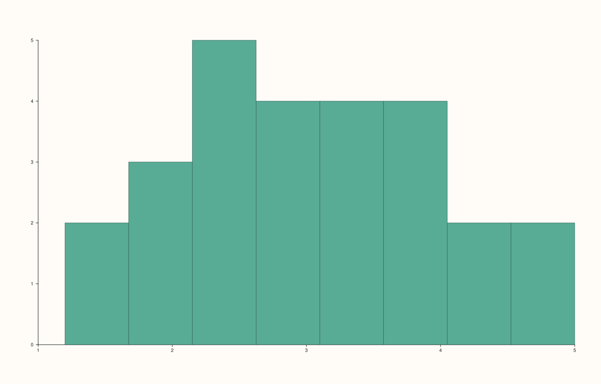

<!-- pluss-hand-authored -->

# flash::displot

[Back to flash API Reference](../../flash_api_reference)

## Signatures

```cpp
template <class Values>
Trace& flash::displot(Pane& pane, Values&& values, int bins = 12)
```

## What It Does

A pure alias for [`flash::histplot`](histplot.md) — the implementation is literally a
call to `histplot(pane, values, bins)`, nothing more. Directly verified: identical
arguments to both functions produce **byte-for-byte identical** SVG output.

```{important} Not a kind-dispatched function
The `displot` name might suggest a kind-dispatched wrapper choosing between
histogram/KDE/ECDF rendering via a `kind` parameter. This displot()
does not do that -- it has exactly one overload, no kind parameter, and always
draws a histogram, identically to histplot(). For a KDE curve, call
flash::kdeplot directly; for an ECDF curve, call flash::ecdfplot directly.
```

## Parameters

**pane** (`Pane&`)
    The target pane. Must be `Planar` (2D).

**values** (series-convertible)
    The raw, ungrouped observations to bin.

**bins** (`int`, default `12`)
    The number of equal-width bins, over the data's own observed range.

## Returns

`Trace&`
    A reference to the newly created trace.

## Examples

Example 1. Identical call shape to `histplot()`.

```cpp
using namespace pluss::pl;

auto fig = studio("flash_displot_default");
auto& pane = fig.pane2();
std::vector<double> raw{1.2, 1.5, 1.8, 2.1, 2.3, 2.5, 2.6, 2.8, 3.0, 3.2, 3.5, 3.9, 4.1,
                         4.4, 4.8, 5.0, 2.0, 2.2, 2.9, 3.1, 3.3, 2.7, 2.4, 3.6, 3.8, 4.0};
flash::displot(pane, raw, 8);
fig.show();
```



Example 2 (verification, not a distinct rendering). `displot(values, 8)` and
`histplot(values, 8)` on identical data, confirmed to produce **byte-for-byte identical**
output.

```cpp
using namespace pluss::pl;

auto fig1 = studio("flash_alias_check_hist");
auto& pane1 = fig1.pane2();
std::vector<double> raw{1.2, 1.5, 1.8, 2.1, 2.3, 2.5, 2.6, 2.8, 3.0, 3.2, 3.5, 3.9, 4.1,
                         4.4, 4.8, 5.0, 2.0, 2.2, 2.9, 3.1, 3.3, 2.7, 2.4, 3.6, 3.8, 4.0};
flash::histplot(pane1, raw, 8);

auto fig2 = studio("flash_alias_check_dis");
auto& pane2 = fig2.pane2();
flash::displot(pane2, raw, 8);
std::cout << "displot(values, 8) == histplot(values, 8): " << (fig1.to_svg() == fig2.to_svg()) << "\n";
```

Output:

```text
displot(values, 8) == histplot(values, 8): 1
```

## Notes

- Not `noexcept`.
- Truly a one-line alias, not merely "behaves the same" — see the important callout above
  about the naming expectation this can set up incorrectly.

## See Also

- [`flash::histplot`](histplot.md): the function this is a byte-for-byte alias of.
- [`flash::kdeplot`](kdeplot.md): the smoothed-density alternative a `kind`-dispatched
  `displot` would reach via `kind="kde"` — call it directly here instead.
- [`flash::ecdfplot`](ecdfplot.md): the cumulative-distribution alternative — also call it
  directly.

<div class="pluss-inline-prev-next">
  <a class="prev-link" href="histplot.html">
    <span class="label">Previous</span>
    <span class="title">histplot</span>
  </a>
  <a class="next-link" href="kdeplot.html">
    <span class="label">Next</span>
    <span class="title">kdeplot</span>
  </a>
</div>
