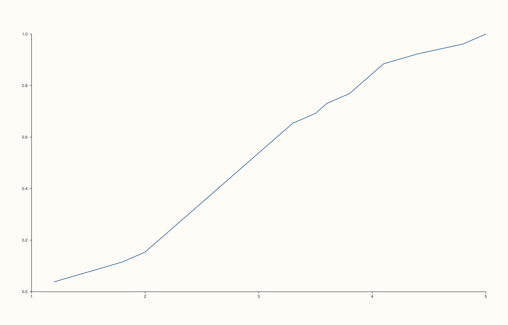

<!-- pluss-hand-authored -->

# flash::ecdfplot

[Back to flash API Reference](../../flash_api_reference)

## Signatures

```cpp
template <class Values>
Trace& flash::ecdfplot(Pane& pane, Values&& values)
```

## What It Does

Draws the empirical cumulative distribution function of `values` — sorts the observations
and plots, at each sorted value, the fraction of the sample at or below it — via
[`flash::lineplot`](lineplot.md). There is only one overload.

```{important} The curve is linearly interpolated between ECDF jumps, not stepped
An empirical CDF is conceptually a step function (it jumps by 1/n at each
observed value and is flat in between), but ecdfplot() draws it through
flash::lineplot, which connects consecutive points with ordinary straight
lines -- not flash::stepplot's step interpolation. For data with few, widely
spaced observations this produces a visibly slanted (not flat-then-jump)
curve between points, which is not the traditional ECDF staircase shape. There
is no option on ecdfplot() to switch to step interpolation.
```

## Parameters

**pane** (`Pane&`)
    The target pane. Must be `Planar` (2D).

**values** (series-convertible)
    The raw, ungrouped observations.

## Returns

`Trace&`
    A reference to the newly created (line) trace.

## Examples

Example 1. A basic ECDF.

```cpp
using namespace pluss::pl;

auto fig = studio("flash_ecdfplot");
auto& pane = fig.pane2();
std::vector<double> raw{1.2, 1.5, 1.8, 2.1, 2.3, 2.5, 2.6, 2.8, 3.0, 3.2, 3.5, 3.9, 4.1,
                         4.4, 4.8, 5.0, 2.0, 2.2, 2.9, 3.1, 3.3, 2.7, 2.4, 3.6, 3.8, 4.0};
flash::ecdfplot(pane, raw);
fig.show();
```



Example 2 (edge case). A single-observation input still produces a well-formed one-point
curve, verified by inspecting the underlying trace's payload directly.

```cpp
using namespace pluss::pl;

auto fig = studio("flash_ecdfplot_single");
auto& pane = fig.pane2();
Trace& t = flash::ecdfplot(pane, std::vector<double>{5.0});
const auto& data = std::get<TrendData>(t.payload());
std::cout << "numel: " << data.x.numel() << "\n";
```

Output:

```text
numel: 1
```

## Notes

- Not `noexcept`.
- Sort order and the `(i+1)/n` fraction formula are the whole of the computation — no
  smoothing, no confidence bands, no weighting.
- See the important callout above regarding the linear-interpolation-vs-step visual
  distinction — the underlying math is a genuine ECDF; only the *rendering* between
  observed points isn't a literal staircase.

## See Also

- [`flash::lineplot`](lineplot.md): the underlying draw call.
- [`flash::kdeplot`](kdeplot.md): a smoothed-density alternative to this cumulative view.
- [`flash::stepplot`](stepplot.md): the step-interpolated line trace that would produce
  the traditional ECDF staircase shape, if drawn manually against precomputed ECDF
  coordinates.

<div class="pluss-inline-prev-next">
  <a class="prev-link" href="kdeplot.html">
    <span class="label">Previous</span>
    <span class="title">kdeplot</span>
  </a>
  <a class="next-link" href="areaplot.html">
    <span class="label">Next</span>
    <span class="title">areaplot</span>
  </a>
</div>
