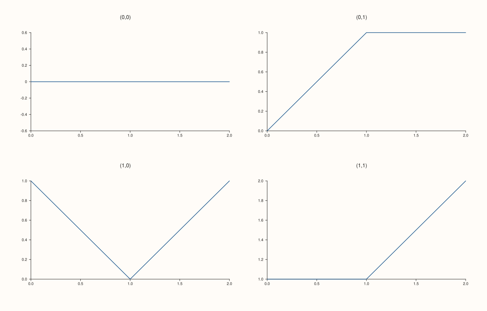

<!-- pluss-hand-authored -->

# flash::facet_map_plot

[Back to flash API Reference](../../flash_api_reference)

## Signature

```cpp
Studio& flash::facet_map_plot(Studio& studio, std::int64_t rows, std::int64_t cols,
                               std::function<void(Pane&, std::int64_t, std::int64_t)> mapper, double gx = 18.0, double gy = 18.0)
```

## What It Does

The fully generic escape hatch behind the whole `*gridplot` family: lays out a
[`flash::FacetGrid`](FacetGrid.md), then — for *every* cell in the `rows × cols` grid,
with no facet-count-driven skipping or hiding — creates a pane, places it, and invokes
your `mapper(pane, row, col)` callback to draw whatever you like into it. Reach for this
directly whenever [`flash::relgridplot`](relgridplot.md),
[`flash::catgridplot`](catgridplot.md), and [`flash::disgridplot`](disgridplot.md) are too
specialized — for example, mixing plot kinds across cells, or drawing something none of
those three dispatch to.

```{important} Every cell gets a callback invocation -- there is no facet-count concept
Unlike relgridplot/catgridplot/disgridplot, facet_map_plot has no notion of "how
many facets you have" -- it always creates exactly rows * cols panes and calls
mapper once per cell, for every (row, col) pair. There is no overflow-hiding
behavior to speak of, because there is no overflow: you decide what every cell
draws, including empty ones (simply do nothing in the callback for those rows/cols).
```

## Parameters

**studio** (`Studio&`)
    The figure to lay out and populate.

**rows**, **cols** (`std::int64_t`)
    The grid's row and column counts. Both must be strictly positive, or
    `facet_map_plot` throws `pluss::Error("flash::facet_map_plot rows/cols must
    be positive")`, verified below. Unlike the other `*gridplot` functions, there is no
    auto-resolution here — you must supply both explicitly.

**mapper** (a callable taking `(Pane&, std::int64_t row, std::int64_t col)`)
    Called once per cell, in row-major order (`row` outer, `col` inner), after that cell's
    pane has already been created and `place(row, col)`d. Do all of that panel's drawing —
    traces, title, labels — inside this callback.

**gx**, **gy** (`double`, default `18.0` each)
    Forwarded straight to the internal [`flash::FacetGrid`](FacetGrid.md) call as its
    `gx`/`gy` gutter — the same default `FacetGrid` itself uses.

## Returns

`Studio&`
    A reference to the same figure, for chaining.

## Examples

Example 1. A `2×2` grid where each panel's line and title are derived directly from its
own `(row, col)` coordinates — something none of `relgridplot`/`catgridplot`/`disgridplot`
could express, since they each draw one fixed kind of plot per panel from pre-supplied
per-facet data, not from the cell coordinates themselves.

```cpp
using namespace pluss::pl;

auto fig = studio("flash_facet_map_plot");
flash::facet_map_plot(fig, 2, 2, [](Pane& pane, std::int64_t row, std::int64_t col) {
  std::vector<double> x{0.0, 1.0, 2.0};
  std::vector<double> y{static_cast<double>(row), static_cast<double>(col), static_cast<double>(row + col)};
  pane.trend(x, y).label("row=" + std::to_string(row) + " col=" + std::to_string(col));
  pane.title("(" + std::to_string(row) + "," + std::to_string(col) + ")");
});
fig.show();
```



Example 2 (edge case). `rows = 0` throws.

```cpp
using namespace pluss::pl;

auto fig = studio("flash_facet_map_plot_bad");
try {
  flash::facet_map_plot(fig, 0, 2, [](Pane&, std::int64_t, std::int64_t) {});
} catch (const pluss::Error& e) {
  std::cout << "facet_map_plot(rows=0) threw: " << e.message() << "\n";
}
```

Output:

```text
facet_map_plot(rows=0) threw: flash::facet_map_plot rows/cols must be positive
```

## Notes

- Not `noexcept`.
- `mapper` is invoked via `std::invoke`, so it may be a lambda, a free function pointer,
  or any callable matching the required signature — a member-function-pointer-plus-object
  form works too via `std::invoke`'s usual rules.
- No hidden cells, no title/label vectors, no `kind` dispatch — everything about each
  panel's content is entirely up to `mapper`.
- [`flash::pairgrid_map_plot`](pairgrid_map_plot.md) and
  [`flash::jointgrid_map_plot`](jointgrid_map_plot.md) are the two other generic,
  callback-driven grid builders in this family, layered over
  [`flash::PairGrid`](PairGrid.md) and [`flash::JointGrid`](JointGrid.md) respectively
  instead of `FacetGrid`.

## See Also

- [`flash::FacetGrid`](FacetGrid.md): the underlying grid-layout constructor.
- [`flash::relgridplot`](relgridplot.md), [`flash::catgridplot`](catgridplot.md),
  [`flash::disgridplot`](disgridplot.md): the specialized, data-driven siblings this
  function underlies.
- [`flash::pairgrid_map_plot`](pairgrid_map_plot.md),
  [`flash::jointgrid_map_plot`](jointgrid_map_plot.md): the `PairGrid`/`JointGrid`
  equivalents of this callback-driven pattern.

<div class="pluss-inline-prev-next">
  <a class="prev-link" href="disgridplot.html">
    <span class="label">Previous</span>
    <span class="title">disgridplot</span>
  </a>
  <a class="next-link" href="pairgrid_map_plot.html">
    <span class="label">Next</span>
    <span class="title">pairgrid_map_plot</span>
  </a>
</div>
