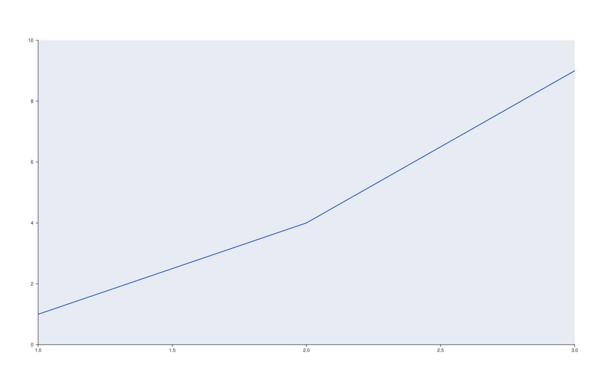

<!-- pluss-hand-authored -->

# flash::flash_theme

[Back to flash API Reference](../../flash_api_reference)

## Signature

```cpp
Theme flash::flash_theme(
    FlashStyle style = FlashStyle::Lightgrid, FlashPalette palette = FlashPalette::Deep)
```

## What It Does

Builds a brand-new [`Theme`](../studio/theme.md) value from a `FlashStyle`/
`FlashPalette` pair — background always plain white, foreground set per `style` (the
same six foreground/name values [`flash::set_style`](set_style.md)'s `FlashStyle`
overload uses), accent colors and surface-palette ramp both taken from
[`flash::flash_palette(palette)`](flash_palette.md). Unlike
[`flash::set_theme`](set_theme.md) (which mutates an existing `Pane`/`Studio` in
place, toggle by toggle), this function returns a standalone `Theme` object you apply
yourself — typically via [`Studio::theme`](../studio/theme.md) (see the important
callout on that page and on [`flash::set_theme`](set_theme.md): it must be applied
*before* the panes it should affect are created).

## Parameters

**style** (`FlashStyle`, default `Lightgrid`)
    Controls the returned `Theme`'s `foreground()` color and `name()` — see
    [`flash::set_style`](set_style.md)'s `FlashStyle` value table for the exact
    foreground color per value. `background()` is always plain white regardless of
    `style`.

**palette** (`FlashPalette`, default `Deep`)
    Controls the returned `Theme`'s `accents()` (via
    [`flash::flash_palette_colors`](flash_palette.md)) and `surface_palette()` (via the
    same palette, wrapped as a `PaletteRamp`) — see
    [`flash::flash_palette`](flash_palette.md)'s value table.

## Returns

`Theme`
    A new theme value, named e.g. `"flash_dark"` or `"flash_sandgrid"` depending on
    `style`.

## Examples

Example 1. Default (`Lightgrid`/`Deep`) vs `Dark`/`Bright`, applied via
`flash::set`/`Studio::theme` **before** the pane is created (required — see the
important callout on [`flash::set_theme`](set_theme.md)) — confirmed to render
genuinely differently.

```cpp
using namespace pluss::pl;

auto fig1 = studio("flash_flash_theme_default_cmp");
flash::set(fig1, flash::flash_theme());
auto& p1 = fig1.pane2();
p1.trend(std::vector<double>{1, 2, 3}, std::vector<double>{1, 4, 9});

auto fig2 = studio("flash_flash_theme_dark_bright");
flash::set(fig2, flash::flash_theme(flash::FlashStyle::Dark, flash::FlashPalette::Bright));
auto& p2 = fig2.pane2();
p2.trend(std::vector<double>{1, 2, 3}, std::vector<double>{1, 4, 9});
std::cout << "flash_theme(default) vs flash_theme(Dark,Bright) differ: " << (fig1.to_svg() != fig2.to_svg()) << "\n";
fig2.show();
```

Output:

```text
flash_theme(default) vs flash_theme(Dark,Bright) differ: 1
```



Example 2 (verification, not a distinct rendering). Inspecting the returned `Theme`
directly, without applying it.

```cpp
using namespace pluss::pl;

auto t = flash::flash_theme(flash::FlashStyle::Sandgrid, flash::FlashPalette::Colorblind);
std::cout << "flash_theme(Sandgrid,Colorblind) name=" << t.name() << " accents=" << t.accents().size() << "\n";
```

Output:

```text
flash_theme(Sandgrid,Colorblind) name=flash_sandgrid accents=10
```

## Notes

- Not `noexcept`.
- Never touches a `Pane`/`Studio`/`Trace` — a pure value-producing function, the same
  category as [`flash::flash_palette`](flash_palette.md).
- Not called by [`flash::set_theme`](set_theme.md) internally, despite the similar
  name — the two are independent, separately-usable pieces of the theming family.
- `style`'s effect here (foreground + name only, background always white) exactly
  matches [`flash::set_style`](set_style.md)'s `FlashStyle` overload's own effect on a
  `Pane` — see that page's important callout for the same white-background detail.

## See Also

- [`flash::set_theme`](set_theme.md): the toggle-based, in-place theming entry point —
  a functionally different tool from this value-producing function, despite the
  similar name.
- [`flash::flash_palette`](flash_palette.md): what this function calls internally for
  `accents()`/`surface_palette()`.
- [`Studio::theme`](../studio/theme.md): the typical way to apply a `Theme` this
  function returns — remember to call it before creating panes.

<div class="pluss-inline-prev-next">
  <a class="prev-link" href="color_palette.html">
    <span class="label">Previous</span>
    <span class="title">color_palette</span>
  </a>
  <a class="next-link" href="blend_palette.html">
    <span class="label">Next</span>
    <span class="title">blend_palette</span>
  </a>
</div>
