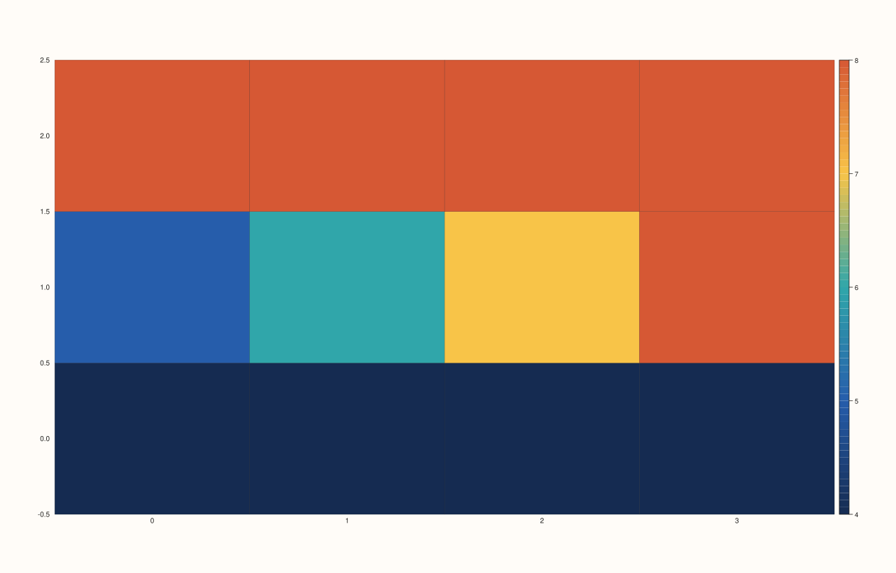
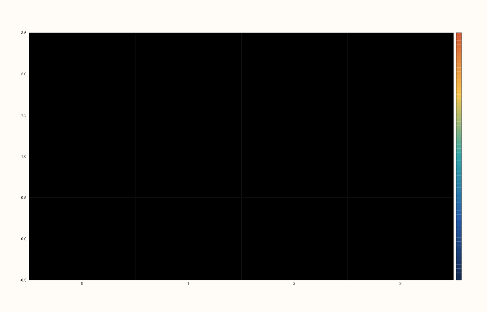
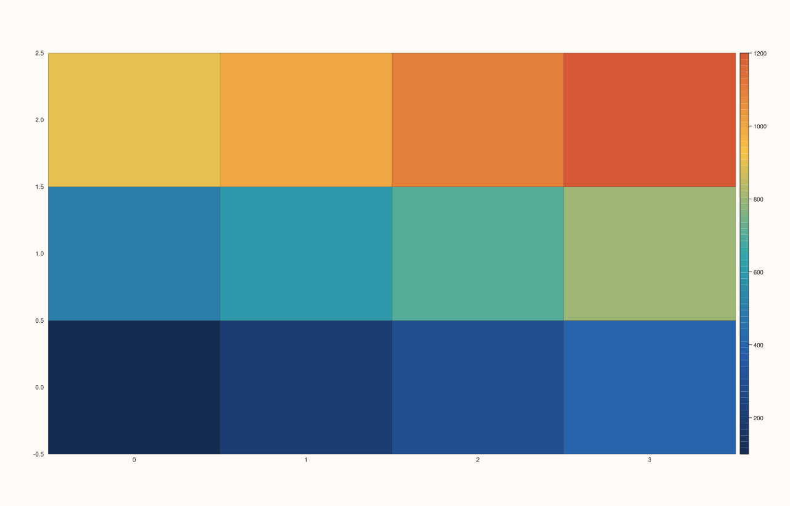
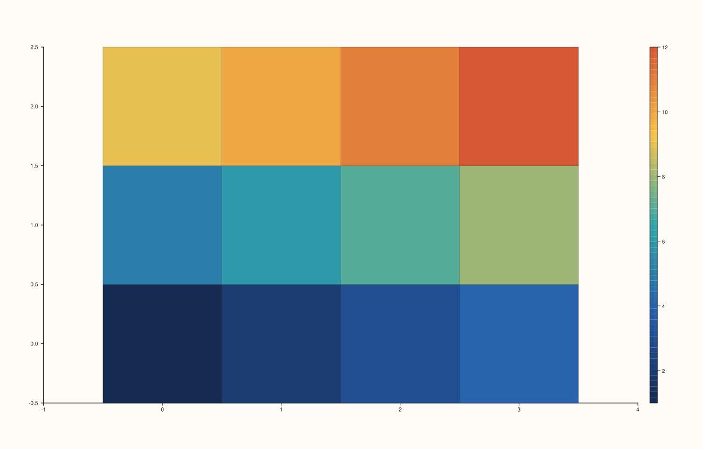

<!-- pluss-hand-authored -->

# flash::heatmap

[Back to flash API Reference](../../flash_api_reference)

## Signatures

```cpp
Trace& flash::heatmap(Pane& pane, Series x, Series y, Series z)

Trace& flash::heatmap(Pane& pane, Series x, Series y, Series z, const HeatmapOptions& options)

Trace& flash::heatmap(Pane& pane, Series x, Series y, Series z, Series c)

Trace& flash::heatmap(Pane& pane, Series x, Series y, Series z, Series c, const HeatmapOptions& options)
```

## What It Does

Draws a grid heatmap via [`Pane::fieldmap`](../pane/fieldmap.md), with value clamping,
masking, and axis/grid styling layered on top. Four overloads:

- **`heatmap(pane, x, y, z[, options])`** — cells colored directly from `z`.
- **`heatmap(pane, x, y, z, c[, options])`** — cells shaped/positioned by `z`, but
  **colored from a separate matrix `c`** instead (see `Pane::fieldmap`'s own docs for the
  shape-vs-color split this mirrors).

```{important} vmin/vmax/mask apply only to z, never to c
In the four-argument (with c) overload, options.vmin, options.vmax, and
options.mask are applied to z -- the SHAPE-defining matrix -- not to c, the
matrix that actually determines the rendered fill color. Setting vmin/vmax on a call that supplies a separate c matrix produces
byte-for-byte IDENTICAL output to the same call without vmin/vmax -- the
clamping has no visible effect at all, because the values it clamps are never
used for coloring. If you need to clamp or mask the rendered color range when
using the c-parameter overload, clamp/mask c yourself before passing it in.
```

## `HeatmapOptions` fields

| Field | Type and default | Description |
|---|---|---|
| `annotate_levels` | `bool`, default `false` | Forwarded to `Trace::annotate_levels` — whether to draw each cell's numeric value as text overlaid on the cell. |
| `scale_guide` | `bool`, default `true` | Forwarded to `Pane::scale_guide` — whether to draw a color-scale legend/guide. |
| `borderless` | `bool`, default `true` | When `true` (the default), applies a bundle of pane styling suited to a clean grid-only look: `GridStyle::None`, all four grid-line toggles off, axes hidden (`axes_visible(false)`), tick *labels* kept visible (`x_tick_labels(true)`, `y_tick_labels(true)`), and both axes' limit method set to `LimitMethod::Tight`. When `false`, none of this styling is applied — the pane keeps whatever grid/axis appearance it already had. |
| `vmin`, `vmax` | `std::optional<double>`, default unset | Clamp `z`'s values to `[vmin, vmax]` before rendering (only when both bounds resolve to finite values with `vmin <= vmax` — otherwise clamping is silently skipped). See the important callout above for why this has no effect in the `c`-taking overloads. |
| `mask` | `std::optional<Series>`, default unset | A same-shape-as-`z` series where zero means "hide this cell" (replaced with `NaN`) and any non-zero means "keep it". Must flatten to exactly `z`'s element count — a mismatch throws `pluss::Error("flash::heatmap mask must match z element count")` (see the important callout below on this validation being broken until this fix). |

## Parameters

**pane** (`Pane&`)
    The target pane. Must be `Planar` (2D).

**x**, **y** (series-convertible)
    The grid's axis coordinates — `x` must have as many entries as `z`'s column count,
    `y` as many as `z`'s row count (enforced by the underlying `Pane::fieldmap`).

**z** (series-convertible, must be rank-2)
    The field values that shape/position the grid (and, in the 3-argument overloads,
    color it too).

**c** (series-convertible, must be rank-2 and the same shape as `z`, 4-argument overloads
only)
    A separate matrix supplying the fill color per cell, decoupled from `z`.

**options** (`const HeatmapOptions&`, optional)
    See the field table above.

## Returns

`Trace&`
    A reference to the newly created (fieldmap) trace.

## Examples

Example 1. Default options — a `3×4` grid, colored directly from `z`.

```cpp
using namespace pluss::pl;

auto fig = studio("flash_heatmap_default");
auto& pane = fig.pane2();
std::vector<double> x{0.0, 1.0, 2.0, 3.0};
std::vector<double> y{0.0, 1.0, 2.0};
std::vector<double> z{1.0, 2.0, 3.0, 4.0, 5.0, 6.0, 7.0, 8.0, 9.0, 10.0, 11.0, 12.0};
auto zs = pluss::make_series(z).reshape({3, 4});
flash::heatmap(pane, x, y, zs);
fig.show();
```


Example 2. `vmin`/`vmax` clamping — changes the rendered output when
`z` itself carries the color.

```cpp
using namespace pluss::pl;

std::vector<double> x{0.0, 1.0, 2.0, 3.0};
std::vector<double> y{0.0, 1.0, 2.0};
std::vector<double> z{1.0, 2.0, 3.0, 4.0, 5.0, 6.0, 7.0, 8.0, 9.0, 10.0, 11.0, 12.0};
auto zs = pluss::make_series(z).reshape({3, 4});

auto fig1 = studio("flash_heatmap_no_clamp");
auto& pane1 = fig1.pane2();
flash::heatmap(pane1, x, y, zs);

auto fig2 = studio("flash_heatmap_clamp");
auto& pane2 = fig2.pane2();
flash::HeatmapOptions opts;
opts.vmin = 4.0;
opts.vmax = 8.0;
flash::heatmap(pane2, x, y, zs, opts);
std::cout << "vmin/vmax clamp changes output: " << (fig1.to_svg() != fig2.to_svg()) << "\n";
```

Output:

```text
vmin/vmax clamp changes output: 1
```




Example 3. `mask` — hiding a rectangular region of cells.

```cpp
using namespace pluss::pl;

auto fig = studio("flash_heatmap_mask");
auto& pane = fig.pane2();
std::vector<double> x{0.0, 1.0, 2.0, 3.0};
std::vector<double> y{0.0, 1.0, 2.0};
std::vector<double> z{1.0, 2.0, 3.0, 4.0, 5.0, 6.0, 7.0, 8.0, 9.0, 10.0, 11.0, 12.0};
auto zs = pluss::make_series(z).reshape({3, 4});
flash::HeatmapOptions opts;
std::vector<double> mask{1, 1, 1, 1,
                         1, 0, 0, 1,
                         1, 1, 1, 1};
opts.mask = pluss::make_series(mask).reshape({3, 4});
flash::heatmap(pane, x, y, zs, opts);
fig.show();
```



Example 4. Separate `c` color matrix — verified that `vmin`/`vmax` (applied to `z`) have
**no** effect on the rendered color when `c` is supplied.

```cpp
using namespace pluss::pl;

std::vector<double> x{0.0, 1.0, 2.0, 3.0};
std::vector<double> y{0.0, 1.0, 2.0};
std::vector<double> z{1.0, 2.0, 3.0, 4.0, 5.0, 6.0, 7.0, 8.0, 9.0, 10.0, 11.0, 12.0};
auto zs = pluss::make_series(z).reshape({3, 4});
std::vector<double> c{100.0, 200.0, 300.0, 400.0, 500.0, 600.0, 700.0, 800.0,
                      900.0, 1000.0, 1100.0, 1200.0};
auto cs = pluss::make_series(c).reshape({3, 4});

auto fig1 = studio("flash_heatmap_c_no_clamp");
auto& pane1 = fig1.pane2();
flash::heatmap(pane1, x, y, zs, cs);

auto fig2 = studio("flash_heatmap_c_vmin_vmax");
auto& pane2 = fig2.pane2();
flash::HeatmapOptions opts;
opts.vmin = 4.0;
opts.vmax = 8.0;
flash::heatmap(pane2, x, y, zs, cs, opts);
std::cout << "vmin/vmax on z has no effect on rendered color: " << (fig1.to_svg() == fig2.to_svg()) << "\n";
```

Output:

```text
vmin/vmax on z has no effect on rendered color: 1
```



Example 5. `borderless = false` — keeps the pane's existing grid/axis styling instead of
applying the clean grid-only look.

```cpp
using namespace pluss::pl;

auto fig = studio("flash_heatmap_bordered");
auto& pane = fig.pane2();
std::vector<double> x{0.0, 1.0, 2.0, 3.0};
std::vector<double> y{0.0, 1.0, 2.0};
std::vector<double> z{1.0, 2.0, 3.0, 4.0, 5.0, 6.0, 7.0, 8.0, 9.0, 10.0, 11.0, 12.0};
auto zs = pluss::make_series(z).reshape({3, 4});
flash::HeatmapOptions opts;
opts.borderless = false;
flash::heatmap(pane, x, y, zs, opts);
fig.show();
```



Example 6 (edge case). A mask whose flattened element count doesn't match `z`'s — throws
cleanly now (see the important callout above).

```cpp
using namespace pluss::pl;

auto fig = studio("flash_heatmap_mask_bad");
auto& pane = fig.pane2();
std::vector<double> x{0.0, 1.0, 2.0, 3.0};
std::vector<double> y{0.0, 1.0, 2.0};
std::vector<double> z{1.0, 2.0, 3.0, 4.0, 5.0, 6.0, 7.0, 8.0, 9.0, 10.0, 11.0, 12.0};
auto zs = pluss::make_series(z).reshape({3, 4});
flash::HeatmapOptions opts;
std::vector<double> mask{1, 1, 1};
opts.mask = pluss::make_series(mask);
try {
  flash::heatmap(pane, x, y, zs, opts);
} catch (const pluss::Error& e) {
  std::cout << "threw: " << e.message() << "\n";
}
```

Output:

```text
threw: flash::heatmap mask must match z element count
```

## Notes

- Not `noexcept`.
- [`flash::clustermap`](clustermap.md) wraps `heatmap`, adding row/column reordering
  before rendering.
- `z` (and `c`) must be rank-2 series — see
  [`Pane::fieldmap`](../pane/fieldmap.md)'s own docs for the exact error this raises on a
  flat, one-dimensional input.

## See Also

- [`Pane::fieldmap`](../pane/fieldmap.md): the underlying method, including the full
  shape-vs-color explanation for the `c` parameter.
- [`Pane::scale_guide`](../pane/scale_guide.md): what `options.scale_guide` controls.
- [`flash::clustermap`](clustermap.md): row/column-reordered heatmaps.

<div class="pluss-inline-prev-next">
  <a class="prev-link" href="resid_histplot.html">
    <span class="label">Previous</span>
    <span class="title">resid_histplot</span>
  </a>
  <a class="next-link" href="clustermap.html">
    <span class="label">Next</span>
    <span class="title">clustermap</span>
  </a>
</div>
