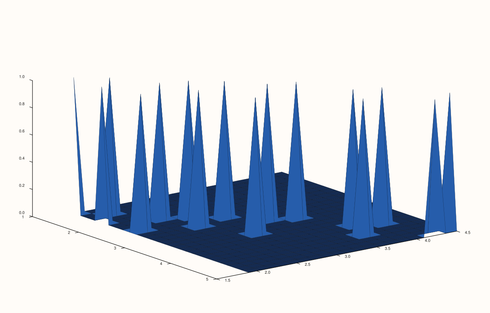
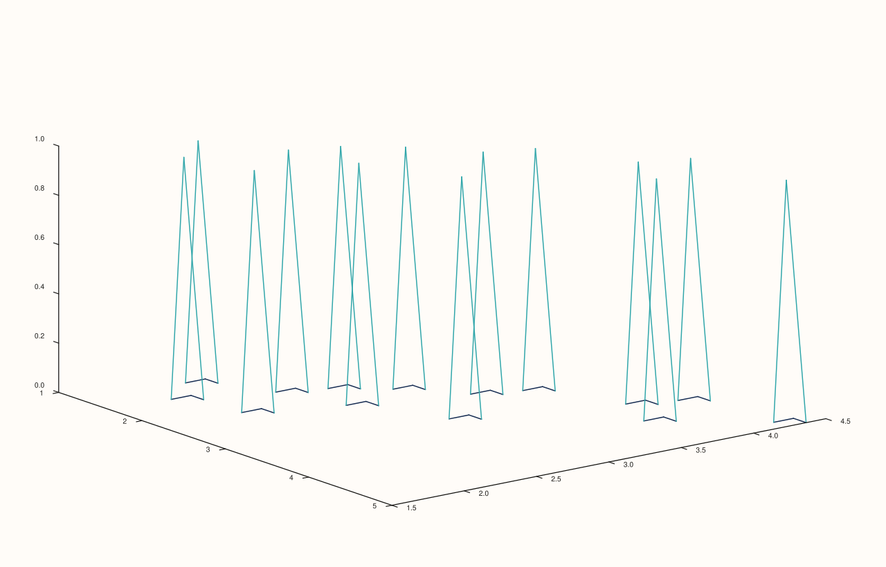
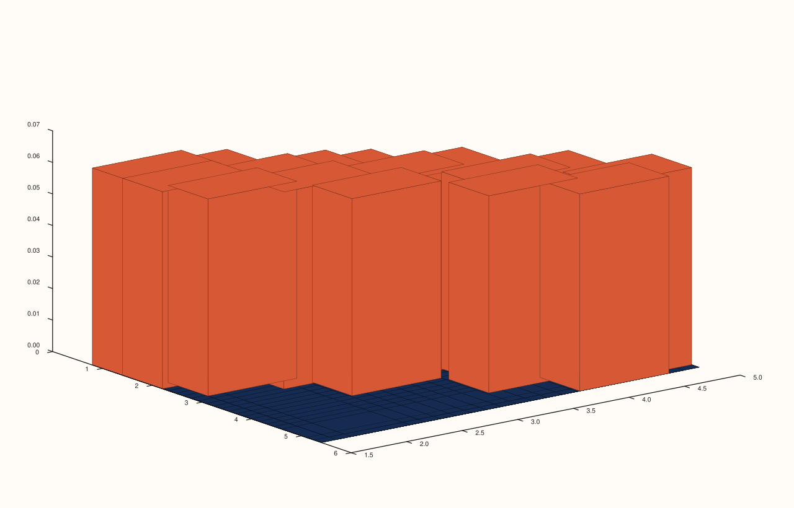
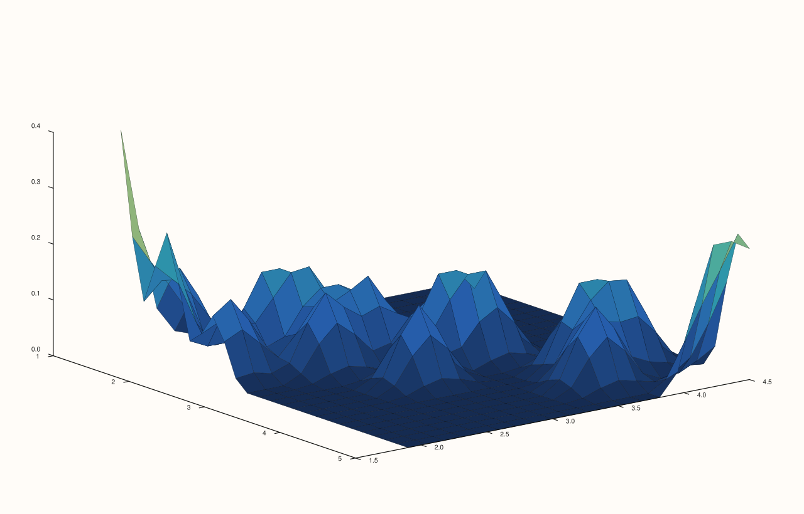
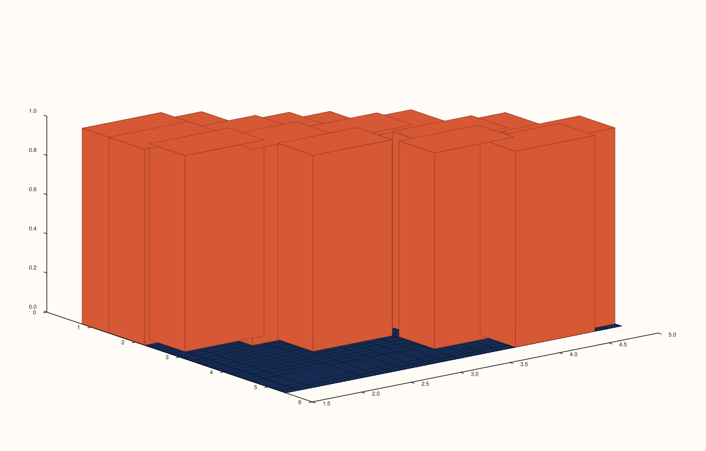

<!-- pluss-hand-authored -->

# flash::hist3d

[Back to flash API Reference](../../flash_api_reference)

## Signatures

```cpp
struct Hist3DOptions {
  std::int64_t bins_x{26};
  std::int64_t bins_y{20};
  bool normalize{false};
  bool smooth{false};
  std::int64_t smooth_passes{1};
  bool as_surface{false};
  bool as_wireframe{false};
};

template <class X, class Y>
Trace& flash::hist3d(Pane& pane, X&& x, Y&& y, const Hist3DOptions& options = {})

template <class X, class Y>
Trace& flash::hist3d(Studio& studio, X&& x, Y&& y, const Hist3DOptions& options = {}, std::string title = {})
```

## What It Does

The one genuinely new function in the 3D familiar-naming family (not a rename of
an existing 3D-native function): bins raw `(x, y)` observations into a 2D histogram grid
(via the same `hist2d_grid` helper [`flash::jointplot`](jointplot.md)'s `Hex`/`Kde` kinds
use), then renders that grid's bin counts as a bar-forest by default — or, via
`as_surface`/`as_wireframe`, as a filled surface or wireframe mesh instead: a 3D
analogue of a 2D histogram, one bar (or surface height) per `(x, y)` bin.

```{important} as_surface and as_wireframe are checked in order -- as_wireframe wins if both are set
hist3d checks as_wireframe first, then as_surface, then falls back to the bar-forest
default -- so setting BOTH as_surface = true and as_wireframe = true renders as a
wireframe, not a surface. There is no validation preventing both from being set at
once; the check order simply decides which one silently wins.
```

## `Hist3DOptions` fields

**bins_x**, **bins_y** (`std::int64_t`, default `26`, `20`)
    Grid resolution for the underlying 2D histogram. Each clamped to at least `4`
    internally by `hist2d_grid` — the same helper and same clamp
    [`flash::jointplot`](jointplot.md)'s `Hex`/`Kde` kinds use, though `hist3d`'s own
    defaults (`26`/`20`) differ from `jointplot`'s `Hex` defaults (`28`/`22`).

**normalize** (`bool`, default `false`)
    Whether the binned grid is divided by its own total sum before rendering (turning raw
    counts into a density-like proportion) — a no-op when the total is `0` or
    non-finite. Directly verified to render genuinely differently from the default
    (raw-count) grid.

**smooth** (`bool`, default `false`)
    Whether the binned grid is blurred by `smooth_passes` passes before rendering — same
    smoothing mechanism [`flash::jointplot`](jointplot.md)'s `Kde` kind uses on its own
    binned grid.

**smooth_passes** (`std::int64_t`, default `1`)
    Smoothing pass count when `smooth` is `true`. Clamped to at least `1`.

**as_surface** (`bool`, default `false`)
    Render the binned grid as a filled [`flash::sheet`](sheet.md) surface instead of the
    default bar forest. See the important callout above for its interaction with
    `as_wireframe`.

**as_wireframe** (`bool`, default `false`)
    Render the binned grid as a [`flash::lattice`](lattice.md) wireframe mesh instead of
    the default bar forest. Takes priority over `as_surface` when both are set.

## Parameters

**pane** (`Pane&`, Pane overload)
    The target pane. Must be `Volumetric`.

**studio** (`Studio&`, Studio overload)
    The figure to create a new `Volumetric` pane in.

**x**, **y** (series-convertible)
    The raw observations to bin. Unlike the 3D-native family's own functions, `hist3d`
    performs no explicit rank validation of its own before calling `hist2d_grid` — that
    helper's own checks (equal, non-empty lengths; at least one finite pair) apply
    instead.

**options** (`const Hist3DOptions&`, optional)
    See the field table above.

**title** (`std::string`, default `{}`, Studio overload only)
    Forwarded to `Studio::pane3` as the new pane's title.

## Returns

`Trace&`
    A reference to the newly created trace, for chaining.

## Examples

Example 1. Default options — bar-forest rendering of the binned `(x, y)` grid.

```cpp
using namespace pluss::pl;

auto fig = studio("flash_hist3d_default");
auto& pane = fig.pane3();
std::vector<double> x{1.2, 1.5, 1.8, 2.1, 2.3, 2.5, 2.6, 2.8, 3.0, 3.2, 3.5, 3.9, 4.1, 4.4, 4.8, 5.0};
std::vector<double> y{2.0, 2.2, 1.9, 2.5, 2.8, 2.1, 3.0, 2.6, 3.3, 3.5, 2.9, 3.8, 4.0, 3.6, 4.5, 4.2};
flash::hist3d(pane, x, y);
fig.show();
```


Example 2. `as_surface = true` — a filled surface instead of bars.

```cpp
using namespace pluss::pl;

auto fig = studio("flash_hist3d_surface");
auto& pane = fig.pane3();
std::vector<double> x{1.2, 1.5, 1.8, 2.1, 2.3, 2.5, 2.6, 2.8, 3.0, 3.2, 3.5, 3.9, 4.1, 4.4, 4.8, 5.0};
std::vector<double> y{2.0, 2.2, 1.9, 2.5, 2.8, 2.1, 3.0, 2.6, 3.3, 3.5, 2.9, 3.8, 4.0, 3.6, 4.5, 4.2};
flash::Hist3DOptions opts;
opts.as_surface = true;
flash::hist3d(pane, x, y, opts);
fig.show();
```



Example 3. `as_wireframe = true` — a wireframe mesh instead of bars.

```cpp
using namespace pluss::pl;

auto fig = studio("flash_hist3d_wireframe");
auto& pane = fig.pane3();
std::vector<double> x{1.2, 1.5, 1.8, 2.1, 2.3, 2.5, 2.6, 2.8, 3.0, 3.2, 3.5, 3.9, 4.1, 4.4, 4.8, 5.0};
std::vector<double> y{2.0, 2.2, 1.9, 2.5, 2.8, 2.1, 3.0, 2.6, 3.3, 3.5, 2.9, 3.8, 4.0, 3.6, 4.5, 4.2};
flash::Hist3DOptions opts;
opts.as_wireframe = true;
flash::hist3d(pane, x, y, opts);
fig.show();
```



Example 4 (verification, not a distinct rendering). `normalize = true` renders genuinely
differently from the default (raw-count) grid, confirmed via direct SVG comparison.

```cpp
using namespace pluss::pl;

std::vector<double> x{1.2, 1.5, 1.8, 2.1, 2.3, 2.5, 2.6, 2.8, 3.0, 3.2, 3.5, 3.9, 4.1, 4.4, 4.8, 5.0};
std::vector<double> y{2.0, 2.2, 1.9, 2.5, 2.8, 2.1, 3.0, 2.6, 3.3, 3.5, 2.9, 3.8, 4.0, 3.6, 4.5, 4.2};

auto fig1 = studio("flash_hist3d_raw");
auto& pane1 = fig1.pane3();
flash::hist3d(pane1, x, y);

auto fig2 = studio("flash_hist3d_normalize");
auto& pane2 = fig2.pane3();
flash::Hist3DOptions opts;
opts.normalize = true;
flash::hist3d(pane2, x, y, opts);

std::cout << "hist3d normalize vs default differ: " << (fig1.to_svg() != fig2.to_svg()) << "\n";
fig2.show();
```

Output:

```text
hist3d normalize vs default differ: 1
```



Example 5 (verification, not a distinct rendering). `smooth = true` on the `as_surface`
rendering renders genuinely differently from the unsmoothed surface, confirmed via
direct SVG comparison.

```cpp
using namespace pluss::pl;

std::vector<double> x{1.2, 1.5, 1.8, 2.1, 2.3, 2.5, 2.6, 2.8, 3.0, 3.2, 3.5, 3.9, 4.1, 4.4, 4.8, 5.0};
std::vector<double> y{2.0, 2.2, 1.9, 2.5, 2.8, 2.1, 3.0, 2.6, 3.3, 3.5, 2.9, 3.8, 4.0, 3.6, 4.5, 4.2};

auto fig1 = studio("flash_hist3d_surface_unsmoothed");
auto& pane1 = fig1.pane3();
flash::Hist3DOptions opts1;
opts1.as_surface = true;
flash::hist3d(pane1, x, y, opts1);

auto fig2 = studio("flash_hist3d_surface_smoothed");
auto& pane2 = fig2.pane3();
flash::Hist3DOptions opts2;
opts2.as_surface = true;
opts2.smooth = true;
opts2.smooth_passes = 2;
flash::hist3d(pane2, x, y, opts2);

std::cout << "hist3d smooth vs unsmoothed surface differ: " << (fig1.to_svg() != fig2.to_svg()) << "\n";
fig2.show();
```

Output:

```text
hist3d smooth vs unsmoothed surface differ: 1
```



Example 6. `Studio` overload — no explicit `pane3()` call needed.

```cpp
using namespace pluss::pl;

auto fig = studio("flash_hist3d_studio");
std::vector<double> x{1.2, 1.5, 1.8, 2.1, 2.3, 2.5, 2.6, 2.8, 3.0, 3.2, 3.5, 3.9, 4.1, 4.4, 4.8, 5.0};
std::vector<double> y{2.0, 2.2, 1.9, 2.5, 2.8, 2.1, 3.0, 2.6, 3.3, 3.5, 2.9, 3.8, 4.0, 3.6, 4.5, 4.2};
flash::hist3d(fig, x, y);
fig.show();
```



## Notes

- Not `noexcept`.
- Unlike every other function in this session's 3D families, `hist3d` performs no
  `require_rank_at_most` validation of its own — its inputs go straight to
  `detail::hist2d_grid`, which has its own, differently-worded checks.
- See the important callout above: `as_wireframe` silently wins over `as_surface` when
  both are set, rather than throwing or picking a documented priority the reader would
  need to guess at from field-declaration order alone.

## See Also

- [`flash::bar3d`](bar3d.md): the plain bar-forest rename this function's default output
  kind matches in spirit (though `hist3d` bins raw observations, `bar3d` renders an
  already-gridded `z`).
- [`flash::sheet`](sheet.md), [`flash::lattice`](lattice.md): what `as_surface`/
  `as_wireframe` render through.
- [`flash::jointplot`](jointplot.md): another consumer of the same `hist2d_grid`
  binning helper, for its `Hex`/`Kde` kinds.
- [`Studio::pane3`](../studio/pane3.md): what the `Studio` overload calls internally.

<div class="pluss-inline-prev-next">
  <a class="prev-link" href="bar3d.html">
    <span class="label">Previous</span>
    <span class="title">bar3d</span>
  </a>
  <a class="next-link" href="camera3d.html">
    <span class="label">Next</span>
    <span class="title">camera3d</span>
  </a>
</div>
