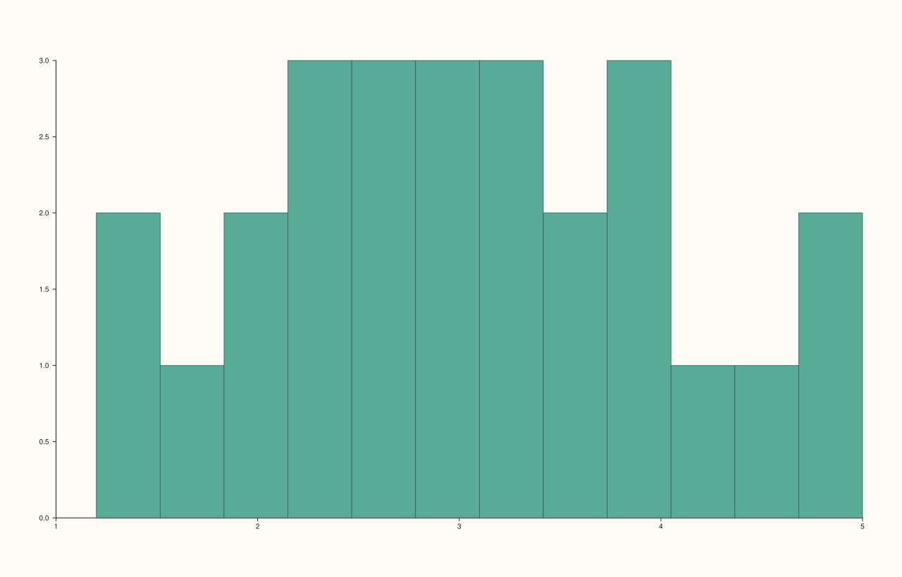
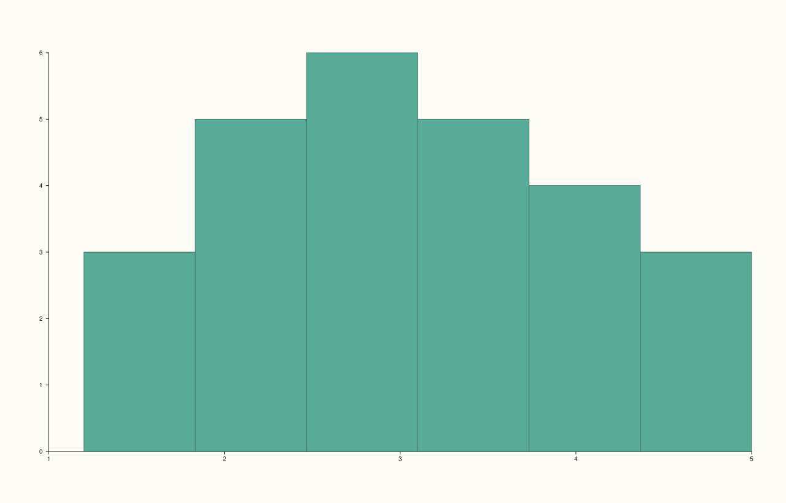

<!-- pluss-hand-authored -->

# flash::histplot

[Back to flash API Reference](../../flash_api_reference)

## Signatures

```cpp
Trace& flash::histplot(Pane& pane, Series values, int bins = 12)
```

## What It Does

The high-level entry point for a histogram: a direct, one-argument-simpler wrapper
around [`Pane::bucket`](../pane/bucket.md) — `histplot(pane, values, bins)` is exactly
`pane.bucket(values, bins)`. There is only one overload, and it deliberately does **not**
expose `Pane::bucket`'s explicit-`Range1d` third overload — `histplot()` always bins the
data's own observed range.

## Parameters

**pane** (`Pane&`)
    The target pane. Must be `Planar` (2D) — this wraps `Pane::bucket`, which requires it.

**values** (series-convertible)
    The raw, ungrouped observations to bin.

**bins** (`int`, default `12`)
    The number of equal-width bins, over the data's own observed range.

## Returns

`Trace&`
    A reference to the newly created trace.

## Examples

Example 1. The default 12 bins.

```cpp
using namespace pluss::pl;

auto fig = studio("flash_histplot_default");
auto& pane = fig.pane2();
std::vector<double> raw{1.2, 1.5, 1.8, 2.1, 2.3, 2.5, 2.6, 2.8, 3.0, 3.2, 3.5, 3.9, 4.1,
                         4.4, 4.8, 5.0, 2.0, 2.2, 2.9, 3.1, 3.3, 2.7, 2.4, 3.6, 3.8, 4.0};
flash::histplot(pane, raw);
fig.show();
```



Example 2. A coarser, custom bin count. Renders
different bar boundaries from Example 1.

```cpp
using namespace pluss::pl;

auto fig = studio("flash_histplot_custom_bins");
auto& pane = fig.pane2();
std::vector<double> raw{1.2, 1.5, 1.8, 2.1, 2.3, 2.5, 2.6, 2.8, 3.0, 3.2, 3.5, 3.9, 4.1,
                         4.4, 4.8, 5.0, 2.0, 2.2, 2.9, 3.1, 3.3, 2.7, 2.4, 3.6, 3.8, 4.0};
flash::histplot(pane, raw, 6);
fig.show();
```



## Notes

- Not `noexcept`.
- No range-override option — for a bin range wider (or narrower) than the data's own
  observed span, call [`Pane::bucket`](../pane/bucket.md)'s third (`Range1d`-taking)
  overload directly; `histplot()` cannot reach it.
- [`flash::displot`](displot.md) is a pure alias for this exact function — see that page
  for direct verification.

## See Also

- [`Pane::bucket`](../pane/bucket.md): the lower-level method this wraps, including the
  explicit-range overload `histplot()` doesn't expose.
- [`flash::displot`](displot.md): a identical alias.
- [`flash::kdeplot`](kdeplot.md): a smoothed density-curve alternative to this binned-count
  view of the same kind of raw observations.
- [`flash::rugplot`](rugplot.md): a complementary per-observation tick-mark overlay, often
  paired with a histogram.

<div class="pluss-inline-prev-next">
  <a class="prev-link" href="relplot.html">
    <span class="label">Previous</span>
    <span class="title">relplot</span>
  </a>
  <a class="next-link" href="displot.html">
    <span class="label">Next</span>
    <span class="title">displot</span>
  </a>
</div>
