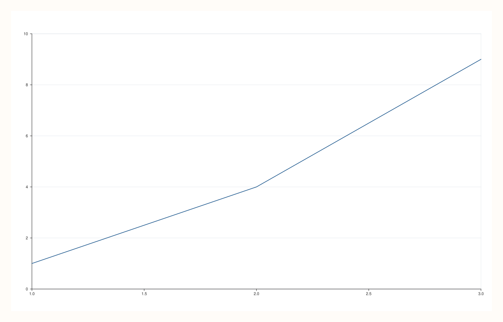

<!-- pluss-hand-authored -->

# flash::horizontal_grid

[Back to flash API Reference](../../flash_api_reference)

## Signature

```cpp
Pane& flash::horizontal_grid(Pane& pane, bool enable = true) noexcept
```

## What It Does

Restricts a pane's grid to horizontal lines only (`y_major_grid` on, `x_major_grid`/
`z_major_grid`/minor grids off) — but **only** on panes currently styled with one of
[`flash::set_style`](set_style.md)'s three grid-family `FlashStyle` values (`Darkgrid`/
`Lightgrid`/`Sandgrid`). The function detects this by checking whether the pane's
current [`theme_tokens().name()`](../pane/theme_tokens.md) contains `"darkgrid"`,
`"lightgrid"`, or `"sandgrid"` as a substring.

```{important} Non-grid-family styles are forced gridless, not left alone, regardless of enable
If the pane's current theme name does NOT match one of the three grid-family
substrings above -- e.g. it was styled with FlashStyle::Dark/Light/Sand, or never
styled via flash::set_style/set_theme at all -- horizontal_grid unconditionally forces
the pane fully gridless (Pane::grid(GridStyle::None), all major/minor grids off) on
EVERY call, even when enable is true. This was directly verified below: calling
horizontal_grid(pane, true) on a FlashStyle::Dark pane produces byte-identical output
to not calling it at all, since Dark is already gridless -- but on a pane whose theme
name does not contain a recognized "*grid" substring for any other reason, this
function will actively strip any existing grid rather than leaving it untouched.
```

## Parameters

**pane** (`Pane&`)
    The pane to adjust.

**enable** (`bool`, default `true`)
    On a grid-family-styled pane: `true` restricts to horizontal-only lines, `false`
    restores the full major grid (`x`/`y`/`z` all on). On a non-grid-family-styled
    pane: ignored — see the important callout above.

## Returns

`Pane&`
    A reference to `pane`, for chaining.

## Examples

Example 1. `Lightgrid`-styled pane, `horizontal_grid(pane, true)` — confirmed to render
genuinely differently from the un-toggled `Lightgrid` pane via direct SVG comparison.

```cpp
using namespace pluss::pl;

auto fig1 = studio("flash_hgrid_off");
auto& p1 = fig1.pane2();
p1.trend(std::vector<double>{1, 2, 3}, std::vector<double>{1, 4, 9});
flash::set_style(p1, flash::FlashStyle::Lightgrid);

auto fig2 = studio("flash_hgrid_on");
auto& p2 = fig2.pane2();
p2.trend(std::vector<double>{1, 2, 3}, std::vector<double>{1, 4, 9});
flash::set_style(p2, flash::FlashStyle::Lightgrid);
flash::horizontal_grid(p2, true);
std::cout << "horizontal_grid(true) on gridstyle theme differs: " << (fig1.to_svg() != fig2.to_svg()) << "\n";
fig2.show();
```

Output:

```text
horizontal_grid(true) on gridstyle theme differs: 1
```



Example 2 (edge case). `Dark`-styled pane (a non-grid-family style, already gridless) —
`horizontal_grid(pane, true)` is byte-identical to leaving it alone, since both paths
land on fully gridless.

```cpp
using namespace pluss::pl;

auto fig3 = studio("flash_hgrid_on_dark_style");
auto& p3 = fig3.pane2();
p3.trend(std::vector<double>{1, 2, 3}, std::vector<double>{1, 4, 9});
flash::set_style(p3, flash::FlashStyle::Dark);

auto fig4 = studio("flash_hgrid_on_dark_style_2");
auto& p4 = fig4.pane2();
p4.trend(std::vector<double>{1, 2, 3}, std::vector<double>{1, 4, 9});
flash::set_style(p4, flash::FlashStyle::Dark);
flash::horizontal_grid(p4, true);
std::cout << "horizontal_grid(true) on non-grid style (Dark) byte-identical: " << (fig3.to_svg() == fig4.to_svg()) << "\n";
```

Output:

```text
horizontal_grid(true) on non-grid style (Dark) byte-identical: 1
```

## Notes

- `noexcept`.
- The grid-family detection is a plain substring search on the pane's current theme
  *name string* — it is not a stored enum/flag. A hand-built `Theme` whose name happens
  to contain e.g. `"lightgrid"` would be treated as grid-family by this function even
  if it was never produced by `flash::set_style`.
- See the important callout above: this function is not purely additive — on an
  unrecognized theme it actively clears any existing grid, it does not leave one alone.

## See Also

- [`flash::set_style`](set_style.md): sets the theme names this function's detection
  logic keys off of.
- [`flash::set_theme`](set_theme.md): can enable this behavior as part of its own
  broader theming bundle, via `FlashThemeOptions::horizontal_grid`.
- [`Pane::grid`](../pane/grid.md): the lower-level method this function ultimately
  calls.

<div class="pluss-inline-prev-next">
  <a class="prev-link" href="tickless.html">
    <span class="label">Previous</span>
    <span class="title">tickless</span>
  </a>
  <a class="next-link" href="show.html">
    <span class="label">Next</span>
    <span class="title">show</span>
  </a>
</div>
