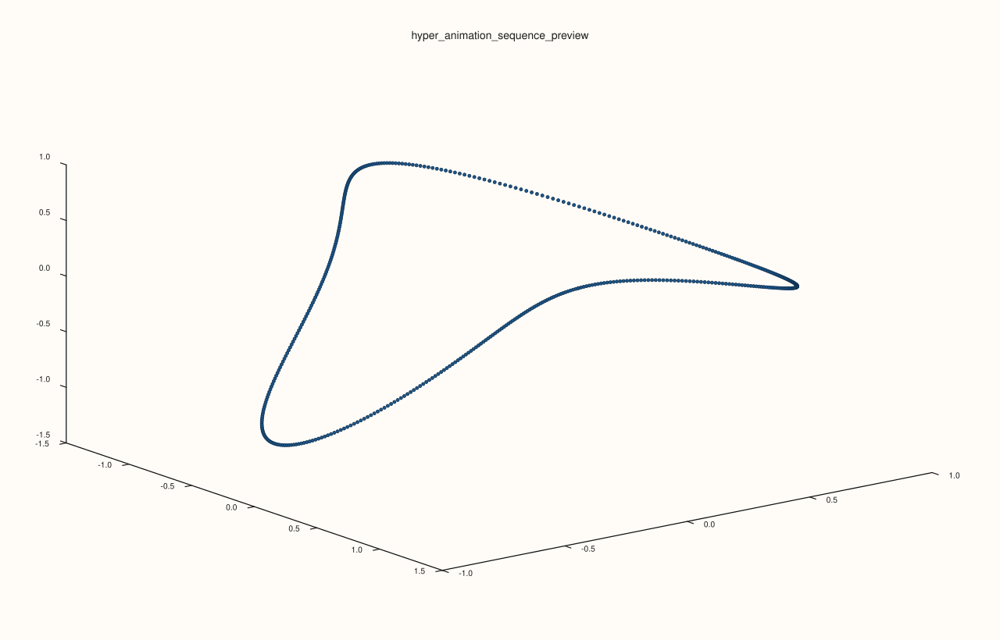

<!-- pluss-hand-authored -->

# flash::hyper_animation_sequence

[Back to flash API Reference](../../flash_api_reference)

## Signature

```cpp
std::vector<HyperPlotOptions> flash::hyper_animation_sequence(
    const HyperPlotOptions& base, const HyperSweepOptions& options = {})
```

## What It Does

A pure, `Pane`/`Studio`-independent helper: generates a sequence of `HyperPlotOptions`
snapshots, each identical to `base` except for one rotation field (`plane`) swept evenly
from `start_deg` to `end_deg` across `frames` steps — the "frame list" that a real 4D
animation would need, computed all at once rather than driven live by a browser's
`requestAnimationFrame` loop (contrast with [`flash::animate4`](animate4.md), which
computes rotations live in JavaScript instead of precomputing a frame list). Used
internally by [`flash::export4_frames`](export4_frames.md) to know exactly which
rotation angle to render for each exported frame.

## Parameters

**base** (`const HyperPlotOptions&`)
    The starting options every generated frame copies — every field except whichever one
    `options.plane` selects stays fixed at `base`'s own value across all frames.

**options** (`const HyperSweepOptions&`, optional)
    See the field table below.

## `HyperSweepOptions` fields

| Field | Type and default | Description |
|---|---|---|
| `frames` | `std::int64_t`, default `96` | How many `HyperPlotOptions` snapshots to generate. Must be greater than `1`, or `hyper_animation_sequence` throws `std::invalid_argument("flash::hyper_animation_sequence: frames must be > 1")`. |
| `plane` | `HyperSweepPlane`, default `XW` | Which of `base`'s six rotation fields is swept: `XY` → `rot_xy_deg`, `XZ` → `rot_xz_deg`, `XW` → `rot_xw_deg`, `YZ` → `rot_yz_deg`, `YW` → `rot_yw_deg`, `ZW` → `rot_zw_deg`. Every other rotation field stays fixed at `base`'s value. |
| `start_deg`, `end_deg` | `double`, default `0.0`, `360.0` | The angular range swept across the generated frames. |
| `include_endpoint` | `bool`, default `false` | Whether the step size divides the range by `frames` (`false`, so frame `frames - 1` lands just short of `end_deg` — the conventional choice for a seamlessly looping `0°`–`360°` animation, where `end_deg` and the next loop's `start_deg` would otherwise coincide and duplicate a frame) or by `frames - 1` (`true`, so the last frame lands exactly on `end_deg`). |

## Returns

`std::vector<HyperPlotOptions>`
    Exactly `options.frames` entries, each a copy of `base` with `options.plane`'s
    rotation field set to that frame's swept angle.

## Examples

Example 1. Four frames sweeping the `XW` plane through a full `360°`, default
(non-inclusive) endpoint — evenly spaced at `90°` increments, landing on `0`, `90`,
`180`, `270` (never reaching `360`, which would duplicate the `0°` frame).

```cpp
using namespace pluss::pl;

flash::HyperPlotOptions base;
flash::HyperSweepOptions sweep;
sweep.frames = 4;
sweep.plane = flash::HyperSweepPlane::XW;
sweep.start_deg = 0.0;
sweep.end_deg = 360.0;
sweep.include_endpoint = false;
auto frames = flash::hyper_animation_sequence(base, sweep);
std::cout << "hyper_animation_sequence(frames=4) count: " << frames.size() << "\n";
for (const auto& f : frames) {
  std::cout << "  rot_xw_deg=" << f.rot_xw_deg << "\n";
}
```

Output:

```text
hyper_animation_sequence(frames=4) count: 4
  rot_xw_deg=0
  rot_xw_deg=90
  rot_xw_deg=180
  rot_xw_deg=270
```

Example 2 (edge case). `frames = 1` throws.

```cpp
using namespace pluss::pl;

flash::HyperPlotOptions base;
flash::HyperSweepOptions sweep;
sweep.frames = 1;
try {
  auto frames = flash::hyper_animation_sequence(base, sweep);
} catch (const pluss::Error& e) {
  std::string msg(e.what());
  std::cout << "hyper_animation_sequence(frames=1) threw: " << msg.substr(0, msg.find('\n')) << "\n";
}
```

Output:

```text
hyper_animation_sequence(frames=1) threw: flash::hyper_animation_sequence: frames must be > 1
```

Example 3. Consume one generated snapshot immediately by feeding it into
[`flash::cloud4`](cloud4.md). This is the practical hand-off pattern when you want to
compute frames centrally and render selected ones yourself.

```cpp
using namespace pluss::pl;

auto fig = studio("flash_hyper_animation_sequence_preview");
auto& pane = fig.pane3();

auto t = pluss::series::linspace(0.0, 2.0 * 3.14159265358979323846, 480, pluss::ScalarType::Float64);
auto hx = t.cos();
auto hy = t.sin();
auto hz = t.mul(2.0).cos().mul(0.72);
auto hw = t.mul(3.0).sin().mul(0.58);

flash::HyperPlotOptions base;
base.projection = flash::HyperProjection::PerspectiveW;
base.rot_yz_deg = 15.0;
base.rot_zw_deg = 24.0;
base.w_perspective_distance = 3.6;

flash::HyperSweepOptions sweep;
sweep.frames = 5;
sweep.plane = flash::HyperSweepPlane::XW;
sweep.start_deg = 0.0;
sweep.end_deg = 60.0;
sweep.include_endpoint = true;

auto frames = flash::hyper_animation_sequence(base, sweep);
flash::cloud4(pane, hx, hy, hz, hw, frames.at(2));
fig.show();
```



## Notes

- Not `noexcept`.
- Purely computational — never touches a `Pane`, `Studio`, or `Trace`; each returned
  `HyperPlotOptions` can be fed directly to [`flash::path4`](path4.md)/
  [`flash::cloud4`](cloud4.md) to render that frame.
- `HyperSweepPlane`'s six enumerators name exactly the same six rotation planes as
  `HyperPlotOptions`' own `rot_*_deg` fields (see [`flash::path4`](path4.md)'s field
  table).

## See Also

- [`flash::export4_frames`](export4_frames.md): the function that calls this one
  internally to determine each exported frame's rotation.
- [`flash::path4`](path4.md), [`flash::cloud4`](cloud4.md): the two functions each
  generated frame's `HyperPlotOptions` can be rendered with.
- [`flash::animate4`](animate4.md): the live, browser-side animated equivalent, which
  computes rotations in JavaScript rather than precomputing a frame list like this
  function does.

<div class="pluss-inline-prev-next">
  <a class="prev-link" href="cloud4.html">
    <span class="label">Previous</span>
    <span class="title">cloud4</span>
  </a>
  <a class="next-link" href="animate3.html">
    <span class="label">Next</span>
    <span class="title">animate3</span>
  </a>
</div>
