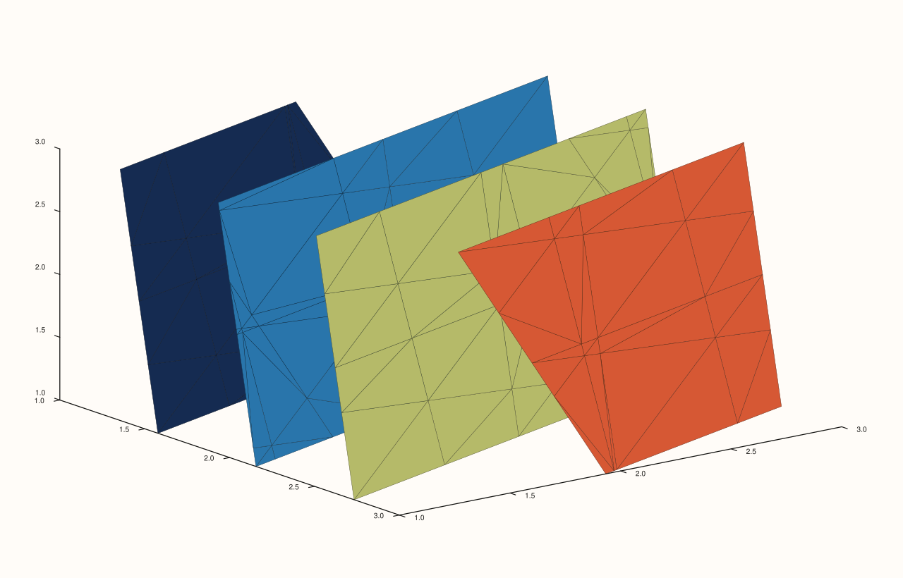
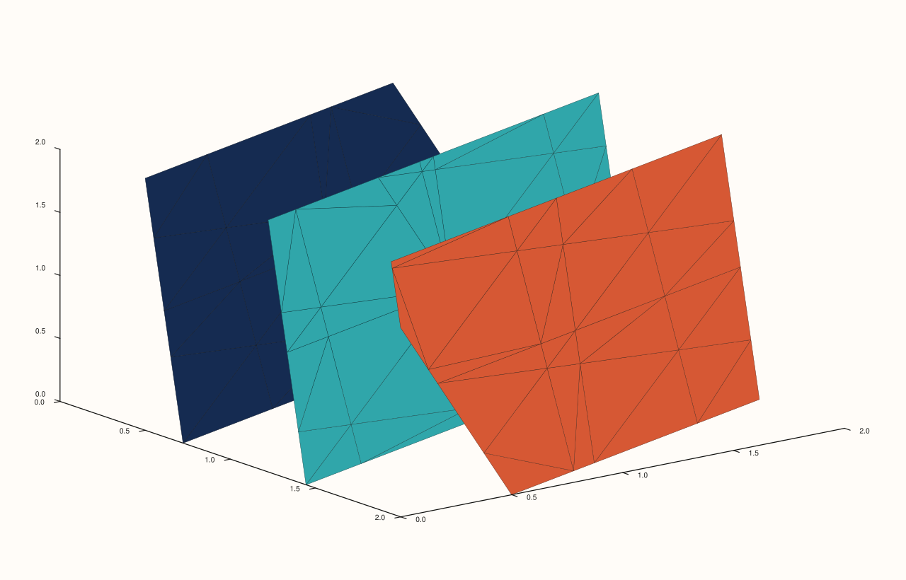

<!-- pluss-hand-authored -->

# flash::isoshell

[Back to flash API Reference](../../flash_api_reference)

## Signatures

```cpp
Trace& flash::isoshell(Pane& pane, Series values, int level_count = 4)

Trace& flash::isoshell(Pane& pane, Series x, Series y, Series z, Series values, int level_count = 4)

Trace& flash::isoshell(Pane& pane, Series x, Series y, Series z, Series values, Series levels)
```

## What It Does

A thin wrapper around [`Pane::isoshell`](../pane/isoshell.md): converts every argument to
`Series`, validates each is rank ≤ 3, then delegates to the identically-shaped native
`Pane::isoshell` overload. Every delegation is identical to calling
`Pane::isoshell` directly. Three overloads,
mirroring [`Pane::isoshell`](../pane/isoshell.md)'s own: `(values, level_count = 4)`
(all axes auto-indexed from `values`' own three dimensions), `(x, y, z, values,
level_count = 4)` (explicit axes), and `(x, y, z, values, levels)` (explicit axes and
explicit threshold values).

```{important} Two independent rank checks, at two different layers, with two different exception types
flash::isoshell's own validation only checks values (and x/y/z/levels, where present)
are rank <= 3 -- a loose upper bound, throwing pluss::Error via the shared
require_rank_at_most helper (message: "flash::isoshell: expected input rank <= 3").
Pane::isoshell then separately, more strictly, requires values to be rank-3 EXACTLY,
throwing a plain pluss::Error ("isoshell: values must be a rank-3 field") --
a completely different exception type. A rank-1 or rank-2 values passes flash's own
check (both are <= 3) but still fails Pane::isoshell's stricter exact-rank-3 check, for example with a 3-element flat vector, which throws the
pluss::Error, not the pluss::Error.
```

## Parameters

**pane** (`Pane&`)
    The target pane. Must be `Volumetric`.

**values** (series-convertible, must be rank ≤ 3 for `flash::isoshell`'s own check, and
rank-3 exactly to satisfy [`Pane::isoshell`](../pane/isoshell.md)'s own deeper
requirement — see the important callout above)
    The volumetric scalar field, indexed `values(x, y, z)`.

**x**, **y**, **z** (series-convertible, must each be rank ≤ 3, four- and five-argument
overloads)
    Explicit coordinate axes, matching `values`' three dimensions. Auto-indexed as
    `0, 1, 2, …` in the single-argument overload.

**level_count** (`int`, default `4`, one- and four-argument overloads)
    Automatic, evenly-spaced isosurface threshold count — note the default of `4` here,
    versus `8` for [`flash::ridge3`](ridge3.md)/[`Pane::contour`](../pane/contour.md)/
    [`Pane::isoband`](../pane/isoband.md).

**levels** (series-convertible, must be rank ≤ 3, non-integral type, five-argument
overload only)
    Explicit threshold values, replacing automatic spacing.

## Returns

`Trace&`
    A reference to the newly created trace, for chaining.

## Examples

Example 1. `(values, level_count = 4)` overload — all axes auto-indexed from a `3×3×3`
field.

```cpp
using namespace pluss::pl;

auto fig = studio("flash_isoshell_values_only");
auto& pane = fig.pane3();
auto field = pluss::series::linspace(0.0, 1.0, 27, pluss::ScalarType::Float64).reshape({3, 3, 3});
flash::isoshell(pane, field);
fig.show();
```



Example 2. `(x, y, z, values, level_count = 4)` overload — explicit coordinate axes.

```cpp
using namespace pluss::pl;

auto fig = studio("flash_isoshell_xyz_values");
auto& pane = fig.pane3();
std::vector<double> x{0.0, 1.0, 2.0};
std::vector<double> y{0.0, 1.0, 2.0};
std::vector<double> z{0.0, 1.0, 2.0};
auto field = pluss::series::linspace(0.0, 1.0, 27, pluss::ScalarType::Float64).reshape({3, 3, 3});
flash::isoshell(pane, x, y, z, field, 3);
fig.show();
```



Example 3. `(x, y, z, values, levels)` overload — explicit threshold values.

```cpp
using namespace pluss::pl;

auto fig = studio("flash_isoshell_explicit_levels");
auto& pane = fig.pane3();
std::vector<double> x{0.0, 1.0, 2.0};
std::vector<double> y{0.0, 1.0, 2.0};
std::vector<double> z{0.0, 1.0, 2.0};
auto field = pluss::series::linspace(0.0, 1.0, 27, pluss::ScalarType::Float64).reshape({3, 3, 3});
std::vector<double> levels{0.25, 0.5, 0.75};
flash::isoshell(pane, x, y, z, field, levels);
fig.show();
```


Example 4 (a comparison, not a new picture). `flash::isoshell(pane, values)`
renders identical to `pane.isoshell(values)` called directly.

```cpp
using namespace pluss::pl;

auto field = pluss::series::linspace(0.0, 1.0, 27, pluss::ScalarType::Float64).reshape({3, 3, 3});

auto fig1 = studio("flash_isoshell_flash");
auto& pane1 = fig1.pane3();
flash::isoshell(pane1, field);

auto fig2 = studio("flash_isoshell_native");
auto& pane2 = fig2.pane3();
pane2.isoshell(field);

std::cout << "flash::isoshell(pane,values) == pane.isoshell(values): " << (fig1.to_svg() == fig2.to_svg()) << "\n";
```

Output:

```text
flash::isoshell(pane,values) == pane.isoshell(values): 1
```

Example 5 (edge case). A rank-1 `values` passes `flash::isoshell`'s own rank-≤3 check but
fails `Pane::isoshell`'s stricter rank-3-exact check — thrown as `pluss::Error`,
not `pluss::Error`, per the important callout above.

```cpp
using namespace pluss::pl;

auto fig = studio("flash_isoshell_rank_throw");
auto& pane = fig.pane3();
std::vector<double> flat_values{1.0, 2.0, 3.0};
try {
  flash::isoshell(pane, flat_values);
} catch (const pluss::Error& e) {
  std::cout << "isoshell(rank-1 values) threw: " << e.message() << "\n";
}
```

Output:

```text
isoshell(rank-1 values) threw: isoshell: values must be a rank-3 field
```

## Notes

- Not `noexcept`.
- See the important callout above: this function's own validation is looser (rank ≤ 3)
  than [`Pane::isoshell`](../pane/isoshell.md)'s (rank-3 exact for `values`), and the two
  layers throw different exception types.
- No `Studio` convenience overload, same as [`flash::spire3`](spire3.md) and
  [`flash::ridge3`](ridge3.md).

## See Also

- [`Pane::isoshell`](../pane/isoshell.md): the underlying native method this function
  delegates to entirely, and the source of the stricter rank-3-exact `values`
  requirement.
- [`flash::ridge3`](ridge3.md): the 2D-field elevated-contour analogue (versus this
  function's rank-3 volumetric field).
- [`Pane::contour`](../pane/contour.md), [`Pane::isoband`](../pane/isoband.md): the
  source of the `8`-level default this function deliberately diverges from (`4`).

<div class="pluss-inline-prev-next">
  <a class="prev-link" href="ridge3.html">
    <span class="label">Previous</span>
    <span class="title">ridge3</span>
  </a>
  <a class="next-link" href="plot3D.html">
    <span class="label">Next</span>
    <span class="title">plot3D</span>
  </a>
</div>
