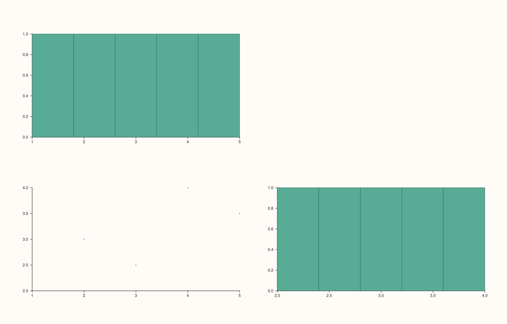

<!-- pluss-hand-authored -->

# flash::jointgrid_map_plot

[Back to flash API Reference](../../flash_api_reference)

## Signature

```cpp
Studio& flash::jointgrid_map_plot(Studio& studio, std::function<void(Pane&)> joint_mapper,
                                   std::function<void(Pane&, bool)> marginal_mapper,
                                   double gx = 14.0, double gy = 14.0)
```

## What It Does

The generic, callback-driven builder behind a joint-plus-marginals view: lays out a
[`flash::JointGrid`](JointGrid.md) (`2×2`), then creates and populates all four cells
itself, in this fixed order:

1. **Top marginal** (row 0, col 0) — `marginal_mapper(pane, true)`.
2. **Joint panel** (row 1, col 0) — `joint_mapper(pane)`.
3. **Right marginal** (row 1, col 1) — `marginal_mapper(pane, false)`.
4. **Corner** (row 0, col 1) — always `.hide()`d; no callback is invoked for it.

This is the piece [`flash::JointGrid`](JointGrid.md) itself deliberately omits: knowing
which of its four cells is the top marginal, the joint panel, the right marginal, and the
unused corner. A call always produces exactly 4 panes.

```{important} marginal_mapper is called twice, joint_mapper once, corner gets no callback at all
marginal_mapper(pane, true) draws the top marginal (typically feature X's own
distribution), and marginal_mapper(pane, false) draws the right marginal
(typically feature Y's own distribution) -- the same callable, invoked twice
with a different bool each time, so a single mapper commonly branches on that
flag to pick which feature to summarize (see the example below, which reuses
one lambda for both marginals). joint_mapper is invoked exactly once, for the
bottom-left panel only. The top-right corner cell is created and immediately
hidden -- neither mapper ever sees it.
```

## Parameters

**studio** (`Studio&`)
    The figure to lay out and populate.

**joint_mapper** (a callable taking `(Pane&)`)
    Called once, for the bottom-left (joint) panel — typically draws the bivariate
    relationship between the two features.

**marginal_mapper** (a callable taking `(Pane&, bool is_top)`)
    Called twice: once for the top marginal with `is_top = true`, once for the right
    marginal with `is_top = false`.

**gx**, **gy** (`double`, default `14.0` each)
    Forwarded straight to the internal [`flash::JointGrid`](JointGrid.md) call as its
    `gx`/`gy` gutter.

## Returns

`Studio&`
    A reference to the same figure, for chaining.

## Examples

Example 1. A joint scatter of two features, with each feature's own histogram in its
marginal — the single `marginal_mapper` lambda branches on `is_top` to pick which
feature's sample to summarize.

```cpp
using namespace pluss::pl;

auto fig = studio("flash_jointgrid_map_plot");
std::vector<double> x{1.0, 2.0, 3.0, 4.0, 5.0};
std::vector<double> y{2.0, 3.0, 2.5, 4.0, 3.5};
flash::jointgrid_map_plot(
    fig,
    [&](Pane& joint) { joint.cloud(x, y); },
    [&](Pane& marginal, bool is_top) {
      if (is_top) {
        marginal.bucket(x, 5);
      } else {
        marginal.bucket(y, 5);
      }
    });
std::cout << "pane count: " << fig.pane_count() << " (top marginal, joint, right marginal, hidden corner)\n";
fig.show();
```

Output:

```text
pane count: 4 (top marginal, joint, right marginal, hidden corner)
```



## Notes

- Not `noexcept`.
- Both mappers are invoked via `std::invoke`, so each may be a lambda, a free function
  pointer, or any callable matching the required signature — and they need not be the same
  callable type as each other.
- The corner cell is unconditionally hidden — there is no option to show it or give it
  content.
- [`flash::facet_map_plot`](facet_map_plot.md) and
  [`flash::pairgrid_map_plot`](pairgrid_map_plot.md) are the other generic,
  callback-driven grid builders in this family, layered over
  [`flash::FacetGrid`](FacetGrid.md) and [`flash::PairGrid`](PairGrid.md) respectively.

## See Also

- [`flash::JointGrid`](JointGrid.md): the underlying grid-layout constructor.
- [`flash::facet_map_plot`](facet_map_plot.md),
  [`flash::pairgrid_map_plot`](pairgrid_map_plot.md): sibling callback-driven grid
  builders.
- [`Pane::hide`](../pane/visible.md): what hides the corner cell.
- [`Pane::bucket`](../pane/bucket.md), [`Pane::cloud`](../pane/cloud.md): the two
  native `Pane` methods used in the example above.

<div class="pluss-inline-prev-next">
  <a class="prev-link" href="pairgrid_map_plot.html">
    <span class="label">Previous</span>
    <span class="title">pairgrid_map_plot</span>
  </a>
  <a class="next-link" href="pairplot.html">
    <span class="label">Next</span>
    <span class="title">pairplot</span>
  </a>
</div>
