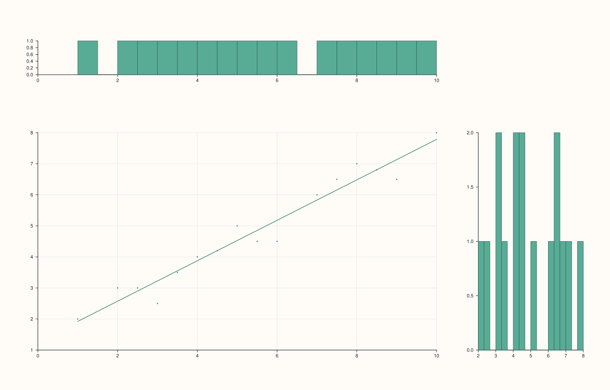
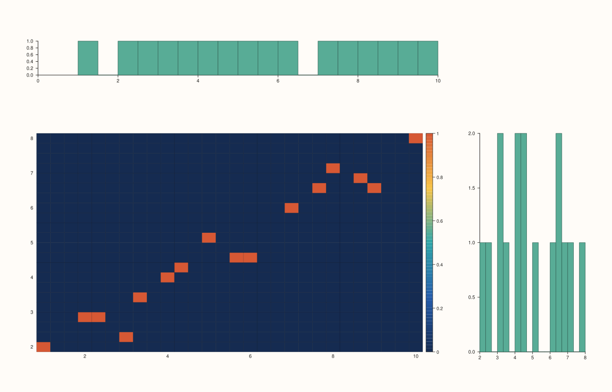
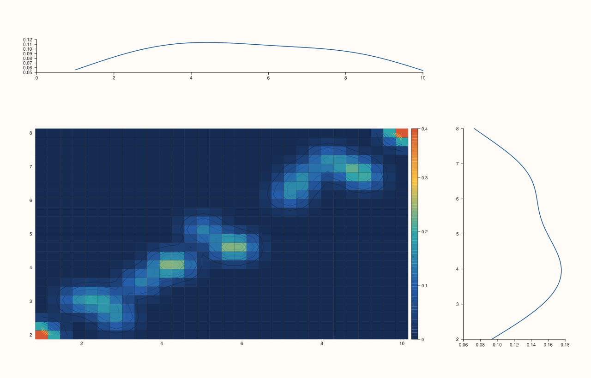
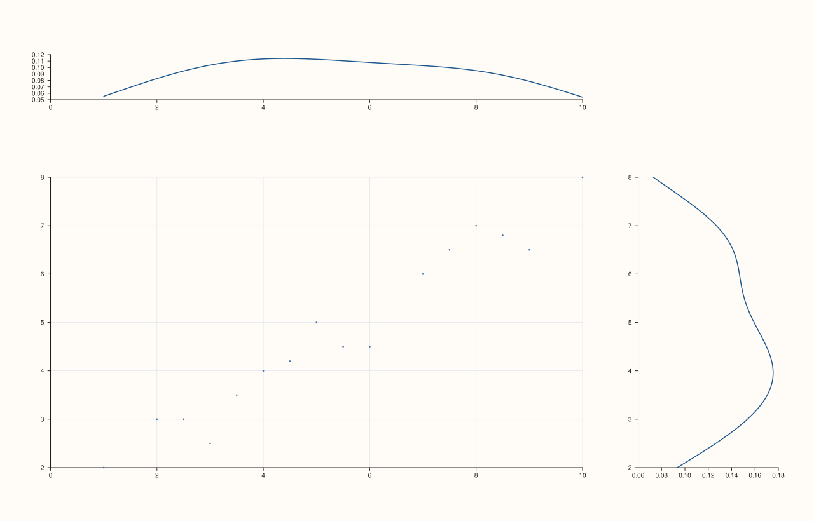
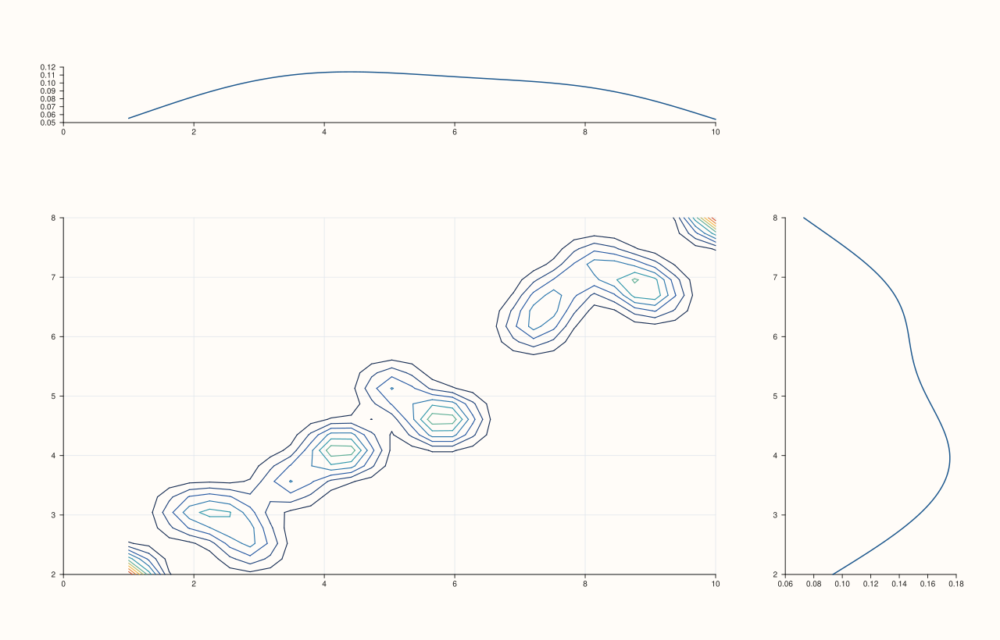
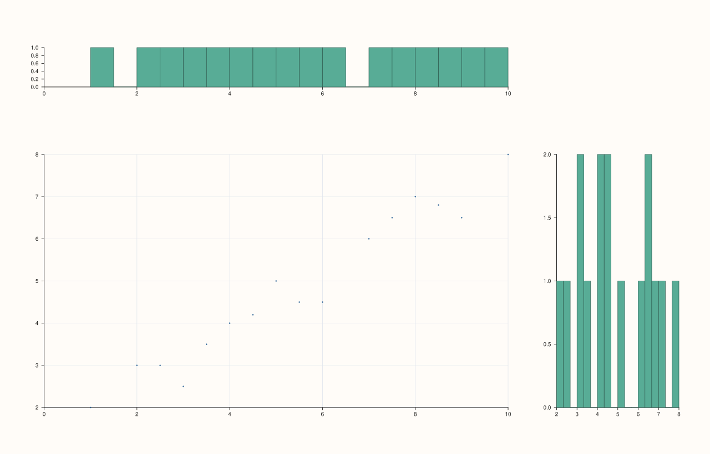
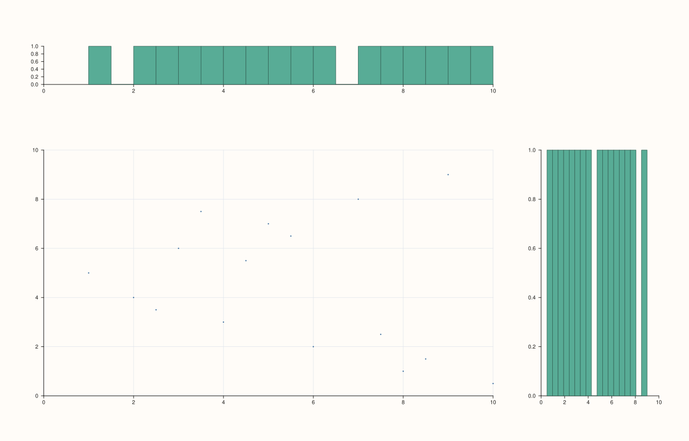

<!-- pluss-hand-authored -->

# flash::jointplot

[Back to flash API Reference](../../flash_api_reference)

## Signatures

```cpp
// -- core (series-convertible x/y) --
Studio& flash::jointplot(Studio& studio, Series x, Series y, std::string_view kind = "scatter")
Studio& flash::jointplot(Studio& studio, Series x, Series y, const JointPlotOptions& options)

// -- Dataset, by feature name --
Studio& flash::jointplot(Studio& studio, const Dataset& data, std::string_view x_name,
                          std::string_view y_name, std::string_view kind = "scatter")
Studio& flash::jointplot(Studio& studio, const Dataset& data, std::string_view x_name,
                          std::string_view y_name, const JointPlotOptions& options)

// -- matrix + MatrixFrameOptions, by feature name --
Studio& flash::jointplot(Studio& studio, const Series& matrix, std::string_view x_name,
                          std::string_view y_name, const MatrixFrameOptions& frame_options,
                          std::string_view kind = "scatter")
Studio& flash::jointplot(Studio& studio, const Series& matrix, std::string_view x_name,
                          std::string_view y_name, const MatrixFrameOptions& frame_options,
                          const JointPlotOptions& options)

// -- matrix + explicit feature_names + Axis, by feature name (3 name-container forms x 2 kind/options) --
Studio& flash::jointplot(Studio& studio, const Series& matrix, std::string_view x_name,
                          std::string_view y_name,
                          pluss::msharp::RangeView::Of<std::string_view> feature_names,
                          Axis feature_axis, std::string_view kind = "scatter")
Studio& flash::jointplot(Studio& studio, const Series& matrix, std::string_view x_name,
                          std::string_view y_name,
                          pluss::msharp::RangeView::Of<std::string_view> feature_names,
                          Axis feature_axis, const JointPlotOptions& options)
Studio& flash::jointplot(Studio& studio, const Series& matrix, std::string_view x_name,
                          std::string_view y_name, const std::vector<std::string>& feature_names,
                          Axis feature_axis, std::string_view kind = "scatter")
Studio& flash::jointplot(Studio& studio, const Series& matrix, std::string_view x_name,
                          std::string_view y_name, const std::vector<std::string>& feature_names,
                          Axis feature_axis, const JointPlotOptions& options)
Studio& flash::jointplot(Studio& studio, const Series& matrix, std::string_view x_name,
                          std::string_view y_name,
                          std::initializer_list<std::string_view> feature_names,
                          Axis feature_axis, std::string_view kind = "scatter")
Studio& flash::jointplot(Studio& studio, const Series& matrix, std::string_view x_name,
                          std::string_view y_name,
                          std::initializer_list<std::string_view> feature_names,
                          Axis feature_axis, const JointPlotOptions& options)

// -- bare matrix, by feature name (auto-labeled x_1, x_2, ...) --
Studio& flash::jointplot(Studio& studio, const Series& matrix, std::string_view x_name,
                          std::string_view y_name, std::string_view kind = "scatter")
Studio& flash::jointplot(Studio& studio, const Series& matrix, std::string_view x_name,
                          std::string_view y_name, const JointPlotOptions& options)

// -- matrix, by feature INDEX --
Studio& flash::jointplot(Studio& studio, const Series& matrix,
                          const MatrixJointOptions& matrix_options,
                          std::string_view kind = "scatter")
Studio& flash::jointplot(Studio& studio, const Series& matrix,
                          const MatrixJointOptions& matrix_options,
                          const JointPlotOptions& options)
```

## What It Does

Draws a joint distribution plot: a large central panel showing the bivariate relationship
between two features (`x`, `y`), flanked by a top marginal (x's own univariate
distribution) and a right marginal (y's own). The layout is built as a `4×4`
[`Studio::mosaic`](../studio/mosaic.md) with the joint panel spanning
`place(1, 0, 3, 3)`, the top marginal `place(0, 0, 1, 3)`, and the right marginal
`place(1, 3, 3, 1)` (see [`Pane::place`](../pane/place.md) for the `(row, col, row_span,
col_span)` signature this relies on).

Sixteen overloads, but they reduce to two *behaviors* layered under four *data-selection*
mechanisms:

- **Behavior**: every overload ultimately calls one of two core forms — `(x, y,
  kind_string)` or `(x, y, JointPlotOptions)` — which is what actually decides the joint
  panel's glyph (`kind`) and the marginals' glyph (`marginal`).
- **Data selection**: `(x, y)` directly; `(Dataset, x_name, y_name)`, looking features up
  by name; `(matrix, x_name, y_name, ...)` in five sub-forms (via `MatrixFrameOptions`,
  or explicit feature names in three container flavors, or a bare matrix with
  auto-generated names) that all funnel through the `Dataset` form; and `(matrix,
  MatrixJointOptions)`, which selects `x`/`y` by feature **index** instead of name.

```{important} Unlike flash::pairplot/triplot, the matrix-by-name overloads route through Dataset internally
The five "matrix + x_name/y_name" overloads don't split the matrix into columns and pick
two directly -- they call flash::make_dataset(matrix, feature_names, feature_axis) to
build a full Dataset, then delegate to the Dataset-by-name overload, which looks up
x_name/y_name via Dataset::numeric(). This means an unrecognized x_name/y_name on ANY
matrix overload surfaces the same "flash::jointplot(dataset): unknown numeric feature"
message as the Dataset overload itself, not a matrix- or index-specific one.
```

## `JointPlotOptions` fields

| Field | Type and default | Description |
|---|---|---|
| `kind` | `JointPlotKind`, default `Scatter` | The joint (central) panel's glyph: - `Scatter` — a point cloud via [`Pane::cloud`](../pane/cloud.md). - `Reg` — delegates the entire joint panel to [`flash::regplot`](regplot.md) with the nested `reg` options. - `Hex` — a 2D-binned heatmap (via [`flash::heatmap`](heatmap.md)) over a `hex_bins_x × hex_bins_y` grid. The name is historical; the rendered result is a rectangular-cell density view, not literal hexagon tiles. - `Kde` — a smoothed 2D density: the same binned grid, blurred by `kde_smooth_passes`, drawn as filled contours (`kde_fill`) plus a [`Pane::contour`](../pane/contour.md) outline at `kde_levels` levels. Also switches the default `marginal` to `Kde` (see the important callout below). |
| `marginal` | `JointMarginalKind`, default `Hist` | The two marginal panels' glyph: `Hist` (via [`Pane::bucket`](../pane/bucket.md), using `marginal_bins`) or `Kde` (a density curve using `marginal_kde_points`). |
| `marginal_bins` | `std::int64_t`, default `18` | Bin count for `Hist`-kind marginals. At least `1`; fewer throws `pluss::Error`. |
| `marginal_kde_points` | `std::int64_t`, default `128` | Evaluation-point count for `Kde`-kind marginals. At least `2`; fewer throws `pluss::Error`. |
| `hex_bins_x`, `hex_bins_y` | `std::int64_t`, default `28`, `22` | Grid resolution for `kind = Hex`. Each at least `1`; fewer throws `pluss::Error`. |
| `kde_bins_x`, `kde_bins_y` | `std::int64_t`, default `30`, `24` | Grid resolution for `kind = Kde`, before smoothing. Same `4`-minimum clamp. |
| `kde_smooth_passes` | `std::int64_t`, default `2` | How many smoothing passes are applied to the binned KDE grid before contouring. `0` or negative disables smoothing (returns the raw binned grid unchanged). |
| `kde_levels` | `std::int64_t`, default `10` | Contour level count for `kind = Kde`'s outline. At least `1`; fewer throws `pluss::Error`. |
| `kde_fill` | `bool`, default `true` | Whether `kind = Kde` also draws a filled [`flash::heatmap`](heatmap.md) underneath the contour outline (`true`) or only the contour lines (`false`). |
| `show_joint_grid` | `bool`, default `true` | Whether the joint (central) panel gets `GridStyle::Major` gridlines. |
| `show_marginal_grid` | `bool`, default `false` | Whether the two marginal panels get `GridStyle::Major` gridlines — note the default is `false` here, the opposite of `show_joint_grid`'s `true` default. |
| `grid_gap_x`, `grid_gap_y` | `double`, default `8.0` each | The gutter between the `4×4` mosaic's cells, forwarded to `Studio::mosaic`. |
| `reg` | `RegPlotOptions`, default-constructed | Forwarded to [`flash::regplot`](regplot.md) for the joint panel when `kind == Reg` — every field documented there applies. Its `marker_area` field also doubles as the marker area for `kind = Scatter`'s point cloud (`max(1.0, options.reg.marker_area)`), even though `Scatter` never calls `regplot` itself. |

```{important} kind = Kde also silently switches marginal to Kde, only via the kind-string overload
The "kde" kind-STRING form (options.kind = Kde) additionally sets options.marginal =
Kde as part of building its JointPlotOptions -- so flash::jointplot(studio, x, y,
"kde") gives you Kde marginals for free. Setting options.kind = JointPlotKind::Kde
directly through a hand-built JointPlotOptions does NOT do this -- marginal stays
whatever you left it (Hist by default), since that override only lives in the
kind-string convenience overload's translation logic, not in the core function itself.
Example 4 (kind-string "kde") renders Kde marginals; achieving the
same via the options overload requires setting BOTH kind and marginal explicitly, shown
in Example 5.
```

## `MatrixJointOptions` fields

| Field | Type and default | Description |
|---|---|---|
| `feature_axis` | `Axis`, default `Axis::Cols` | Which matrix axis holds the features — same meaning as [`MatrixFrameOptions::feature_axis`](pairplot.md). |
| `x_feature`, `y_feature` | `std::int64_t`, default `0`, `1` | 0-based feature indices to plot. Both must be in range, and must differ from each other, or `jointplot` throws (see Examples below). |

## Parameters

**studio** (`Studio&`)
    The figure to lay out and populate — always a `4×4` mosaic with exactly three panes
    (joint, top marginal, right marginal).

**x**, **y** (series-convertible, core overloads)
    The two features to plot directly. Must have identical lengths, or `jointplot` throws
    `pluss::Error("flash::jointplot requires x/y with identical lengths")`.

**kind** (`std::string_view`, default `"scatter"`, kind-string overloads)
    `"scatter"`, `"reg"`, `"hex"`, or `"kde"` — any other string throws `pluss::Error`
    naming the kinds there are.

**data** (`const Dataset&`, Dataset overloads)
    See `flash::make_dataset` on the [`flash::pairplot`](pairplot.md) page.

**x_name**, **y_name** (`std::string_view`, name-based overloads)
    Feature names to look up. An unrecognized name throws (see the important callout
    above and the edge-case example below) — on **every** name-based overload, including
    the matrix ones, since they all route through the same `Dataset::numeric` lookup.

**matrix**, **frame_options**, **feature_names**, **feature_axis** (matrix-by-name
overloads)
    Identical shape and behavior to [`flash::pairplot`](pairplot.md)'s matrix overloads.

**matrix_options** (`const MatrixJointOptions&`, index-based overloads)
    See the field table above.

**options** (`const JointPlotOptions&`, optional)
    See the field table above.

## Returns

`Studio&`
    A reference to the same figure, for chaining.

## Examples

Example 1. Default overload — `kind = "scatter"` (the default string), `Hist` marginals.

```cpp
using namespace pluss::pl;

auto fig = studio("flash_jointplot_scatter");
std::vector<double> x{1.0, 2.0, 3.0, 4.0, 5.0, 6.0, 7.0, 8.0, 9.0, 10.0, 2.5, 5.5, 7.5, 3.5, 8.5, 4.5};
std::vector<double> y{2.0, 3.0, 2.5, 4.0, 5.0, 4.5, 6.0, 7.0, 6.5, 8.0, 3.0, 4.5, 6.5, 3.5, 6.8, 4.2};
flash::jointplot(fig, x, y);
fig.show();
```


Example 2. `kind = "reg"` — the joint panel becomes a full [`flash::regplot`](regplot.md).

```cpp
using namespace pluss::pl;

auto fig = studio("flash_jointplot_reg");
std::vector<double> x{1.0, 2.0, 3.0, 4.0, 5.0, 6.0, 7.0, 8.0, 9.0, 10.0, 2.5, 5.5, 7.5, 3.5, 8.5, 4.5};
std::vector<double> y{2.0, 3.0, 2.5, 4.0, 5.0, 4.5, 6.0, 7.0, 6.5, 8.0, 3.0, 4.5, 6.5, 3.5, 6.8, 4.2};
flash::jointplot(fig, x, y, "reg");
fig.show();
```



Example 3. `kind = "hex"` — a binned-heatmap joint panel.

```cpp
using namespace pluss::pl;

auto fig = studio("flash_jointplot_hex");
std::vector<double> x{1.0, 2.0, 3.0, 4.0, 5.0, 6.0, 7.0, 8.0, 9.0, 10.0, 2.5, 5.5, 7.5, 3.5, 8.5, 4.5};
std::vector<double> y{2.0, 3.0, 2.5, 4.0, 5.0, 4.5, 6.0, 7.0, 6.5, 8.0, 3.0, 4.5, 6.5, 3.5, 6.8, 4.2};
flash::jointplot(fig, x, y, "hex");
fig.show();
```



Example 4. `kind = "kde"` — a smoothed contour density joint panel. Note the marginals
are also `Kde` here (see the important callout above — this is the kind-string overload's
extra behavior).

```cpp
using namespace pluss::pl;

auto fig = studio("flash_jointplot_kde");
std::vector<double> x{1.0, 2.0, 3.0, 4.0, 5.0, 6.0, 7.0, 8.0, 9.0, 10.0, 2.5, 5.5, 7.5, 3.5, 8.5, 4.5};
std::vector<double> y{2.0, 3.0, 2.5, 4.0, 5.0, 4.5, 6.0, 7.0, 6.5, 8.0, 3.0, 4.5, 6.5, 3.5, 6.8, 4.2};
flash::jointplot(fig, x, y, "kde");
fig.show();
```



Example 5. The options overload, setting `marginal = Kde` explicitly while `kind` stays
at its default `Scatter` — demonstrating the marginals and joint panel vary independently
through the options form (unlike the `"kde"` kind-string shortcut).

```cpp
using namespace pluss::pl;

auto fig = studio("flash_jointplot_marginal_kde");
std::vector<double> x{1.0, 2.0, 3.0, 4.0, 5.0, 6.0, 7.0, 8.0, 9.0, 10.0, 2.5, 5.5, 7.5, 3.5, 8.5, 4.5};
std::vector<double> y{2.0, 3.0, 2.5, 4.0, 5.0, 4.5, 6.0, 7.0, 6.5, 8.0, 3.0, 4.5, 6.5, 3.5, 6.8, 4.2};
flash::JointPlotOptions opts;
opts.marginal = flash::JointMarginalKind::Kde;
flash::jointplot(fig, x, y, opts);
fig.show();
```



Example 6. `kind = Kde`, `kde_fill = false` — contour outline only, no filled heatmap
underneath.

```cpp
using namespace pluss::pl;

auto fig = studio("flash_jointplot_kde_nofill");
std::vector<double> x{1.0, 2.0, 3.0, 4.0, 5.0, 6.0, 7.0, 8.0, 9.0, 10.0, 2.5, 5.5, 7.5, 3.5, 8.5, 4.5};
std::vector<double> y{2.0, 3.0, 2.5, 4.0, 5.0, 4.5, 6.0, 7.0, 6.5, 8.0, 3.0, 4.5, 6.5, 3.5, 6.8, 4.2};
flash::JointPlotOptions opts;
opts.kind = flash::JointPlotKind::Kde;
opts.marginal = flash::JointMarginalKind::Kde;
opts.kde_fill = false;
flash::jointplot(fig, x, y, opts);
fig.show();
```



Example 7. `Dataset` overload, by feature name.

```cpp
using namespace pluss::pl;

auto fig = studio("flash_jointplot_dataset");
std::vector<double> x{1.0, 2.0, 3.0, 4.0, 5.0, 6.0, 7.0, 8.0, 9.0, 10.0, 2.5, 5.5, 7.5, 3.5, 8.5, 4.5};
std::vector<double> y{2.0, 3.0, 2.5, 4.0, 5.0, 4.5, 6.0, 7.0, 6.5, 8.0, 3.0, 4.5, 6.5, 3.5, 6.8, 4.2};
auto data = flash::make_dataset({pluss::make_series(x, {16}), pluss::make_series(y, {16})}, {"alpha", "beta"});
flash::jointplot(fig, data, "alpha", "beta");
fig.show();
```


Example 8. Matrix + `MatrixFrameOptions` overload, by feature name.

```cpp
using namespace pluss::pl;

std::vector<double> a{1.0, 2.0, 3.0, 4.0, 5.0, 6.0, 7.0, 8.0, 9.0, 10.0, 2.5, 5.5, 7.5, 3.5, 8.5, 4.5};
std::vector<double> b{2.0, 3.0, 2.5, 4.0, 5.0, 4.5, 6.0, 7.0, 6.5, 8.0, 3.0, 4.5, 6.5, 3.5, 6.8, 4.2};
std::vector<double> flat;
for (std::size_t i = 0; i < a.size(); ++i) { flat.push_back(a[i]); flat.push_back(b[i]); }
auto matrix = pluss::make_series(flat, {16, 2});

auto fig = studio("flash_jointplot_matrix_frame");
flash::MatrixFrameOptions frame_opts;
frame_opts.feature_names = {"alpha", "beta"};
flash::jointplot(fig, matrix, "alpha", "beta", frame_opts);
fig.show();
```


Example 9. Matrix + explicit `feature_names` + `Axis` overload — identical
to Example 8 given the same data (both route through the same `Dataset`-building path).

```cpp
using namespace pluss::pl;

std::vector<double> a{1.0, 2.0, 3.0, 4.0, 5.0, 6.0, 7.0, 8.0, 9.0, 10.0, 2.5, 5.5, 7.5, 3.5, 8.5, 4.5};
std::vector<double> b{2.0, 3.0, 2.5, 4.0, 5.0, 4.5, 6.0, 7.0, 6.5, 8.0, 3.0, 4.5, 6.5, 3.5, 6.8, 4.2};
std::vector<double> flat;
for (std::size_t i = 0; i < a.size(); ++i) { flat.push_back(a[i]); flat.push_back(b[i]); }
auto matrix = pluss::make_series(flat, {16, 2});

auto fig = studio("flash_jointplot_matrix_names_axis");
flash::jointplot(fig, matrix, "alpha", "beta", {"alpha", "beta"}, flash::Axis::Cols);
fig.show();
```


Example 10. Bare matrix overload — no names, so features are addressed by their
auto-generated `"x_1"`/`"x_2"` labels.

```cpp
using namespace pluss::pl;

std::vector<double> a{1.0, 2.0, 3.0, 4.0, 5.0, 6.0, 7.0, 8.0, 9.0, 10.0, 2.5, 5.5, 7.5, 3.5, 8.5, 4.5};
std::vector<double> b{2.0, 3.0, 2.5, 4.0, 5.0, 4.5, 6.0, 7.0, 6.5, 8.0, 3.0, 4.5, 6.5, 3.5, 6.8, 4.2};
std::vector<double> flat;
for (std::size_t i = 0; i < a.size(); ++i) { flat.push_back(a[i]); flat.push_back(b[i]); }
auto matrix = pluss::make_series(flat, {16, 2});

auto fig = studio("flash_jointplot_matrix_bare");
flash::jointplot(fig, matrix, "x_1", "x_2");
fig.show();
```



Example 11. Matrix + `MatrixJointOptions` overload — selecting features by **index**
(`0` and `2` of three) instead of by name.

```cpp
using namespace pluss::pl;

std::vector<double> a{1.0, 2.0, 3.0, 4.0, 5.0, 6.0, 7.0, 8.0, 9.0, 10.0, 2.5, 5.5, 7.5, 3.5, 8.5, 4.5};
std::vector<double> b{2.0, 3.0, 2.5, 4.0, 5.0, 4.5, 6.0, 7.0, 6.5, 8.0, 3.0, 4.5, 6.5, 3.5, 6.8, 4.2};
std::vector<double> c{5.0, 4.0, 6.0, 3.0, 7.0, 2.0, 8.0, 1.0, 9.0, 0.5, 3.5, 6.5, 2.5, 7.5, 1.5, 5.5};
std::vector<double> flat;
for (std::size_t i = 0; i < a.size(); ++i) { flat.push_back(a[i]); flat.push_back(b[i]); flat.push_back(c[i]); }
auto matrix = pluss::make_series(flat, {16, 3});

auto fig = studio("flash_jointplot_matrix_joint_opts");
flash::MatrixJointOptions matrix_opts;
matrix_opts.x_feature = 0;
matrix_opts.y_feature = 2;
flash::jointplot(fig, matrix, matrix_opts);
fig.show();
```



Example 12 (edge case). Mismatched `x`/`y` lengths throw.

```cpp
using namespace pluss::pl;

auto fig = studio("flash_jointplot_mismatch");
std::vector<double> x{1.0, 2.0, 3.0, 4.0, 5.0, 6.0, 7.0, 8.0, 9.0, 10.0, 2.5, 5.5, 7.5, 3.5, 8.5, 4.5};
std::vector<double> short_y{1.0, 2.0, 3.0};
try {
  flash::jointplot(fig, x, short_y);
} catch (const pluss::Error& e) {
  std::cout << "jointplot(x/y mismatch) threw: " << e.message() << "\n";
}
```

Output:

```text
jointplot(x/y mismatch) threw: flash::jointplot requires x/y with identical lengths
```

Example 13 (edge case). An unrecognized feature name throws — the same message on every
name-based overload, per the important callout above.

```cpp
using namespace pluss::pl;

auto fig = studio("flash_jointplot_bad_feature");
std::vector<double> x{1.0, 2.0, 3.0, 4.0, 5.0, 6.0, 7.0, 8.0, 9.0, 10.0, 2.5, 5.5, 7.5, 3.5, 8.5, 4.5};
std::vector<double> y{2.0, 3.0, 2.5, 4.0, 5.0, 4.5, 6.0, 7.0, 6.5, 8.0, 3.0, 4.5, 6.5, 3.5, 6.8, 4.2};
auto data = flash::make_dataset({pluss::make_series(x, {16}), pluss::make_series(y, {16})}, {"alpha", "beta"});
try {
  flash::jointplot(fig, data, "alpha", "nonexistent");
} catch (const pluss::Error& e) {
  std::string msg(e.message());
  std::cout << "jointplot(dataset, unknown feature) threw: " << msg.substr(0, msg.find('\n')) << "\n";
}
```

Output:

```text
jointplot(dataset, unknown feature) threw: flash::jointplot(dataset): unknown continuous feature 'nonexistent'
```

Example 14 (edge case). `MatrixJointOptions::x_feature == y_feature` throws.

```cpp
using namespace pluss::pl;

std::vector<double> a{1.0, 2.0, 3.0, 4.0, 5.0, 6.0, 7.0, 8.0, 9.0, 10.0, 2.5, 5.5, 7.5, 3.5, 8.5, 4.5};
std::vector<double> b{2.0, 3.0, 2.5, 4.0, 5.0, 4.5, 6.0, 7.0, 6.5, 8.0, 3.0, 4.5, 6.5, 3.5, 6.8, 4.2};
std::vector<double> flat;
for (std::size_t i = 0; i < a.size(); ++i) { flat.push_back(a[i]); flat.push_back(b[i]); }
auto matrix = pluss::make_series(flat, {16, 2});

auto fig = studio("flash_jointplot_same_feature");
flash::MatrixJointOptions matrix_opts;
matrix_opts.x_feature = 0;
matrix_opts.y_feature = 0;
try {
  flash::jointplot(fig, matrix, matrix_opts);
} catch (const pluss::Error& e) {
  std::string msg(e.message());
  std::cout << "jointplot(matrix, x_feature==y_feature) threw: " << msg.substr(0, msg.find('\n')) << "\n";
}
```

Output:

```text
jointplot(matrix, x_feature==y_feature) threw: flash::jointplot(matrix): x_feature and y_feature must differ
```

## Notes

- Not `noexcept`.
- Always produces exactly three panes in a `4×4` mosaic — see [`Pane::place`](../pane/place.md)
  for the row/col/span layout this relies on.
- The kind string (`"scatter"`, `"reg"`, `"hex"` or `"kde"`) is checked like the kind strings of the other `flash::` functions: any other string throws `pluss::Error`.
- `Dataset`-based name lookups (`Dataset::numeric`) power every name-based overload,
  including all the matrix ones — see the important callout above.
- `kind = Scatter`'s marker size is drawn from `options.reg.marker_area`, even though
  `Scatter` never calls [`flash::regplot`](regplot.md) — a shared field repurposed across
  kinds rather than a dedicated `marker_area` field of its own.

## See Also

- [`flash::regplot`](regplot.md): what the joint panel delegates to entirely when
  `kind = Reg`, and the source of the nested `reg` options.
- [`flash::heatmap`](heatmap.md): what powers `kind = Hex` and `kind = Kde`'s fill.
- [`Pane::contour`](../pane/contour.md): what draws `kind = Kde`'s outline.
- [`flash::pairplot`](pairplot.md): the `Dataset`/matrix-overload shape this page's
  data-selection overloads mirror.
- [`Studio::mosaic`](../studio/mosaic.md), [`Pane::place`](../pane/place.md): the
  underlying layout mechanics.

<div class="pluss-inline-prev-next">
  <a class="prev-link" href="radviz.html">
    <span class="label">Previous</span>
    <span class="title">radviz</span>
  </a>
  <a class="next-link" href="summaryplot.html">
    <span class="label">Next</span>
    <span class="title">summaryplot</span>
  </a>
</div>
