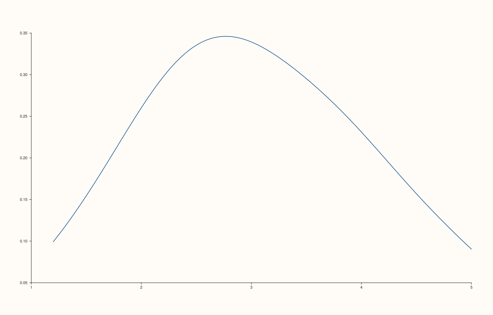
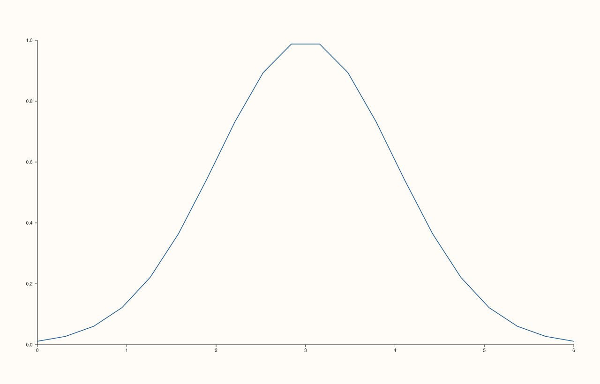

<!-- pluss-hand-authored -->

# flash::kdeplot

[Back to flash API Reference](../../flash_api_reference)

## Signatures

```cpp
Trace& flash::kdeplot(Pane& pane, Series x, Series density)

Trace& flash::kdeplot(Pane& pane, Series values, std::int64_t points = 128)
```

## What It Does

Draws a smoothed density curve via [`flash::lineplot`](lineplot.md). Two overloads with
different jobs:

- **`kdeplot(pane, x, density)`** — the caller has *already computed* a density curve
  (any two paired series) and just wants it line-plotted. No KDE math happens in this
  overload at all — it's a direct `lineplot(pane, x, density)` call.
- **`kdeplot(pane, values, points = 128)`** — the caller supplies *raw observations*, and
  `kdeplot()` computes a Gaussian kernel density estimate itself, then line-plots
  the resulting curve.

```{important} The computed KDE's bandwidth uses Scott's rule, not a fixed constant
For the raw-observations overload, the Gaussian KDE's bandwidth is computed from
the data itself via Scott's rule: 1.06 * sigma * n^(-0.2), where sigma is the
data's own (population) standard deviation and n is the observation count --
not a user-configurable parameter, and not a fixed default width. The
evaluation grid spans exactly [min(values), max(values)] with points samples
(floored to a minimum of 16 regardless of what's requested), evaluated via a
direct Gaussian-kernel summation (not an FFT-based approximation). There is no
way to override the bandwidth or the evaluation range through kdeplot() itself
-- compute your own (x, density) pair and use the first overload for that.
```

## Parameters

**pane** (`Pane&`)
    The target pane. Must be `Planar` (2D) — this wraps `Pane::trend`, which requires it.

**x**, **density** (series-convertible, first overload only)
    A pre-computed density curve — `density[i]` at position `x[i]`, connected in index
    order. No validation beyond what [`flash::lineplot`](lineplot.md) itself performs.

**values** (series-convertible, second overload only)
    The raw observations to estimate a density from.

**points** (`std::int64_t`, default `128`, second overload only)
    The number of evaluation points on the estimated curve, evenly spaced across
    `[min(values), max(values)]`. Internally floored to a minimum of 16 regardless of what
    is requested.

## Returns

`Trace&`
    A reference to the newly created (line) trace.

## Examples

Example 1. The computed-KDE overload, default `points = 128`.

```cpp
using namespace pluss::pl;

auto fig = studio("flash_kdeplot_computed");
auto& pane = fig.pane2();
std::vector<double> raw{1.2, 1.5, 1.8, 2.1, 2.3, 2.5, 2.6, 2.8, 3.0, 3.2, 3.5, 3.9, 4.1,
                         4.4, 4.8, 5.0, 2.0, 2.2, 2.9, 3.1, 3.3, 2.7, 2.4, 3.6, 3.8, 4.0};
flash::kdeplot(pane, raw);
fig.show();
```


Example 2. Custom, coarser `points` — 64 evaluation points. Renders different (visibly less smooth) curve resolution than a finer grid.

```cpp
using namespace pluss::pl;

auto fig = studio("flash_kdeplot_64pts");
auto& pane = fig.pane2();
std::vector<double> raw{1.2, 1.5, 1.8, 2.1, 2.3, 2.5, 2.6, 2.8, 3.0, 3.2, 3.5, 3.9, 4.1,
                         4.4, 4.8, 5.0, 2.0, 2.2, 2.9, 3.1, 3.3, 2.7, 2.4, 3.6, 3.8, 4.0};
flash::kdeplot(pane, raw, std::int64_t{64});
fig.show();
```


Example 3. A much finer 256-point grid — verified different from Example 2.

```cpp
using namespace pluss::pl;

auto fig = studio("flash_kdeplot_256pts");
auto& pane = fig.pane2();
std::vector<double> raw{1.2, 1.5, 1.8, 2.1, 2.3, 2.5, 2.6, 2.8, 3.0, 3.2, 3.5, 3.9, 4.1,
                         4.4, 4.8, 5.0, 2.0, 2.2, 2.9, 3.1, 3.3, 2.7, 2.4, 3.6, 3.8, 4.0};
flash::kdeplot(pane, raw, std::int64_t{256});
fig.show();
```



Example 4. The pre-computed-density overload — a hand-built Gaussian bump, plotted with
no KDE math performed by `kdeplot()` itself.

```cpp
using namespace pluss::pl;

auto fig = studio("flash_kdeplot_precomputed");
auto& pane = fig.pane2();
auto x = pluss::series::linspace(0.0, 6.0, 20, pluss::ScalarType::Float64);
std::vector<double> density;
for (int i = 0; i < 20; ++i) {
  const double xv = i * 6.0 / 19.0;
  density.push_back(std::exp(-0.5 * (xv - 3.0) * (xv - 3.0)));
}
flash::kdeplot(pane, x, density);
fig.show();
```



## Notes

- Not `noexcept`.
- The two overloads are disambiguated purely by whether the third argument is an
  `int`/`std::int64_t`-like value (`points`) or a series-convertible curve (`density`) —
  there's no explicit tag, so passing an integer literal always selects the
  raw-observations overload, and passing anything series-like always selects the
  pre-computed-curve overload.
- The computed KDE never rescales to a probability density integrating to 1 over an
  arbitrary domain beyond its own evaluation grid — see the important callout above for
  the exact normalization and bandwidth formula.
- `flash::displot` does **not** reach this function — despite the naming similarity to
  a `kind="kde"` dispatch, this codebase's `displot()` is a plain alias for
  [`flash::histplot`](histplot.md), not a dispatcher. Call `kdeplot()` directly for a
  density curve.

## See Also

- [`flash::lineplot`](lineplot.md): the underlying draw call both overloads eventually
  reach.
- [`flash::histplot`](histplot.md) / [`flash::displot`](displot.md): the binned-count
  alternative to this smoothed-density view.
- [`flash::ecdfplot`](ecdfplot.md): the cumulative-distribution alternative.

<div class="pluss-inline-prev-next">
  <a class="prev-link" href="displot.html">
    <span class="label">Previous</span>
    <span class="title">displot</span>
  </a>
  <a class="next-link" href="ecdfplot.html">
    <span class="label">Next</span>
    <span class="title">ecdfplot</span>
  </a>
</div>
