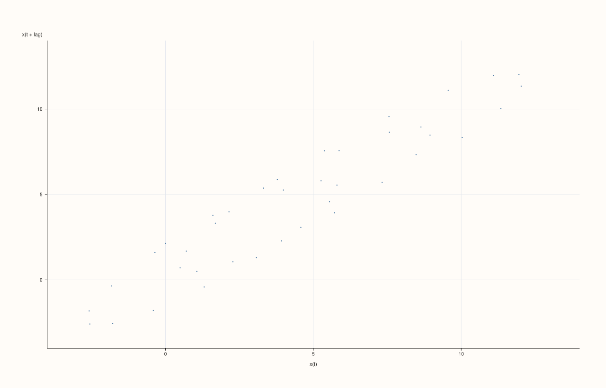
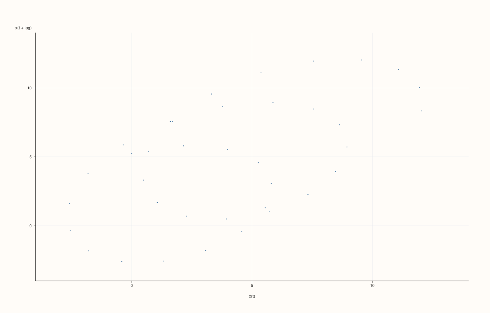

<!-- pluss-hand-authored -->

# flash::lagplot

[Back to flash API Reference](../../flash_api_reference)

## Signature

```cpp
template <class Values>
Studio& flash::lagplot(Studio& studio, Values&& values, const LagPlotOptions& options = {})
```

## What It Does

Draws a lag plot: a scatter of `x(t)` against `x(t + lag)` — plotting every value in a
series against the value some fixed number of steps later — the classic quick check for
autocorrelation and randomness in a sequence (a diagonal-hugging cloud suggests strong
lag-`n` correlation; a formless cloud suggests none). Single overload, single pane, single
[`Pane::cloud`](../pane/cloud.md) trace.

## Parameters

**studio** (`Studio&`)
    The figure to populate — a single new [`Studio::pane2`](../studio/pane2.md).

**values** (series-convertible)
    The sequence to lag against itself. Must contain at least two points, or `lagplot`
    throws `std::invalid_argument("flash::lagplot requires at least two points")`.

**options** (`const LagPlotOptions&`, optional)
    See the field table below.

## `LagPlotOptions` fields

| Field | Type and default | Description |
|---|---|---|
| `lag` | `std::int64_t`, default `1` | The step offset between `x(t)` (the x-axis) and `x(t + lag)` (the y-axis). Clamped to `[1, n - 1]` — always at least `1` step, never beyond the series' own length. |
| `max_points` | `std::int64_t`, default `2500` | Cap on how many `(x(t), x(t+lag))` pairs are plotted. When the usable pair count (`n - lag`) exceeds this, an evenly-strided subset of at most `max_points` pairs is plotted instead — `0` or negative disables the cap entirely (every usable pair is plotted). |
| `marker_area` | `double`, default `16.0` | Per-point marker area, clamped to at least `2.0`. |
| `trace_width` | `float`, default `0.55F` | Stroke width for the point cloud. |

## Returns

`Studio&`
    A reference to the same figure, for chaining.

## Examples

Example 1. Default overload — `lag = 1`, plotting each value against its immediate
successor.

```cpp
using namespace pluss::pl;

auto fig = studio("flash_lagplot_default");
std::vector<double> values;
for (int i = 0; i < 40; ++i) {
  values.push_back(std::sin(static_cast<double>(i) * 0.4) * 5.0 + static_cast<double>(i) * 0.2);
}
flash::lagplot(fig, values);
fig.show();
```



Example 2 (verification, not a distinct rendering). `lag = 3` renders genuinely
differently from the `lag = 1` default, confirmed via direct SVG comparison.

```cpp
using namespace pluss::pl;

std::vector<double> values;
for (int i = 0; i < 40; ++i) {
  values.push_back(std::sin(static_cast<double>(i) * 0.4) * 5.0 + static_cast<double>(i) * 0.2);
}

auto fig1 = studio("flash_lagplot_lag1");
flash::lagplot(fig1, values);

auto fig2 = studio("flash_lagplot_lag3");
flash::LagPlotOptions opts;
opts.lag = 3;
flash::lagplot(fig2, values, opts);

std::cout << "lagplot lag=1 vs lag=3 differ: " << (fig1.to_svg() != fig2.to_svg()) << "\n";
fig2.show();
```

Output:

```text
lagplot lag=1 vs lag=3 differ: 1
```



Example 3 (edge case). Fewer than two points throws.

```cpp
using namespace pluss::pl;

auto fig = studio("flash_lagplot_too_few");
std::vector<double> one{1.0};
try {
  flash::lagplot(fig, one);
} catch (const std::invalid_argument& e) {
  std::cout << "lagplot(1 point) threw: " << e.what() << "\n";
}
```

Output:

```text
lagplot(1 point) threw: flash::lagplot requires at least two points
```

## Notes

- Not `noexcept`.
- Not order-preserving beyond what `values` itself carries — `lagplot` treats its input
  strictly as an ordered sequence; there is no explicit time/index axis argument.
- Shares its `max_points` downsampling behavior with the multivariate-view family
  (e.g. [`flash::pairplot`](pairplot.md)).

## See Also

- [`flash::acfplot`](acfplot.md), [`flash::pacfplot`](pacfplot.md): the correlogram
  siblings that summarize the same kind of lagged relationship across *every* lag at
  once, rather than one scatter per fixed lag.
- [`Pane::cloud`](../pane/cloud.md): the native method drawing the point cloud.

<div class="pluss-inline-prev-next">
  <a class="prev-link" href="summaryplot.html">
    <span class="label">Previous</span>
    <span class="title">summaryplot</span>
  </a>
  <a class="next-link" href="acfplot.html">
    <span class="label">Next</span>
    <span class="title">acfplot</span>
  </a>
</div>
