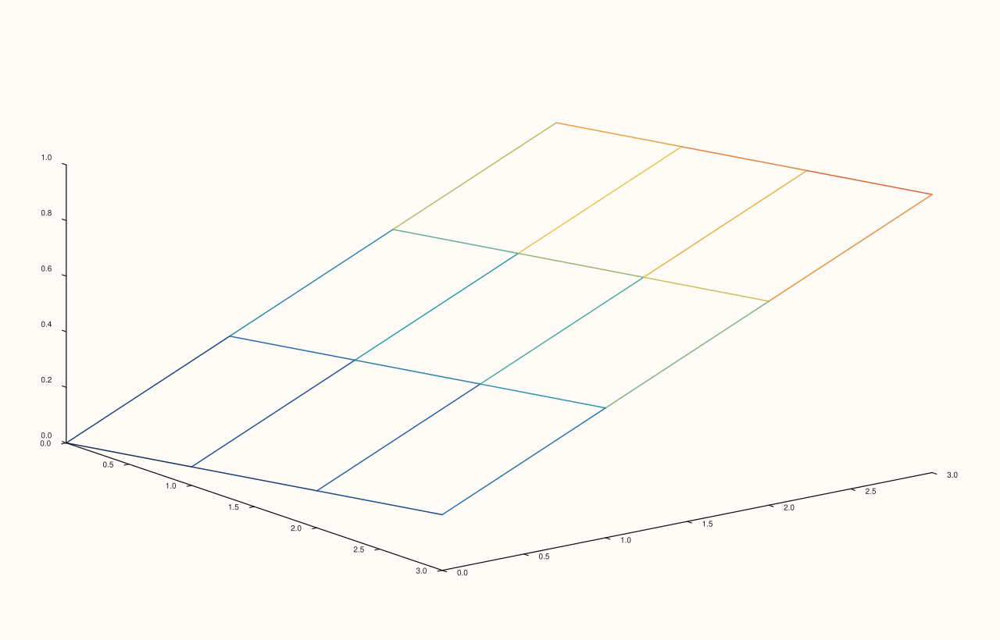

<!-- pluss-hand-authored -->

# flash::lattice

[Back to flash API Reference](../../flash_api_reference)

## Signatures

```cpp
template <class X, class Y, class Z>
Trace& flash::lattice(Pane& pane, X&& x, Y&& y, Z&& z)

template <class X, class Y, class Z, class C>
Trace& flash::lattice(Pane& pane, X&& x, Y&& y, Z&& z, C&& c)

template <class X, class Y, class Z>
Trace& flash::lattice(Studio& studio, X&& x, Y&& y, Z&& z, std::string title = {})
```

## What It Does

A thin wrapper around [`Pane::lattice`](../pane/lattice.md): converts every argument to
`Series`, validates each is rank ≤ 3, then delegates to the identically-shaped native
`Pane::lattice` overload. Every `Pane`-overload delegation is byte-identical to calling
`Pane::lattice` directly — directly verified via SVG comparison. Same three-overload
shape as [`flash::sheet`](sheet.md) — `lattice` and `sheet` share the exact same
`SurfaceData` payload, differing only in `TraceKind` (wireframe vs. filled surface).

```{important} The color-matrix c argument is documented to have NO effect on lattice, unlike sheet
Per Pane::lattice's own Notes, the c argument has no observed rendering effect at all
on lattice() -- even at extreme color contrast -- consistent with a pure wireframe
having no filled area for a per-cell color to paint. flash::lattice(pane, x, y, z, c)
still accepts and Series-converts c (and still validates its rank), it just has no
visible effect once forwarded to Pane::lattice.
```

## Parameters

**pane** (`Pane&`, Pane overloads)
    The target pane. Must be `Volumetric`.

**studio** (`Studio&`, Studio overload)
    The figure to create a new `Volumetric` pane in.

**x**, **y** (series-convertible, must each be rank ≤ 3)
    The grid's coordinate axes.

**z** (series-convertible, must be rank ≤ 3, and rank-2 to satisfy
[`Pane::lattice`](../pane/lattice.md)'s own deeper requirement)
    The wireframe height at each `(x, y)` grid point.

**c** (series-convertible, must be rank ≤ 3, four-argument overload only)
    Accepted and validated, but has no visible rendering effect — see the important
    callout above.

**title** (`std::string`, default `{}`, Studio overload only)
    Forwarded to `Studio::pane3` as the new pane's title.

## Returns

`Trace&`
    A reference to the newly created trace, for chaining.

## Examples

Example 1. `(x, y, z)` overload — a wireframe mesh.

```cpp
using namespace pluss::pl;

auto fig = studio("flash_lattice_xyz");
auto& pane = fig.pane3();
std::vector<double> x{0.0, 1.0, 2.0, 3.0};
std::vector<double> y{0.0, 1.0, 2.0, 3.0};
auto z = pluss::series::linspace(0.0, 1.0, 16, pluss::ScalarType::Float64).reshape({4, 4});
flash::lattice(pane, x, y, z);
fig.show();
```


Example 2. `Studio` overload — no explicit `pane3()` call needed.

```cpp
using namespace pluss::pl;

auto fig = studio("flash_lattice_studio");
std::vector<double> x{0.0, 1.0, 2.0, 3.0};
std::vector<double> y{0.0, 1.0, 2.0, 3.0};
auto z = pluss::series::linspace(0.0, 1.0, 16, pluss::ScalarType::Float64).reshape({4, 4});
flash::lattice(fig, x, y, z);
fig.show();
```



Example 3 (verification, not a distinct rendering). `flash::lattice(pane, x, y, z)`
renders byte-identical to `pane.lattice(x, y, z)` called directly.

```cpp
using namespace pluss::pl;

std::vector<double> x{0.0, 1.0, 2.0, 3.0};
std::vector<double> y{0.0, 1.0, 2.0, 3.0};
auto z = pluss::series::linspace(0.0, 1.0, 16, pluss::ScalarType::Float64).reshape({4, 4});

auto fig1 = studio("flash_lattice_flash");
auto& pane1 = fig1.pane3();
flash::lattice(pane1, x, y, z);

auto fig2 = studio("flash_lattice_native");
auto& pane2 = fig2.pane3();
pane2.lattice(x, y, z);

std::cout << "flash::lattice(pane,x,y,z) == pane.lattice(x,y,z): " << (fig1.to_svg() == fig2.to_svg()) << "\n";
```

Output:

```text
flash::lattice(pane,x,y,z) == pane.lattice(x,y,z): 1
```

## Notes

- Not `noexcept`.
- Same rank-≤3-only validation depth as [`flash::sheet`](sheet.md) — the stricter
  rank-2-exact requirement on `z` lives one layer deeper, inside
  [`Pane::lattice`](../pane/lattice.md) itself.
- Used internally by [`flash::triplot`](triplot.md)'s `TriplotKind::Lattice`, via a
  binned-grid triplet (see that page's important callout for the genuine bug this
  session fixed there).

## See Also

- [`Pane::lattice`](../pane/lattice.md): the underlying native method this function
  delegates to entirely, and the source of the `c`-argument-has-no-effect finding.
- [`flash::sheet`](sheet.md): the filled-surface sibling — identical payload shape.
- [`Studio::pane3`](../studio/pane3.md): what the `Studio` overload calls internally.

<div class="pluss-inline-prev-next">
  <a class="prev-link" href="sheet.html">
    <span class="label">Previous</span>
    <span class="title">sheet</span>
  </a>
  <a class="next-link" href="spire3.html">
    <span class="label">Next</span>
    <span class="title">spire3</span>
  </a>
</div>
