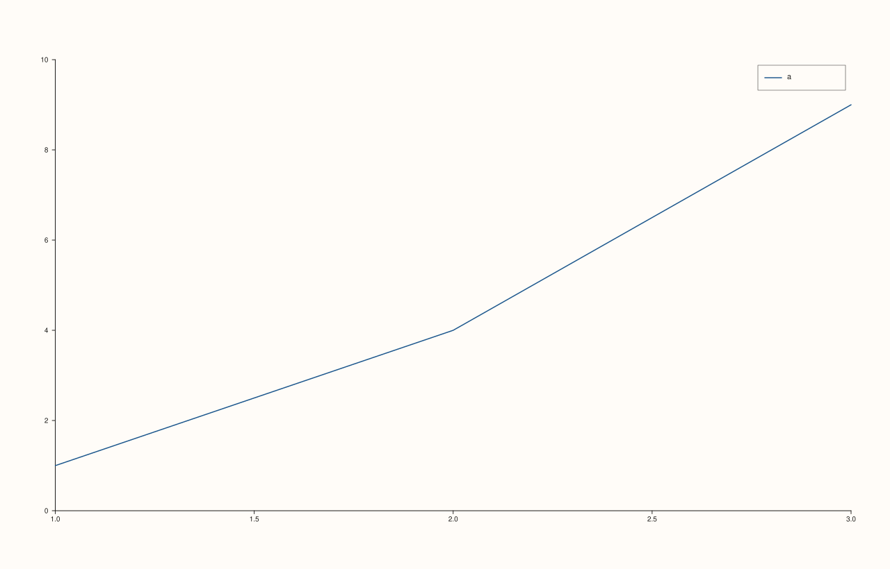
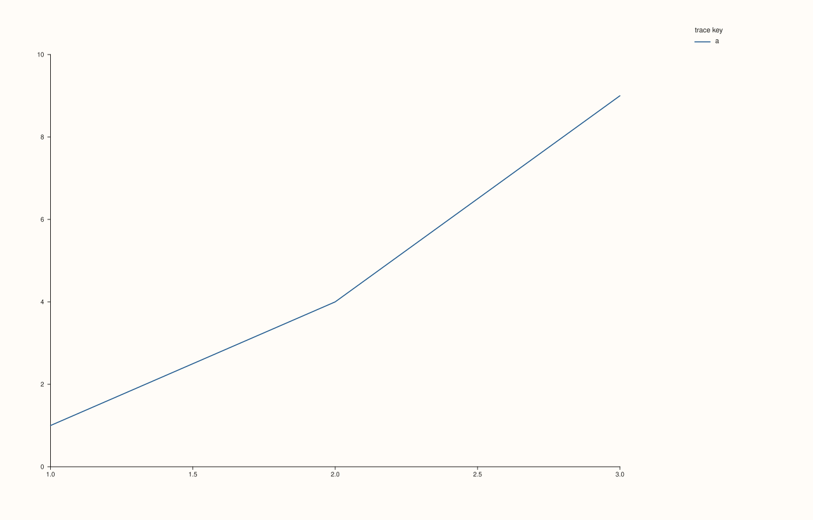

<!-- pluss-hand-authored -->

# flash::legend_frame

[Back to flash API Reference](../../flash_api_reference)

## Signatures

```cpp
Pane& flash::legend_frame(Pane& pane, KeyFrame frame) noexcept
Studio& flash::legend_frame(Studio& studio, KeyFrame frame) noexcept
```

## What It Does

Thin wrappers forwarding straight to
[`Pane::legend_frame`](../pane/legend_frame.md)/[`Studio::legend_frame`](../studio/legend_frame.md),
which control the legend box's border/background styling (independent of *where* the
legend is placed — see [`flash::move_legend`](move_legend.md) for that).

## Parameters

**pane** (`Pane&`, `Pane` overload)
    The pane whose in-pane legend's frame styling to set.

**studio** (`Studio&`, `Studio` overload)
    The figure whose consolidated legend's frame styling to set.

**frame** (`KeyFrame`)
    `Framed` (solid border and opaque background), `Soft` (low-contrast background, no
    hard border — the default on both `Pane` and `Studio`), or `None` (no background or
    border at all). See [`Pane::legend_frame`](../pane/legend_frame.md)/
    [`Studio::legend_frame`](../studio/legend_frame.md) for the full description.

## Returns

`Pane&` / `Studio&`
    A reference to the object passed in, for chaining.

## Examples

Example 1. `(Pane&, KeyFrame::Framed)` — a solid-bordered legend box.

```cpp
using namespace pluss::pl;

auto fig = studio("flash_legend_frame_pane");
auto& pane = fig.pane2();
pane.trend(std::vector<double>{1, 2, 3}, std::vector<double>{1, 4, 9}).label("a");
flash::legend(pane, KeyPlace::NorthEast);
flash::legend_frame(pane, KeyFrame::Framed);
fig.show();
```



Example 2. `(Studio&, KeyFrame::None)` — a docked, frameless consolidated legend.

```cpp
using namespace pluss::pl;

auto fig = studio("flash_legend_frame_studio");
auto& pane = fig.pane2();
pane.trend(std::vector<double>{1, 2, 3}, std::vector<double>{1, 4, 9}).label("a");
flash::legend(fig, KeyDock::East);
flash::legend_frame(fig, KeyFrame::None);
fig.show();
```



## Notes

- Both overloads are `noexcept`.
- `legend_frame`'s styling only has a visible effect once a legend is actually being
  drawn — call [`flash::move_legend`/`flash::legend`](move_legend.md) (or
  `Pane::legend`/`Studio::legend` directly) with a non-`None` place/dock first, as in
  both examples above.
- No `flash::` alias exists for this function (unlike `move_legend`/`legend`) — the
  underlying `Pane::legend_frame`/`Studio::legend_frame` methods only have the one
  name each.

## See Also

- [`flash::move_legend`](move_legend.md): positions the legend this function styles.
- [`Pane::legend_frame`](../pane/legend_frame.md), [`Studio::legend_frame`](../studio/legend_frame.md):
  the underlying methods this function forwards to directly.

<div class="pluss-inline-prev-next">
  <a class="prev-link" href="move_legend.html">
    <span class="label">Previous</span>
    <span class="title">move_legend</span>
  </a>
  <a class="next-link" href="tight_layout.html">
    <span class="label">Next</span>
    <span class="title">tight_layout</span>
  </a>
</div>
