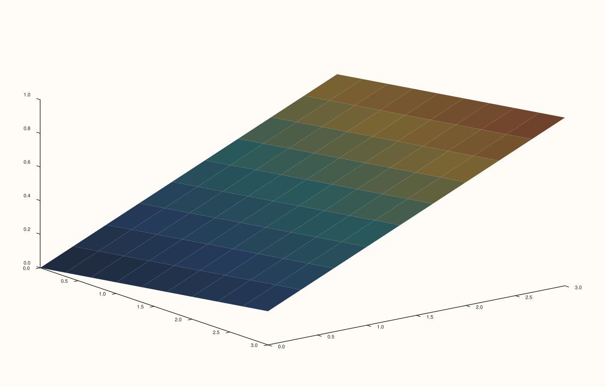
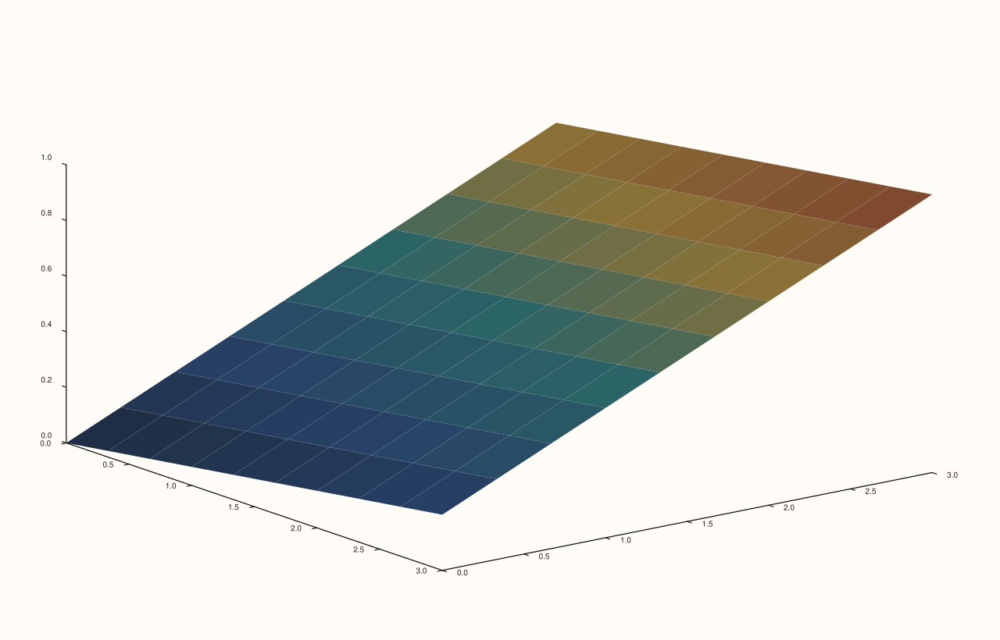
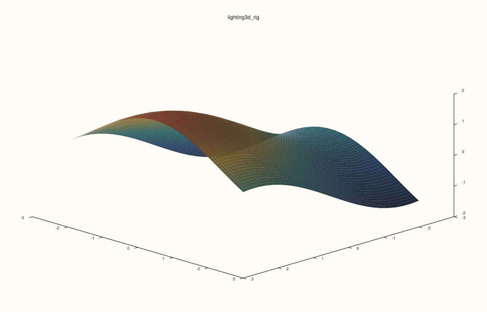

<!-- pluss-hand-authored -->

# flash::lighting3d

[Back to flash API Reference](../../flash_api_reference)

## Signature

```cpp
struct Lighting3DOptions {
  bool clear_first{true};
  bool headlight{true};
  bool lamp_left{false};
  bool lamp_right{false};
  bool sun_key{false};
};

Pane& flash::lighting3d(Pane& pane, const Lighting3DOptions& options)
```

## What It Does

A convenience wrapper around [`Pane::lights`](../pane/lights.md): optionally clears the
pane's `LightRig`, then conditionally appends any combination of `headlight()`,
`lamp_left()`, `lamp_right()`, and `sun_key()` presets — one boolean flag per light
preset, applied in that fixed order, instead of chaining the calls yourself.

```{important} Has no VISIBLE effect unless the pane's traces use LightingMode::Gouraud or ::Flat
lighting3d only mutates the pane's LightRig contents (via Pane::lights()) -- it never
touches any trace's own Trace::lighting mode. A trace's LightingMode defaults to
::None (per Trace::lighting's own documented default), and a ::None trace ignores the
LightRig entirely, regardless of how many lights are configured. Directly verified: two
otherwise-identical scenes with genuinely different light configurations (headlight-only
vs. sun_key-only) render byte-IDENTICAL when the pane's trace is left at its default
LightingMode::None, but render genuinely DIFFERENT once the same trace has
LightingMode::Gouraud set (e.g. via flash::trace_preset3d(trace,
TracePreset3D::Surface), which sets Gouraud). Always pair lighting3d with a
Gouraud/Flat-lit trace if you expect to see its effect.
```

## Parameters

**pane** (`Pane&`)
    The target pane whose `LightRig` is mutated.

**options** (`const Lighting3DOptions&`)
    See the field table below.

## `Lighting3DOptions` fields

**clear_first** (`bool`, default `true`)
    Whether [`Pane::lights().clear()`](../pane/lights.md) runs before any of the flags
    below are applied — `false` layers new lights on top of whatever the pane's
    `LightRig` already contained.

**headlight** (`bool`, default `true`)
    Whether [`lights().headlight()`](../pane/lights.md) is appended — one light
    co-located with the camera.

**lamp_left**, **lamp_right** (`bool`, default `false` each)
    Whether [`lights().lamp_left()`](../pane/lights.md)/`lamp_right()` are appended.

**sun_key** (`bool`, default `false`)
    Whether [`lights().sun_key()`](../pane/lights.md) is appended — this preset alone
    adds **two** lights per call, unlike the other three (one each).

## Returns

`Pane&`
    A reference to the same pane, for chaining.

## Examples

Example 1. Default options (`headlight` only) — rendered with `LightingMode::Gouraud`
explicitly set on the trace (via [`flash::trace_preset3d`](trace_preset3d.md)), so the
lighting configuration's effect is actually visible — see the important callout above.

```cpp
using namespace pluss::pl;

auto fig = studio("flash_lighting3d_default");
auto& pane = fig.pane3();
std::vector<double> coord{0.0, 1.0, 2.0, 3.0};
auto z = pluss::series::linspace(0.0, 1.0, 16, pluss::ScalarType::Float64).reshape({4, 4});
auto& trace = pane.sheet(coord, coord, z);
flash::trace_preset3d(trace, flash::TracePreset3D::Surface);
flash::lighting3d(pane, flash::Lighting3DOptions{});
fig.show();
```



Example 2 (verification, not a distinct rendering). `headlight = false, sun_key = true`
renders genuinely differently from the default, confirmed via direct SVG comparison —
provided the trace has `LightingMode::Gouraud` set, per the important callout above.

```cpp
using namespace pluss::pl;

std::vector<double> coord{0.0, 1.0, 2.0, 3.0};

auto fig1 = studio("flash_lighting3d_default_cmp");
auto& pane1 = fig1.pane3();
auto z1 = pluss::series::linspace(0.0, 1.0, 16, pluss::ScalarType::Float64).reshape({4, 4});
auto& trace1 = pane1.sheet(coord, coord, z1);
flash::trace_preset3d(trace1, flash::TracePreset3D::Surface);
flash::lighting3d(pane1, flash::Lighting3DOptions{});

auto fig2 = studio("flash_lighting3d_sun_key");
auto& pane2 = fig2.pane3();
auto z2 = pluss::series::linspace(0.0, 1.0, 16, pluss::ScalarType::Float64).reshape({4, 4});
auto& trace2 = pane2.sheet(coord, coord, z2);
flash::trace_preset3d(trace2, flash::TracePreset3D::Surface);
flash::Lighting3DOptions opts;
opts.headlight = false;
opts.sun_key = true;
flash::lighting3d(pane2, opts);

std::cout << "lighting3d default vs sun_key differ (with Gouraud trace): " << (fig1.to_svg() != fig2.to_svg()) << "\n";
fig2.show();
```

Output:

```text
lighting3d default vs sun_key differ (with Gouraud trace): 1
```



Example 3. Build a fuller rig with left lamp, right lamp, and sun key while leaving the
headlight off. This is the shape to use when you want the lighting to feel directional
instead of camera-locked.

```cpp
using namespace pluss::pl;

auto fig = studio("flash_lighting3d_rig");
auto& pane = fig.pane3();
auto gx = pluss::series::linspace(-2.5, 2.5, 24, pluss::ScalarType::Float64);
auto gy = pluss::series::linspace(-2.5, 2.5, 24, pluss::ScalarType::Float64);
auto gz = gx.reshape({1, 24}).tile({24, 1}).mul(0.6).sin()
            .add(gy.reshape({24, 1}).tile({1, 24}).mul(0.7).cos());

auto& trace = pane.sheet(gx, gy, gz);
flash::trace_preset3d(trace, flash::TracePreset3D::Surface);
flash::camera_preset3d(pane, flash::CameraPreset3D::Isometric);
flash::lighting3d(
    pane,
    flash::Lighting3DOptions{
        .clear_first = true,
        .headlight = false,
        .lamp_left = true,
        .lamp_right = true,
        .sun_key = true,
    });
fig.show();
```



## Notes

- Not `noexcept`.
- Order of application is fixed: `clear_first`, then `headlight`, `lamp_left`,
  `lamp_right`, `sun_key` — always in that sequence, regardless of which flags are set.
- See the important callout above — the single most consequential fact about this
  function: it is silently inert on any trace still at its default `LightingMode::None`.

## See Also

- [`Pane::lights`](../pane/lights.md): the underlying accessor and the full `LightRig`
  preset reference.
- [`Trace::lighting`](../trace/lighting.md): what must be set to `Gouraud`/`Flat` (away
  from its own `None` default) for this function's configuration to have any visible
  effect.
- [`flash::trace_preset3d`](trace_preset3d.md): a convenient way to set
  `LightingMode::Gouraud` on a trace (its `Surface`/`Cloud`/`Volume` presets all do).
- [`flash::scene3d`](scene3d.md): composes this function alongside camera/theme/grid
  settings.

<div class="pluss-inline-prev-next">
  <a class="prev-link" href="camera_preset3d.html">
    <span class="label">Previous</span>
    <span class="title">camera_preset3d</span>
  </a>
  <a class="next-link" href="theme_preset3d.html">
    <span class="label">Next</span>
    <span class="title">theme_preset3d</span>
  </a>
</div>
