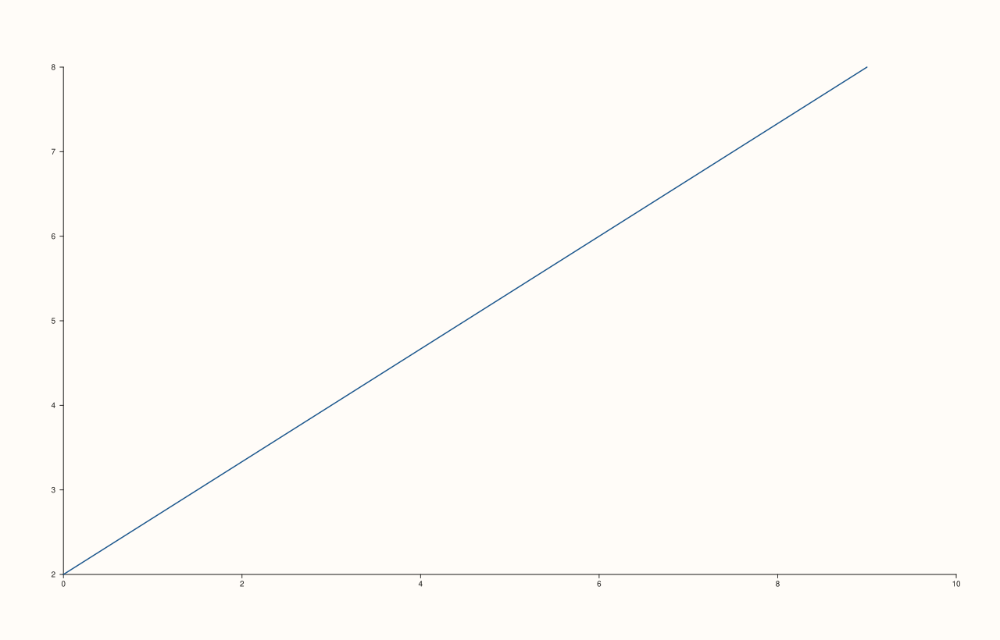
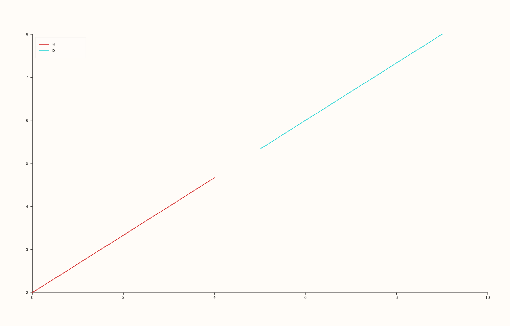
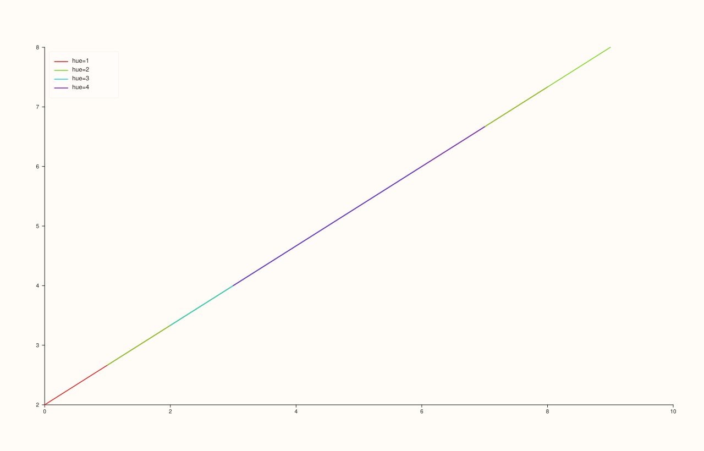
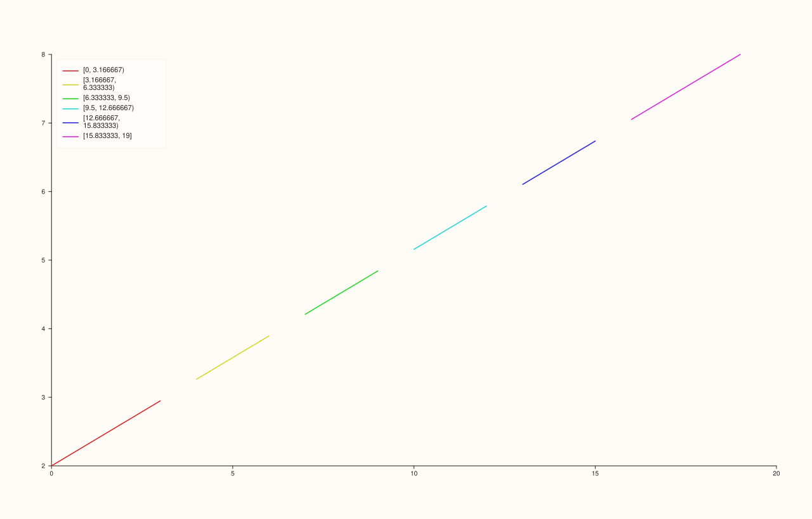

<!-- pluss-hand-authored -->

# flash::lineplot

[Back to flash API Reference](../../flash_api_reference)

## Signatures

```cpp
template <class X, class Y>
Trace& flash::lineplot(Pane& pane, X&& x, Y&& y)

template <class X, class Y>
Trace& flash::lineplot(Pane& pane, X&& x, Y&& y, const Note& hue)

template <class X, class Y, class Hue>
Trace& flash::lineplot(Pane& pane, X&& x, Y&& y, Hue&& hue)
```

## What It Does

The high-level entry point for a connected line plot: a thin wrapper around
[`Pane::trend`](../pane/trend.md) that adds automatic hue grouping, mirroring
[`flash::scatterplot`](scatterplot.md)'s three-overload shape exactly — but with genuinely
different numbers and a genuinely different overflow strategy, both directly verified
below:

- **`lineplot(pane, x, y)`** — a single, ungrouped line trace. Equivalent to
  `pane.trend(x, y)`.
- **`lineplot(pane, x, y, hue)`** where `hue` is a `Note` —
  **categorical** hue: one colored, legended `Trace` per distinct label, each drawn via
  [`Pane::trend`](../pane/trend.md).
- **`lineplot(pane, x, y, hue)`** where `hue` is any other series-convertible value —
  **numeric** hue:
  - **8 or fewer unique values** — one colored, legended trace per distinct value
    (labeled `"hue=<value>"`).
  - **More than 8 unique values** — unlike `scatterplot()`'s continuous-palette fallback,
    `lineplot()` instead **bins** the numeric hue into 6 equal-width buckets (via the
    data's own observed min/max) and draws one trace per non-empty bucket, each labeled
    with its bucket range (e.g. `"[0, 3.17)"`, with the final bucket's upper bound
    inclusive: `"[15.83, 19]"`).

```{important} lineplot's numeric-hue threshold (8) and fallback (binning) both differ from scatterplot's
flash::scatterplot(pane, x, y, hue) applies the same two-branch shape, but with a
threshold of 10 (not 8) and a continuous-palette single-trace fallback (not
6-way binning). Directly verified: 9 unique hue values on identical x/y data
produced 9 discrete traces under scatterplot() (9 <= 10, still discrete) but
only 6 traces under lineplot() (9 > 8, already binned into 6 buckets). Read
each function's own numbers -- do not assume they match just because the
dispatch shape looks the same.
```

```{important} The hue overloads return only the LAST group's Trace&
Exactly the same caveat as scatterplot(): when hue produces multiple traces
(grouped or binned), the returned Trace& refers only to the last one drawn --
not a handle to the whole plot. See flash::scatterplot's identical callout for
the full explanation.
```

As with `scatterplot()`, any hue overload turns the pane's legend on at `KeyPlace::Auto`
if it wasn't already placed somewhere.

## Parameters

**pane** (`Pane&`)
    The target pane. Must be `Planar` (2D) — this wraps `Pane::trend`, which requires it.

**x**, **y** (series-convertible)
    The line's vertex coordinates, connected in index order.

**hue** (`const Note&`, or any series-convertible value, third overload group only)
    The grouping/coloring variable, paired with `x`/`y` by index.

## Returns

`Trace&`
    A reference to the newly created trace — the *only* trace for the no-hue overload, or
    the *last-drawn group/bucket's* trace for either hue overload.

## Examples

Example 1. Plain, ungrouped line.

```cpp
using namespace pluss::pl;

auto fig = studio("flash_lineplot_plain");
auto& pane = fig.pane2();
flash::lineplot(pane, pluss::series::linspace(0.0, 9.0, 10, pluss::ScalarType::Float64),
                 pluss::series::linspace(2.0, 8.0, 10, pluss::ScalarType::Float64));
fig.show();
```



Example 2. Categorical hue via a `Note` — two group labels,
two colored/legended lines.

```cpp
using namespace pluss::pl;

auto fig = studio("flash_lineplot_note_hue");
auto& pane = fig.pane2();
auto grp = pluss::note::make({"a", "a", "a", "a", "a", "b", "b", "b", "b", "b"});
flash::lineplot(pane, pluss::series::linspace(0.0, 9.0, 10, pluss::ScalarType::Float64),
                 pluss::series::linspace(2.0, 8.0, 10, pluss::ScalarType::Float64), grp);
std::cout << "trace_count: " << pane.trace_count() << "\n";
fig.show();
```

Output:

```text
trace_count: 2
```



Example 3. Numeric hue with 4 unique values — at or under the threshold of 8, so it
renders as 4 discrete, legended groups.

```cpp
using namespace pluss::pl;

auto fig = studio("flash_lineplot_numeric_hue_discrete");
auto& pane = fig.pane2();
std::vector<double> hue{1.0, 2.0, 3.0, 4.0, 1.0, 2.0, 3.0, 4.0, 1.0, 2.0};
flash::lineplot(pane, pluss::series::linspace(0.0, 9.0, 10, pluss::ScalarType::Float64),
                 pluss::series::linspace(2.0, 8.0, 10, pluss::ScalarType::Float64), hue);
std::cout << "trace_count: " << pane.trace_count() << "\n";
fig.show();
```

Output:

```text
trace_count: 4
```



Example 4. Numeric hue with 20 unique values — past the threshold, so it's binned into
(up to) 6 buckets rather than 20 individual groups, and unlike `scatterplot()`'s overflow
path, it does **not** collapse to a single trace.

```cpp
using namespace pluss::pl;

auto fig = studio("flash_lineplot_numeric_hue_binned");
auto& pane = fig.pane2();
auto hue = pluss::series::linspace(0.0, 19.0, 20, pluss::ScalarType::Float64);
flash::lineplot(pane, pluss::series::linspace(0.0, 19.0, 20, pluss::ScalarType::Float64),
                 pluss::series::linspace(2.0, 8.0, 20, pluss::ScalarType::Float64), hue);
std::cout << "trace_count: " << pane.trace_count() << "\n";
fig.show();
```

Output:

```text
trace_count: 6
```



## Notes

- Not `noexcept`.
- Hue-grouped/binned line traces get `width(1.6F)` internally (thicker than
  `scatterplot()`'s per-group `width(0.55F)`, since a visible line needs more weight than
  a marker outline) — not user-configurable through `lineplot()` itself.
- Bucket boundaries in the binned-overflow case come from the hue data's own observed
  `[min, max]` range, divided into 6 equal-width intervals; the final bucket's label uses
  an inclusive upper bound (`"[...]"`) while every earlier bucket is half-open
  (`"[...)"`)  — matching ordinary binning conventions.
- `flash::relplot(..., kind="line")` is a thin dispatcher that calls this exact function
  — see [`flash::relplot`](relplot.md).

## See Also

- [`Pane::trend`](../pane/trend.md): the lower-level method this wraps.
- [`flash::scatterplot`](scatterplot.md): the discrete-marker counterpart, sharing the
  same three-overload shape with different numeric-hue numbers and fallback strategy.
- [`flash::stepplot`](stepplot.md): a related connected-line trace using a step (not
  linear) interpolation between points, with no hue support.
- [`flash::relplot`](relplot.md): a `kind`-dispatched wrapper choosing between
  `scatterplot()` and this function.

<div class="pluss-inline-prev-next">
  <a class="prev-link" href="scatterplot.html">
    <span class="label">Previous</span>
    <span class="title">scatterplot</span>
  </a>
  <a class="next-link" href="stepplot.html">
    <span class="label">Next</span>
    <span class="title">stepplot</span>
  </a>
</div>
