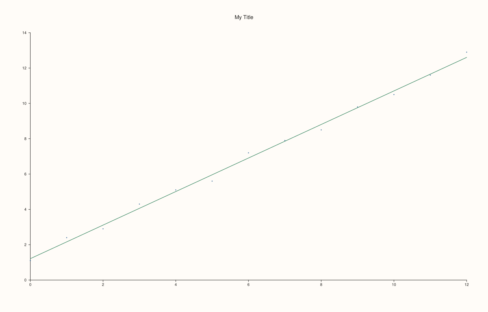
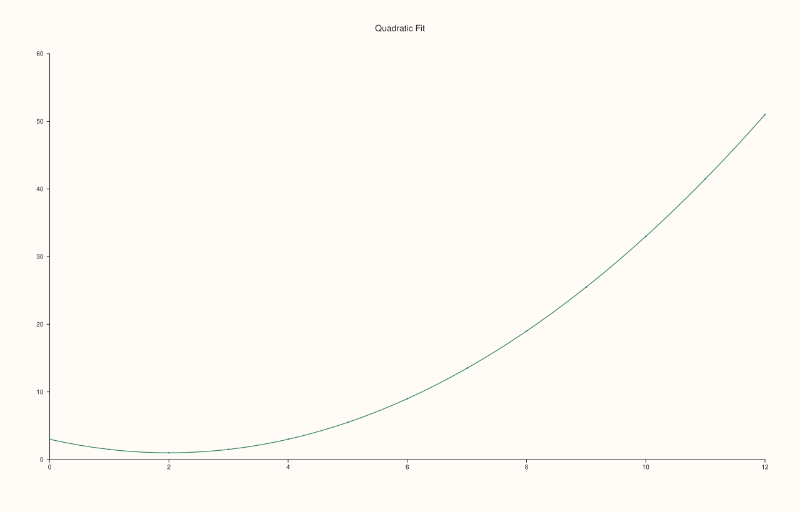

<!-- pluss-hand-authored -->

# flash::lmplot

[Back to flash API Reference](../../flash_api_reference)

## Signatures

```cpp
template <class X, class Y>
Trace& flash::lmplot(Studio& studio, X&& x, Y&& y, std::string title = {})

template <class X, class Y>
Trace& flash::lmplot(Studio& studio, X&& x, Y&& y, const RegPlotOptions& options, std::string title = {})
```

## What It Does

A `Studio`-level convenience wrapper around [`flash::regplot`](regplot.md) — creates a
new `Pane` on the given `Studio` (via `Studio::pane2`) and forwards straight to
`regplot`, so you don't need to create the pane yourself for a simple one-off regression
plot. Two overloads:

- **`lmplot(studio, x, y, title = "")`** — default `RegPlotOptions`.
- **`lmplot(studio, x, y, options, title = "")`** — explicit `RegPlotOptions`, giving
  access to everything documented on [`regplot`](regplot.md)'s page (polynomial `order`,
  `robust`, `lowess`, confidence bands, and so on).

## Parameters

**studio** (`Studio&`)
    The figure to add a new pane to.

**x**, **y** (series-convertible)
    The raw observation pairs, forwarded to `regplot` unchanged (including its
    finite-value filtering and minimum-two-points validation).

**options** (`const RegPlotOptions&`, second overload only)
    See [`flash::regplot`](regplot.md)'s field table.

**title** (`std::string`, default empty, optional on both overloads)
    The new pane's title.

## Returns

`Trace&`
    Whatever `regplot` itself returns — see [`regplot`](regplot.md)'s Returns section for
    the exact fit/scatter/fallback precedence.

## Examples

Example 1. Default options, with a title.

```cpp
using namespace pluss::pl;

auto fig = studio("flash_lmplot_default");
std::vector<double> x{0.0, 1.0, 2.0, 3.0, 4.0, 5.0, 6.0, 7.0, 8.0, 9.0, 10.0, 11.0, 12.0};
std::vector<double> y{1.1, 2.4, 2.9, 4.3, 5.1, 5.6, 7.2, 7.9, 8.5, 9.8, 10.5, 11.6, 12.9};
flash::lmplot(fig, x, y, std::string("My Title"));
fig.show();
```



Example 2. Explicit `RegPlotOptions` — a quadratic fit.

```cpp
using namespace pluss::pl;

auto fig = studio("flash_lmplot_options");
std::vector<double> x{0.0, 1.0, 2.0, 3.0, 4.0, 5.0, 6.0, 7.0, 8.0, 9.0, 10.0, 11.0, 12.0};
std::vector<double> y;
for (double xi : x) y.push_back(0.5 * xi * xi - 2.0 * xi + 3.0);
flash::RegPlotOptions opts;
opts.order = 2;
flash::lmplot(fig, x, y, opts, std::string("Quadratic Fit"));
fig.show();
```



## Notes

- Not `noexcept`.
- Always creates a **new** pane — there is no overload that draws into an existing
  `Pane`. If you need that, call [`flash::regplot`](regplot.md) directly on a pane you
  already have.
- Inherits `regplot`'s fixed reference-safety behavior (see the important callout on
  [`regplot`](regplot.md)'s page) — it was never independently affected since it simply
  forwards.

## See Also

- [`flash::regplot`](regplot.md): the underlying function, and the full
  `RegPlotOptions` field reference.
- [`Studio::pane2`](../studio/pane2.md): the method used internally to create the new
  pane.

<div class="pluss-inline-prev-next">
  <a class="prev-link" href="regplot.html">
    <span class="label">Previous</span>
    <span class="title">regplot</span>
  </a>
  <a class="next-link" href="residplot.html">
    <span class="label">Next</span>
    <span class="title">residplot</span>
  </a>
</div>
