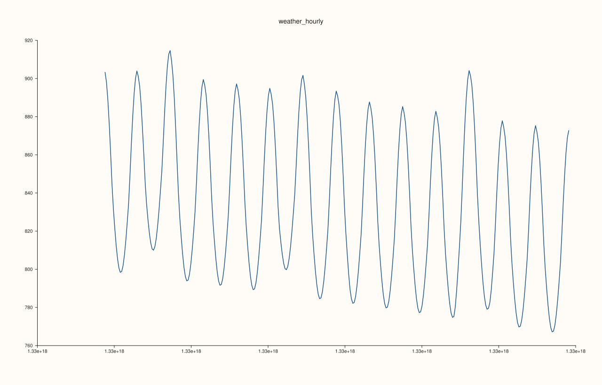
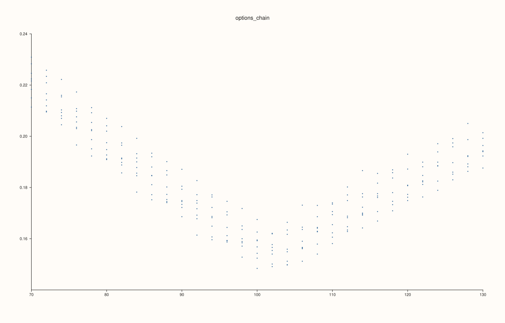

<!-- pluss-hand-authored -->

# flash::load_dataset

[Back to flash API Reference](../../flash_api_reference)

## Signature

```cpp
std::optional<flash::Dataset> flash::load_dataset(std::string_view name)
```

## What It Does

Loads one curated flash dataset by logical name.

Unlike the retired inline stub, the current implementation loads persisted assets:

- a schema file `<name>.schema.csv`
- a data file `<name>.csv`

The loader resolves those assets from the installed flash dataset directory or from the
`PLUSS_FLASH_DATASET_DIR` override. It does not fetch data from the network.

The returned `Dataset` preserves:

- grouped numeric, text, and temporal payload families
- full feature order via `feature_order`
- per-feature kind labels via `feature_kinds`
- missingness via the `*_validity` vectors

That makes the result usable both for flash plotting and for higher-level rectangular
interop such as [`flash::Dataset::frame`](dataset_frame.md) when PlussMic is present.

## Parameters

**name**
    The logical dataset name to resolve.

    This must be one of the curated names returned by
    [`flash::get_dataset_names`](get_dataset_names.md). If `name` is not in that
    curated family, the function returns `std::nullopt`.

    If `name` is recognized but the persisted assets cannot be found or parsed, the
    function throws a `pluss::Error`. In other words:

    - unknown name: `std::nullopt`
    - known name but bad installation or malformed files: exception

## Returns

`std::optional<Dataset>`
    The loaded dataset when `name` is recognized, otherwise `std::nullopt`.

## Dataset Surface

`load_dataset(...)` returns a `flash::Dataset`, which is flash's grouped container for
numeric, text, and temporal feature families.

Stored attributes:

- `feature_order`
  Logical feature order across all stored families.
- `feature_kinds`
  Per-feature family labels such as `"numeric"`, `"text"`, and `"temporal"`.
- `numeric_names`, `numeric_values`, `numeric_validity`
  Numeric feature names, payloads, and optional validity masks.
- `text_names`, `text_values`, `text_validity`
  Text feature names, payloads, and optional validity masks.
- `temporal_names`, `temporal_values`, `temporal_validity`
  Temporal feature names, payloads, and optional validity masks.

Named accessors:

- `numeric(name)`
  Returns one numeric feature by name when it exists.
- `text(name)`
  Returns one text feature by name when it exists.
- `temporal(name)`
  Returns one temporal feature by name when it exists.
- `numeric_validity_mask(name)`, `text_validity_mask(name)`, `temporal_validity_mask(name)`
  Return the stored validity mask for one named feature when a mask exists.
- `continuous(name)`
  Returns a plotting-oriented numeric view of a numeric or temporal feature, with
  invalid rows surfaced as `NaN`.

Related pages:

- [`flash::Dataset`](Dataset.md)
- [`flash::Dataset::from_frame`](dataset_from_frame.md)
- [`flash::Dataset::frame`](dataset_frame.md)
- [`flash::Dataset::nrows`](dataset_nrows.md)
- [`flash::Dataset::ncols`](dataset_ncols.md)
- [`flash::Dataset::size`](dataset_size.md)

## Curated Dataset Family

As of **Thursday, August 13, 2026**, `load_dataset` recognizes and loads 13 persisted
teaching datasets:

- `tips` — 240 rows, 9 columns. Restaurant-style mixed numeric/categorical data.
- `flights` — 144 rows, 8 columns. Seasonal airline time-series teaching data.
- `petals` — 150 rows, 8 columns. Compact class-labelled measurement data.
- `exams` — 180 rows, 10 columns. Assessment and grade-policy demonstrations.
- `retail_daily` — 3,650 rows, 11 columns. Daily retail panel with promotions and seasonality.
- `weather_hourly` — 120,000 rows, 12 columns. Large hourly temporal dataset for long-run demos.
- `factor_blocks` — 5,000 rows, 14 columns. Correlated numeric blocks for matrix-style teaching.
- `sensor64` — 1,024 rows, 64 columns. High-dimensional sensor frame.
- `options_chain` — 4,000 rows, 17 columns. Financial temporals plus option-surface teaching fields.
- `customer_funnel` — 5,000 rows, 11 columns. Lifecycle and funnel-style mixed data.
- `commute_modes` — 3,000 rows, 11 columns. Mobility/categorical teaching data.
- `regimes` — 3,000 rows, 10 columns. Regime-labelled time-series data.
- `quality_batches` — 2,000 rows, 13 columns. Industrial quality-control teaching data.

## Examples

Example 1. Load `tips`, inspect the grouped payload families, and confirm the preserved
feature order.

```cpp
using namespace pluss::pl;

auto tips = flash::load_dataset("tips");
std::cout << "load_dataset(\"tips\") has_value=" << tips.has_value() << "\n";
if (tips) {
  std::cout << "  numeric feature count=" << tips->numeric_values.size() << "\n";
  std::cout << "  text feature count=" << tips->text_values.size() << "\n";
  std::cout << "  temporal feature count=" << tips->temporal_values.size() << "\n";
  std::cout << "  feature_order size=" << (tips->feature_order ? tips->feature_order->numel() : -1) << "\n";
  std::cout << "  first feature=" << (tips->feature_order ? tips->feature_order->at(0) : "<none>") << "\n";
  std::cout << "  day present=" << tips->text("day").has_value() << "\n";
  std::cout << "  total_bill present=" << tips->numeric("total_bill").has_value() << "\n";
}
```

Output:

```text
load_dataset("tips") has_value=1
  numeric feature count=5
  text feature count=4
  temporal feature count=0
  feature_order size=9
  first feature=total_bill
  day present=1
  total_bill present=1
```

Example 2. Load a temporal dataset and access both the raw temporal payload and its
continuous numeric plotting view.

```cpp
using namespace pluss::pl;

auto weather = flash::load_dataset("weather_hourly");
std::cout << "load_dataset(\"weather_hourly\") has_value=" << weather.has_value() << "\n";
if (weather) {
  std::cout << "  timestamp temporal=" << weather->temporal("timestamp").has_value() << "\n";
  std::cout << "  timestamp continuous=" << weather->continuous("timestamp").has_value() << "\n";
  std::cout << "  station text=" << weather->text("station").has_value() << "\n";
  std::cout << "  demand_mw numeric=" << weather->numeric("demand_mw").has_value() << "\n";
}
```

Output:

```text
load_dataset("weather_hourly") has_value=1
  timestamp temporal=1
  timestamp continuous=1
  station text=1
  demand_mw numeric=1
```

Example 3. Unknown names return `std::nullopt`.

```cpp
using namespace pluss::pl;

auto missing_dataset = flash::load_dataset("does_not_exist");
std::cout << "load_dataset(\"does_not_exist\") has_value=" << missing_dataset.has_value() << "\n";
```

Output:

```text
load_dataset("does_not_exist") has_value=0
```

Example 4. Plot a compact teaching view from `weather_hourly` by reusing the loaded
temporal axis as a continuous plotting coordinate.

```cpp
using namespace pluss::pl;

auto weather = flash::load_dataset("weather_hourly");
if (weather) {
  auto time = weather->continuous("timestamp");
  auto demand = weather->numeric("demand_mw");

  auto fig = studio("flash_load_dataset_weather_hourly");
  auto& pane = fig.pane2("weather_hourly");

  if (time && demand) {
    flash::lineplot(
        pane,
        time->slice(0, 0, 336),
        demand->slice(0, 0, 336));
  }

  fig.show();
}
```

Output plot:



Example 5. Plot a compact option-surface teaching slice from `options_chain`.

```cpp
using namespace pluss::pl;

auto chain = flash::load_dataset("options_chain");
if (chain) {
  auto strike = chain->numeric("strike");
  auto iv = chain->numeric("iv");

  auto fig = studio("flash_load_dataset_options_chain");
  auto& pane = fig.pane2("options_chain");

  if (strike && iv) {
    flash::scatterplot(
        pane,
        strike->slice(0, 0, 240),
        iv->slice(0, 0, 240));
  }

  fig.show();
}
```

Output plot:



## Notes

- Not `noexcept`.
- The loader searches for persisted dataset assets in this order:
  - `PLUSS_FLASH_DATASET_DIR`
  - installed/share-style flash dataset roots
  - project-local dataset roots while developing in-tree
- Date-only temporal tokens such as `YYYY-MM-DD` are normalized to midnight UTC during
  load so curated temporal teaching datasets remain ergonomic.
- Missing temporal values are stored as `Timeline::kNaT` internally and are also
  tracked through `temporal_validity`.
- `Dataset::continuous(name)` is the plotting-oriented accessor:
  - numeric features are returned as numeric series
  - temporal features are converted to numeric axis values
  - invalid entries are surfaced as `NaN` in the returned numeric series
- Name lookups are linear over the grouped `Note` name vectors. That is fine for
  curated teaching datasets and modest-width plotting frames.
- When PlussMic is available, [`flash::Dataset::from_frame`](dataset_from_frame.md) and
  [`flash::Dataset::frame`](dataset_frame.md) provide DataFrame interop on top of this
  same `Dataset` structure.

## See Also

- [`flash::get_dataset_names`](get_dataset_names.md): discover the curated registry.
- [`flash::Dataset::from_frame`](dataset_from_frame.md): export a `DataFrame` into this
  grouped dataset surface.
- [`flash::Dataset::frame`](dataset_frame.md): rebuild a rectangular `DataFrame` from a
  loaded dataset.
- [`flash::pairplot`](pairplot.md): documents `Dataset` as a reusable flash plotting bundle.
- [`flash::jointplot`](jointplot.md): uses named `Dataset` columns for joint views.

<div class="pluss-inline-prev-next">
  <a class="prev-link" href="get_dataset_names.html">
    <span class="label">Previous</span>
    <span class="title">get_dataset_names</span>
  </a>
  <a class="next-link" href="Dataset.html">
    <span class="label">Next</span>
    <span class="title">Dataset<br>overview</span>
  </a>
</div>
