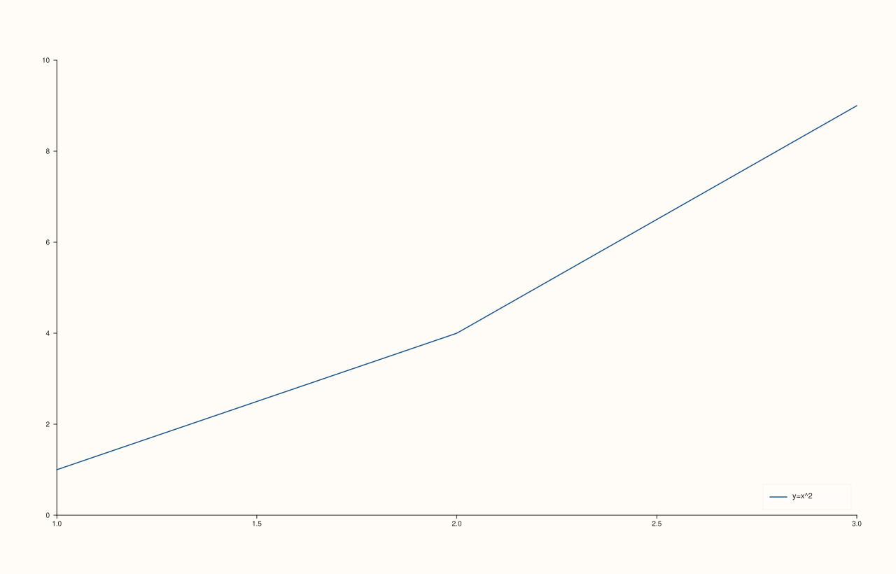

<!-- pluss-hand-authored -->

# flash::move_legend

[Back to flash API Reference](../../flash_api_reference)

## Signatures

```cpp
Pane& flash::move_legend(Pane& pane, KeyPlace place) noexcept
Studio& flash::move_legend(Studio& studio, KeyDock dock) noexcept

Pane& flash::legend(Pane& pane, KeyPlace place) noexcept
Studio& flash::legend(Studio& studio, KeyDock dock) noexcept
```

## What It Does

Thin wrappers, one per legend concept this codebase
already has: `(Pane&, KeyPlace)` forwards straight to
[`Pane::legend`](../pane/legend.md) (an in-pane legend box, positioned at one of seven
`KeyPlace` corners/edges or off), and `(Studio&, KeyDock)` forwards straight to
[`Studio::legend`](../studio/legend.md) (a consolidated, figure-wide legend docked to
one edge). `flash::legend` is an exact alias of `flash::move_legend` for both
overloads — identical below.

## Parameters

**pane** (`Pane&`, `Pane` overloads)
    The pane to position an in-pane legend on.

**studio** (`Studio&`, `Studio` overloads)
    The figure to dock a consolidated legend on.

**place** (`KeyPlace`, `Pane` overloads)
    See [`Pane::legend`](../pane/legend.md) for `KeyPlace`'s full value set (seven
    placements, including `None` to turn the legend off).

**dock** (`KeyDock`, `Studio` overloads)
    See [`Studio::legend`](../studio/legend.md) for `KeyDock`'s three values (`None`,
    `East`, `South`).

## Returns

`Pane&` / `Studio&`
    A reference to the object passed in, for chaining.

## Examples

Example 1. `(Pane&, KeyPlace)`.

```cpp
using namespace pluss::pl;

auto fig = studio("flash_move_legend_pane_a");
auto& pane = fig.pane2();
pane.trend(std::vector<double>{1, 2, 3}, std::vector<double>{1, 4, 9}).label("y=x^2");
flash::move_legend(pane, KeyPlace::SouthEast);
fig.show();
```



Example 2 (a comparison, not a new picture). `flash::legend(Pane&, KeyPlace)` is
identical to `flash::move_legend(Pane&, KeyPlace)`.

```cpp
using namespace pluss::pl;

auto fig1 = studio("flash_move_legend_pane_a");
auto& p1 = fig1.pane2();
p1.trend(std::vector<double>{1, 2, 3}, std::vector<double>{1, 4, 9}).label("y=x^2");
flash::move_legend(p1, KeyPlace::SouthEast);

auto fig2 = studio("flash_legend_pane_b");
auto& p2 = fig2.pane2();
p2.trend(std::vector<double>{1, 2, 3}, std::vector<double>{1, 4, 9}).label("y=x^2");
flash::legend(p2, KeyPlace::SouthEast);
std::cout << "move_legend(Pane) vs legend(Pane) byte-identical: " << (fig1.to_svg() == fig2.to_svg()) << "\n";
```

Output:

```text
move_legend(Pane) vs legend(Pane) byte-identical: 1
```

Example 3 (a comparison, not a new picture). `(Studio&, KeyDock)`: `move_legend`
vs `legend`, both docking a consolidated legend to the figure's east edge.

```cpp
using namespace pluss::pl;

auto fig3 = studio("flash_move_legend_studio_a");
auto& p3 = fig3.pane2();
p3.trend(std::vector<double>{1, 2, 3}, std::vector<double>{1, 4, 9}).label("a");
flash::move_legend(fig3, KeyDock::East);

auto fig4 = studio("flash_legend_studio_b");
auto& p4 = fig4.pane2();
p4.trend(std::vector<double>{1, 2, 3}, std::vector<double>{1, 4, 9}).label("a");
flash::legend(fig4, KeyDock::East);
std::cout << "move_legend(Studio) vs legend(Studio) byte-identical: " << (fig3.to_svg() == fig4.to_svg()) << "\n";
fig4.show();
```

Output:

```text
move_legend(Studio) vs legend(Studio) byte-identical: 1
```

## Notes

- Both overloads of both names are `noexcept`.
- `move_legend`/`legend` are two equally-valid names for the exact same pair of
  operations — pick whichever reads better in context.
- Neither overload creates a legend if no trace on the pane/figure has a
  [`label`](../trace/label.md) set — an empty legend box may still be drawn/reserved
  depending on the underlying `Pane::legend`/`Studio::legend` behavior; see those pages
  for the precise no-labeled-traces behavior.

## See Also

- [`flash::legend_frame`](legend_frame.md): controls the legend's border/background
  styling once it's positioned by this function.
- [`Pane::legend`](../pane/legend.md), [`Studio::legend`](../studio/legend.md): the
  underlying methods both overloads forward to directly.
- [`flash::set_theme`](set_theme.md): can set `legend_place`/`legend_dock` as part of a
  broader theming bundle, using the same `KeyPlace`/`KeyDock` types.

<div class="pluss-inline-prev-next">
  <a class="prev-link" href="set_context.html">
    <span class="label">Previous</span>
    <span class="title">set_context</span>
  </a>
  <a class="next-link" href="legend_frame.html">
    <span class="label">Next</span>
    <span class="title">legend_frame</span>
  </a>
</div>
