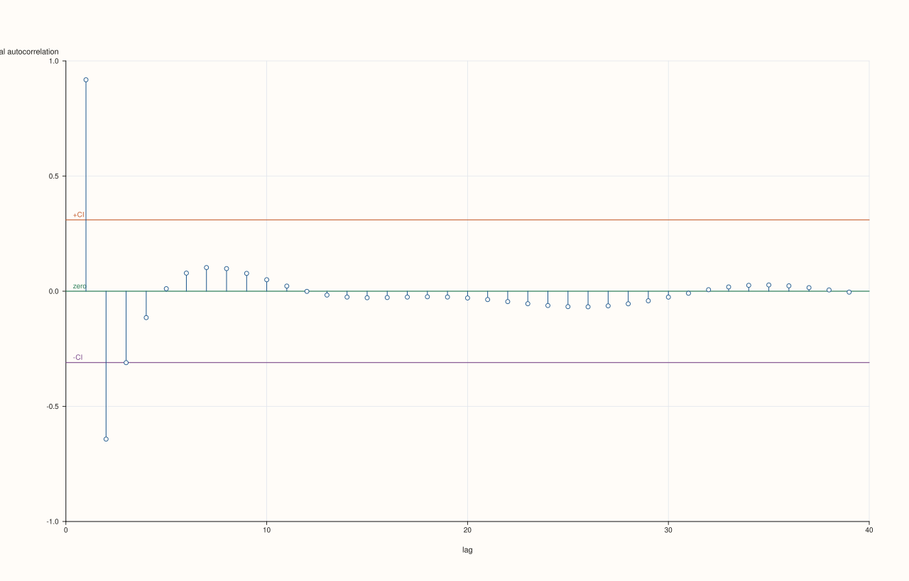
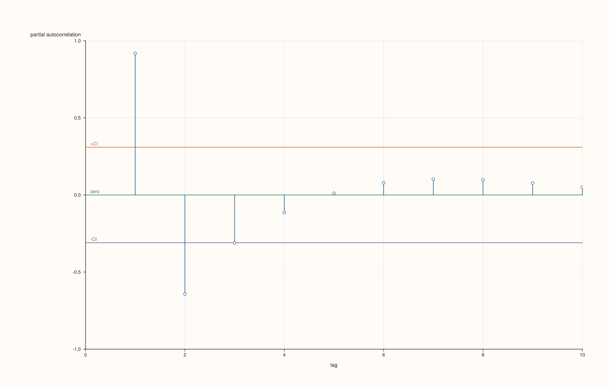

<!-- pluss-hand-authored -->

# flash::pacfplot

[Back to flash API Reference](../../flash_api_reference)

## Signature

```cpp
Studio& flash::pacfplot(Studio& studio, Series values, const PacfPlotOptions& options = {})
```

## What It Does

Draws a partial-autocorrelation-function (PACF) correlogram: like
[`flash::acfplot`](acfplot.md), one [`Pane::spike`](../pane/spike.md) per lag against a
zero baseline, but each spike measures the correlation between a series and its lag-`k`
shift *after* removing the linear effect already explained by lags `1` through `k − 1` —
the diagnostic used to distinguish direct lag dependence from dependence that's really
just propagating through shorter lags. Internally computed via the Durbin-Levinson
recursion over the full ACF sequence (lags `0` through `max_lag`), independent of
`include_zero_lag`'s display-only filtering.

`PacfPlotOptions` is field-for-field identical to [`AcfPlotOptions`](acfplot.md) — same
defaults, same confidence-band mechanics (including its constant-width, non-Bartlett
approximation — see [`flash::acfplot`](acfplot.md)'s important callout), same
`marker_area` field that's declared but never read.

## Parameters

**studio** (`Studio&`)
    The figure to populate — a single new [`Studio::pane2`](../studio/pane2.md), y-axis
    fixed to `[-1.0, 1.0]`.

**values** (series-convertible)
    The sequence to compute partial autocorrelations for. Must contain at least four
    points, or `pacfplot` throws `pluss::Error("flash::pacfplot requires at
    least four points")` — one more than [`flash::acfplot`](acfplot.md)'s three-point
    minimum, since the Durbin-Levinson recursion needs slightly more data to be
    meaningful.

**options** (`const PacfPlotOptions&`, optional)
    See the field table below.

## `PacfPlotOptions` fields

| Field | Type and default | Description |
|---|---|---|
| `max_lag` | `std::int64_t`, default `40` | The largest lag computed and shown. At least `1` (fewer throws `pluss::Error`); a value above `n - 1` is reduced to `n - 1`, since a series has no longer lags. |
| `include_zero_lag` | `bool`, default `false` | Whether lag `0` (always exactly `1.0`) is included as its own spike. |
| `show_confidence_band` | `bool`, default `true` | Whether the `+CI`/`-CI` reference lines are drawn — same constant-width normal-approximation mechanics as [`flash::acfplot`](acfplot.md). |
| `confidence_level` | `double`, default `0.95` | As for [`flash::acfplot`](acfplot.md): strictly between 0 and 1, with the band at the exact normal quantile of the level. |
| `trace_width` | `float`, default `1.2F` | Stroke width for the correlogram's spikes. |
| `marker_area` | `double`, default `14.0` | Declared, but never read anywhere in `pacfplot`'s implementation — same inert field as [`AcfPlotOptions::marker_area`](acfplot.md). |

## Returns

`Studio&`
    A reference to the same figure, for chaining.

## Examples

Example 1. Default overload — partial autocorrelations for lags `1` through `40` (or
`n - 1`).

```cpp
using namespace pluss::pl;

auto fig = studio("flash_pacfplot_default");
std::vector<double> values;
for (int i = 0; i < 40; ++i) {
  values.push_back(std::sin(static_cast<double>(i) * 0.4) * 5.0 + static_cast<double>(i) * 0.2);
}
flash::pacfplot(fig, values);
fig.show();
```



Example 2 (a comparison, not a new picture). `max_lag = 10` renders differently from the `40`-lag default.

```cpp
using namespace pluss::pl;

std::vector<double> values;
for (int i = 0; i < 40; ++i) {
  values.push_back(std::sin(static_cast<double>(i) * 0.4) * 5.0 + static_cast<double>(i) * 0.2);
}

auto fig1 = studio("flash_pacfplot_lag_default");
flash::pacfplot(fig1, values);

auto fig2 = studio("flash_pacfplot_lag_small");
flash::PacfPlotOptions opts;
opts.max_lag = 10;
flash::pacfplot(fig2, values, opts);

std::cout << "pacfplot max_lag=40(default) vs 10 differ: " << (fig1.to_svg() != fig2.to_svg()) << "\n";
fig2.show();
```

Output:

```text
pacfplot max_lag=40(default) vs 10 differ: 1
```



Example 3 (edge case). Fewer than four points throws.

```cpp
using namespace pluss::pl;

auto fig = studio("flash_pacfplot_too_few");
std::vector<double> three{1.0, 2.0, 3.0};
try {
  flash::pacfplot(fig, three);
} catch (const pluss::Error& e) {
  std::cout << "pacfplot(3 points) threw: " << e.message() << "\n";
}
```

Output:

```text
pacfplot(3 points) threw: flash::pacfplot requires at least four points
```

## Notes

- Not `noexcept`.
- Uses the Durbin-Levinson recursion, computed once over the full ACF sequence up to
  `max_lag` — `include_zero_lag` only filters what's *displayed*, it does not change the
  recursion itself.
- Every value is clamped to `[-1.0, 1.0]` before plotting.
- Requires one more point than [`flash::acfplot`](acfplot.md)'s minimum (four vs. three)
  — see the Parameters section above.

## See Also

- [`flash::acfplot`](acfplot.md): the (non-partial) autocorrelation sibling, and the
  source of the confidence-level and constant-width band mechanics
  this page's options share field-for-field.
- [`flash::ccfplot`](ccfplot.md): the two-series cross-correlation sibling.
- [`Pane::spike`](../pane/spike.md), [`Pane::rule_y`](../pane/rule_y.md): the native
  drawing methods used for the correlogram spikes and confidence band.

<div class="pluss-inline-prev-next">
  <a class="prev-link" href="acfplot.html">
    <span class="label">Previous</span>
    <span class="title">acfplot</span>
  </a>
  <a class="next-link" href="ccfplot.html">
    <span class="label">Next</span>
    <span class="title">ccfplot</span>
  </a>
</div>
