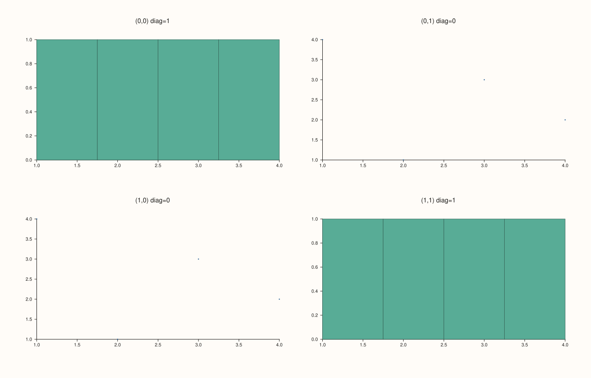

<!-- pluss-hand-authored -->

# flash::pairgrid_map_plot

[Back to flash API Reference](../../flash_api_reference)

## Signature

```cpp
template <class Mapper>
  requires std::invocable<Mapper, Pane&, std::int64_t, std::int64_t, bool>
Studio& flash::pairgrid_map_plot(Studio& studio, std::int64_t dimensions,
                                  Mapper&& mapper, double gx = 14.0, double gy = 14.0)
```

## What It Does

The generic, callback-driven builder behind a pairwise-comparison grid: lays out a
[`flash::PairGrid`](PairGrid.md) (`dimensions × dimensions`), then — for every cell —
creates a pane, places it, and invokes `mapper(pane, row, col, is_diagonal)`, where
`is_diagonal` is `true` exactly when `row == col`. This is the piece
[`flash::PairGrid`](PairGrid.md) itself deliberately omits: knowing which cells are
diagonal (conventionally a univariate distribution of one feature) versus off-diagonal
(conventionally a bivariate relationship between two features) is entirely
`pairgrid_map_plot`'s job.

## Parameters

**studio** (`Studio&`)
    The figure to lay out and populate.

**dimensions** (`std::int64_t`)
    Both the row and column count of the resulting square grid — one per feature being
    compared pairwise. Must be strictly positive, or `pairgrid_map_plot` throws
    `std::invalid_argument("flash::pairgrid_map_plot dimensions must be positive")`.

**mapper** (`Mapper&&`, invocable as `(Pane&, std::int64_t row, std::int64_t col, bool
is_diagonal) -> void`)
    Called once per cell, in row-major order, after that cell's pane has already been
    created and `place(row, col)`d. `is_diagonal` is `row == col` — typically used to
    branch between drawing a univariate distribution (diagonal) and a bivariate
    relationship (off-diagonal) for the same underlying feature set, as shown below.

**gx**, **gy** (`double`, default `14.0` each)
    Forwarded straight to the internal [`flash::PairGrid`](PairGrid.md) call as its
    `gx`/`gy` gutter — the same tighter default `PairGrid` itself uses.

## Returns

`Studio&`
    A reference to the same figure, for chaining.

## Examples

Example 1. A `2×2` pairwise grid comparing two features — diagonal cells show each
feature's own distribution via [`Pane::bucket`](../pane/bucket.md), off-diagonal cells
show the pairwise relationship via [`Pane::cloud`](../pane/cloud.md).

```cpp
using namespace pluss::pl;

auto fig = studio("flash_pairgrid_map_plot");
std::vector<double> feature_a{1.0, 2.0, 3.0, 4.0};
std::vector<double> feature_b{4.0, 1.0, 3.0, 2.0};
flash::pairgrid_map_plot(fig, 2, [&](Pane& pane, std::int64_t row, std::int64_t col, bool is_diagonal) {
  if (is_diagonal) {
    pane.bucket(row == 0 ? feature_a : feature_b, 4);
  } else {
    pane.cloud(feature_a, feature_b);
  }
  pane.title("(" + std::to_string(row) + "," + std::to_string(col) + ") diag=" + (is_diagonal ? "1" : "0"));
});
fig.show();
```



## Notes

- Not `noexcept`.
- `mapper` is invoked via `std::invoke`, so it may be a lambda, a free function pointer,
  or any callable matching the required signature.
- `is_diagonal` is purely `row == col` — `pairgrid_map_plot` does not itself choose what a
  diagonal or off-diagonal cell draws; that decision is entirely inside your callback, as
  shown above.
- [`flash::facet_map_plot`](facet_map_plot.md) is the rectangular-grid equivalent (no
  diagonal concept); [`flash::jointgrid_map_plot`](jointgrid_map_plot.md) is the
  joint-plus-marginals equivalent.

## See Also

- [`flash::PairGrid`](PairGrid.md): the underlying grid-layout constructor.
- [`flash::facet_map_plot`](facet_map_plot.md),
  [`flash::jointgrid_map_plot`](jointgrid_map_plot.md): sibling callback-driven grid
  builders.
- [`Pane::bucket`](../pane/bucket.md), [`Pane::cloud`](../pane/cloud.md): the two
  native `Pane` methods used in the example above.

<div class="pluss-inline-prev-next">
  <a class="prev-link" href="facet_map_plot.html">
    <span class="label">Previous</span>
    <span class="title">facet_map_plot</span>
  </a>
  <a class="next-link" href="jointgrid_map_plot.html">
    <span class="label">Next</span>
    <span class="title">jointgrid_map_plot</span>
  </a>
</div>
