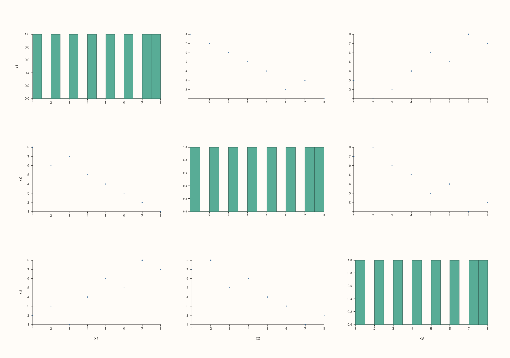
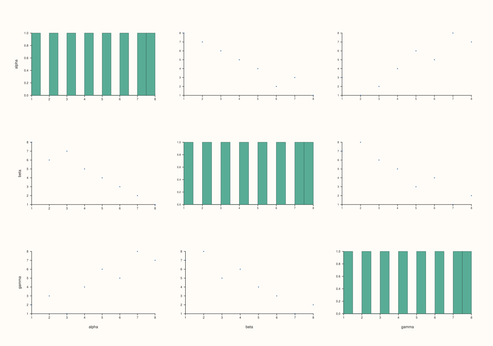
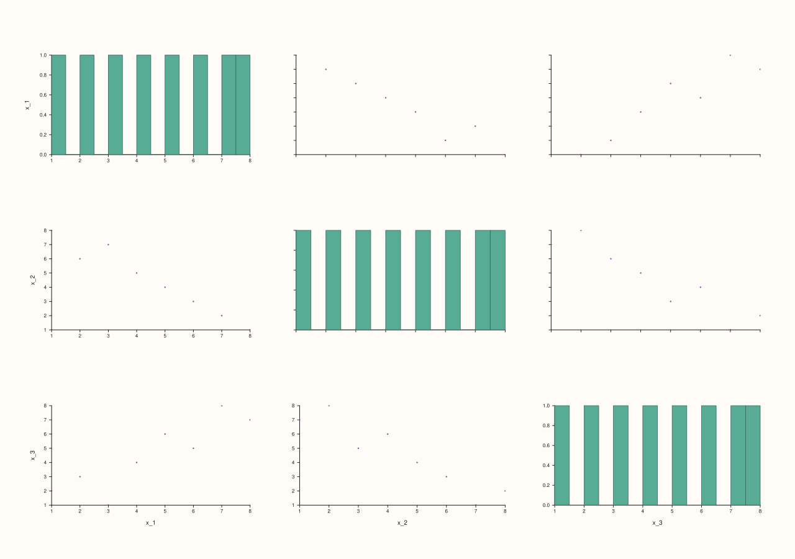
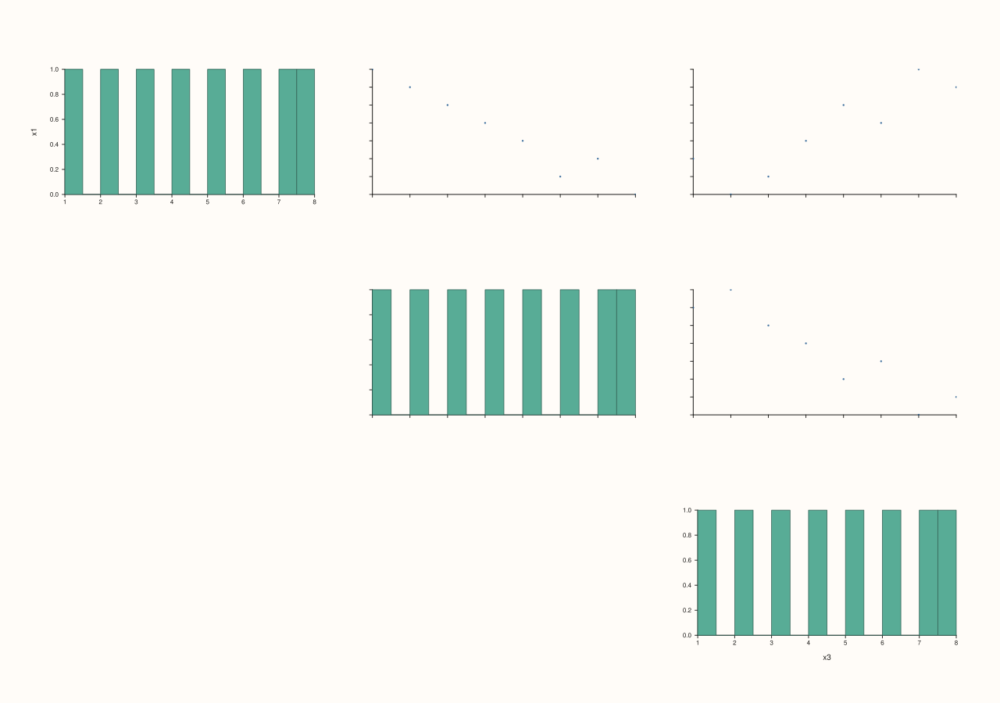
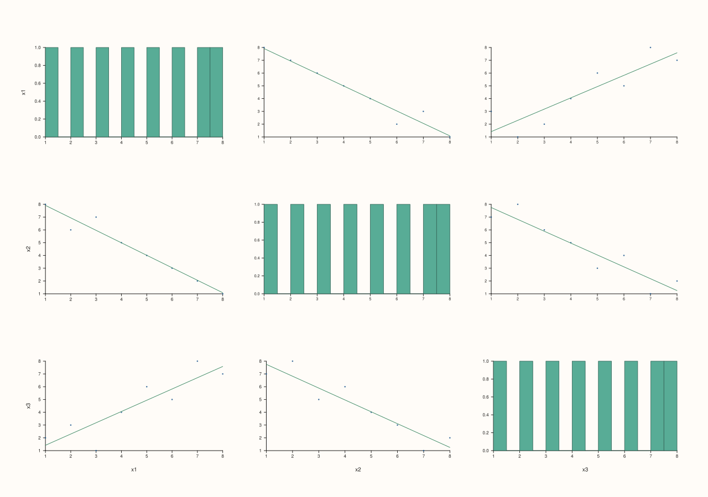
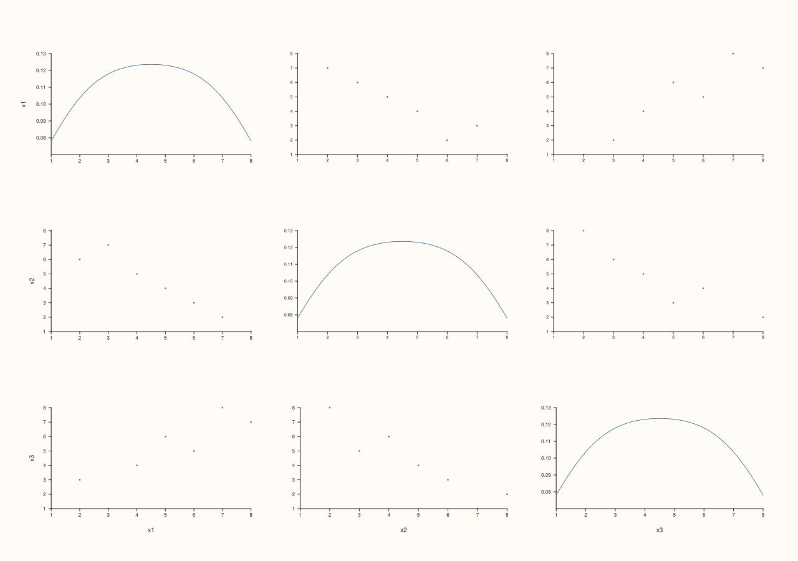
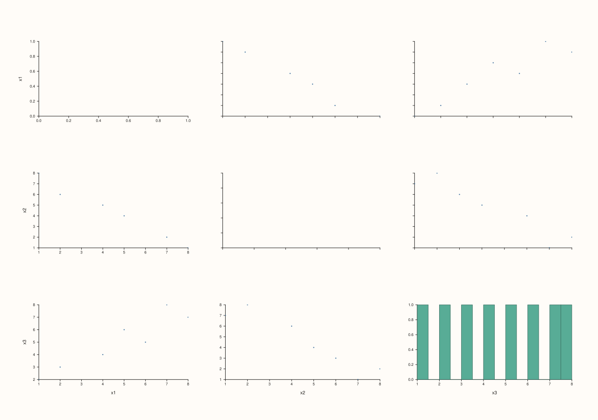
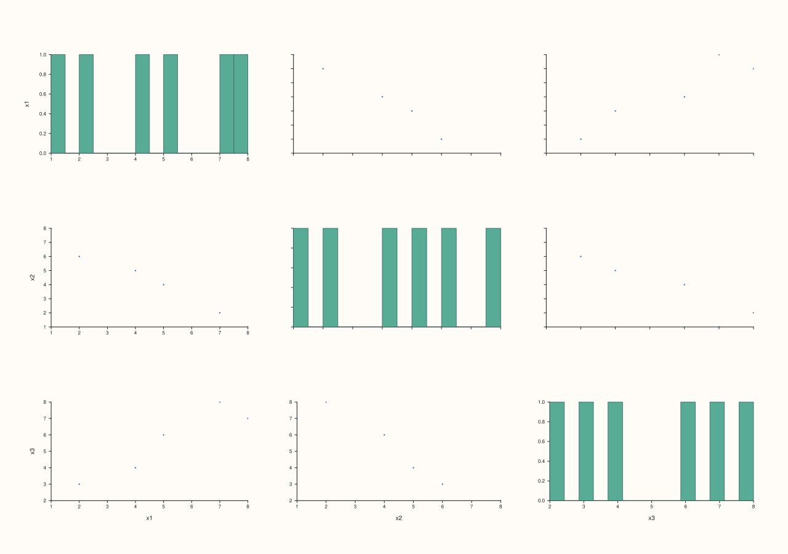

<!-- pluss-hand-authored -->

# flash::pairplot

[Back to flash API Reference](../../flash_api_reference)

## Signatures

```cpp
Studio& flash::pairplot(Studio& studio, pluss::msharp::RangeView::Series columns,
                         const PairPlotOptions& options = {})

Studio& flash::pairplot(Studio& studio, std::initializer_list<Series> columns,
                         const PairPlotOptions& options = {})

Studio& flash::pairplot(Studio& studio, const Dataset& data,
                         const PairPlotOptions& options = {})

Studio& flash::pairplot(Studio& studio, const Series& matrix,
                         const MatrixFrameOptions& frame_options,
                         const PairPlotOptions& options = {})

Studio& flash::pairplot(Studio& studio, const Series& matrix,
                         pluss::msharp::RangeView::Of<std::string_view> feature_names,
                         Axis feature_axis, const PairPlotOptions& options = {})

Studio& flash::pairplot(Studio& studio, const Series& matrix,
                         const std::vector<std::string>& feature_names,
                         Axis feature_axis, const PairPlotOptions& options = {})

Studio& flash::pairplot(Studio& studio, const Series& matrix,
                         std::initializer_list<std::string_view> feature_names,
                         Axis feature_axis, const PairPlotOptions& options = {})

Studio& flash::pairplot(Studio& studio, const Series& matrix,
                         const PairPlotOptions& options = {})
```

## What It Does

Builds a full `N × N` grid of every pairwise relationship among `N` numeric features:
the diagonal shows each feature's own univariate distribution, off-diagonal cells show
a bivariate view of two features against each other. Internally it lays out an `N × N` mosaic (sized to fit
automatically by default), then, per cell: draws a histogram or KDE on the diagonal, and a
scatter (optionally with a regression fit line) off the diagonal.

Eight overloads cover every way to hand it a feature set: a `RangeView::Series` or
`std::initializer_list<Series>` of raw columns; a pre-built `Dataset` (see "`Dataset` and
`make_dataset`" below, carrying its own feature names); a rank-2 `Series` matrix in five
different feature-naming/axis-orientation shapes; or a bare matrix with no names at all
(auto-labeled
`x_1`, `x_2`, …).

```{important} Diagonal, triangle exclusion, and per-cell axis-label placement
Every cell is created and placed regardless of `triangle` -- `triangle == Lower`/`Upper`
does not skip creating excluded cells, it hides them (`Pane::hide()`) after creation, the
same overflow-cell-hiding pattern used throughout the `*gridplot` family. Only the
outer edge of the grid gets tick labels/axis labels at all (`Pane::x_label`/`y_label` are
set to `""` everywhere else): the bottom row and the left column. `hide_inner_ticks` (default `true`) additionally switches off the tick labels of every
non-edge pane; set it `false` to keep them on inner panes too.
```

```{important} corner=true silently forces triangle to Lower when triangle is still Full
If options.corner is true and options.triangle is still at its default (Full), pairplot
overwrites triangle to Lower before doing anything else: a figure
built with only corner=true renders byte-identical to one built with explicit
triangle=PairPlotTriangle::Lower. This silent override only fires when triangle is still
Full; explicitly setting BOTH corner=true and triangle=Upper leaves Upper in force
(corner never downgrades an explicit Upper choice).
```

```{important} auto_size resizes the whole Studio, not just this grid
When auto_size is true (the default), pairplot calls Studio::size() itself, computing a
suggested width/height from cell_width/cell_height/grid_gap_x/grid_gap_y/outer_pad_x/
outer_pad_y and the feature count -- clamped to at least min_width x min_height. This
resizes the ENTIRE figure, which matters if you called pairplot on a Studio that already
had other panes or a size you'd set intentionally. Set auto_size=false to keep whatever
size the Studio already had.
```

## `PairPlotOptions` fields

### Content

| Field | Type and default | Description |
|---|---|---|
| `triangle` | `PairPlotTriangle`, default `Full` | Which off-diagonal cells to keep visible: `Full` (every cell), `Lower` (`row >= col` only), or `Upper` (`row <= col` only). Excluded cells are still created, then hidden. |
| `kind` | `PairPlotKind`, default `Scatter` | The off-diagonal glyph: `Scatter` (a point cloud via [`Pane::cloud`](../pane/cloud.md)) or `Reg` (the same scatter plus a fit-only regression line, drawn via [`flash::regplot`](regplot.md) with `show_scatter=false`, `show_ci=false`). |
| `diag_kind` | `PairPlotDiagKind`, default `Histogram` | The diagonal glyph: `Histogram` (via [`Pane::bucket`](../pane/bucket.md), using `diag_bins`) or `Density` (a KDE curve via [`Pane::trend`](../pane/trend.md), using `diag_density_points`, clamped to at least `32`). |
| `corner` | `bool`, default `false` | See the important callout above — silently forces `triangle` to `Lower` when `triangle` is still at its default `Full`. |
| `dropna` | `bool`, default `false` | Whether to drop every row where *any* feature is non-finite (`NaN`/`Inf`) before plotting, computed via a combined `isfinite()`/`logical_and()` mask across all features. When all rows are dropped, `pairplot` throws `pluss::Error("flash::pairplot has no rows after filtering/sampling")`. |
| `monochrome` | `bool`, default `true` | Whether every trace uses the theme's default single stroke color (`true`) or a per-panel color drawn from an internal categorical palette (`false`) — diagonal traces color by row index, off-diagonal traces color by `row + col`. |
| `labels` | `std::vector<std::string>`, default empty | Feature names for the outer-edge axis labels. Used only when its length exactly matches the feature count; otherwise every feature falls back to an auto-generated `"x" + std::to_string(index + 1)` label (`"x1"`, `"x2"`, …). |

### Sizing & layout

| Field | Type and default | Description |
|---|---|---|
| `auto_size` | `bool`, default `true` | Whether `pairplot` calls `Studio::size()` itself. See the important callout above. |
| `min_width`, `min_height` | `double`, default `1280.0`, `900.0` | The floor `Studio::size()` is clamped to when `auto_size` is `true`, regardless of how small the computed suggested size would otherwise be. |
| `cell_width`, `cell_height` | `double`, default `210.0` each | The per-cell size (in points) used by the `auto_size` width/height computation. |
| `outer_pad_x`, `outer_pad_y` | `double`, default `120.0` each | Extra margin (in points) added once to the `auto_size` width/height computation, for outer axis labels/ticks. |
| `grid_gap_x`, `grid_gap_y` | `double`, default `8.0` each | The gutter between cells, forwarded straight to `Studio::mosaic`. |
| `show_grid` | `bool`, default `false` | Whether each panel gets `GridStyle::Major` gridlines (`true`) or `GridStyle::None` (`false`) — note `pairplot`'s default is `false`, the opposite of most other `flash::` grid-of-plots functions. |
| `hide_inner_ticks` | `bool`, default `true` | See the first important callout above. |

### Sampling & diagonal detail

| Field | Type and default | Description |
|---|---|---|
| `max_points` | `std::int64_t`, default `2500` | Row-count cap. When a feature has more rows than this, every column is deterministically downsampled to an evenly-strided subset of at most `max_points` rows (same mechanism as [`flash::relgridplot`](relgridplot.md)'s siblings share via `detail::downsample_columns`). |
| `diag_bins` | `std::int64_t`, default `14` | Bin count forwarded to `Pane::bucket` when `diag_kind == Histogram`. At least `1`; fewer throws `pluss::Error`. |
| `diag_density_points` | `std::int64_t`, default `128` | KDE evaluation-point count when `diag_kind == Density`. At least `2`; fewer throws `pluss::Error`. |

### Font, marker, and stroke tuning

| Field | Type and default | Description |
|---|---|---|
| `tick_font_scale` | `double`, default `0.8` | The base tick-label font scale for edge panes (non-edge panes use this scaled further down by `hide_inner_ticks`). A value that is not finite and positive throws `pluss::Error`. |
| `axis_label_font_scale` | `double`, default `0.9` | The axis-label font scale, applied to every pane. A value that is not finite and positive throws `pluss::Error`. |
| `diag_trace_width` | `float`, default `0.75F` | Stroke width for diagonal traces. |
| `scatter_trace_width` | `float`, default `0.45F` | Stroke width for off-diagonal scatter markers (and the baseline `regplot` fit-line width is derived from this when `kind == Reg`: `max(0.8F, scatter_trace_width + 0.45F)`). |
| `marker_area_scale`, `marker_area_min`, `marker_area_max` | `double`, default `380.0`, `7.0`, `18.0` | Off-diagonal marker area is computed as `marker_area_scale / sqrt(points * feature_count)`, then clamped to `[marker_area_min, marker_area_max]` — larger point counts and feature grids automatically shrink markers to reduce overplotting. |
| `auto_tick_decimals` | `std::optional<int>`, default `std::nullopt` | When set, forwarded to both [`Pane::x_auto_tick_decimals`](../pane/x_auto_tick_decimals.md) and [`Pane::y_auto_tick_decimals`](../pane/y_auto_tick_decimals.md) on every pane. Left alone (each axis's own default) when unset. |

### Per-axis tick/label passthroughs

| Field | Type and default | Description |
|---|---|---|
| `x_tick_rotation_deg`, `y_tick_rotation_deg` | `std::optional<double>`, default `std::nullopt` | Forwarded to [`Pane::x_tick_rotation`](../pane/x_tick_rotation.md)/ [`y_tick_rotation`](../pane/y_tick_rotation.md) when set. |
| `x_label_rotation_deg`, `y_label_rotation_deg` | `std::optional<double>`, default `std::nullopt` | Forwarded to [`Pane::x_label_rotation`](../pane/x_label_rotation.md)/ [`y_label_rotation`](../pane/y_label_rotation.md) when set. |
| `x_tick_format`, `y_tick_format` | `std::optional<TickFormat>`, default `std::nullopt` | Forwarded to [`Pane::x_tick_format`](../pane/x_tick_format.md)/ [`y_tick_format`](../pane/y_tick_format.md) when set. |
| `x_tick_label_gap_points`, `y_tick_label_gap_points` | `std::optional<double>`, default `std::nullopt` | Forwarded to [`Pane::x_tick_label_gap`](../pane/x_tick_label_gap.md)/ [`y_tick_label_gap`](../pane/y_tick_label_gap.md) when set. |
| `x_label_gap_points`, `y_label_gap_points` | `std::optional<double>`, default `std::nullopt` | Forwarded to [`Pane::x_label_gap`](../pane/x_label_gap.md)/ [`y_label_gap`](../pane/y_label_gap.md) when set. |

## Parameters

**studio** (`Studio&`)
    The figure to lay out and populate.

**columns** (`pluss::msharp::RangeView::Series` or `std::initializer_list<Series>`)
    One entry per feature — `columns[i]` is that feature's complete value series. Must be
    non-empty, and every column must be the same length, or `pairplot` throws
    `pluss::Error("flash::pairplot requires at least one series")` (empty case)
    or `pluss::Error("flash::pairplot requires equal-length columns")` (length
    mismatch).

**data** (`const Dataset&`, Dataset overload only)
    A pre-built dataset — see `flash::make_dataset` in the "`Dataset` and `make_dataset`"
    section below.
    Its `numeric_names` become `options.labels` automatically when `options.labels` is
    empty.

**matrix** (`const Series&`, matrix overloads only)
    A rank-2 `Series`. Split into one column per feature according to `feature_axis`
    (`Axis::Cols`, the default: each matrix column is a feature; `Axis::Rows`: each matrix
    row is a feature).

**frame_options** (`const MatrixFrameOptions&`, one matrix overload only)
    `{ Axis feature_axis; std::vector<std::string> feature_names; }` — bundles the axis
    orientation and feature names into one value.

**feature_names** (`RangeView::Of<std::string_view>`, `const std::vector<std::string>&`,
or `std::initializer_list<std::string_view>`, three matrix overloads)
    Per-feature names, forwarded into `options.labels` when `options.labels` is empty.
    A mismatched count falls back to auto-generated `"x_1"`, `"x_2"`, … labels (note the
    underscore — the matrix overloads' auto-labels differ slightly from the
    columns-overloads' `"x1"`, `"x2"`, … fallback).

**feature_axis** (`Axis`, matrix overloads with explicit names)
    `Axis::Cols` or `Axis::Rows` — which matrix axis holds the features.

**options** (`const PairPlotOptions&`, optional)
    See the field table above.

## Returns

`Studio&`
    A reference to the same figure, for chaining.

## `Dataset` and `make_dataset`

`Dataset` is flash's grouped, name-aware bundle for dataset-driven plotting overloads.

The two simplest constructors are:

```cpp
flash::Dataset flash::make_dataset(
    std::vector<Series> numeric_values,
    std::vector<std::string> numeric_names = {});

flash::Dataset flash::make_dataset(
    const Series& matrix,
    std::vector<std::string> feature_names = {},
    Axis feature_axis = Axis::Cols);
```

See [`flash::Dataset`](Dataset.md) for the grouped surface itself. When PlussMic is
present, the same dataset type also supports
[`flash::Dataset::from_table`](dataset_from_table.md) and
[`flash::Dataset::frame`](dataset_frame.md).

## Examples

Example 1. Default overload — three features, default options (`Full` triangle,
`Scatter`/`Histogram`).

```cpp
using namespace pluss::pl;

auto fig = studio("flash_pairplot_default");
std::vector<pluss::Series> cols{
    pluss::make_series(std::vector<double>{1.0, 2.0, 3.0, 4.0, 5.0, 6.0, 7.0, 8.0}, {8}),
    pluss::make_series(std::vector<double>{8.0, 6.0, 7.0, 5.0, 4.0, 3.0, 2.0, 1.0}, {8}),
    pluss::make_series(std::vector<double>{2.0, 3.0, 1.0, 4.0, 6.0, 5.0, 8.0, 7.0}, {8})};
flash::pairplot(fig, pluss::msharp::RangeView::Series(cols));
fig.show();
```


Example 2. `std::initializer_list<Series>` overload — identical to the
`RangeView::Series` form above given the same data.

```cpp
using namespace pluss::pl;

auto x1 = pluss::make_series(std::vector<double>{1.0, 2.0, 3.0, 4.0, 5.0, 6.0, 7.0, 8.0}, {8});
auto x2 = pluss::make_series(std::vector<double>{8.0, 6.0, 7.0, 5.0, 4.0, 3.0, 2.0, 1.0}, {8});
auto x3 = pluss::make_series(std::vector<double>{2.0, 3.0, 1.0, 4.0, 6.0, 5.0, 8.0, 7.0}, {8});
auto fig = studio("flash_pairplot_il");
flash::pairplot(fig, {x1, x2, x3});
fig.show();
```



Example 3. `Dataset` overload, built via `flash::make_dataset` — feature names come
through as the outer-edge axis labels automatically.

```cpp
using namespace pluss::pl;

auto fig = studio("flash_pairplot_dataset");
auto data = flash::make_dataset(
    {pluss::make_series(std::vector<double>{1.0, 2.0, 3.0, 4.0, 5.0, 6.0, 7.0, 8.0}, {8}),
     pluss::make_series(std::vector<double>{8.0, 6.0, 7.0, 5.0, 4.0, 3.0, 2.0, 1.0}, {8}),
     pluss::make_series(std::vector<double>{2.0, 3.0, 1.0, 4.0, 6.0, 5.0, 8.0, 7.0}, {8})},
    {"alpha", "beta", "gamma"});
flash::pairplot(fig, data);
fig.show();
```


Example 4. Matrix + `MatrixFrameOptions` overload — same three features packed into one
`8×3` matrix (`Axis::Cols` default: each column is a feature).

```cpp
using namespace pluss::pl;

std::vector<double> a{1.0, 2.0, 3.0, 4.0, 5.0, 6.0, 7.0, 8.0};
std::vector<double> b{8.0, 6.0, 7.0, 5.0, 4.0, 3.0, 2.0, 1.0};
std::vector<double> c{2.0, 3.0, 1.0, 4.0, 6.0, 5.0, 8.0, 7.0};
std::vector<double> flat;
for (std::size_t i = 0; i < a.size(); ++i) { flat.push_back(a[i]); flat.push_back(b[i]); flat.push_back(c[i]); }
auto matrix = pluss::make_series(flat, {8, 3});

auto fig = studio("flash_pairplot_matrix_frame");
flash::MatrixFrameOptions frame_opts;
frame_opts.feature_names = {"alpha", "beta", "gamma"};
flash::pairplot(fig, matrix, frame_opts);
fig.show();
```


Example 5. Matrix + `RangeView::Of<std::string_view>` feature names + explicit `Axis`
overload — same matrix, names supplied directly instead of through
`MatrixFrameOptions`.

```cpp
using namespace pluss::pl;

std::vector<double> a{1.0, 2.0, 3.0, 4.0, 5.0, 6.0, 7.0, 8.0};
std::vector<double> b{8.0, 6.0, 7.0, 5.0, 4.0, 3.0, 2.0, 1.0};
std::vector<double> c{2.0, 3.0, 1.0, 4.0, 6.0, 5.0, 8.0, 7.0};
std::vector<double> flat;
for (std::size_t i = 0; i < a.size(); ++i) { flat.push_back(a[i]); flat.push_back(b[i]); flat.push_back(c[i]); }
auto matrix = pluss::make_series(flat, {8, 3});

auto fig = studio("flash_pairplot_matrix_names_axis");
flash::pairplot(fig, matrix, {"alpha", "beta", "gamma"}, flash::Axis::Cols);
fig.show();
```



Example 6. Bare matrix overload — no names at all, so features fall back to
auto-generated `"x_1"`/`"x_2"`/`"x_3"` labels.

```cpp
using namespace pluss::pl;

std::vector<double> a{1.0, 2.0, 3.0, 4.0, 5.0, 6.0, 7.0, 8.0};
std::vector<double> b{8.0, 6.0, 7.0, 5.0, 4.0, 3.0, 2.0, 1.0};
std::vector<double> c{2.0, 3.0, 1.0, 4.0, 6.0, 5.0, 8.0, 7.0};
std::vector<double> flat;
for (std::size_t i = 0; i < a.size(); ++i) { flat.push_back(a[i]); flat.push_back(b[i]); flat.push_back(c[i]); }
auto matrix = pluss::make_series(flat, {8, 3});

auto fig = studio("flash_pairplot_matrix_bare");
flash::pairplot(fig, matrix);
fig.show();
```



Example 7. `triangle = Lower` — only the lower-triangular and diagonal cells are visible.

```cpp
using namespace pluss::pl;

auto fig = studio("flash_pairplot_lower");
std::vector<pluss::Series> cols{
    pluss::make_series(std::vector<double>{1.0, 2.0, 3.0, 4.0, 5.0, 6.0, 7.0, 8.0}, {8}),
    pluss::make_series(std::vector<double>{8.0, 6.0, 7.0, 5.0, 4.0, 3.0, 2.0, 1.0}, {8}),
    pluss::make_series(std::vector<double>{2.0, 3.0, 1.0, 4.0, 6.0, 5.0, 8.0, 7.0}, {8})};
flash::PairPlotOptions opts;
opts.triangle = flash::PairPlotTriangle::Lower;
flash::pairplot(fig, pluss::msharp::RangeView::Series(cols), opts);
fig.show();
```


Example 8. `triangle = Upper` — the mirror image of Example 7.

```cpp
using namespace pluss::pl;

auto fig = studio("flash_pairplot_upper");
std::vector<pluss::Series> cols{
    pluss::make_series(std::vector<double>{1.0, 2.0, 3.0, 4.0, 5.0, 6.0, 7.0, 8.0}, {8}),
    pluss::make_series(std::vector<double>{8.0, 6.0, 7.0, 5.0, 4.0, 3.0, 2.0, 1.0}, {8}),
    pluss::make_series(std::vector<double>{2.0, 3.0, 1.0, 4.0, 6.0, 5.0, 8.0, 7.0}, {8})};
flash::PairPlotOptions opts;
opts.triangle = flash::PairPlotTriangle::Upper;
flash::pairplot(fig, pluss::msharp::RangeView::Series(cols), opts);
fig.show();
```



Example 9 (a comparison, not a new picture). `corner = true` renders identical
to explicit `triangle = Lower`, confirming the silent-override rule from the important
callout above.

```cpp
using namespace pluss::pl;

std::vector<pluss::Series> cols{
    pluss::make_series(std::vector<double>{1.0, 2.0, 3.0, 4.0, 5.0, 6.0, 7.0, 8.0}, {8}),
    pluss::make_series(std::vector<double>{8.0, 6.0, 7.0, 5.0, 4.0, 3.0, 2.0, 1.0}, {8}),
    pluss::make_series(std::vector<double>{2.0, 3.0, 1.0, 4.0, 6.0, 5.0, 8.0, 7.0}, {8})};

auto fig1 = studio("flash_pairplot_corner");
flash::PairPlotOptions corner_opts;
corner_opts.corner = true;
flash::pairplot(fig1, pluss::msharp::RangeView::Series(cols), corner_opts);

auto fig2 = studio("flash_pairplot_lower_cmp");
flash::PairPlotOptions lower_opts;
lower_opts.triangle = flash::PairPlotTriangle::Lower;
flash::pairplot(fig2, pluss::msharp::RangeView::Series(cols), lower_opts);

std::cout << "corner=true == explicit triangle=Lower: " << (fig1.to_svg() == fig2.to_svg()) << "\n";
```

Output:

```text
corner=true == explicit triangle=Lower: 1
```


Example 10. `kind = Reg` — every off-diagonal cell gets a fit-only regression line
alongside its scatter.

```cpp
using namespace pluss::pl;

auto fig = studio("flash_pairplot_reg");
std::vector<pluss::Series> cols{
    pluss::make_series(std::vector<double>{1.0, 2.0, 3.0, 4.0, 5.0, 6.0, 7.0, 8.0}, {8}),
    pluss::make_series(std::vector<double>{8.0, 6.0, 7.0, 5.0, 4.0, 3.0, 2.0, 1.0}, {8}),
    pluss::make_series(std::vector<double>{2.0, 3.0, 1.0, 4.0, 6.0, 5.0, 8.0, 7.0}, {8})};
flash::PairPlotOptions opts;
opts.kind = flash::PairPlotKind::Reg;
flash::pairplot(fig, pluss::msharp::RangeView::Series(cols), opts);
fig.show();
```



Example 11. `diag_kind = Density` — a KDE curve replaces the default histogram on the
diagonal.

```cpp
using namespace pluss::pl;

auto fig = studio("flash_pairplot_density");
std::vector<pluss::Series> cols{
    pluss::make_series(std::vector<double>{1.0, 2.0, 3.0, 4.0, 5.0, 6.0, 7.0, 8.0}, {8}),
    pluss::make_series(std::vector<double>{8.0, 6.0, 7.0, 5.0, 4.0, 3.0, 2.0, 1.0}, {8}),
    pluss::make_series(std::vector<double>{2.0, 3.0, 1.0, 4.0, 6.0, 5.0, 8.0, 7.0}, {8})};
flash::PairPlotOptions opts;
opts.diag_kind = flash::PairPlotDiagKind::Density;
flash::pairplot(fig, pluss::msharp::RangeView::Series(cols), opts);
fig.show();
```



Example 12. `monochrome = false` — every panel's trace colored per-feature rather than a
single uniform stroke color.

```cpp
using namespace pluss::pl;

auto fig = studio("flash_pairplot_color");
std::vector<pluss::Series> cols{
    pluss::make_series(std::vector<double>{1.0, 2.0, 3.0, 4.0, 5.0, 6.0, 7.0, 8.0}, {8}),
    pluss::make_series(std::vector<double>{8.0, 6.0, 7.0, 5.0, 4.0, 3.0, 2.0, 1.0}, {8}),
    pluss::make_series(std::vector<double>{2.0, 3.0, 1.0, 4.0, 6.0, 5.0, 8.0, 7.0}, {8})};
flash::PairPlotOptions opts;
opts.monochrome = false;
flash::pairplot(fig, pluss::msharp::RangeView::Series(cols), opts);
fig.show();
```


Example 13 and 14. `dropna` off vs. on — two features each carry one injected `NaN`;
`dropna = true` removes those rows from every feature before plotting. differ.

```cpp
using namespace pluss::pl;

std::vector<double> a{1.0, 2.0, 3.0, 4.0, 5.0, 6.0, 7.0, 8.0};
std::vector<double> b{8.0, 6.0, 7.0, 5.0, 4.0, 3.0, 2.0, 1.0};
a[2] = std::numeric_limits<double>::quiet_NaN();
b[5] = std::numeric_limits<double>::quiet_NaN();
std::vector<pluss::Series> cols{
    pluss::make_series(a, {8}), pluss::make_series(b, {8}),
    pluss::make_series(std::vector<double>{2.0, 3.0, 1.0, 4.0, 6.0, 5.0, 8.0, 7.0}, {8})};

auto fig1 = studio("flash_pairplot_dropna_off");
flash::PairPlotOptions off_opts;
flash::pairplot(fig1, pluss::msharp::RangeView::Series(cols), off_opts);

auto fig2 = studio("flash_pairplot_dropna_on");
flash::PairPlotOptions on_opts;
on_opts.dropna = true;
flash::pairplot(fig2, pluss::msharp::RangeView::Series(cols), on_opts);

std::cout << "dropna=false vs dropna=true differ: " << (fig1.to_svg() != fig2.to_svg()) << "\n";
```

Output:

```text
dropna=false vs dropna=true differ: 1
```





Example 15. Custom `labels`, overriding the auto-generated `"x1"`/`"x2"`/`"x3"` fallback.

```cpp
using namespace pluss::pl;

auto fig = studio("flash_pairplot_labels");
std::vector<pluss::Series> cols{
    pluss::make_series(std::vector<double>{1.0, 2.0, 3.0, 4.0, 5.0, 6.0, 7.0, 8.0}, {8}),
    pluss::make_series(std::vector<double>{8.0, 6.0, 7.0, 5.0, 4.0, 3.0, 2.0, 1.0}, {8}),
    pluss::make_series(std::vector<double>{2.0, 3.0, 1.0, 4.0, 6.0, 5.0, 8.0, 7.0}, {8})};
flash::PairPlotOptions opts;
opts.labels = {"Height", "Weight", "Age"};
flash::pairplot(fig, pluss::msharp::RangeView::Series(cols), opts);
fig.show();
```


Example 16 (edge case). Empty `columns` throws.

```cpp
using namespace pluss::pl;

auto fig = studio("flash_pairplot_empty");
try {
  flash::pairplot(fig, pluss::msharp::RangeView::Series{});
} catch (const pluss::Error& e) {
  std::cout << "pairplot(empty) threw: " << e.message() << "\n";
}
```

Output:

```text
pairplot(empty) threw: flash::pairplot requires at least one series
```

Example 17 (edge case). `dropna = true` against all-`NaN` columns leaves zero rows,
which throws rather than rendering an empty grid.

```cpp
using namespace pluss::pl;

auto fig = studio("flash_pairplot_allnan");
std::vector<double> nan_col(5, std::numeric_limits<double>::quiet_NaN());
std::vector<pluss::Series> cols{pluss::make_series(nan_col, {5}), pluss::make_series(nan_col, {5})};
flash::PairPlotOptions opts;
opts.dropna = true;
try {
  flash::pairplot(fig, pluss::msharp::RangeView::Series(cols), opts);
} catch (const pluss::Error& e) {
  std::cout << "pairplot(all-nan, dropna) threw: " << e.message() << "\n";
}
```

Output:

```text
pairplot(all-nan, dropna) threw: flash::pairplot has no rows after filtering/sampling
```

## Notes

- Not `noexcept`.
- Every overload ultimately funnels through the first (`RangeView::Series` +
  `PairPlotOptions`) overload.
- `dropna` computes its mask once across *all* features combined (`isfinite()` chained via
  `logical_and()`) — a single `NaN` anywhere in a row removes that row from every feature's
  plotted data, not just the offending one.
- Rows/columns containing only non-finite values after `dropna=false` still get plotted
  as-is (no filtering happens unless `dropna` is explicitly `true`).
- `max_points` downsampling happens *after* `dropna` filtering, so the cap applies to the
  post-filter row count.
- The `Dataset`/matrix-with-frame-options/matrix-with-names overloads' auto-generated
  fallback label format (`"x_1"`, underscore) differs from the plain `columns`-overloads'
  fallback (`"x1"`, no underscore).
- Every leftmost-column pane additionally gets
  [`Pane::y_label_centered(true)`](../pane/y_label_centered.md) — pairplot's y-labels are
  feature names, centered on-axis so they don't collide with dense, rotated y tick labels.

## See Also

- [`flash::triplot`](triplot.md): the three-feature-per-panel sibling, grouping features
  into triplets instead of an exhaustive pairwise grid.
- [`flash::regplot`](regplot.md): the function `kind = Reg` delegates to for each
  off-diagonal fit line.
- [`Pane::cloud`](../pane/cloud.md), [`Pane::bucket`](../pane/bucket.md),
  [`Pane::trend`](../pane/trend.md): the native per-cell drawing methods used for the
  scatter, histogram, and density glyphs respectively.
- [`Studio::mosaic`](../studio/mosaic.md), [`Studio::size`](../studio/size.md): the
  underlying layout/sizing methods `pairplot` calls internally.

<div class="pluss-inline-prev-next">
  <a class="prev-link" href="jointgrid_map_plot.html">
    <span class="label">Previous</span>
    <span class="title">jointgrid_map_plot</span>
  </a>
  <a class="next-link" href="triplot.html">
    <span class="label">Next</span>
    <span class="title">triplot</span>
  </a>
</div>
