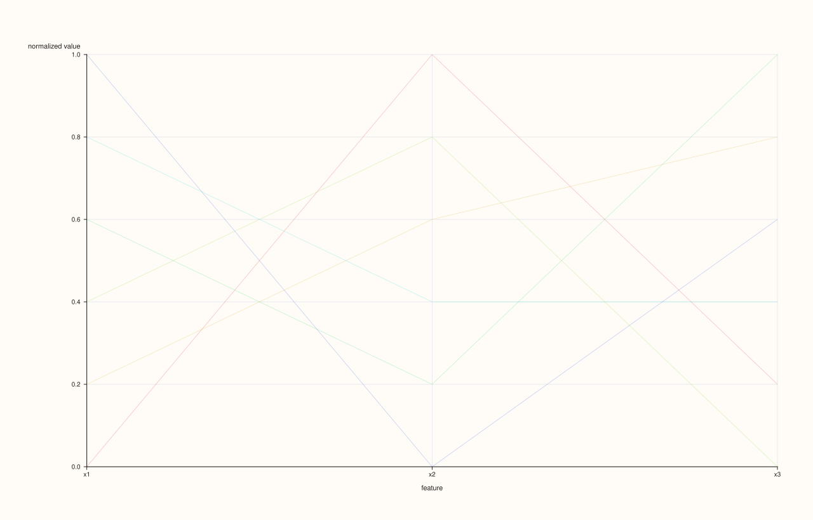
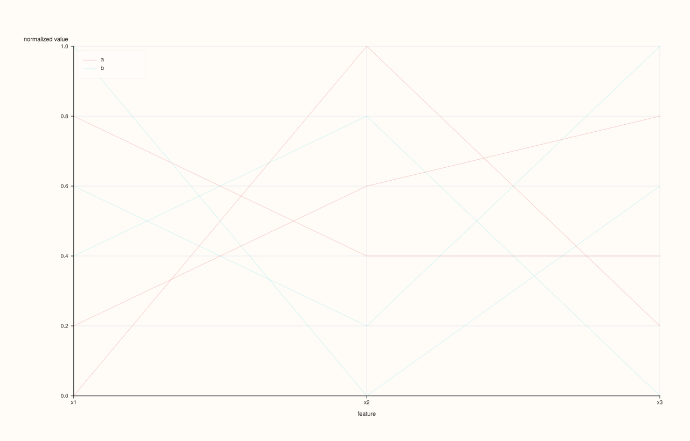
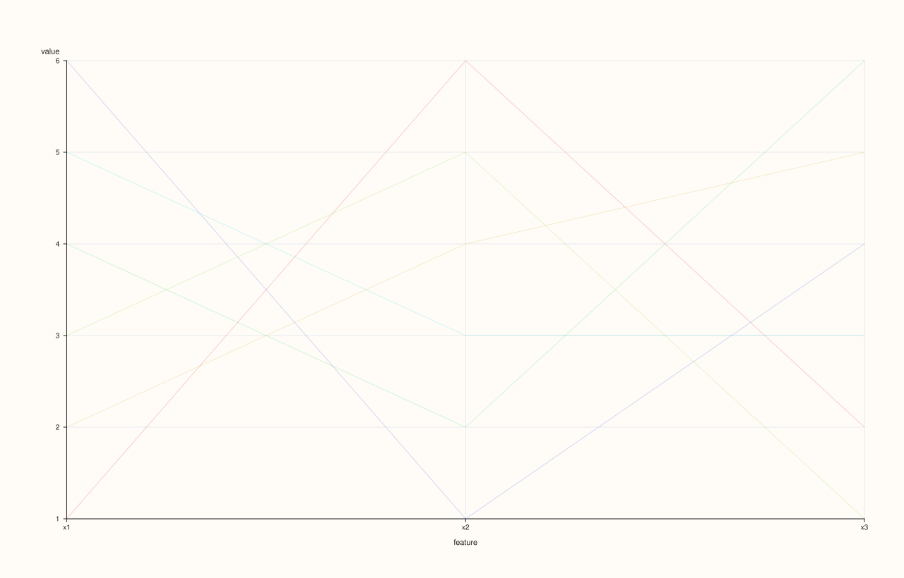
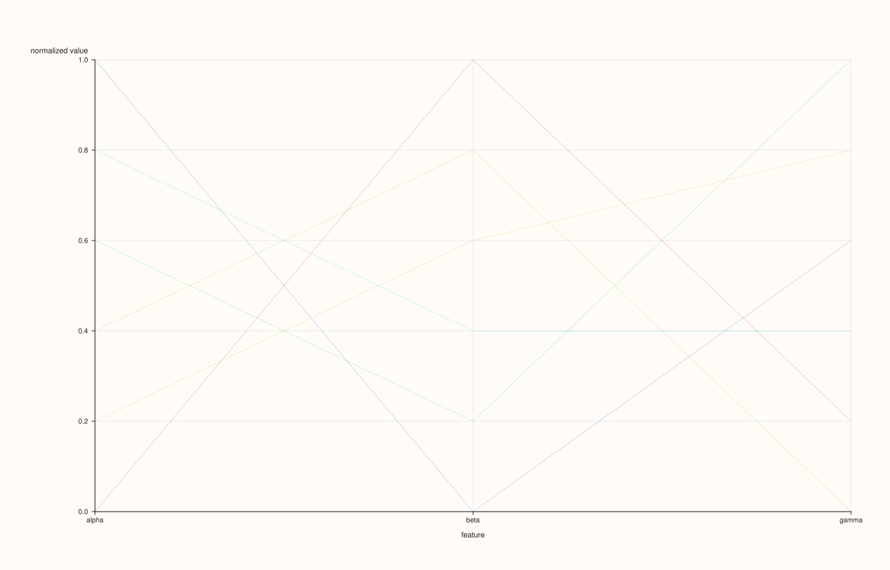

<!-- pluss-hand-authored -->

# flash::parallelplot

[Back to flash API Reference](../../flash_api_reference)

## Signatures

```cpp
Studio& flash::parallelplot(Studio& studio, pluss::msharp::RangeView::Series columns,
                             const ParallelCoordinatesOptions& options = {})

Studio& flash::parallelplot(Studio& studio, pluss::msharp::RangeView::Series columns,
                             const Note& group_labels,
                             const ParallelCoordinatesOptions& options = {})

Studio& flash::parallelplot(Studio& studio, const Dataset& data,
                             const ParallelCoordinatesOptions& options = {})

Studio& flash::parallelplot(Studio& studio, const Series& matrix,
                             const MatrixFrameOptions& frame_options,
                             const ParallelCoordinatesOptions& options = {})

Studio& flash::parallelplot(Studio& studio, const Series& matrix,
                             pluss::msharp::RangeView::Of<std::string_view> feature_names,
                             Axis feature_axis, const ParallelCoordinatesOptions& options = {})

Studio& flash::parallelplot(Studio& studio, const Series& matrix,
                             const std::vector<std::string>& feature_names,
                             Axis feature_axis, const ParallelCoordinatesOptions& options = {})

Studio& flash::parallelplot(Studio& studio, const Series& matrix,
                             std::initializer_list<std::string_view> feature_names,
                             Axis feature_axis, const ParallelCoordinatesOptions& options = {})

Studio& flash::parallelplot(Studio& studio, const Series& matrix,
                             const ParallelCoordinatesOptions& options = {})
```

## What It Does

Draws a parallel-coordinates plot: one vertical axis per feature, laid out left to right
at ordinal x-positions `0, 1, 2, …`, with one line per row/observation connecting its
value on every feature's axis. This is the classic way to eyeball many features at once
in a single 2D [`Studio::pane2`](../studio/pane2.md) — every row becomes a single polyline via
[`Pane::trend`](../pane/trend.md), so `n` rows means `n` overlapping traces, which is why
`alpha` (translucency) and `max_points` (a hard row cap) both exist by default.

Eight overloads: a plain `columns` form (every row drawn in one uniform, semi-transparent
color); a `columns` + `group_labels` form (rows colored and legended by group, one color
per distinct label); a `Dataset` form (see the [`flash::pairplot`](pairplot.md) page);
and five matrix forms mirroring [`flash::pairplot`](pairplot.md)'s matrix-overload shape.

```{important} normalize defaults to true -- each feature is independently min-max scaled to [0, 1]
With normalize = true (the default), every feature's values are independently
rescaled to [0, 1] before plotting (min -> 0, max -> 1) via an internal
min-max normalization -- necessary for parallel coordinates to be readable
at all when features are on wildly different scales. A feature with no
variance (or non-finite min/max) normalizes to a flat 0.0 for every row,
rather than dividing by zero. Set normalize = false to plot each feature's
raw values on its own axis instead, which renders differently from the default.
```

## `ParallelCoordinatesOptions` fields

| Field | Type and default | Description |
|---|---|---|
| `labels` | `std::vector<std::string>`, default empty | Per-feature x-axis tick labels. Falls back to `"x1"`, `"x2"`, … when its length doesn't match the feature count. |
| `normalize` | `bool`, default `true` | See the important callout above. |
| `max_points` | `std::int64_t`, default `1200` | Row-count cap — rows beyond this are deterministically downsampled to an evenly-strided subset (same mechanism shared across the `flash::` multivariate-view family). With the `group_labels` overload, the group-label vector is downsampled in lockstep with the rows. |
| `alpha` | `double`, default `0.24` | Per-line opacity, in (0, 1]; a value outside it throws `pluss::Error`. Values below `0.999` mark the trace transparent. Low default opacity is what makes overlapping lines readable as density rather than a solid mass. |
| `trace_width` | `float`, default `0.9F` | Stroke width for every line. |
| `show_grid` | `bool`, default `true` | Whether the pane gets `GridStyle::Major` gridlines (`true`) or `GridStyle::None` (`false`). |
| `show_legend` | `bool`, default `true` | Whether a legend is drawn (`KeyPlace::Auto`) or suppressed (`KeyPlace::None`). With the plain (no `group_labels`) overload there's nothing to legend regardless — every line uses the same uniform color and none are `label()`-ed — so this only visibly matters for the `group_labels` overload. |

## Parameters

**studio** (`Studio&`)
    The figure to populate — a single new [`Studio::pane2`](../studio/pane2.md) pane.

**columns** (`pluss::msharp::RangeView::Series`)
    One entry per feature. Must contain at least two features, or `parallelplot` throws
    `pluss::Error("flash::parallelplot requires at least two columns")`, and
    every column must be the same length (`"flash::parallelplot requires equal-length
    columns"` on mismatch, via the shared `detail::require_equal_lengths` check).

**group_labels** (`const Note&`, group-labels overload only)
    One label per row, used to color and legend each row's line by group instead of a
    uniform color. Its length must exactly match the row count, or `parallelplot` throws
    `pluss::Error("flash::parallelplot: group label length must match rows")`.

**data** (`const Dataset&`, Dataset overload only)
    See `flash::make_dataset` on the [`flash::pairplot`](pairplot.md) page.

**matrix**, **frame_options**, **feature_names**, **feature_axis** (matrix overloads)
    Identical shape and behavior to [`flash::pairplot`](pairplot.md)'s matrix overloads —
    see that page's Parameters section for the full description.

**options** (`const ParallelCoordinatesOptions&`, optional)
    See the field table above.

## Returns

`Studio&`
    A reference to the same figure, for chaining.

## Examples

Example 1. Default overload — three features, every row drawn in one uniform,
semi-transparent color.

```cpp
using namespace pluss::pl;

auto fig = studio("flash_parallelplot_default");
std::vector<pluss::Series> cols{
    pluss::make_series(std::vector<double>{1.0, 2.0, 3.0, 4.0, 5.0, 6.0}, {6}),
    pluss::make_series(std::vector<double>{6.0, 4.0, 5.0, 2.0, 3.0, 1.0}, {6}),
    pluss::make_series(std::vector<double>{2.0, 5.0, 1.0, 6.0, 3.0, 4.0}, {6})};
flash::parallelplot(fig, pluss::msharp::RangeView::Series(cols));
fig.show();
```



Example 2. `group_labels` overload — rows colored and legended by group (`"a"`/`"b"`).

```cpp
using namespace pluss::pl;

auto fig = studio("flash_parallelplot_classes");
std::vector<pluss::Series> cols{
    pluss::make_series(std::vector<double>{1.0, 2.0, 3.0, 4.0, 5.0, 6.0}, {6}),
    pluss::make_series(std::vector<double>{6.0, 4.0, 5.0, 2.0, 3.0, 1.0}, {6}),
    pluss::make_series(std::vector<double>{2.0, 5.0, 1.0, 6.0, 3.0, 4.0}, {6})};
auto classes = pluss::note::make({"a", "a", "b", "b", "a", "b"});
flash::parallelplot(fig, pluss::msharp::RangeView::Series(cols), classes);
fig.show();
```



Example 3 (a comparison, not a new picture). `normalize = false` renders
differently from the default.

```cpp
using namespace pluss::pl;

std::vector<pluss::Series> cols1{
    pluss::make_series(std::vector<double>{1.0, 2.0, 3.0, 4.0, 5.0, 6.0}, {6}),
    pluss::make_series(std::vector<double>{6.0, 4.0, 5.0, 2.0, 3.0, 1.0}, {6}),
    pluss::make_series(std::vector<double>{2.0, 5.0, 1.0, 6.0, 3.0, 4.0}, {6})};
auto fig1 = studio("flash_parallelplot_norm_on");
flash::parallelplot(fig1, pluss::msharp::RangeView::Series(cols1));

std::vector<pluss::Series> cols2{
    pluss::make_series(std::vector<double>{1.0, 2.0, 3.0, 4.0, 5.0, 6.0}, {6}),
    pluss::make_series(std::vector<double>{6.0, 4.0, 5.0, 2.0, 3.0, 1.0}, {6}),
    pluss::make_series(std::vector<double>{2.0, 5.0, 1.0, 6.0, 3.0, 4.0}, {6})};
auto fig2 = studio("flash_parallelplot_norm_off");
flash::ParallelCoordinatesOptions opts;
opts.normalize = false;
flash::parallelplot(fig2, pluss::msharp::RangeView::Series(cols2), opts);

std::cout << "parallelplot normalize=true vs false differ: " << (fig1.to_svg() != fig2.to_svg()) << "\n";
fig2.show();
```

Output:

```text
parallelplot normalize=true vs false differ: 1
```



Example 4. `Dataset` overload, via `flash::make_dataset`.

```cpp
using namespace pluss::pl;

auto fig = studio("flash_parallelplot_dataset");
auto data = flash::make_dataset(
    {pluss::make_series(std::vector<double>{1.0, 2.0, 3.0, 4.0, 5.0, 6.0}, {6}),
     pluss::make_series(std::vector<double>{6.0, 4.0, 5.0, 2.0, 3.0, 1.0}, {6}),
     pluss::make_series(std::vector<double>{2.0, 5.0, 1.0, 6.0, 3.0, 4.0}, {6})},
    {"alpha", "beta", "gamma"});
flash::parallelplot(fig, data);
fig.show();
```



Example 5. Matrix + feature-names + `Axis` overload.

```cpp
using namespace pluss::pl;

std::vector<double> a{1.0, 2.0, 3.0, 4.0, 5.0, 6.0};
std::vector<double> b{6.0, 4.0, 5.0, 2.0, 3.0, 1.0};
std::vector<double> c{2.0, 5.0, 1.0, 6.0, 3.0, 4.0};
std::vector<double> flat;
for (std::size_t i = 0; i < a.size(); ++i) { flat.push_back(a[i]); flat.push_back(b[i]); flat.push_back(c[i]); }
auto matrix = pluss::make_series(flat, {6, 3});

auto fig = studio("flash_parallelplot_matrix");
flash::parallelplot(fig, matrix, {"alpha", "beta", "gamma"}, flash::Axis::Cols);
fig.show();
```


Example 6 (edge case). Fewer than two columns throws.

```cpp
using namespace pluss::pl;

auto fig = studio("flash_parallelplot_too_few");
std::vector<pluss::Series> cols{pluss::make_series(std::vector<double>{1.0, 2.0, 3.0, 4.0, 5.0, 6.0}, {6})};
try {
  flash::parallelplot(fig, pluss::msharp::RangeView::Series(cols));
} catch (const pluss::Error& e) {
  std::cout << "parallelplot(1 col) threw: " << e.message() << "\n";
}
```

Output:

```text
parallelplot(1 col) threw: flash::parallelplot requires at least two columns
```

Example 7 (edge case). A `group_labels` length that doesn't match the row count throws.

```cpp
using namespace pluss::pl;

auto fig = studio("flash_parallelplot_mismatch");
std::vector<pluss::Series> cols{
    pluss::make_series(std::vector<double>{1.0, 2.0, 3.0, 4.0, 5.0, 6.0}, {6}),
    pluss::make_series(std::vector<double>{6.0, 4.0, 5.0, 2.0, 3.0, 1.0}, {6})};
auto bad_classes = pluss::note::make({"a", "b"});
try {
  flash::parallelplot(fig, pluss::msharp::RangeView::Series(cols), bad_classes);
} catch (const pluss::Error& e) {
  std::cout << "parallelplot(group length mismatch) threw: " << e.message() << "\n";
}
```

Output:

```text
parallelplot(group length mismatch) threw: flash::parallelplot: group label length must match rows
```

## Notes

- Not `noexcept`.
- x-positions are always ordinal integers `0, 1, 2, …` — one per feature, evenly spaced,
  regardless of feature count or `labels`.
- The plain overload emits one anonymous trace per row (no `label()` call); the
  `group_labels` overload emits `label()` only once per distinct group (the first row of
  each group), so the legend shows one entry per group rather than one per row.
- Shares `max_points` downsampling, `Dataset`/matrix-overload shapes, and feature-label
  fallback rules with [`flash::andrews_curves`](andrews_curves.md) and
  [`flash::radviz`](radviz.md) — all three are siblings in the same
  curve/glyph-per-observation family.

## See Also

- [`flash::andrews_curves`](andrews_curves.md), [`flash::radviz`](radviz.md): sibling
  multivariate views over the same kind of per-row, per-feature input.
- [`flash::pairplot`](pairplot.md): the `Dataset`/matrix-overload shape this page's
  overloads mirror.
- [`Pane::trend`](../pane/trend.md): the native method drawing each row's polyline.

<div group="pluss-inline-prev-next">
  <a group="prev-link" href="triplot.html">
    <span group="label">Previous</span>
    <span group="title">triplot</span>
  </a>
  <a group="next-link" href="andrews_curves.html">
    <span group="label">Next</span>
    <span group="title">andrews_curves</span>
  </a>
</div>
