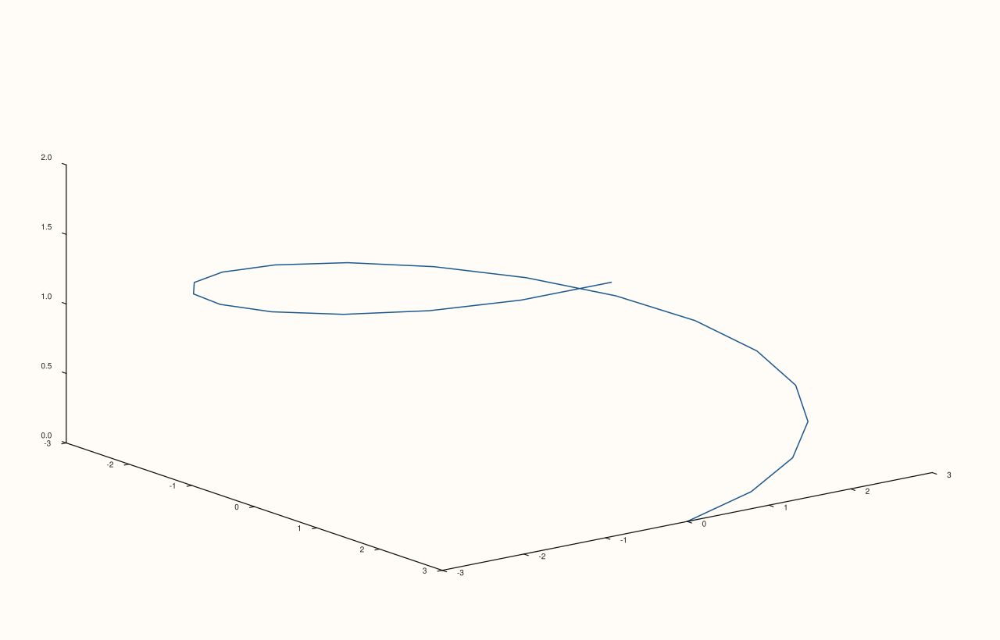

<!-- pluss-hand-authored -->

# flash::path3

[Back to flash API Reference](../../flash_api_reference)

## Signatures

```cpp
template <class X, class Y, class Z>
Trace& flash::path3(Pane& pane, X&& x, Y&& y, Z&& z)

template <class X, class Y, class Z>
Trace& flash::path3(Studio& studio, X&& x, Y&& y, Z&& z, std::string title = {})
```

## What It Does

A thin wrapper around [`Pane::path3`](../pane/path3.md): converts `x`/`y`/`z` to `Series`,
validates each is rank ≤ 3, then delegates to `pane.path3(x, y, z)`. The `Pane` overload
is byte-identical to calling `Pane::path3` directly — directly verified via SVG
comparison. The `Studio` overload additionally creates a new
[`Volumetric`](../studio/pane3.md) pane for you via `studio.pane3(title)`, so you never
have to create the pane yourself first.

```{important} Every flash:: 3D-native function shares this exact two-part pattern
path3, cloud3, sheet, lattice, spire3, ridge3, and isoshell all follow the identical
shape: a Pane overload that Series-converts its arguments, checks each is rank <= 3
via a shared internal helper, and calls the identically-named native Pane method --
plus, for path3/cloud3/sheet/lattice only (not spire3/ridge3/isoshell), a bonus Studio
overload that creates the Volumetric pane for you. Every one of these Pane-overload
delegations was directly verified to render byte-identical output to calling the
native Pane method with the same arguments -- see each function's own page in this
family for its own verification.
```

## Parameters

**pane** (`Pane&`, Pane overload)
    The target pane. Must be `Volumetric` — see [`Pane::path3`](../pane/path3.md)'s own
    important callout for the exact error thrown otherwise.

**studio** (`Studio&`, Studio overload)
    The figure to create a new `Volumetric` pane in.

**x**, **y**, **z** (series-convertible, must each be rank ≤ 3)
    The trajectory coordinates. A rank-4-or-higher input throws
    `std::invalid_argument("flash::path3: expected input rank <= 3")` — see
    [`Pane::path3`](../pane/path3.md) for the coordinate-length-matching requirements this
    layer doesn't itself add anything to.

**title** (`std::string`, default `{}`, Studio overload only)
    Forwarded to `Studio::pane3` as the new pane's title.

## Returns

`Trace&`
    A reference to the newly created trace, for chaining.

## Examples

Example 1. `Pane` overload — a helical trajectory, same data as
[`Pane::path3`](../pane/path3.md)'s own first example.

```cpp
using namespace pluss::pl;

auto fig = studio("flash_path3_pane");
auto& pane = fig.pane3();
std::vector<double> t;
for (int i = 0; i <= 20; ++i) t.push_back(i * 0.3);
std::vector<double> px, py, pz;
for (double v : t) {
  px.push_back(std::cos(v) * 3.0);
  py.push_back(std::sin(v) * 3.0);
  pz.push_back(v * 0.3);
}
flash::path3(pane, px, py, pz);
fig.show();
```



Example 2. `Studio` overload — no explicit `pane3()` call needed.

```cpp
using namespace pluss::pl;

auto fig = studio("flash_path3_studio");
std::vector<double> t;
for (int i = 0; i <= 20; ++i) t.push_back(i * 0.3);
std::vector<double> px, py, pz;
for (double v : t) {
  px.push_back(std::cos(v) * 3.0);
  py.push_back(std::sin(v) * 3.0);
  pz.push_back(v * 0.3);
}
flash::path3(fig, px, py, pz);
fig.show();
```


Example 3 (verification, not a distinct rendering). `flash::path3(pane, ...)` renders
byte-identical to `pane.path3(...)` called directly, confirming the important callout
above.

```cpp
using namespace pluss::pl;

std::vector<double> t;
for (int i = 0; i <= 20; ++i) t.push_back(i * 0.3);
std::vector<double> px, py, pz;
for (double v : t) {
  px.push_back(std::cos(v) * 3.0);
  py.push_back(std::sin(v) * 3.0);
  pz.push_back(v * 0.3);
}

auto fig1 = studio("flash_path3_flash");
auto& pane1 = fig1.pane3();
flash::path3(pane1, px, py, pz);

auto fig2 = studio("flash_path3_native");
auto& pane2 = fig2.pane3();
pane2.path3(px, py, pz);

std::cout << "flash::path3(pane,...) == pane.path3(...): " << (fig1.to_svg() == fig2.to_svg()) << "\n";
```

Output:

```text
flash::path3(pane,...) == pane.path3(...): 1
```

## Notes

- Not `noexcept`.
- See [`Pane::path3`](../pane/path3.md) for what actually gets rendered — this page only
  documents the `flash::` layer's own validation and the Studio-overload convenience.

## See Also

- [`Pane::path3`](../pane/path3.md): the underlying native method this function
  delegates to entirely.
- [`flash::cloud3`](cloud3.md): the point-cloud sibling in this same 3D-native family.
- [`Studio::pane3`](../studio/pane3.md): what the `Studio` overload calls internally.

<div class="pluss-inline-prev-next">
  <a class="prev-link" href="bootstrapplot.html">
    <span class="label">Previous</span>
    <span class="title">bootstrapplot</span>
  </a>
  <a class="next-link" href="cloud3.html">
    <span class="label">Next</span>
    <span class="title">cloud3</span>
  </a>
</div>
