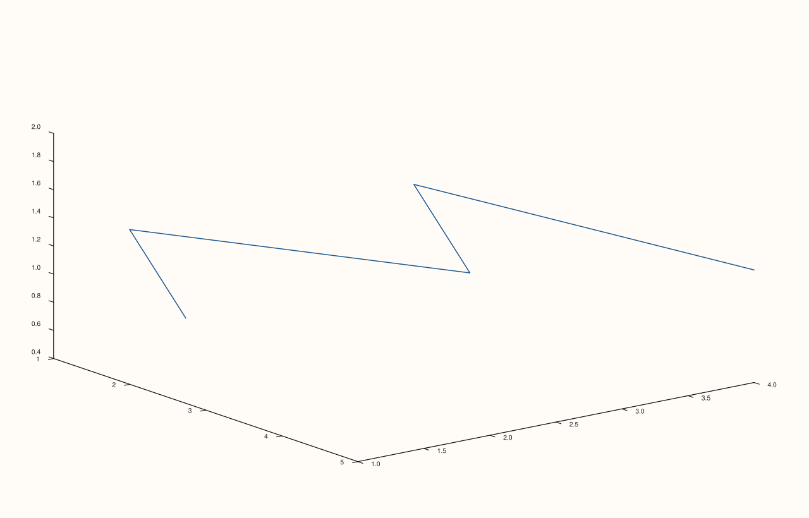
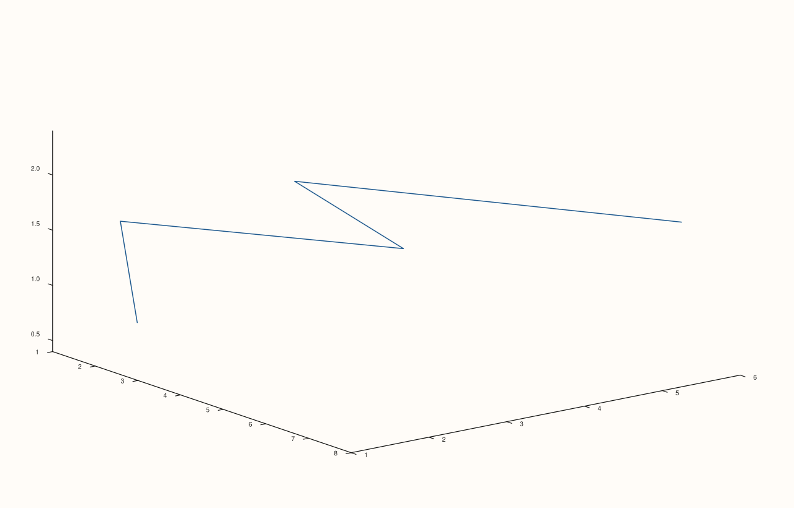

<!-- pluss-hand-authored -->

# flash::path4

[Back to flash API Reference](../../flash_api_reference)

## Signatures

```cpp
Trace& flash::path4(Pane& pane, Series x, Series y, Series z, Series w,
                     const HyperPlotOptions& options = {})

Trace& flash::path4(Studio& studio, Series x, Series y, Series z, Series w,
                     const HyperPlotOptions& options = {}, std::string title = {})
```

## What It Does

Renders a 4-dimensional `(x, y, z, w)` trajectory as a static 3D
[`path3`](path3.md) trace, by first mathematically projecting every 4D point down to 3D
(applying up to six independent plane rotations — `xy`, `xz`, `xw`, `yz`, `yw`, `zw` —
then either dropping `w` outright, under `Orthographic` projection, or using it as a
perspective-foreshortening factor, under `PerspectiveW`), and only then connecting the
projected `(x, y, z)` points as an ordinary 3D path. This is the *static* 4D
visualization primitive — for an animated, browser-rendered sweep through rotation
angles instead, see [`flash::animate4`](animate4.md).

Two overloads: a `Pane`-taking form, and a `Studio`-taking convenience form that creates
a new [`Volumetric`](../studio/pane3.md) pane for you.

## Parameters

**pane** (`Pane&`, Pane overload)
    The target pane. Must be `Volumetric` (since the projected result is drawn via
    [`Pane::path3`](../pane/path3.md)).

**studio** (`Studio&`, Studio overload)
    The figure to create a new `Volumetric` pane in.

**x**, **y**, **z**, **w** (series-convertible, must each be rank ≤ 3 and identical
lengths)
    The 4D trajectory's coordinates. Unequal lengths throw
    `pluss::Error("flash::path4: x, y, z, w must have identical lengths")`
    (thrown by the shared internal projection helper, using this function's own name in
    the message).

**options** (`const HyperPlotOptions&`, optional)
    See the field table below.

**title** (`std::string`, default `{}`, Studio overload only)
    Forwarded to `Studio::pane3` as the new pane's title.

## `HyperPlotOptions` fields

| Field | Type and default | Description |
|---|---|---|
| `projection` | `HyperProjection`, default `Orthographic` | `Orthographic` drops `w` after rotation (a straightforward 4D→3D orthographic projection); `PerspectiveW` instead uses `w` (relative to `w_perspective_distance`) to scale `x`/`y`/`z`, giving points at different `w` positions a visible near/far-style foreshortening. |
| `rot_xy_deg`, `rot_xz_deg`, `rot_xw_deg`, `rot_yz_deg`, `rot_yw_deg`, `rot_zw_deg` | `double`, default `0.0` each | Rotation angles (degrees) in each of the six independent planes a 4D space has — three more than 3D's usual `xy`/`xz`/`yz` set, since 4D introduces `xw`/`yw`/`zw` as well. All default to `0.0` (no rotation). |
| `w_perspective_distance` | `double`, default `3.0` | The `w`-axis "camera distance" used by `PerspectiveW` projection's foreshortening calculation. Unused under `Orthographic`. |
| `w_slice` | `std::optional<Range1d>` — `{ double low; double high; }`, default empty | When set, only points whose *projected* `w` value falls within `[low, high]` participate — every other point is dropped before the 3D path is drawn. Since `path4` connects points into a single continuous path, dropping some points also changes which points are adjacent in the drawn line, not just how many points are shown. If `w_slice` filters out every point, `path4` throws `pluss::Error("flash::path4: no points remain after projection/slice")` — verified below. |
| `point_size` | `double`, default `8.0` | Declared, but not read anywhere in `path4`'s own implementation (it belongs to the `HyperPlotOptions` that [`flash::cloud4`](cloud4.md) shares, where it controls marker size) — `path4` does not use it. |

## Returns

`Trace&`
    A reference to the newly created trace, for chaining.

## Examples

Example 1. `Pane` overload, default options (`Orthographic` projection, no rotation, no
slice).

```cpp
using namespace pluss::pl;

auto fig = studio("flash_path4_pane");
auto& pane = fig.pane3();
std::vector<double> x{1.0, 2.0, 3.0, 4.0, 5.0};
std::vector<double> y{2.0, 1.0, 3.0, 2.0, 4.0};
std::vector<double> z{0.5, 1.5, 1.0, 2.0, 1.2};
std::vector<double> w{0.1, 0.4, 0.7, 0.3, 0.9};
flash::path4(pane, x, y, z, w);
fig.show();
```



Example 2. `Studio` overload — no explicit `pane3()` call needed.

```cpp
using namespace pluss::pl;

auto fig = studio("flash_path4_studio");
std::vector<double> x{1.0, 2.0, 3.0, 4.0, 5.0};
std::vector<double> y{2.0, 1.0, 3.0, 2.0, 4.0};
std::vector<double> z{0.5, 1.5, 1.0, 2.0, 1.2};
std::vector<double> w{0.1, 0.4, 0.7, 0.3, 0.9};
flash::path4(fig, x, y, z, w);
fig.show();
```


Example 3 (a comparison, not a new picture). `projection = PerspectiveW` renders
differently from the `Orthographic` default.

```cpp
using namespace pluss::pl;

std::vector<double> x{1.0, 2.0, 3.0, 4.0, 5.0};
std::vector<double> y{2.0, 1.0, 3.0, 2.0, 4.0};
std::vector<double> z{0.5, 1.5, 1.0, 2.0, 1.2};
std::vector<double> w{0.1, 0.4, 0.7, 0.3, 0.9};

auto fig1 = studio("flash_path4_ortho_cmp");
auto& pane1 = fig1.pane3();
flash::path4(pane1, x, y, z, w);

auto fig2 = studio("flash_path4_perspective");
auto& pane2 = fig2.pane3();
flash::HyperPlotOptions opts;
opts.projection = flash::HyperProjection::PerspectiveW;
flash::path4(pane2, x, y, z, w, opts);

std::cout << "path4 orthographic vs perspective differ: " << (fig1.to_svg() != fig2.to_svg()) << "\n";
fig2.show();
```

Output:

```text
path4 orthographic vs perspective differ: 1
```



Example 4 (edge case). A `w_slice` range that excludes every point throws.

```cpp
using namespace pluss::pl;

auto fig = studio("flash_path4_empty_slice");
auto& pane = fig.pane3();
std::vector<double> x{1.0, 2.0};
std::vector<double> y{1.0, 2.0};
std::vector<double> z{1.0, 2.0};
std::vector<double> w{5.0, 6.0};
flash::HyperPlotOptions opts;
opts.w_slice = Range1d{-1.0, -0.5};
try {
  flash::path4(pane, x, y, z, w, opts);
} catch (const pluss::Error& e) {
  std::string msg(e.message());
  std::cout << "path4(all points sliced out) threw: " << msg.substr(0, msg.find('\n')) << "\n";
}
```

Output:

```text
path4(all points sliced out) threw: flash::path4: no points remain after projection/slice
```

## Notes

- Not `noexcept`.
- `point_size` is declared on `HyperPlotOptions` but only consumed by
  [`flash::cloud4`](cloud4.md) — inert on `path4`.
- Rotation is applied around the origin in all six planes before projection/slicing —
  there is no separate "center of rotation" configuration.
- Both `x`/`y`/`z`/`w` must be equal-length (validated as a single combined check, not
  per-pair).

## See Also

- [`flash::cloud4`](cloud4.md): the point-cloud sibling, sharing the exact same
  `HyperPlotOptions` (where `point_size` is consumed).
- [`flash::animate4`](animate4.md): the animated, browser-rendered 4D sweep this static
  function is a snapshot-equivalent of.
- [`Pane::path3`](../pane/path3.md): what the projected 3D result is ultimately drawn
  through.
- [`Studio::pane3`](../studio/pane3.md): what the `Studio` overload calls internally.

<div class="pluss-inline-prev-next">
  <a class="prev-link" href="trace3d.html">
    <span class="label">Previous</span>
    <span class="title">trace3d</span>
  </a>
  <a class="next-link" href="cloud4.html">
    <span class="label">Next</span>
    <span class="title">cloud4</span>
  </a>
</div>
