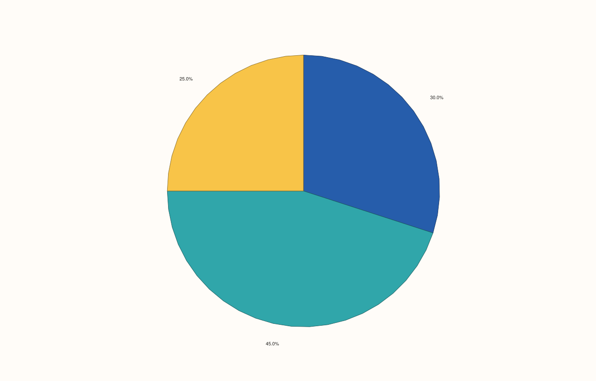

<!-- pluss-hand-authored -->

# flash::pieplot

[Back to flash API Reference](../../flash_api_reference)

## Signatures

```cpp
template <class Values>
Trace& flash::pieplot(Pane& pane, Values&& values)

template <class Values>
Trace& flash::pieplot(Pane& pane, Values&& values,
                       pluss::msharp::RangeView::Of<std::string_view> labels)

template <class Values>
Trace& flash::pieplot(Pane& pane, Values&& values,
                       std::initializer_list<std::string_view> labels)
```

## What It Does

Draws a pie chart via [`Pane::wedge`](../pane/wedge.md) — one wedge per value,
proportional to that value's share of the total. Three overloads:

- **`pieplot(pane, values)`** — unlabeled wedges.
- **`pieplot(pane, values, labels)`** (`RangeView` form) — one label per wedge, in
  `values` order.
- **`pieplot(pane, values, {"a", "b", ...})`** (brace-init-list form) — the same, spelled
  with a plain `std::initializer_list<std::string_view>` for convenient inline literals;
  forwards to the `RangeView` overload.

```{important} No explode/offset overload reachable through pieplot()
Pane::wedge itself has two additional overloads accepting an explode
series -- a per-wedge radial offset that visually separates a slice from the
pie (the classic "exploded pie chart" effect). Neither is wrapped by
flash::pieplot() -- if you want exploded wedges, call Pane::wedge directly
with its (values, explode, labels) overload.
```

## Parameters

**pane** (`Pane&`)
    The target pane. Must be `Planar` (2D).

**values** (series-convertible)
    The wedge magnitudes. Rendered proportionally to their share of the sum — they need
    not already sum to 1 or 100.

**labels** (`RangeView::Of<std::string_view>` or `std::initializer_list<std::string_view>`,
optional)
    One label per wedge, in `values` order. Omit for unlabeled wedges.

## Returns

`Trace&`
    A reference to the newly created (wedge) trace.

## Examples

Example 1. Unlabeled wedges.

```cpp
using namespace pluss::pl;

auto fig = studio("flash_pieplot_default");
auto& pane = fig.pane2();
std::vector<double> values{30.0, 45.0, 25.0};
flash::pieplot(pane, values);
fig.show();
```



Example 2. Labeled wedges via the brace-init-list convenience overload.

```cpp
using namespace pluss::pl;

auto fig = studio("flash_pieplot_labels");
auto& pane = fig.pane2();
std::vector<double> values{30.0, 45.0, 25.0};
flash::pieplot(pane, values, {"cats", "dogs", "birds"});
fig.show();
```


Example 3. The `RangeView` overload constructed directly, rather than via the
brace-init-list convenience form — verified byte-identical to Example 2's output, since
the brace-init-list overload does nothing but forward into this one.

```cpp
using namespace pluss::pl;

auto fig = studio("flash_pieplot_rangeview");
auto& pane = fig.pane2();
std::vector<double> values{30.0, 45.0, 25.0};
std::vector<std::string_view> label_vec{"cats", "dogs", "birds"};
pluss::msharp::RangeView::Of<std::string_view> labels(label_vec);
flash::pieplot(pane, values, labels);
fig.show();
```


## Notes

- Not `noexcept`.
- No `Note`-taking overload exists — unlike the rest of this family, `pieplot()` never
  auto-derives wedge labels from a categorical variable; you always supply `values`
  (already aggregated per category) and, optionally, `labels` in matching order.
- `labels`, if given, must have exactly as many entries as `values` — mismatched lengths
  are a `Pane::wedge`-level concern, not validated by `pieplot()` itself.

## See Also

- [`Pane::wedge`](../pane/wedge.md): the underlying method, including its two
  explode-offset overloads not reachable through `pieplot()`.
- [`flash::countplot`](countplot.md): a related way to turn per-category tallies into a
  chart, as bars instead of wedges.

<div class="pluss-inline-prev-next">
  <a class="prev-link" href="countplot.html">
    <span class="label">Previous</span>
    <span class="title">countplot</span>
  </a>
  <a class="next-link" href="catplot.html">
    <span class="label">Next</span>
    <span class="title">catplot</span>
  </a>
</div>
