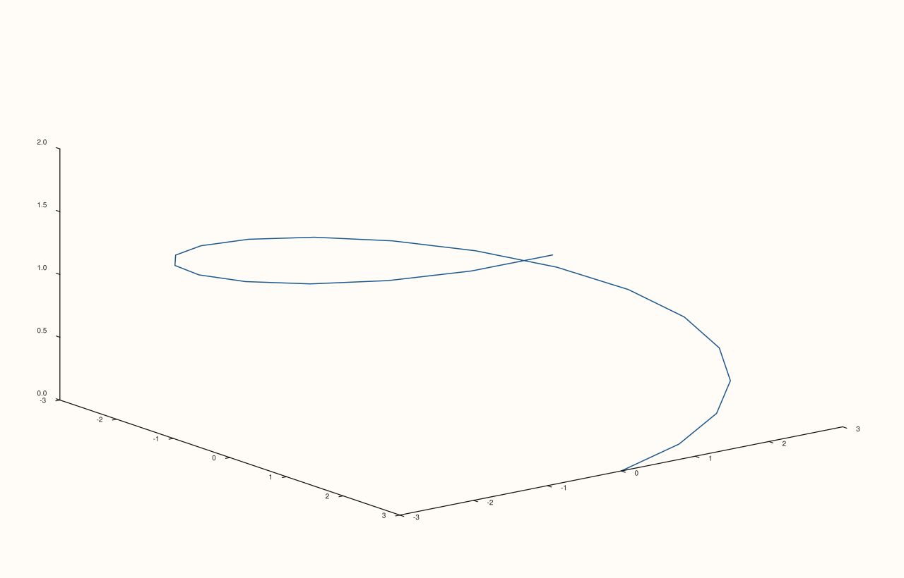

<!-- pluss-hand-authored -->

# flash::plot3D

[Back to flash API Reference](../../flash_api_reference)

## Signature

```cpp
template <class X, class Y, class Z>
Trace& flash::plot3D(Pane& pane, X&& x, Y&& y, Z&& z)
```

## What It Does

A pure, one-line rename of [`flash::path3`](path3.md) — `plot3D(pane, x, y, z)` is exactly
`path3(pane, x, y, z)`, nothing more. Exists purely to offer a shorter, more
familiar name some callers already expect. Directly verified byte-identical.

## Parameters

**pane** (`Pane&`)
    The target pane. Must be `Volumetric`.

**x**, **y**, **z** (series-convertible, must each be rank ≤ 3)
    The trajectory coordinates — identical requirements to [`flash::path3`](path3.md).

## Returns

`Trace&`
    A reference to the newly created trace, for chaining.

## Examples

Example 1. Same helical trajectory as [`flash::path3`](path3.md)'s own example.

```cpp
using namespace pluss::pl;

auto fig = studio("flash_plot3D");
auto& pane = fig.pane3();
std::vector<double> t;
for (int i = 0; i <= 20; ++i) t.push_back(i * 0.3);
std::vector<double> px, py, pz;
for (double v : t) {
  px.push_back(std::cos(v) * 3.0);
  py.push_back(std::sin(v) * 3.0);
  pz.push_back(v * 0.3);
}
flash::plot3D(pane, px, py, pz);
fig.show();
```



Example 2 (verification, not a distinct rendering). `flash::plot3D` renders
byte-identical to `flash::path3` given the same arguments.

```cpp
using namespace pluss::pl;

std::vector<double> t;
for (int i = 0; i <= 20; ++i) t.push_back(i * 0.3);
std::vector<double> px, py, pz;
for (double v : t) {
  px.push_back(std::cos(v) * 3.0);
  py.push_back(std::sin(v) * 3.0);
  pz.push_back(v * 0.3);
}

auto fig1 = studio("flash_plot3D_cmp1");
auto& pane1 = fig1.pane3();
flash::plot3D(pane1, px, py, pz);

auto fig2 = studio("flash_plot3D_cmp2");
auto& pane2 = fig2.pane3();
flash::path3(pane2, px, py, pz);

std::cout << "plot3D == path3: " << (fig1.to_svg() == fig2.to_svg()) << "\n";
```

Output:

```text
plot3D == path3: 1
```

## Notes

- Not `noexcept`.
- No `Studio`-taking overload — same as [`flash::path3`](path3.md)'s own `Pane`
  overload (though `path3` additionally has a `Studio` overload this alias doesn't
  mirror).

## See Also

- [`flash::path3`](path3.md): the function this is a pure rename of.
- [`flash::scatter3D`](scatter3D.md), [`flash::plot_surface`](plot_surface.md),
  [`flash::plot_wireframe`](plot_wireframe.md), [`flash::contour3D`](contour3D.md),
  [`flash::bar3d`](bar3d.md): the other familiar-naming aliases in this family.

<div class="pluss-inline-prev-next">
  <a class="prev-link" href="isoshell.html">
    <span class="label">Previous</span>
    <span class="title">isoshell</span>
  </a>
  <a class="next-link" href="scatter3D.html">
    <span class="label">Next</span>
    <span class="title">scatter3D</span>
  </a>
</div>
