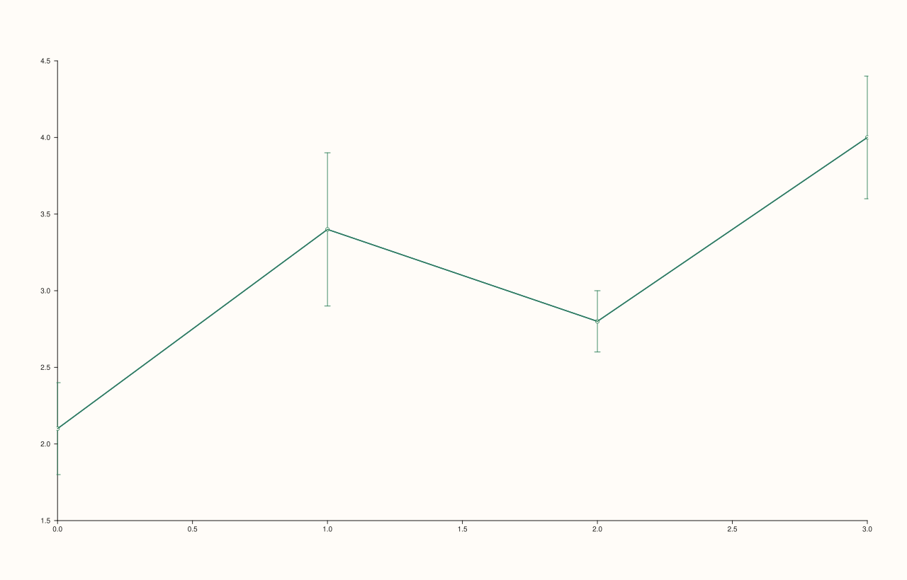
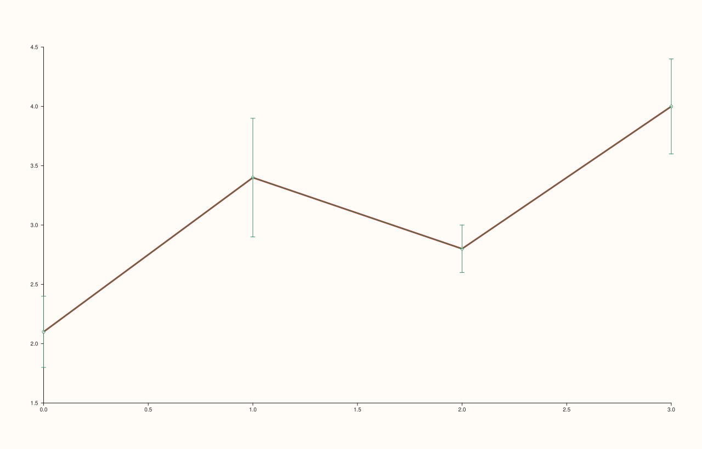

<!-- pluss-hand-authored -->

# flash::pointplot

[Back to flash API Reference](../../flash_api_reference)

## Signatures

```cpp
Trace& flash::pointplot(Pane& pane, Series x, Series y, Series err)
```

## What It Does

Draws the classic "mean-with-error-bars-and-connecting-line" summary view — a
[`flash::lineplot`](lineplot.md) connecting the `y` points, **plus** a
[`Pane::whisk`](../pane/whisk.md) drawing a symmetric vertical error bar at each point
from `err`. There is only one overload.

```{important} Draws two traces but returns only the error-bar trace
pointplot() calls flash::lineplot(pane, x, y) first (its return value is
discarded), then draws and returns the Pane::whisk error-bar trace. Both traces
land in the pane -- the line is rendered -- but you only get a
Trace& handle to the whisk trace. If you need to style the connecting line
(width, color, dash pattern), call flash::lineplot() yourself first and style
its returned Trace& directly, then draw pointplot()'s error bars separately,
or draw the two pieces manually via Pane::trend/Pane::whisk.
```

```{important} err must be precomputed -- no automatic confidence-interval estimation
flash::pointplot() does not bootstrap a confidence interval from raw per-category
observations -- it always takes
a precomputed err series and applies it symmetrically above and below each
y value -- one error magnitude per point. If you need bootstrapped or
asymmetric confidence intervals, compute them yourself (see flash::regplot's
show_ci option for one example of that machinery) and pass the result as
err, or use flash::whiskplot()'s 6-argument asymmetric overload directly.
```

## Parameters

**pane** (`Pane&`)
    The target pane. Must be `Planar` (2D).

**x** (series-convertible)
    The x-axis positions, shared by both the line and the error bars.

**y** (series-convertible)
    The y-axis values, shared by both the line and the error bars.

**err** (series-convertible)
    The symmetric error magnitude at each point — applied identically above (`y + err`)
    and below (`y - err`) every point.

## Returns

`Trace&`
    A reference to the error-bar (whisk) trace — **not** the connecting-line trace. See
    the important callout above.

## Examples

Example 1. A basic point plot with a connecting line and symmetric error bars, which
draws exactly two traces (one line, one whisk) and returns the whisk trace.

```cpp
using namespace pluss::pl;

auto fig = studio("flash_pointplot_default");
auto& pane = fig.pane2();
std::vector<double> x{0.0, 1.0, 2.0, 3.0};
std::vector<double> y{2.1, 3.4, 2.8, 4.0};
std::vector<double> err{0.3, 0.5, 0.2, 0.4};
Trace& t = flash::pointplot(pane, x, y, err);
std::cout << "pointplot trace kind is Whisk (line trace discarded): " << (t.kind() == TraceKind::Whisk) << "\n";
std::cout << "pointplot pane trace count (line + whisk): " << pane.traces().size() << "\n";
fig.show();
```

Output:

```text
pointplot trace kind is Whisk (line trace discarded): 1
pointplot pane trace count (line + whisk): 2
```



Example 2. The documented workaround for styling the connecting line: skip `pointplot()`
entirely and draw the two pieces manually via `Pane::trend`/`Pane::whisk`, exactly as the
important callout above recommends.

```cpp
using namespace pluss::pl;

auto fig = studio("flash_pointplot_manual_styled");
auto& pane = fig.pane2();
std::vector<double> x{0.0, 1.0, 2.0, 3.0};
std::vector<double> y{2.1, 3.4, 2.8, 4.0};
std::vector<double> err{0.3, 0.5, 0.2, 0.4};
Trace& line = pane.trend(x, y);
line.width(3.0F).stroke(Rgba::from_u8(214, 39, 40));
pane.whisk(x, y, err);
std::cout << "pane trace count: " << pane.traces().size() << " (styled line + whisk)\n";
fig.show();
```

Output:

```text
pane trace count: 2 (styled line + whisk)
```



## Notes

- Not `noexcept`.
- No `Note`/categorical-group overload exists — `x` is always treated as a numeric
  position series. For categorical x-positions, encode them yourself (e.g. via
  `detail`-style category encoding, or simply pass consecutive integers alongside a
  separate `Pane::x_categories()` call).
- [`flash::whiskplot`](whiskplot.md) exposes the same underlying `Pane::whisk` machinery
  directly, without the automatic connecting line — reach for it if you want error bars
  alone.

## See Also

- [`flash::lineplot`](lineplot.md): the connecting-line half of this function.
- [`Pane::whisk`](../pane/whisk.md): the error-bar half of this function, and the
  underlying method `flash::whiskplot` also wraps.
- [`flash::whiskplot`](whiskplot.md): error bars only, with support for full asymmetric
  x/y error in all four directions.

<div class="pluss-inline-prev-next">
  <a class="prev-link" href="boxenplot.html">
    <span class="label">Previous</span>
    <span class="title">boxenplot</span>
  </a>
  <a class="next-link" href="whiskplot.html">
    <span class="label">Next</span>
    <span class="title">whiskplot</span>
  </a>
</div>
