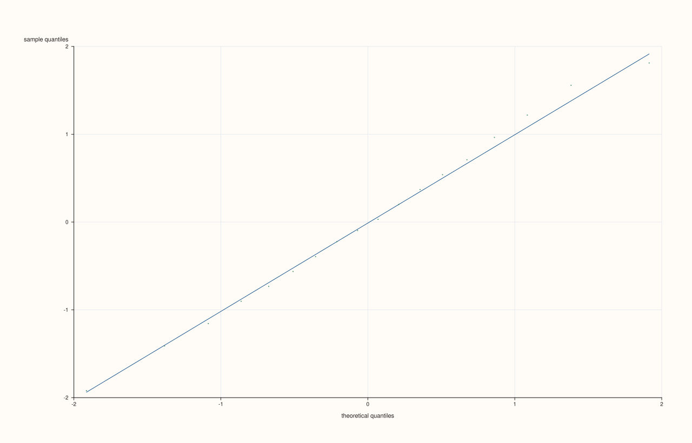
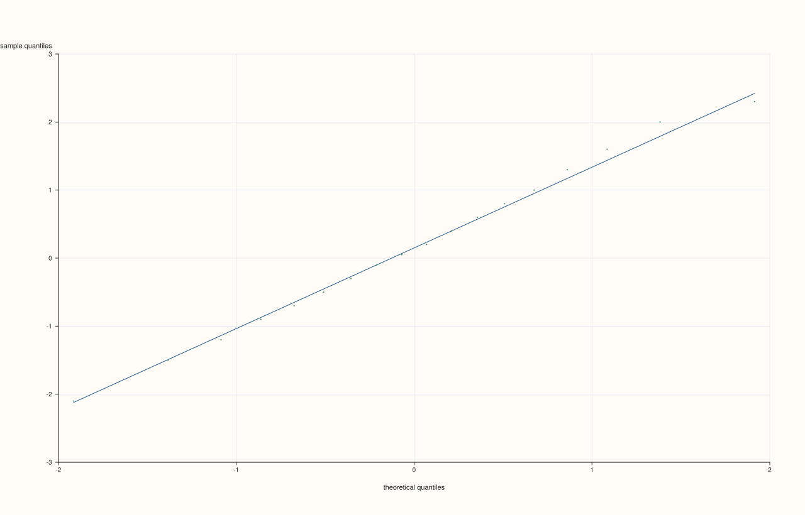
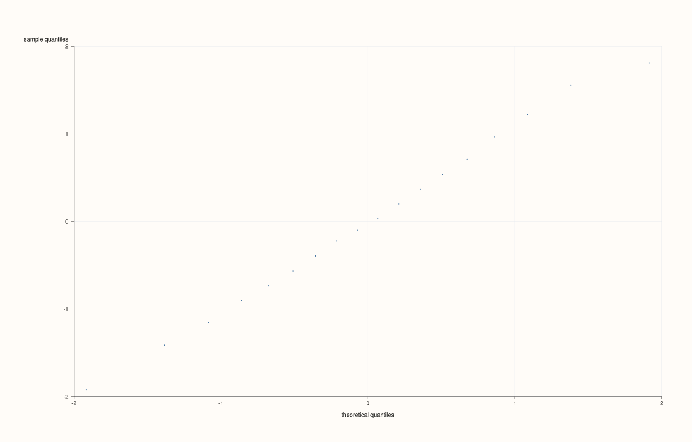

<!-- pluss-hand-authored -->

# flash::qqplot

[Back to flash API Reference](../../flash_api_reference)

## Signatures

```cpp
Trace& flash::qqplot(Pane& pane, Series values, const QqPlotOptions& options = {})

Trace& flash::qqplot(Studio& studio, Series values, const QqPlotOptions& options = {},
                      std::string title = {})
```

## What It Does

Draws a normal quantile-quantile (Q-Q) plot — sorted sample values against the
theoretical quantiles of a standard normal distribution, the standard visual check for
whether a dataset is approximately normally distributed (points should fall close to a
straight line if it is). Two overloads:

- **`qqplot(pane, values, options = {})`** — draws into an existing pane.
- **`qqplot(studio, values, options = {}, title = "")`** — a `Studio`-level convenience
  form that creates its own pane (mirroring the `lmplot`/`regplot` relationship).

The theoretical quantiles are computed via a rational-function approximation to the
inverse normal CDF (Acklam's algorithm), evaluated at `(i + 0.5) / n` for each of the `n`
sorted sample points (the standard "plotting position" convention).

The returned `Trace&` is always the qq scatter, with or without the reference line (which is drawn first, behind it), and it stays valid for the life of the pane.

## `QqPlotOptions` fields

| Field | Type and default | Description |
|---|---|---|
| `standardize` | `bool`, default `true` | When `true` (the default), the sample is standardized (`(x - mean) / population_stddev`) before plotting, so the sample-quantile axis is in "standard deviations" units directly comparable to the theoretical-quantile axis. When `false`, the sample keeps its original units. Standardization is skipped (silently, no error) if the sample's standard deviation is at or below `1e-12` — a constant (zero-variance) sample is left as-is either way. |
| `show_reference_line` | `bool`, default `true` | Whether to draw a straight reference line through the sample's 25th/75th percentile points (an IQR-based reference, robust to outliers — not a simple `y = x` line, and not a least-squares fit of the qq points themselves). |
| `marker_area` | `double`, default `14.0`, clamped to a minimum of `2.0` | The qq points' marker size. |
| `trace_width` | `float`, default `0.75F` | The qq scatter trace's stroke width. |
| `reference_width` | `float`, default `1.0F` | The reference line's stroke width. |

## Parameters

**pane** (`Pane&`, first overload) / **studio** (`Studio&`, second overload)
    The target pane, or a `Studio` to create a new pane on.

**values** (series-convertible)
    The sample to check for normality. Non-finite entries are dropped before sorting; at
    least two finite values are required — fewer throws `pluss::Error
    ("flash::qqplot requires at least two finite values")`.

**options** (`const QqPlotOptions&`, optional)
    See the field table above.

**title** (`std::string`, default empty, second overload only)
    The new pane's title.

## Returns

`Trace&`
    A reference to the qq scatter trace (never the reference line, when both are drawn).

## Examples

Example 1. Default options — standardized, with a reference line.

```cpp
using namespace pluss::pl;

auto fig = studio("flash_qqplot_standardized");
auto& pane = fig.pane2();
std::vector<double> sample{-2.1, -1.5, -1.2, -0.9, -0.7, -0.5, -0.3, -0.1, 0.05, 0.2,
                           0.4, 0.6, 0.8, 1.0, 1.3, 1.6, 2.0, 2.3};
flash::qqplot(pane, sample);
fig.show();
```



Example 2. `standardize = false` — the sample keeps its raw units on the y-axis.

```cpp
using namespace pluss::pl;

auto fig = studio("flash_qqplot_not_standardized");
auto& pane = fig.pane2();
std::vector<double> sample{-2.1, -1.5, -1.2, -0.9, -0.7, -0.5, -0.3, -0.1, 0.05, 0.2,
                           0.4, 0.6, 0.8, 1.0, 1.3, 1.6, 2.0, 2.3};
flash::QqPlotOptions opts;
opts.standardize = false;
flash::qqplot(pane, sample, opts);
fig.show();
```



Example 3. `show_reference_line = false`. The returned trace is the qq scatter.

```cpp
using namespace pluss::pl;

auto fig = studio("flash_qqplot_no_reference");
auto& pane = fig.pane2();
std::vector<double> sample{-2.1, -1.5, -1.2, -0.9, -0.7, -0.5, -0.3, -0.1, 0.05, 0.2,
                           0.4, 0.6, 0.8, 1.0, 1.3, 1.6, 2.0, 2.3};
flash::QqPlotOptions opts;
opts.show_reference_line = false;
flash::qqplot(pane, sample, opts);
std::cout << "pane trace count: " << pane.traces().size() << " (expect 1)\n";
fig.show();
```

Output:

```text
pane trace count: 1 (expect 1)
```



## Notes

- Not `noexcept`.
- Sets `x_label("theoretical quantiles")` and `y_label("sample quantiles")` on the pane
  automatically, along with `GridStyle::Major` — these overwrite any labels/grid style
  already set on the pane.
- The reference line is IQR-based (25th/75th percentile), not a `y = x` identity line —
  for a standardized sample from a true standard normal, the two are close but not
  identical.

## See Also

- [`Pane::cloud`](../pane/cloud.md), [`Pane::trend`](../pane/trend.md): the underlying
  methods for the qq scatter and reference line respectively.
- [`Studio::pane2`](../studio/pane2.md): what the `Studio`-level overload calls internally.

<div class="pluss-inline-prev-next">
  <a class="prev-link" href="residplot.html">
    <span class="label">Previous</span>
    <span class="title">residplot</span>
  </a>
  <a class="next-link" href="resid_histplot.html">
    <span class="label">Next</span>
    <span class="title">resid_histplot</span>
  </a>
</div>
