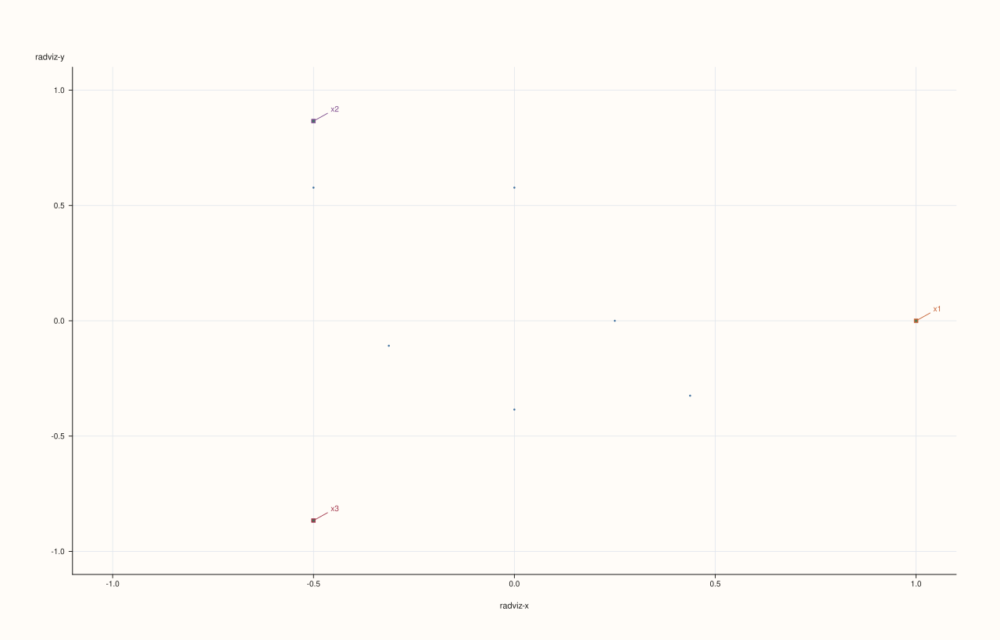
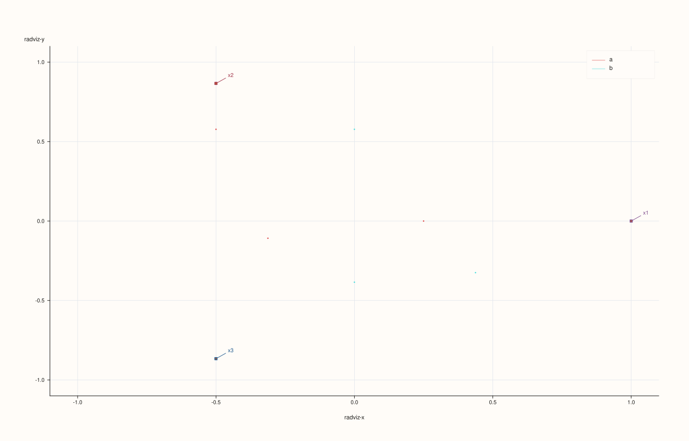
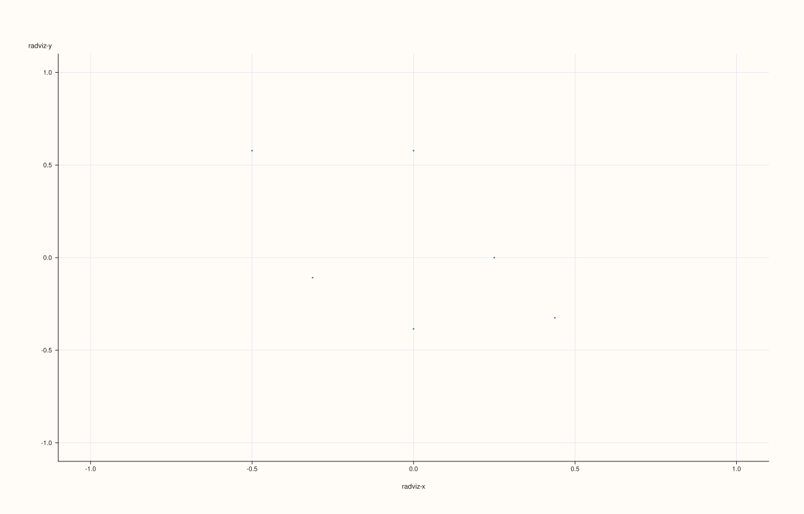
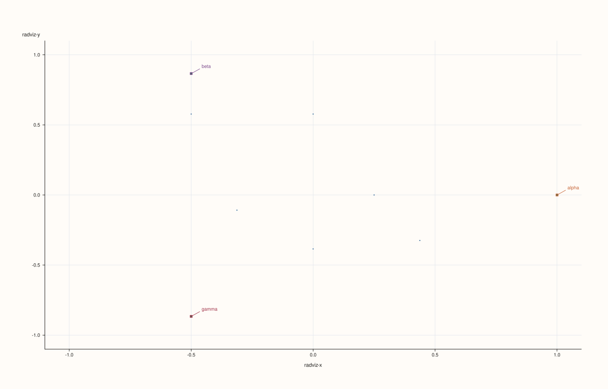

<!-- pluss-hand-authored -->

# flash::radviz

[Back to flash API Reference](../../flash_api_reference)

## Signatures

```cpp
Studio& flash::radviz(Studio& studio, pluss::msharp::RangeView::Series columns,
                       const RadvizOptions& options = {})

Studio& flash::radviz(Studio& studio, pluss::msharp::RangeView::Series columns,
                       const Note& class_labels, const RadvizOptions& options = {})

Studio& flash::radviz(Studio& studio, const Dataset& data,
                       const RadvizOptions& options = {})

Studio& flash::radviz(Studio& studio, const Series& matrix,
                       const MatrixFrameOptions& frame_options,
                       const RadvizOptions& options = {})

Studio& flash::radviz(Studio& studio, const Series& matrix,
                       pluss::msharp::RangeView::Of<std::string_view> feature_names,
                       Axis feature_axis, const RadvizOptions& options = {})

Studio& flash::radviz(Studio& studio, const Series& matrix,
                       const std::vector<std::string>& feature_names,
                       Axis feature_axis, const RadvizOptions& options = {})

Studio& flash::radviz(Studio& studio, const Series& matrix,
                       std::initializer_list<std::string_view> feature_names,
                       Axis feature_axis, const RadvizOptions& options = {})

Studio& flash::radviz(Studio& studio, const Series& matrix,
                       const RadvizOptions& options = {})
```

## What It Does

Draws a RadViz ("radial visualization") plot: `n` features are placed as anchor points
evenly spaced around a unit circle, then every row is plotted as a single 2D point, pulled
toward each anchor in proportion to that row's (non-negative-clamped, optionally
normalized) value for that feature — a spring/force-layout-style projection of an
`n`-dimensional row down to 2D. Rows dominated by one feature cluster near that feature's
anchor; rows balanced across features cluster near the center.

Eight overloads mirror [`flash::parallelplot`](parallelplot.md)'s and
[`flash::andrews_curves`](andrews_curves.md)'s exactly: a plain `columns` form, a
`columns` + `class_labels` form, a `Dataset` form, and five matrix forms — the one
difference is `radviz` requires **three** features minimum (a 2-anchor RadViz has no
interesting geometry), not two.

```{important} Anchor positions are always evenly spaced, weights are clamped non-negative
Anchor i sits at angle 2*pi*i/n on the unit circle -- fixed purely by feature COUNT and
order, never by the data itself. Each row's plotted point is a weighted average of all n
anchors, where feature j's weight for that row is max(0, value) -- negative values (after
normalize, if enabled) contribute zero pull rather than pulling away from an anchor. A
row with all-zero weights falls back to the coordinate origin (denominator clamped to
1.0) rather than dividing by zero.
```

## `RadvizOptions` fields

| Field | Type and default | Description |
|---|---|---|
| `labels` | `std::vector<std::string>`, default empty | Per-feature anchor labels, drawn via [`Pane::pin`](../pane/pins.md) next to each anchor when `show_anchors` is `true`. Falls back to `"x1"`, `"x2"`, … when its length doesn't match the feature count. |
| `normalize` | `bool`, default `true` | Whether every feature is independently min-max scaled to `[0, 1]` before computing anchor weights — same rule and same degenerate-feature fallback (flat `0.0`) as [`flash::parallelplot`](parallelplot.md)/[`flash::andrews_curves`](andrews_curves.md). |
| `max_points` | `std::int64_t`, default `3000` | Row-count cap, same deterministic downsampling mechanism shared across the family. |
| `marker_area` | `double`, default `18.0` | Per-row point marker area, clamped to at least `2.0`. |
| `trace_width` | `float`, default `0.55F` | Stroke width for the per-row point cloud (and, with the `class_labels` overload, each class's point cloud). |
| `show_grid` | `bool`, default `true` | Whether the pane gets `GridStyle::Major` gridlines (`true`) or `GridStyle::None` (`false`). |
| `show_anchors` | `bool`, default `true` | Whether the `n` feature anchors are drawn at all — as their own marker cloud (area fixed at `26.0`, independent of `marker_area`) plus a text [`pin`](../pane/pins.md) label per anchor. `false` renders only the per-row points, with no visual reference for where each feature's pull direction is. |
| `show_legend` | `bool`, default `true` | Whether a legend is drawn. Unlike [`flash::parallelplot`](parallelplot.md)/[`flash::andrews_curves`](andrews_curves.md), the plain (no `class_labels`) overload explicitly forces `KeyPlace::None` regardless of `show_legend` — there's nothing to legend, and this field is only consulted by the `class_labels` overload. |

## Parameters

**studio** (`Studio&`)
    The figure to populate — a single new [`Studio::pane2`](../studio/pane2.md), with both axes
    fixed to `[-1.1, 1.1]` via [`Pane::x_limits`](../pane/x_limits.md)/
    [`y_limits`](../pane/y_limits.md) (the anchors always sit on the unit circle, so this
    keeps them fully in view with a small margin).

**columns** (`pluss::msharp::RangeView::Series`)
    One entry per feature. Must contain at least **three** features
    (`std::invalid_argument("flash::radviz requires at least three columns")`), and every
    column must be the same length.

**class_labels** (`const Note&`, class-labels overload only)
    One label per row. Its length must exactly match the row count, or `radviz` throws
    `std::invalid_argument("flash::radviz: class label length must match rows")`.

**data** (`const Dataset&`, Dataset overload only)
    See `flash::make_dataset` on the [`flash::pairplot`](pairplot.md) page.

**matrix**, **frame_options**, **feature_names**, **feature_axis** (matrix overloads)
    Identical shape and behavior to [`flash::pairplot`](pairplot.md)'s matrix overloads.

**options** (`const RadvizOptions&`, optional)
    See the field table above.

## Returns

`Studio&`
    A reference to the same figure, for chaining.

## Examples

Example 1. Default overload — three features (three anchors), six rows, uniform color.

```cpp
using namespace pluss::pl;

auto fig = studio("flash_radviz_default");
std::vector<pluss::Series> cols{
    pluss::make_series(std::vector<double>{1.0, 2.0, 3.0, 4.0, 5.0, 6.0}, {6}),
    pluss::make_series(std::vector<double>{6.0, 4.0, 5.0, 2.0, 3.0, 1.0}, {6}),
    pluss::make_series(std::vector<double>{2.0, 5.0, 1.0, 6.0, 3.0, 4.0}, {6})};
flash::radviz(fig, pluss::msharp::RangeView::Series(cols));
fig.show();
```



Example 2. `class_labels` overload — points colored and legended by class, anchors still
drawn.

```cpp
using namespace pluss::pl;

auto fig = studio("flash_radviz_classes");
std::vector<pluss::Series> cols{
    pluss::make_series(std::vector<double>{1.0, 2.0, 3.0, 4.0, 5.0, 6.0}, {6}),
    pluss::make_series(std::vector<double>{6.0, 4.0, 5.0, 2.0, 3.0, 1.0}, {6}),
    pluss::make_series(std::vector<double>{2.0, 5.0, 1.0, 6.0, 3.0, 4.0}, {6})};
auto classes = pluss::note::make({"a", "a", "b", "b", "a", "b"});
flash::radviz(fig, pluss::msharp::RangeView::Series(cols), classes);
fig.show();
```



Example 3. `show_anchors = false` — only the per-row points remain, no anchor markers or
labels.

```cpp
using namespace pluss::pl;

auto fig = studio("flash_radviz_no_anchors");
std::vector<pluss::Series> cols{
    pluss::make_series(std::vector<double>{1.0, 2.0, 3.0, 4.0, 5.0, 6.0}, {6}),
    pluss::make_series(std::vector<double>{6.0, 4.0, 5.0, 2.0, 3.0, 1.0}, {6}),
    pluss::make_series(std::vector<double>{2.0, 5.0, 1.0, 6.0, 3.0, 4.0}, {6})};
flash::RadvizOptions opts;
opts.show_anchors = false;
flash::radviz(fig, pluss::msharp::RangeView::Series(cols), opts);
fig.show();
```



Example 4. `Dataset` overload, via `flash::make_dataset`.

```cpp
using namespace pluss::pl;

auto fig = studio("flash_radviz_dataset");
auto data = flash::make_dataset(
    {pluss::make_series(std::vector<double>{1.0, 2.0, 3.0, 4.0, 5.0, 6.0}, {6}),
     pluss::make_series(std::vector<double>{6.0, 4.0, 5.0, 2.0, 3.0, 1.0}, {6}),
     pluss::make_series(std::vector<double>{2.0, 5.0, 1.0, 6.0, 3.0, 4.0}, {6})},
    {"alpha", "beta", "gamma"});
flash::radviz(fig, data);
fig.show();
```



Example 5. Matrix + feature-names + `Axis` overload.

```cpp
using namespace pluss::pl;

std::vector<double> a{1.0, 2.0, 3.0, 4.0, 5.0, 6.0};
std::vector<double> b{6.0, 4.0, 5.0, 2.0, 3.0, 1.0};
std::vector<double> c{2.0, 5.0, 1.0, 6.0, 3.0, 4.0};
std::vector<double> flat;
for (std::size_t i = 0; i < a.size(); ++i) { flat.push_back(a[i]); flat.push_back(b[i]); flat.push_back(c[i]); }
auto matrix = pluss::make_series(flat, {6, 3});

auto fig = studio("flash_radviz_matrix");
flash::radviz(fig, matrix, {"alpha", "beta", "gamma"}, flash::Axis::Cols);
fig.show();
```


Example 6 (edge case). Fewer than three columns throws — note the higher minimum than
[`flash::parallelplot`](parallelplot.md)/[`flash::andrews_curves`](andrews_curves.md)'s
two-column minimum.

```cpp
using namespace pluss::pl;

auto fig = studio("flash_radviz_too_few");
std::vector<pluss::Series> cols{
    pluss::make_series(std::vector<double>{1.0, 2.0, 3.0, 4.0, 5.0, 6.0}, {6}),
    pluss::make_series(std::vector<double>{6.0, 4.0, 5.0, 2.0, 3.0, 1.0}, {6})};
try {
  flash::radviz(fig, pluss::msharp::RangeView::Series(cols));
} catch (const std::invalid_argument& e) {
  std::cout << "radviz(2 cols) threw: " << e.what() << "\n";
}
```

Output:

```text
radviz(2 cols) threw: flash::radviz requires at least three columns
```

## Notes

- Not `noexcept`.
- Anchor angles depend only on feature count/order, never on the data — two calls with
  the same feature count always place anchors identically.
- Feature weights are clamped to `max(0, value)` — after `normalize` (which maps to
  `[0, 1]`), this clamp is a no-op; with `normalize = false` and genuinely negative raw
  data, negative values simply exert zero pull rather than pulling in the opposite
  direction.
- The plain overload explicitly forces `KeyPlace::None` for its legend, regardless of
  `show_legend` — see the field table above.
- Shares `max_points`/`normalize`/`Dataset`/matrix-overload plumbing with
  [`flash::parallelplot`](parallelplot.md) and
  [`flash::andrews_curves`](andrews_curves.md), but requires three features minimum
  instead of two.

## See Also

- [`flash::parallelplot`](parallelplot.md), [`flash::andrews_curves`](andrews_curves.md):
  sibling multivariate views over the same per-row, per-feature input shape.
- [`Pane::cloud`](../pane/cloud.md): the native method drawing both the per-row points
  and the anchor markers.
- [`Pane::pin`](../pane/pins.md): the native method labeling each anchor.

<div class="pluss-inline-prev-next">
  <a class="prev-link" href="andrews_curves.html">
    <span class="label">Previous</span>
    <span class="title">andrews_curves</span>
  </a>
  <a class="next-link" href="jointplot.html">
    <span class="label">Next</span>
    <span class="title">jointplot</span>
  </a>
</div>
