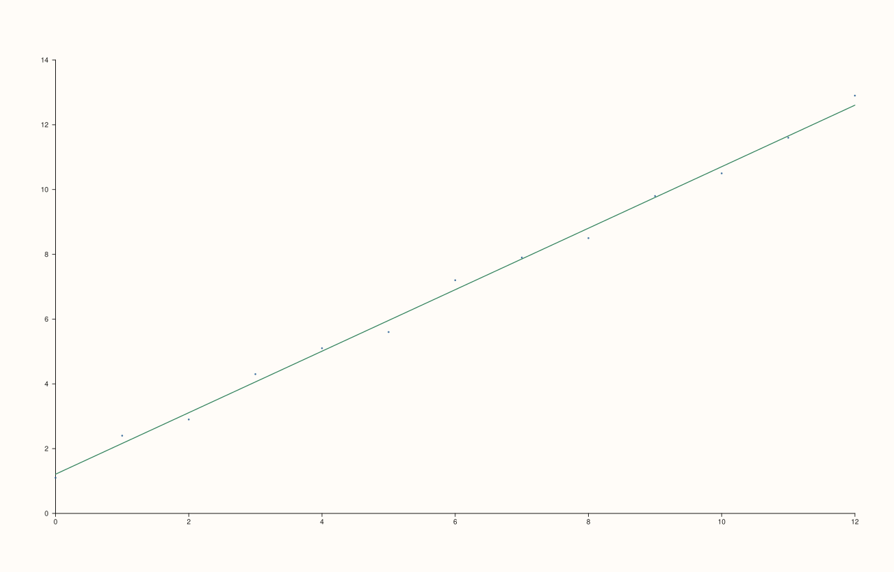
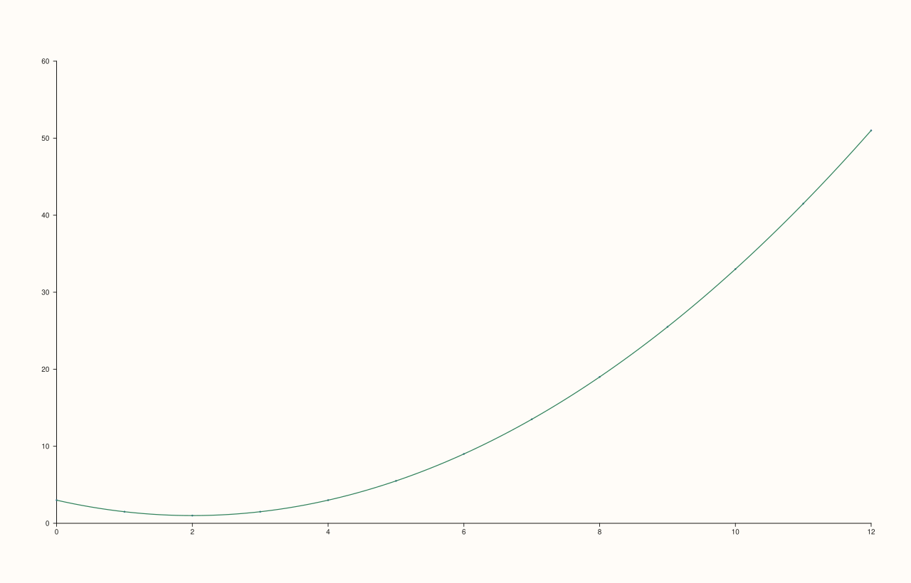
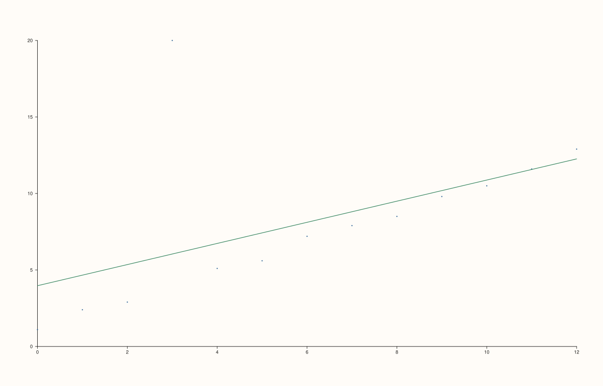
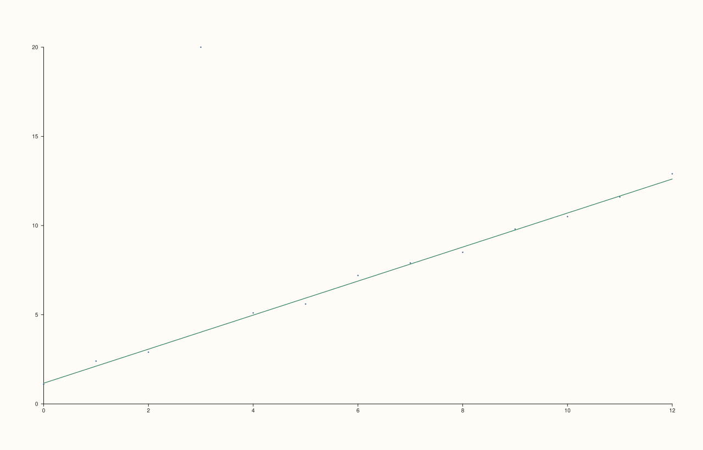
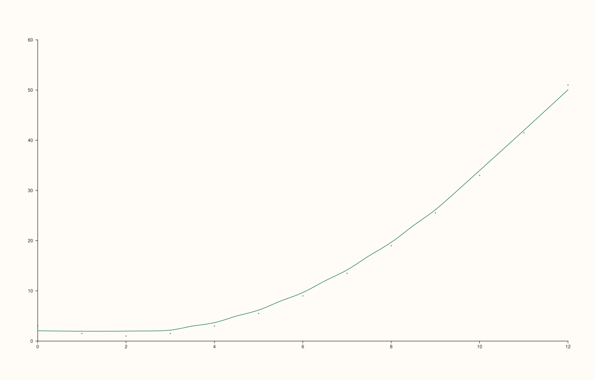
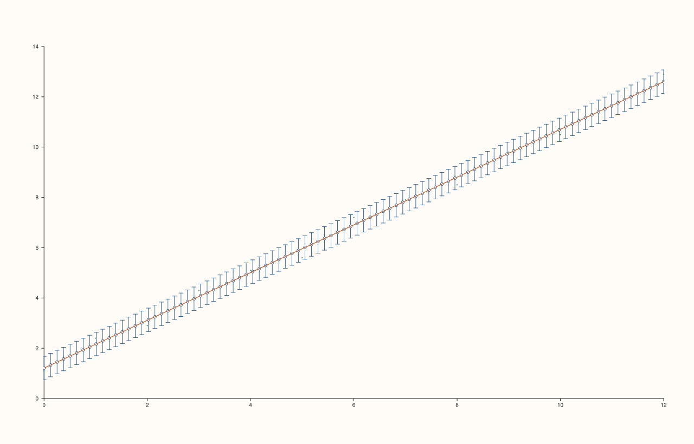
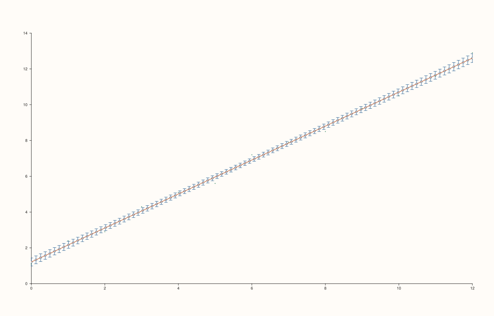
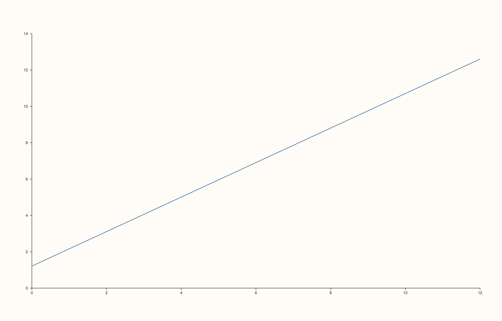

<!-- pluss-hand-authored -->

# flash::regplot

[Back to flash API Reference](../../flash_api_reference)

## Signatures

```cpp
template <class X, class Y>
Trace& flash::regplot(Pane& pane, X&& x, Y&& y, const RegPlotOptions& options = {})
```

## What It Does

Draws a scatter plot with a fitted regression curve overlaid — the workhorse behind
[`lmplot`](lmplot.md) and used internally by `PlussMic`'s `DataFramePlot` fit-line
feature. One overload, but an unusually rich options surface controlling the fit
algorithm, the confidence band, and which of the three possible layers (`scatter`,
`fit`, `ci`) actually get drawn.

Only finite `(x, y)` pairs are used — non-finite values (NaN/Inf) in either series are
silently dropped via `finite_xy` before fitting, not just before rendering. At least two
finite pairs are required; fewer throws `std::invalid_argument("flash::regplot requires
at least two finite x/y pairs")`.

```{important} Fixed: regplot's returned trace could dangle when show_ci was combined with show_scatter/show_fit
Previously, regplot captured a Trace* to the scatter and/or fit trace, THEN
drew the confidence-interval whisk trace afterward (when show_ci was true),
THEN returned through the earlier-captured pointer. Pane::add_trace_ appends
to a std::vector<Trace>, which can reallocate its backing storage on any
push -- so drawing the CI trace after capturing the scatter/fit trace risked
invalidating that earlier reference. Directly verified: calling
regplot(pane, x, y, {.show_ci = true}) with default show_scatter/show_fit
returned a Trace& whose label_text() came back empty and whose data no
longer matched the fit line, instead of the expected "fit" label -- a real,
reproducible case of undefined behavior. This affected any caller enabling
show_ci alongside show_scatter or show_fit, including PlussMic's
DataFramePlot scatter-plot fit-line feature whenever its fit_ci option was
turned on. Fixed at the source: the CI whisk trace is now drawn FIRST,
before the scatter/fit traces, so whichever of scatter/fit is ultimately
returned is always the last trace pushed and never dangles. Verified via a
before/after check confirming the returned trace's label and kind are now
always correct.
```

## `RegPlotOptions` fields

| Field | Type and default | Description |
|---|---|---|
| `show_scatter` | `bool`, default `true` | Whether to draw the raw `(x, y)` points via `Pane::cloud`. |
| `show_fit` | `bool`, default `true` | Whether to draw the fitted curve via `Pane::trend`. |
| `show_ci` | `bool`, default `false` | Whether to draw a confidence band around the fit, via `Pane::whisk`. Only drawn when there are more than 2 finite pairs (`sx.numel() > 2`) — with exactly 2 points there is no meaningful residual spread to estimate from, so the CI is silently skipped even if `show_ci` is `true`. |
| `confidence_level` | `double`, default `0.95` | The nominal coverage of the CI band. Consumed differently depending on `n_boot`: for the analytic path (`n_boot == 0`) it's converted to a z-score via a **6-bucket lookup table**, not a continuous computation — see the important callout on [`catplot`](catplot.md)'s equivalent field for the exact bucket boundaries and the verified consequence (e.g. `0.90` and `0.92` currently produce an *identical* CI width, since both fall in the same "≥ 0.90" bucket). For the bootstrap path (`n_boot > 0`) it's used directly as a percentile-interval width, not quantized. |
| `n_boot` | `std::int64_t`, default `0` | `0` (the default) computes the CI analytically from the fit's residual standard error. Any positive value switches to a **bootstrap** CI: resampling the `(x, y)` pairs with replacement `max(32, n_boot)` times, refitting each resample, and taking the `confidence_level` percentile spread of the resulting predictions at each `fit_x` point. Bootstrap CIs are typically wider and noisier-looking than the analytic ones, especially at the low end of `n_boot`. |
| `order` | `std::int64_t`, default `1` | The polynomial degree fit to the data (clamped to a minimum of `1`). `1` is a straight-line fit; higher values fit increasingly flexible curves. Ignored when `lowess == true`. |
| `robust` | `bool`, default `false` | When `true`, uses iteratively-reweighted least squares (3 iterations, Tukey-biweight downweighting based on the median absolute deviation of residuals) instead of plain least squares — reduces the influence of outliers on the fit. Applies to both the polynomial (`lowess == false`) and LOWESS (`lowess == true`) fit paths. |
| `lowess` | `bool`, default `false` | When `true`, replaces the polynomial fit entirely with a local-regression (LOWESS) curve — ignores `order`. Useful for genuinely non-polynomial relationships. |
| `lowess_frac` | `double`, default `0.35` | Only consulted when `lowess == true`. The fraction of points (clamped to `[0.05, 1.0]`) included in each local neighborhood — smaller values track the data more tightly (more wiggly), larger values smooth more aggressively. |
| `fit_points` | `std::int64_t`, default `96` | How many x-positions (evenly spaced across the data's x-range, clamped to a minimum of `2`) the fitted curve/CI band is evaluated at. |
| `marker_area`, `scatter_trace_width`, `fit_trace_width`, `ci_trace_width` | double / float; defaults 18.0 / 0.55F / 1.25F / 0.35F | Styling knobs forwarded directly to the corresponding trace's marker-area/width setters. |

## Parameters

**pane** (`Pane&`)
    The target pane. Must be `Planar` (2D).

**x**, **y** (series-convertible)
    The raw observation pairs. Must be the same length (enforced by `finite_xy`, which
    throws `std::invalid_argument` on a mismatch).

**options** (`const RegPlotOptions&`, optional)
    See the field table above.

## Returns

`Trace&`
    A reference to the **fit** trace, if `show_fit` was `true`. Otherwise, the **scatter**
    trace, if `show_scatter` was `true`. Otherwise, a `Pane::trend` trace drawn anyway as a
    fallback (styled and labeled `"fit"` identically to the normal fit trace) — meaning
    `regplot` always draws *at least* a fit-line trace, even when both `show_scatter` and
    `show_fit` are `false`. The CI trace, when drawn, is never the return value.

## Examples

Example 1. Default options — scatter plus a linear fit.

```cpp
using namespace pluss::pl;

auto fig = studio("flash_regplot_default");
auto& pane = fig.pane2();
std::vector<double> x{0.0, 1.0, 2.0, 3.0, 4.0, 5.0, 6.0, 7.0, 8.0, 9.0, 10.0, 11.0, 12.0};
std::vector<double> y{1.1, 2.4, 2.9, 4.3, 5.1, 5.6, 7.2, 7.9, 8.5, 9.8, 10.5, 11.6, 12.9};
flash::regplot(pane, x, y);
fig.show();
```



Example 2. `order = 2` — a quadratic fit on genuinely quadratic data.

```cpp
using namespace pluss::pl;

auto fig = studio("flash_regplot_order2");
auto& pane = fig.pane2();
std::vector<double> x{0.0, 1.0, 2.0, 3.0, 4.0, 5.0, 6.0, 7.0, 8.0, 9.0, 10.0, 11.0, 12.0};
std::vector<double> y;
for (double xi : x) y.push_back(0.5 * xi * xi - 2.0 * xi + 3.0);
flash::RegPlotOptions opts;
opts.order = 2;
flash::regplot(pane, x, y, opts);
fig.show();
```



Example 3. Ordinary least squares versus `robust = true` on data with one extreme
outlier — verified to produce genuinely different fitted curves.

```cpp
using namespace pluss::pl;

std::vector<double> x{0.0, 1.0, 2.0, 3.0, 4.0, 5.0, 6.0, 7.0, 8.0, 9.0, 10.0, 11.0, 12.0};
std::vector<double> y_outlier{1.1, 2.4, 2.9, 20.0, 5.1, 5.6, 7.2, 7.9, 8.5, 9.8, 10.5, 11.6, 12.9};

auto fig1 = studio("flash_regplot_ols_outlier");
auto& pane1 = fig1.pane2();
flash::regplot(pane1, x, y_outlier, flash::RegPlotOptions{});

auto fig2 = studio("flash_regplot_robust_outlier");
auto& pane2 = fig2.pane2();
flash::RegPlotOptions robust_opts;
robust_opts.robust = true;
flash::regplot(pane2, x, y_outlier, robust_opts);
std::cout << "OLS vs robust on outlier data differ: " << (fig1.to_svg() != fig2.to_svg()) << "\n";
```

Output:

```text
OLS vs robust on outlier data differ: 1
```




Example 4. `lowess = true` — local regression instead of a global polynomial.

```cpp
using namespace pluss::pl;

auto fig = studio("flash_regplot_lowess");
auto& pane = fig.pane2();
std::vector<double> x{0.0, 1.0, 2.0, 3.0, 4.0, 5.0, 6.0, 7.0, 8.0, 9.0, 10.0, 11.0, 12.0};
std::vector<double> y;
for (double xi : x) y.push_back(0.5 * xi * xi - 2.0 * xi + 3.0);
flash::RegPlotOptions opts;
opts.lowess = true;
opts.lowess_frac = 0.5;
flash::regplot(pane, x, y, opts);
fig.show();
```



Example 5. `show_ci = true`, analytic (default `n_boot = 0`) confidence band. Confirms
the fix above: the returned trace is genuinely the fit trace, not a dangling reference.

```cpp
using namespace pluss::pl;

auto fig = studio("flash_regplot_ci_analytic");
auto& pane = fig.pane2();
std::vector<double> x{0.0, 1.0, 2.0, 3.0, 4.0, 5.0, 6.0, 7.0, 8.0, 9.0, 10.0, 11.0, 12.0};
std::vector<double> y{1.1, 2.4, 2.9, 4.3, 5.1, 5.6, 7.2, 7.9, 8.5, 9.8, 10.5, 11.6, 12.9};
flash::RegPlotOptions opts;
opts.show_ci = true;
Trace& t = flash::regplot(pane, x, y, opts);
std::cout << "pane trace count: " << pane.traces().size() << " (scatter+fit+ci)\n";
std::cout << "returns fit trace: " << (t.label_text() == "fit") << "\n";
fig.show();
```

Output:

```text
pane trace count: 3 (scatter+fit+ci)
returns fit trace: 1
```



Example 6. `show_ci = true` with `n_boot = 200` — a bootstrap confidence band instead of
the analytic one.

```cpp
using namespace pluss::pl;

auto fig = studio("flash_regplot_ci_bootstrap");
auto& pane = fig.pane2();
std::vector<double> x{0.0, 1.0, 2.0, 3.0, 4.0, 5.0, 6.0, 7.0, 8.0, 9.0, 10.0, 11.0, 12.0};
std::vector<double> y{1.1, 2.4, 2.9, 4.3, 5.1, 5.6, 7.2, 7.9, 8.5, 9.8, 10.5, 11.6, 12.9};
flash::RegPlotOptions opts;
opts.show_ci = true;
opts.n_boot = 200;
flash::regplot(pane, x, y, opts);
fig.show();
```



Example 7 (edge case). `show_scatter = false` and `show_fit = false` — the fallback path
still draws exactly one (fit-styled) trace.

```cpp
using namespace pluss::pl;

auto fig = studio("flash_regplot_no_scatter_no_fit");
auto& pane = fig.pane2();
std::vector<double> x{0.0, 1.0, 2.0, 3.0, 4.0, 5.0, 6.0, 7.0, 8.0, 9.0, 10.0, 11.0, 12.0};
std::vector<double> y{1.1, 2.4, 2.9, 4.3, 5.1, 5.6, 7.2, 7.9, 8.5, 9.8, 10.5, 11.6, 12.9};
flash::RegPlotOptions opts;
opts.show_scatter = false;
opts.show_fit = false;
Trace& t = flash::regplot(pane, x, y, opts);
std::cout << "pane trace count: " << pane.traces().size() << " (fallback trend still drawn)\n";
std::cout << "returned label: " << t.label_text() << "\n";
fig.show();
```

Output:

```text
pane trace count: 1 (fallback trend still drawn)
returned label: fit
```



Example 8 (edge case). Fewer than two finite pairs throws.

```cpp
using namespace pluss::pl;

auto fig = studio("flash_regplot_too_few");
auto& pane = fig.pane2();
try {
  flash::regplot(pane, std::vector<double>{1.0}, std::vector<double>{2.0});
} catch (const std::invalid_argument& e) {
  std::cout << "threw: " << e.what() << "\n";
}
```

Output:

```text
threw: flash::regplot requires at least two finite x/y pairs
```

## Notes

- Not `noexcept`.
- [`flash::lmplot`](lmplot.md) is a thin `Studio`-level convenience wrapper that creates
  its own `Pane` and forwards straight to `regplot`.
- [`flash::residplot`](residplot.md) shares `RegPlotOptions`' fit-algorithm fields
  (`order`, `robust`, `lowess`, `lowess_frac`) but ignores `show_scatter`/`show_fit`/
  `show_ci`/`confidence_level`/`n_boot` entirely — it always draws exactly one cloud
  trace of residuals.
- See the important callout above for `confidence_level`'s quantized z-score behavior on
  the analytic (non-bootstrap) CI path.

## See Also

- [`Pane::cloud`](../pane/cloud.md), [`Pane::trend`](../pane/trend.md),
  [`Pane::whisk`](../pane/whisk.md): the underlying methods for the scatter, fit, and CI
  layers respectively.
- [`flash::lmplot`](lmplot.md): the `Studio`-level convenience form.
- [`flash::residplot`](residplot.md): residuals-only view sharing the same fit machinery.
- [`flash::resid_histplot`](resid_histplot.md): a histogram of the same residuals.

<div class="pluss-inline-prev-next">
  <a class="prev-link" href="catplot.html">
    <span class="label">Previous</span>
    <span class="title">catplot</span>
  </a>
  <a class="next-link" href="lmplot.html">
    <span class="label">Next</span>
    <span class="title">lmplot</span>
  </a>
</div>
