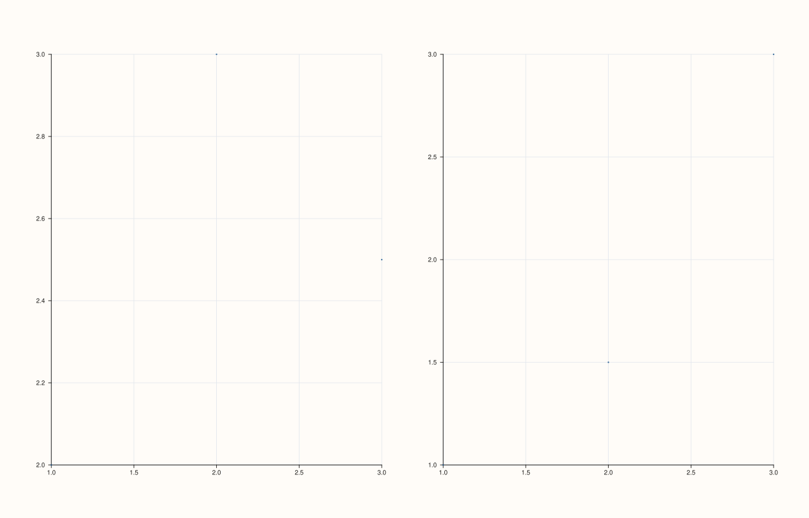
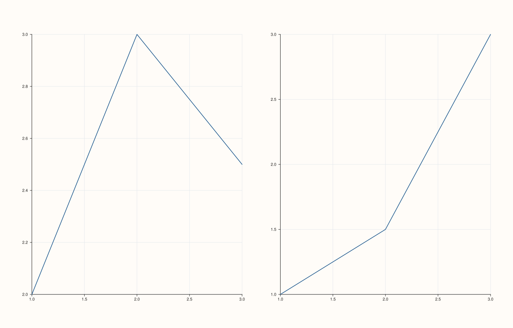
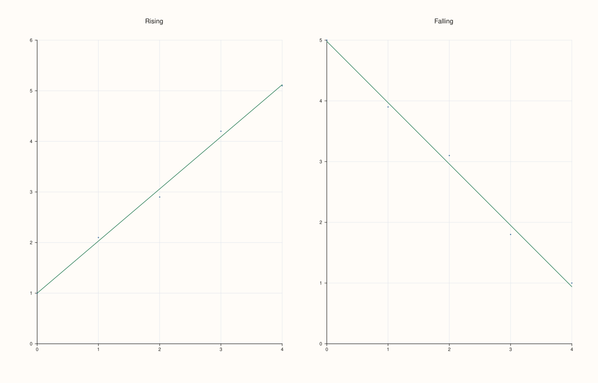
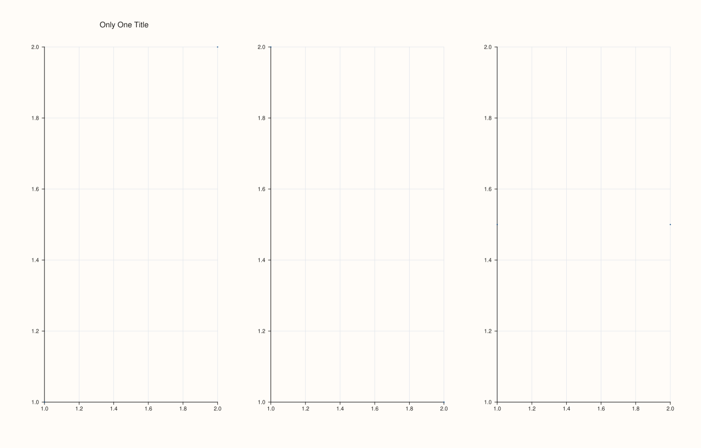
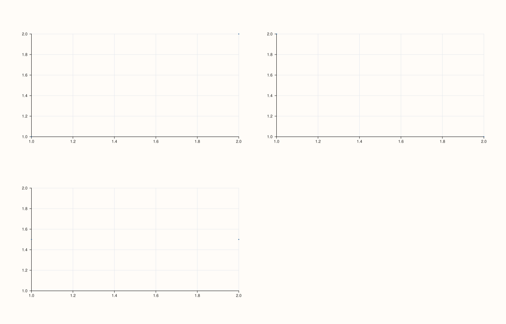

<!-- pluss-hand-authored -->

# flash::relgridplot

[Back to flash API Reference](../../flash_api_reference)

## Signatures

```cpp
RelGridKind flash::relgrid_kind(std::string_view kind);


Studio& flash::relgridplot(Studio& studio, pluss::msharp::RangeView::Series xs,
                            pluss::msharp::RangeView::Series ys,
                            const RelGridPlotOptions& options = {})

Studio& flash::relgridplot(Studio& studio, pluss::msharp::RangeView::Series xs,
                            pluss::msharp::RangeView::Series ys, std::string_view kind)

Studio& flash::relgridplot(Studio& studio, std::initializer_list<Series> xs,
                            std::initializer_list<Series> ys,
                            const RelGridPlotOptions& options = {})

Studio& flash::relgridplot(Studio& studio, std::initializer_list<Series> xs,
                            std::initializer_list<Series> ys, std::string_view kind)
```

## What It Does

Draws one relational plot per facet across an auto- or explicitly-shaped grid.
Each entry in `xs`/`ys` is one facet's complete x/y series; `relgridplot` lays out a [`flash::FacetGrid`](FacetGrid.md),
then draws [`flash::scatterplot`](scatterplot.md), [`flash::lineplot`](lineplot.md), or
[`flash::regplot`](regplot.md) into each cell according to `options.kind`. Four overloads
cover every combination of "options struct vs. bare kind string" and
"`RangeView::Series` vs. `std::initializer_list<Series>`" input.

```{important} Grid shape is auto-resolved, not required
When both options.rows and options.cols are 0 (the default), the shape is computed
via flash::resolve_grid_shape as ceil(sqrt(facet_count)) columns and enough rows to
fit every facet. Set only rows (or only cols) to fix one dimension and let the other
grow to fit. Set both to pick an exact shape -- but rows * cols must be at least the
facet count, or relgridplot throws std::invalid_argument("flash grid helpers:
rows*cols is smaller than facet count"), directly verified below. If the exact shape
overprovisions cells (rows * cols > facet_count), the leftover cells are hidden via
Pane::hide(), also verified below.
```

```{important} Per-panel titles/labels apply positionally, and silently omit when short
options.titles, options.x_labels, and options.y_labels are matched to facets by
index, not by any label/key. A titles vector shorter than the facet count leaves
the remaining panels with an empty title (Pane::title_text() == ""), rather than
repeating, reusing, or throwing -- directly verified below with 3 facets and a
single title, where pane[0] receives it and pane[1] does not. The same
short-vector-is-fine rule applies independently to x_labels and y_labels.
```

## `RelGridPlotOptions` fields

| Field | Type and default | Description |
|---|---|---|
| `kind` | `RelGridKind`, default `RelGridKind::Scatter` | Which flash function draws each panel: `Scatter` → [`scatterplot`](scatterplot.md), `Line` → [`lineplot`](lineplot.md), `Reg` → [`regplot`](regplot.md). The kind-string overloads resolve this via `flash::relgrid_kind("scatter"\|"line"\|"reg")`, which throws `std::invalid_argument("flash::relgridplot unknown kind: " + kind)` for any other string. |
| `rows`, `cols` | `std::int64_t`, default `0` each | Explicit grid shape hints. `0` means "auto" for that dimension — see the important callout above for the full resolution rule, including the `rows*cols < facet_count` error case. |
| `grid_gap_x`, `grid_gap_y` | `double`, default `16.0` each | Forwarded straight to the internal [`flash::FacetGrid`](FacetGrid.md) call as its `gx`/`gy` gutter. |
| `show_grid` | `bool`, default `true` | Whether each panel gets `GridStyle::Major` gridlines (`true`) or `GridStyle::None` (`false`), applied via `Pane::grid` before that panel is drawn. |
| `titles` | `std::vector<std::string>`, default empty | Per-facet panel titles, applied positionally. See the important callout above for the short-vector behavior. |
| `x_labels`, `y_labels` | `std::vector<std::string>`, default empty | Per-facet axis labels, applied positionally via `Pane::x_label`/`Pane::y_label` — same short-vector-is-fine rule as `titles`. |
| `reg` | `RegPlotOptions`, default-constructed | Forwarded to [`flash::regplot`](regplot.md) for every panel when `kind == RelGridKind::Reg` — every field documented on that page (`ci`, `order`, `line_only`, …) applies here too. Unused when `kind` is `Scatter` or `Line`. |

## Parameters

**studio** (`Studio&`)
    The figure to lay out and populate.

**xs**, **ys** (`pluss::msharp::RangeView::Series` or `std::initializer_list<Series>`)
    One entry per facet — `xs[i]`/`ys[i]` are that facet's complete x/y series. Must be
    non-empty and equal in length, or `relgridplot` throws
    `std::invalid_argument("flash::relgridplot requires non-empty aligned x/y facet
    vectors")`, verified below.

**kind** (`std::string_view`, kind-string overloads only)
    `"scatter"`, `"line"`, or `"reg"` — resolved via `flash::relgrid_kind`. Equivalent to
    passing a `RelGridPlotOptions` with only `kind` set.

**options** (`const RelGridPlotOptions&`, optional, options overloads only)
    See the field table above.

## Returns

`Studio&`
    A reference to the same figure, for chaining.

## Examples

Example 1. Default options — two facets, auto-resolved to a `1×2` grid, `Scatter` kind.

```cpp
using namespace pluss::pl;

auto fig = studio("flash_relgridplot_scatter");
std::vector<pluss::Series> xs{pluss::make_series(std::vector<double>{1.0, 2.0, 3.0}, {3}),
                               pluss::make_series(std::vector<double>{1.0, 2.0, 3.0}, {3})};
std::vector<pluss::Series> ys{pluss::make_series(std::vector<double>{2.0, 3.0, 2.5}, {3}),
                               pluss::make_series(std::vector<double>{1.0, 1.5, 3.0}, {3})};
flash::relgridplot(fig, pluss::msharp::RangeView::Series(xs), pluss::msharp::RangeView::Series(ys));
fig.show();
```



Example 2. Kind-string overload — `"line"`.

```cpp
using namespace pluss::pl;

auto fig = studio("flash_relgridplot_line");
std::vector<pluss::Series> xs{pluss::make_series(std::vector<double>{1.0, 2.0, 3.0}, {3}),
                               pluss::make_series(std::vector<double>{1.0, 2.0, 3.0}, {3})};
std::vector<pluss::Series> ys{pluss::make_series(std::vector<double>{2.0, 3.0, 2.5}, {3}),
                               pluss::make_series(std::vector<double>{1.0, 1.5, 3.0}, {3})};
flash::relgridplot(fig, pluss::msharp::RangeView::Series(xs), pluss::msharp::RangeView::Series(ys), "line");
fig.show();
```



Example 3. `Reg` kind with explicit `titles`.

```cpp
using namespace pluss::pl;

auto fig = studio("flash_relgridplot_reg");
std::vector<pluss::Series> xs{pluss::make_series(std::vector<double>{0.0, 1.0, 2.0, 3.0, 4.0}, {5}),
                               pluss::make_series(std::vector<double>{0.0, 1.0, 2.0, 3.0, 4.0}, {5})};
std::vector<pluss::Series> ys{pluss::make_series(std::vector<double>{1.0, 2.1, 2.9, 4.2, 5.1}, {5}),
                               pluss::make_series(std::vector<double>{5.0, 3.9, 3.1, 1.8, 1.0}, {5})};
flash::RelGridPlotOptions opts;
opts.kind = flash::RelGridKind::Reg;
opts.titles = {"Rising", "Falling"};
flash::relgridplot(fig, pluss::msharp::RangeView::Series(xs), pluss::msharp::RangeView::Series(ys), opts);
fig.show();
```



Example 4. `std::initializer_list<Series>` overload — no intermediate `std::vector` or
`RangeView` construction needed.

```cpp
using namespace pluss::pl;

auto fig = studio("flash_relgridplot_il");
auto x1 = pluss::make_series(std::vector<double>{1.0, 2.0, 3.0}, {3});
auto y1 = pluss::make_series(std::vector<double>{2.0, 3.0, 2.5}, {3});
auto x2 = pluss::make_series(std::vector<double>{1.0, 2.0, 3.0}, {3});
auto y2 = pluss::make_series(std::vector<double>{1.0, 1.5, 3.0}, {3});
flash::relgridplot(fig, {x1, x2}, {y1, y2}, "scatter");
fig.show();
```


Example 5. `titles` shorter than the facet count — only the facets with a corresponding
title get one; the rest stay empty, verified via `Pane::title_text()`.

```cpp
using namespace pluss::pl;

auto fig = studio("flash_relgridplot_short_titles");
std::vector<pluss::Series> xs{pluss::make_series(std::vector<double>{1.0, 2.0}, {2}),
                               pluss::make_series(std::vector<double>{1.0, 2.0}, {2}),
                               pluss::make_series(std::vector<double>{1.0, 2.0}, {2})};
std::vector<pluss::Series> ys{pluss::make_series(std::vector<double>{1.0, 2.0}, {2}),
                               pluss::make_series(std::vector<double>{2.0, 1.0}, {2}),
                               pluss::make_series(std::vector<double>{1.5, 1.5}, {2})};
flash::RelGridPlotOptions opts;
opts.titles = {"Only One Title"};
opts.cols = 3;
flash::relgridplot(fig, pluss::msharp::RangeView::Series(xs), pluss::msharp::RangeView::Series(ys), opts);
std::cout << "3 facets, 1 title -- pane[0] title: '" << fig.panes()[0].title_text()
          << "', pane[1] title: '" << fig.panes()[1].title_text() << "'\n";
fig.show();
```

Output:

```text
3 facets, 1 title -- pane[0] title: 'Only One Title', pane[1] title: ''
```



Example 6. An overprovisioned exact shape (`rows=2, cols=2` for 3 facets) — the unused
4th cell is hidden rather than left blank-but-visible.

```cpp
using namespace pluss::pl;

auto fig = studio("flash_relgridplot_overflow");
std::vector<pluss::Series> xs{pluss::make_series(std::vector<double>{1.0, 2.0}, {2}),
                               pluss::make_series(std::vector<double>{1.0, 2.0}, {2}),
                               pluss::make_series(std::vector<double>{1.0, 2.0}, {2})};
std::vector<pluss::Series> ys{pluss::make_series(std::vector<double>{1.0, 2.0}, {2}),
                               pluss::make_series(std::vector<double>{2.0, 1.0}, {2}),
                               pluss::make_series(std::vector<double>{1.5, 1.5}, {2})};
flash::RelGridPlotOptions opts;
opts.rows = 2;
opts.cols = 2;
flash::relgridplot(fig, pluss::msharp::RangeView::Series(xs), pluss::msharp::RangeView::Series(ys), opts);
std::cout << "3 facets in a 2x2=4 grid -- pane count: " << fig.pane_count()
          << ", pane[3] (unused cell) visible: " << fig.panes()[3].visible() << "\n";
fig.show();
```

Output:

```text
3 facets in a 2x2=4 grid -- pane count: 4, pane[3] (unused cell) visible: 0
```



Example 7 (edge case). Empty `xs`/`ys` throws.

```cpp
using namespace pluss::pl;

auto fig = studio("flash_relgridplot_empty");
try {
  flash::relgridplot(fig, pluss::msharp::RangeView::Series{}, pluss::msharp::RangeView::Series{});
} catch (const std::invalid_argument& e) {
  std::cout << "relgridplot(empty) threw: " << e.what() << "\n";
}
```

Output:

```text
relgridplot(empty) threw: flash::relgridplot requires non-empty aligned x/y facet vectors
```

Example 8 (edge case). An exact shape too small for the facet count throws.

```cpp
using namespace pluss::pl;

auto fig = studio("flash_relgridplot_too_small");
std::vector<pluss::Series> xs{pluss::make_series(std::vector<double>{1.0, 2.0}, {2}),
                               pluss::make_series(std::vector<double>{1.0, 2.0}, {2}),
                               pluss::make_series(std::vector<double>{1.0, 2.0}, {2})};
std::vector<pluss::Series> ys = xs;
flash::RelGridPlotOptions opts;
opts.rows = 1;
opts.cols = 2;
try {
  flash::relgridplot(fig, pluss::msharp::RangeView::Series(xs), pluss::msharp::RangeView::Series(ys), opts);
} catch (const std::invalid_argument& e) {
  std::cout << "relgridplot(rows*cols < facets) threw: " << e.what() << "\n";
}
```

Output:

```text
relgridplot(rows*cols < facets) threw: flash grid helpers: rows*cols is smaller than facet count
```

## Notes

- Not `noexcept`.
- `xs.size()` and `ys.size()` must match — the emptiness/length check covers both.
- Every panel gets [`flash::FacetGrid`](FacetGrid.md) layout underneath, with
  `grid_gap_x`/`grid_gap_y` as the gutter — see that page for the shape-resolution
  mechanics shared by every `*gridplot` function.
- [`flash::catgridplot`](catgridplot.md) and [`flash::disgridplot`](disgridplot.md) share
  this same four-overload shape, the same `resolve_grid_shape`-based auto-sizing, and the
  same positional short-vector behavior for `titles`/`x_labels`/`y_labels`.

## See Also

- [`flash::FacetGrid`](FacetGrid.md): the underlying grid-layout constructor.
- [`flash::scatterplot`](scatterplot.md), [`flash::lineplot`](lineplot.md),
  [`flash::regplot`](regplot.md): the three per-panel drawing functions dispatched by
  `kind`.
- [`flash::catgridplot`](catgridplot.md), [`flash::disgridplot`](disgridplot.md): sibling
  grid-of-plots functions for categorical and distribution views.
- [`Pane::hide`](../pane/visible.md), [`Pane::title_text`](../pane/title_text.md): how
  overflow cells and positional titles surface.

<div class="pluss-inline-prev-next">
  <a class="prev-link" href="JointGrid.html">
    <span class="label">Previous</span>
    <span class="title">JointGrid</span>
  </a>
  <a class="next-link" href="catgridplot.html">
    <span class="label">Next</span>
    <span class="title">catgridplot</span>
  </a>
</div>
