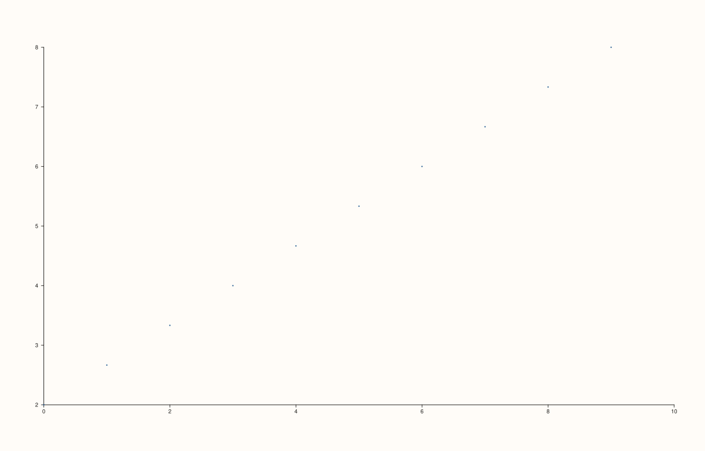
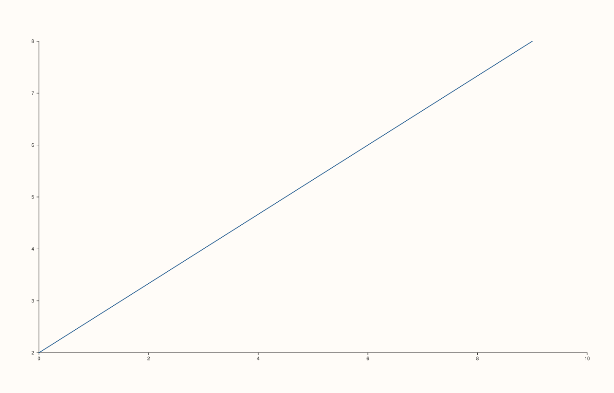
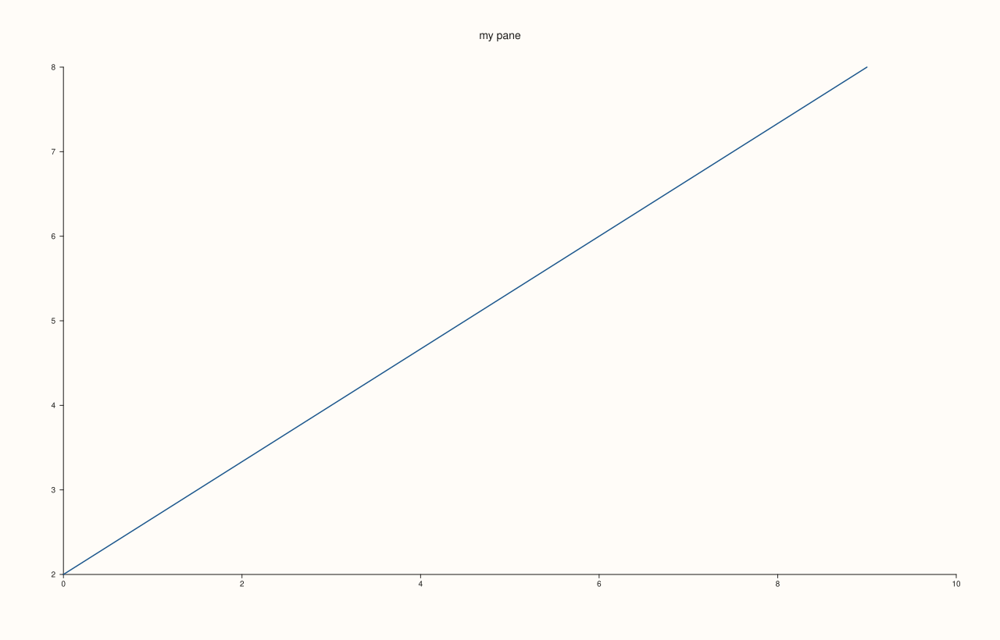

<!-- pluss-hand-authored -->

# flash::relplot

[Back to flash API Reference](../../flash_api_reference)

## Signatures

```cpp
template <class X, class Y>
Trace& flash::relplot(Pane& pane, X&& x, Y&& y, std::string_view kind = "scatter")

template <class X, class Y>
Trace& flash::relplot(Pane& pane, X&& x, Y&& y, const Note& hue, std::string_view kind = "scatter")

template <class X, class Y, class Hue>
Trace& flash::relplot(Pane& pane, X&& x, Y&& y, Hue&& hue, std::string_view kind = "scatter")

template <class X, class Y>
Trace& flash::relplot(Studio& studio, X&& x, Y&& y, std::string_view kind = "scatter", std::string title = {})

template <class X, class Y>
Trace& flash::relplot(Studio& studio, X&& x, Y&& y, const Note& hue, std::string_view kind = "scatter", std::string title = {})

template <class X, class Y, class Hue>
Trace& flash::relplot(Studio& studio, X&& x, Y&& y, Hue&& hue, std::string_view kind = "scatter", std::string title = {})
```

## What It Does

The unifying "relational plot" entry point — a thin `kind=`-dispatched wrapper choosing
between [`flash::scatterplot`](scatterplot.md) (`kind = "scatter"`, the default) and
[`flash::lineplot`](lineplot.md) (`kind = "line"`), so a caller can switch between the two
without changing which function they call — just the `kind` string. Six overloads,
covering every combination of:

- **Target**: an existing [`Pane&`](../../pane_api_reference.md) (draws into it directly), or
  a [`Studio&`](../../studio_api_reference.md) (creates a fresh 2D pane via
  [`Studio::pane2`](../studio/pane2.md) first, optionally named by `title`).
- **Hue**: none, a categorical `Note`, or a numeric
  series-convertible value — forwarded through to whichever of `scatterplot()`/
  `lineplot()` is dispatched to, **including each function's own distinct numeric-hue
  threshold and overflow behavior** (see [`flash::scatterplot`](scatterplot.md)'s and
  [`flash::lineplot`](lineplot.md)'s important callouts — `relplot()` does not
  standardize or override either).

```{important} kind accepts exactly "scatter" or "line" -- anything else silently falls back to scatter
relplot()'s dispatch is a plain string comparison against the literal "line";
every other value (including typos like "Line" or "lines", or any other
string) takes the same code path as kind = "scatter" (the default), with no
validation and no exception. Passing an unrecognized kind does not fail loudly
-- it just silently draws a scatter plot. Double-check the exact spelling
"line" if a relplot() call isn't producing the connected-line output you
expect.
```

## Parameters

**pane** (`Pane&`, first three overloads) / **studio** (`Studio&`, last three overloads)
    The target. The `Studio&` overloads create a new `pane2()` internally — the caller
    never touches the pane directly.

**x**, **y** (series-convertible)
    The point/vertex coordinates.

**hue** (`const Note&`, or any series-convertible value, four of the six overloads)
    Forwarded verbatim to `scatterplot()`/`lineplot()` — see those pages for the exact
    grouping/threshold/fallback behavior.

**kind** (`std::string_view`, default `"scatter"`)
    `"scatter"` dispatches to [`flash::scatterplot`](scatterplot.md);
    `"line"` dispatches to [`flash::lineplot`](lineplot.md). Anything else behaves like
    `"scatter"` — see the important callout above.

**title** (`std::string`, default `{}`, `Studio&` overloads only)
    Passed through to [`Studio::pane2`](../studio/pane2.md) as the new pane's title.

## Returns

`Trace&`
    A reference to the newly created trace — subject to the same
    last-group-only caveat as `scatterplot()`/`lineplot()` when a hue is supplied.

## Examples

Example 1. `kind = "scatter"` (explicit) vs. `kind = "line"` on identical data — verified
via direct SVG diff to render genuinely different output.

```cpp
using namespace pluss::pl;

auto fig1 = studio("flash_relplot_scatter_kind");
auto& pane1 = fig1.pane2();
flash::relplot(pane1, pluss::series::linspace(0.0, 9.0, 10, pluss::ScalarType::Float64),
                pluss::series::linspace(2.0, 8.0, 10, pluss::ScalarType::Float64), "scatter");
fig1.show();
```



```cpp
using namespace pluss::pl;

auto fig2 = studio("flash_relplot_line_kind");
auto& pane2 = fig2.pane2();
flash::relplot(pane2, pluss::series::linspace(0.0, 9.0, 10, pluss::ScalarType::Float64),
                pluss::series::linspace(2.0, 8.0, 10, pluss::ScalarType::Float64), "line");
fig2.show();
```



Example 3. The default `kind` (omitted entirely) — verified to produce **byte-for-byte
identical** output to an explicit `kind = "scatter"` call on the same data.

```cpp
using namespace pluss::pl;

auto fig = studio("flash_relplot_default_kind");
auto& pane = fig.pane2();
flash::relplot(pane, pluss::series::linspace(0.0, 9.0, 10, pluss::ScalarType::Float64),
                pluss::series::linspace(2.0, 8.0, 10, pluss::ScalarType::Float64));
fig.show();
```

Example 4. Categorical hue, dispatched to `kind = "line"` — the hue value is forwarded
straight through to `flash::lineplot`, including its grouping behavior.

```cpp
using namespace pluss::pl;

auto fig = studio("flash_relplot_note_hue_line");
auto& pane = fig.pane2();
auto grp = pluss::note::make({"a", "a", "a", "a", "a", "b", "b", "b", "b", "b"});
flash::relplot(pane, pluss::series::linspace(0.0, 9.0, 10, pluss::ScalarType::Float64),
                pluss::series::linspace(2.0, 8.0, 10, pluss::ScalarType::Float64), grp, "line");
std::cout << "trace_count: " << pane.trace_count() << "\n";
fig.show();
```

Output:

```text
trace_count: 2
```

Example 5. The `Studio&` overload — creates its own pane, no `pane2()` call needed
up front.

```cpp
using namespace pluss::pl;

auto fig = studio("flash_relplot_studio");
Trace& t = flash::relplot(fig, pluss::series::linspace(0.0, 9.0, 10, pluss::ScalarType::Float64),
                           pluss::series::linspace(2.0, 8.0, 10, pluss::ScalarType::Float64), "line", "my pane");
std::cout << "pane_count: " << fig.pane_count() << "\n";
fig.show();
```

Output:

```text
pane_count: 1
```



## Notes

- Not `noexcept`.
- The `Studio&` overloads' `title` parameter is the *last* positional argument, after
  `kind` — a caller supplying a title must also supply `kind` explicitly (there's no way
  to skip `kind` and set only `title` via positional arguments alone).
- `relplot()` performs no validation of its own beyond what `scatterplot()`/`lineplot()`
  already do — see those pages for the actual `x`/`y`/`hue`-length-mismatch exceptions
  this can surface.
- There is no `kind = "step"` option reaching [`flash::stepplot`](stepplot.md) — that
  function has no `relplot()` dispatch path.

## See Also

- [`flash::scatterplot`](scatterplot.md): `kind = "scatter"`'s target, with the full
  numeric-hue threshold/fallback detail.
- [`flash::lineplot`](lineplot.md): `kind = "line"`'s target, with its own different
  numeric-hue threshold/fallback.
- [`Studio::pane2`](../studio/pane2.md): what the `Studio&` overloads call internally to
  create their pane.

<div class="pluss-inline-prev-next">
  <a class="prev-link" href="stepplot.html">
    <span class="label">Previous</span>
    <span class="title">stepplot</span>
  </a>
  <a class="next-link" href="histplot.html">
    <span class="label">Next</span>
    <span class="title">histplot</span>
  </a>
</div>
