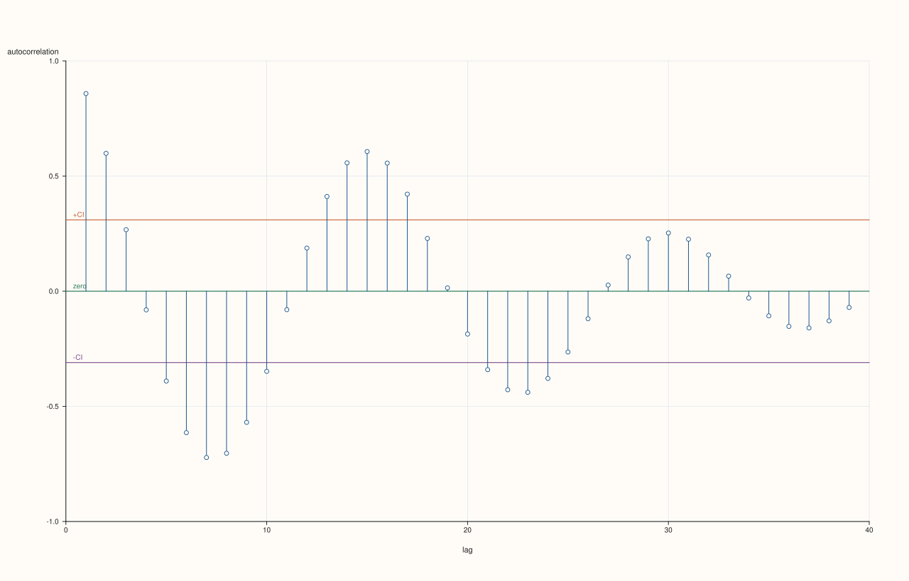

<!-- pluss-hand-authored -->

# flash::resid_acfplot

[Back to flash API Reference](../../flash_api_reference)

## Signature

```cpp
template <class X, class Y>
Studio& flash::resid_acfplot(Studio& studio, X&& x, Y&& y, const ResidAcfPlotOptions& options = {})
```

## What It Does

Fits a regression of `y` on `x` (reusing [`flash::regplot`](regplot.md)'s own prediction
machinery — same `order`/`robust`/`lowess`/`lowess_frac` knobs, via the nested `reg`
options), computes the residuals (`y_i - predicted_i` at each finite pair), then runs
[`flash::acfplot`](acfplot.md) on those residuals instead of the raw series. This is the
standard "did my regression leave any autocorrelation on the table" diagnostic — a
well-specified model's residuals should look like white noise, with no significant ACF
spikes.

## Parameters

**studio** (`Studio&`)
    The figure to populate — a single new [`Studio::pane2`](../studio/pane2.md) (created
    internally by the delegated-to [`flash::acfplot`](acfplot.md) call), y-axis fixed to
    `[-1.0, 1.0]`.

**x**, **y** (series-convertible)
    The predictor/response pair to regress and then autocorrelate the residuals of. Only
    finite `(x, y)` pairs participate (non-finite pairs are dropped via an internal
    `detail::finite_xy` filter, the same mechanism [`flash::regplot`](regplot.md) itself
    uses). At least three finite pairs must remain, or `resid_acfplot` throws
    `std::invalid_argument("flash::resid_acfplot requires at least three finite x/y
    pairs")`.

**options** (`const ResidAcfPlotOptions&`, optional)
    See the field table below.

## `ResidAcfPlotOptions` fields

| Field | Type and default | Description |
|---|---|---|
| `reg` | `RegPlotOptions`, default-constructed | Controls the regression fit computed to produce residuals — every field documented on [`flash::regplot`](regplot.md) that affects the *fit itself* applies here (`order`, `robust`, `lowess`, `lowess_frac`); fields that only affect `regplot`'s own *rendering* (`show_scatter`, `show_ci`, `fit_trace_width`, …) have no effect here, since `resid_acfplot` never calls `regplot` to draw anything — it only reuses its prediction function. |
| `acf` | `AcfPlotOptions`, default-constructed | Forwarded to the internal [`flash::acfplot`](acfplot.md) call over the computed residuals — every field documented on that page applies, including the discrete confidence-level bucketing and the inert `marker_area` field. |

## Returns

`Studio&`
    A reference to the same figure, for chaining.

## Examples

Example 1. Default overload — order-1 (linear) fit, ACF of the residuals with default
`AcfPlotOptions`.

```cpp
using namespace pluss::pl;

auto fig = studio("flash_resid_acfplot_default");
std::vector<double> x, y;
for (int i = 0; i < 40; ++i) {
  x.push_back(std::sin(static_cast<double>(i) * 0.4) * 5.0 + static_cast<double>(i) * 0.2);
  y.push_back(std::cos(static_cast<double>(i) * 0.4) * 4.0 - static_cast<double>(i) * 0.1);
}
flash::resid_acfplot(fig, x, y);
fig.show();
```



Example 2 (edge case). Fewer than three finite pairs throws.

```cpp
using namespace pluss::pl;

auto fig = studio("flash_resid_acfplot_too_few");
std::vector<double> x{1.0, 2.0};
std::vector<double> y{1.0, 2.0};
try {
  flash::resid_acfplot(fig, x, y);
} catch (const std::invalid_argument& e) {
  std::cout << "resid_acfplot(2 points) threw: " << e.what() << "\n";
}
```

Output:

```text
resid_acfplot(2 points) threw: flash::resid_acfplot requires at least three finite x/y pairs
```

## Notes

- Not `noexcept`.
- `options.reg.order` is clamped to at least `1` before fitting, mirroring
  [`flash::regplot`](regplot.md)'s own clamp.
- Only the *prediction* half of `RegPlotOptions` matters here — every rendering-only
  field (`show_scatter`, `show_fit`, `show_ci`, `marker_area`, `fit_trace_width`, …) is
  silently irrelevant, since `resid_acfplot` never draws the regression itself, only the
  residual correlogram.

## See Also

- [`flash::regplot`](regplot.md): the source of the prediction machinery and the full
  `RegPlotOptions` field reference (the fit-affecting subset of which applies here).
- [`flash::acfplot`](acfplot.md): what actually draws the correlogram, over residuals
  instead of a raw series.

<div class="pluss-inline-prev-next">
  <a class="prev-link" href="actplot.html">
    <span class="label">Previous</span>
    <span class="title">actplot</span>
  </a>
  <a class="next-link" href="bootstrapplot.html">
    <span class="label">Next</span>
    <span class="title">bootstrapplot</span>
  </a>
</div>
