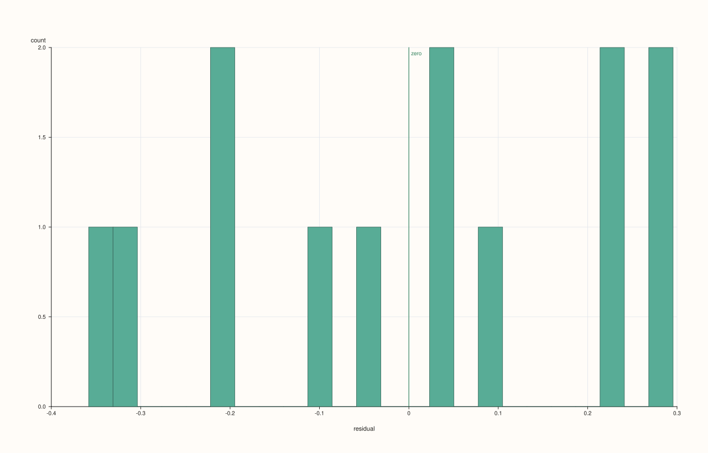
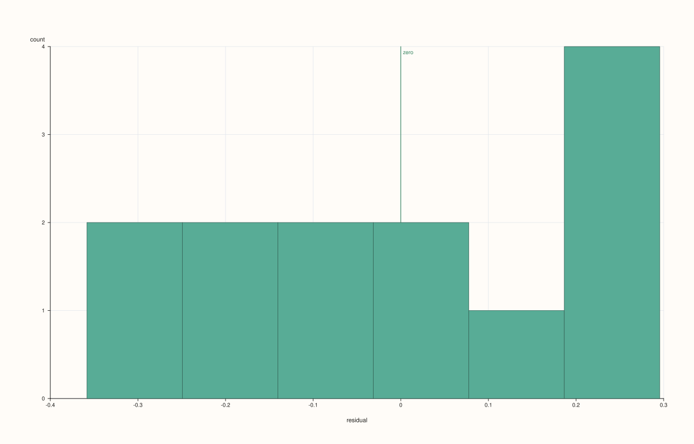

<!-- pluss-hand-authored -->

# flash::resid_histplot

[Back to flash API Reference](../../flash_api_reference)

## Signatures

```cpp
struct ResidHistPlotOptions {
  int bins = 24;
  float trace_width = 0.85F;
  RegPlotOptions reg{};
};

template <class X, class Y>
Trace& flash::resid_histplot(Pane& pane, X&& x, Y&& y, const ResidHistPlotOptions& options = {})

template <class X, class Y>
Trace& flash::resid_histplot(Studio& studio, X&& x, Y&& y,
                              const ResidHistPlotOptions& options = {}, std::string title = {})
```

## What It Does

Fits the same regression curve [`flash::regplot`](regplot.md)/[`flash::residplot`](residplot.md)
would, then bins the residuals (`y - predicted_y`) into a histogram via
[`Pane::bucket`](../pane/bucket.md) — a distributional view of the residuals, complementary
to `residplot`'s scattered-against-`x` view (useful for checking whether residuals are
roughly normally distributed, independent of any pattern in `x`). Two overloads: draw into
an existing pane, or (the `Studio` overload) create a new one.

A zero-reference rule is drawn automatically via `Pane::rule_x(0.0, "zero")`, marking
where a perfectly-fit residual would land.

## `ResidHistPlotOptions` fields

**bins** (`int`, default `24`, clamped to a minimum of `4`)
    The histogram bin count, forwarded to `Pane::bucket`.

**trace_width** (`float`, default `0.85F`)
    The histogram trace's stroke width.

**reg** (`RegPlotOptions`, default-constructed)
    The fit-algorithm configuration used to compute residuals — **only its
    `order`/`robust`/`lowess`/`lowess_frac` fields are consulted**, exactly like
    [`residplot`](residplot.md)'s own `RegPlotOptions` parameter. `show_scatter`,
    `show_fit`, `show_ci`, `confidence_level`, and `n_boot` are all ignored here too.

## Parameters

**pane** (`Pane&`, first overload) / **studio** (`Studio&`, second overload)
    The target pane, or a `Studio` to create a new pane on.

**x**, **y** (series-convertible)
    The raw observation pairs. Filtered to finite pairs; fewer than two finite pairs
    throws `std::invalid_argument("flash::resid_histplot requires at least two finite
    x/y pairs")`.

**options** (`const ResidHistPlotOptions&`, optional)
    See the field table above.

**title** (`std::string`, default empty, second overload only)
    The new pane's title.

## Returns

`Trace&`
    A reference to the newly created (bucket) histogram trace.

## Examples

Example 1. Default options.

```cpp
using namespace pluss::pl;

auto fig = studio("flash_resid_histplot_default");
auto& pane = fig.pane2();
std::vector<double> x{0.0, 1.0, 2.0, 3.0, 4.0, 5.0, 6.0, 7.0, 8.0, 9.0, 10.0, 11.0, 12.0};
std::vector<double> y{1.1, 2.4, 2.9, 4.3, 5.1, 5.6, 7.2, 7.9, 8.5, 9.8, 10.5, 11.6, 12.9};
flash::resid_histplot(pane, x, y);
fig.show();
```



Example 2. A coarser bin count.

```cpp
using namespace pluss::pl;

auto fig = studio("flash_resid_histplot_custom_bins");
auto& pane = fig.pane2();
std::vector<double> x{0.0, 1.0, 2.0, 3.0, 4.0, 5.0, 6.0, 7.0, 8.0, 9.0, 10.0, 11.0, 12.0};
std::vector<double> y{1.1, 2.4, 2.9, 4.3, 5.1, 5.6, 7.2, 7.9, 8.5, 9.8, 10.5, 11.6, 12.9};
flash::ResidHistPlotOptions opts;
opts.bins = 6;
flash::resid_histplot(pane, x, y, opts);
fig.show();
```



## Notes

- Not `noexcept`.
- Unlike [`flash::regplot`](regplot.md)/[`flash::qqplot`](qqplot.md), `resid_histplot`
  was never exposed to the reference-invalidation hazard documented on those pages — it
  only ever draws a single trace, so there is no earlier-captured reference at risk of
  dangling.
- Sets `x_label("residual")` and `y_label("count")` on the pane automatically, along with
  `GridStyle::Major` — these overwrite any labels/grid style already set on the pane.

## See Also

- [`flash::residplot`](residplot.md): the same residuals, scattered against `x` instead
  of binned.
- [`flash::regplot`](regplot.md): the fit `resid_histplot` computes residuals against,
  and the full `RegPlotOptions` field reference.
- [`Pane::bucket`](../pane/bucket.md): the underlying method.
- [`Pane::rule_x`](../pane/rule_x.md): what draws the automatic zero-reference marker.

<div class="pluss-inline-prev-next">
  <a class="prev-link" href="qqplot.html">
    <span class="label">Previous</span>
    <span class="title">qqplot</span>
  </a>
  <a class="next-link" href="heatmap.html">
    <span class="label">Next</span>
    <span class="title">heatmap</span>
  </a>
</div>
