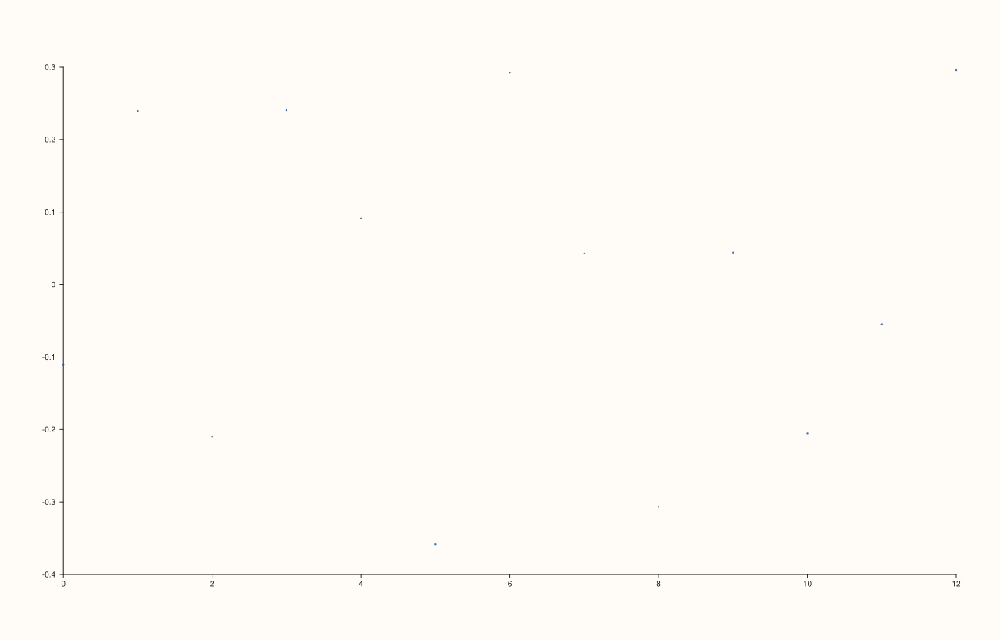
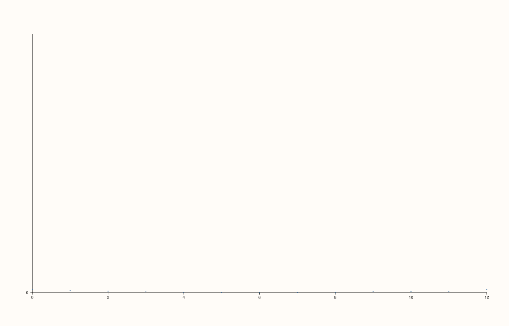

<!-- pluss-hand-authored -->

# flash::residplot

[Back to flash API Reference](../../flash_api_reference)

## Signatures

```cpp
template <class X, class Y>
Trace& flash::residplot(Pane& pane, X&& x, Y&& y, const RegPlotOptions& options)

template <class X, class Y>
Trace& flash::residplot(Pane& pane, X&& x, Y&& y)
```

## What It Does

Fits the same regression curve [`flash::regplot`](regplot.md) would, then plots the
**residuals** (`y - predicted_y`) against `x` as a scatter — the classic diagnostic for
spotting non-linearity or heteroscedasticity a fitted curve's own plot might hide. Two
overloads: with an explicit `RegPlotOptions`, or without (using default-constructed
options).

```{important} Only the fit-algorithm fields of RegPlotOptions apply here
residplot reuses RegPlotOptions purely as a container for the fit
configuration (order, robust, lowess, lowess_frac) -- it does NOT consult
show_scatter, show_fit, show_ci, confidence_level, or n_boot at all.
residplot always draws exactly one Pane::cloud trace of residuals, regardless
of what those fields are set to. If you pass an options struct configured for
a fit line or confidence band, those settings are silently ignored here.
```

## Parameters

**pane** (`Pane&`)
    The target pane. Must be `Planar` (2D).

**x**, **y** (series-convertible)
    The raw observation pairs. Filtered to finite pairs via the same `finite_xy` helper
    `regplot` uses; fewer than two finite pairs throws `std::invalid_argument
    ("flash::residplot requires at least two finite x/y pairs")`.

**options** (`const RegPlotOptions&`, first overload only)
    Only `order`/`robust`/`lowess`/`lowess_frac` are consulted — see the important
    callout above.

## Returns

`Trace&`
    A reference to the newly created (cloud) trace of residuals.

## Examples

Example 1. Default options — a linear fit's residuals.

```cpp
using namespace pluss::pl;

auto fig = studio("flash_residplot_default");
auto& pane = fig.pane2();
std::vector<double> x{0.0, 1.0, 2.0, 3.0, 4.0, 5.0, 6.0, 7.0, 8.0, 9.0, 10.0, 11.0, 12.0};
std::vector<double> y{1.1, 2.4, 2.9, 4.3, 5.1, 5.6, 7.2, 7.9, 8.5, 9.8, 10.5, 11.6, 12.9};
flash::residplot(pane, x, y);
fig.show();
```



Example 2. `order = 2` — residuals of a quadratic fit against genuinely quadratic data
should look like structureless noise scattered around zero.

```cpp
using namespace pluss::pl;

auto fig = studio("flash_residplot_order2");
auto& pane = fig.pane2();
std::vector<double> x{0.0, 1.0, 2.0, 3.0, 4.0, 5.0, 6.0, 7.0, 8.0, 9.0, 10.0, 11.0, 12.0};
std::vector<double> y;
for (double xi : x) y.push_back(0.5 * xi * xi - 2.0 * xi + 3.0);
flash::RegPlotOptions opts;
opts.order = 2;
flash::residplot(pane, x, y, opts);
fig.show();
```



## Notes

- Not `noexcept`.
- Unlike [`flash::regplot`](regplot.md), `residplot` was never exposed to the
  reference-invalidation hazard documented there — it only ever draws a single trace, so
  there is no earlier-captured reference at risk of dangling.
- No zero-reference rule/annotation is added automatically (unlike
  [`flash::resid_histplot`](resid_histplot.md), which draws a `rule_x(0.0, "zero")`
  marker) — if you want a visual zero line here, add it yourself via `Pane::rule_y`.

## See Also

- [`flash::regplot`](regplot.md): the fit `residplot` computes residuals against, and the
  full `RegPlotOptions` field reference.
- [`flash::resid_histplot`](resid_histplot.md): the same residuals, binned into a
  histogram instead of scattered against `x`.
- [`Pane::cloud`](../pane/cloud.md): the underlying method.

<div class="pluss-inline-prev-next">
  <a class="prev-link" href="lmplot.html">
    <span class="label">Previous</span>
    <span class="title">lmplot</span>
  </a>
  <a class="next-link" href="qqplot.html">
    <span class="label">Next</span>
    <span class="title">qqplot</span>
  </a>
</div>
