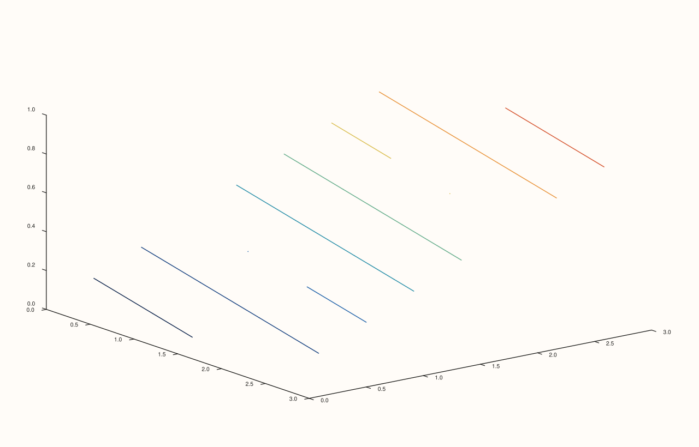
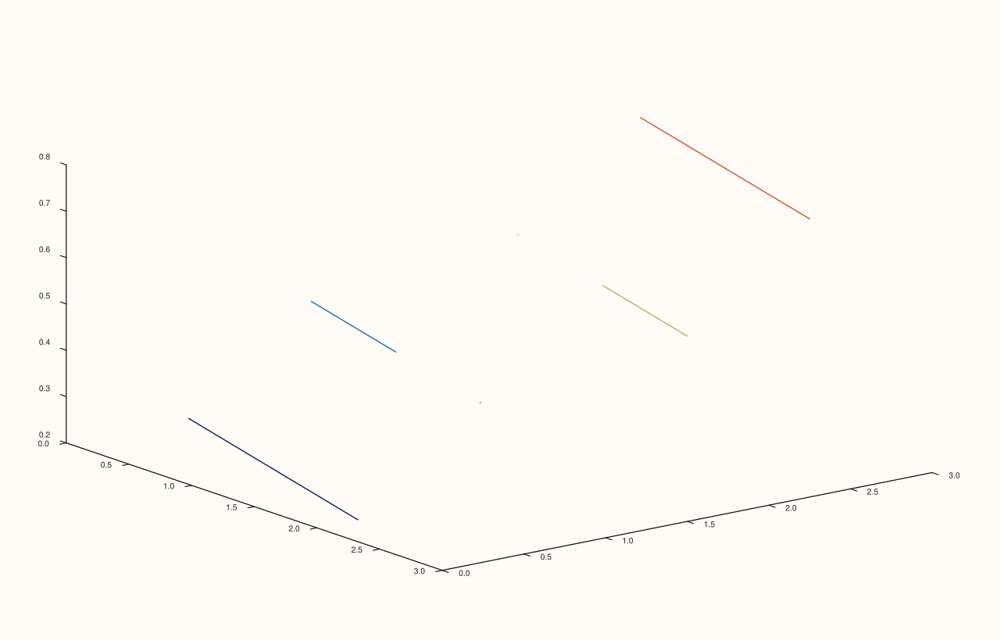
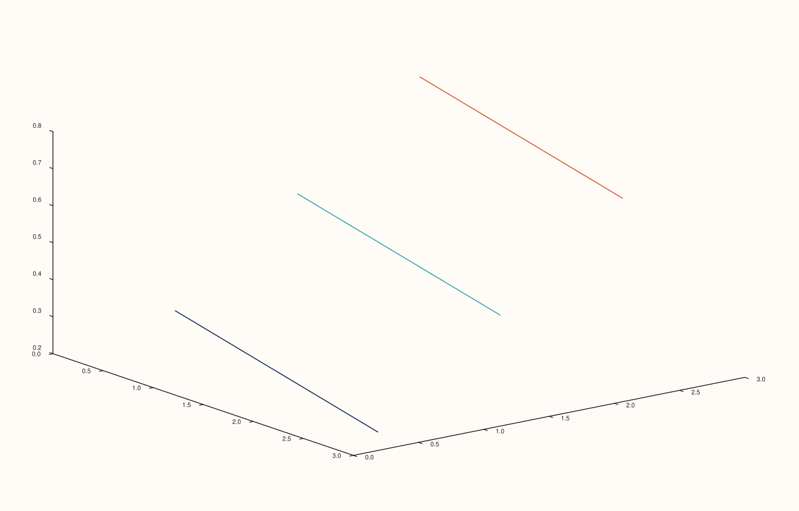

<!-- pluss-hand-authored -->

# flash::ridge3

[Back to flash API Reference](../../flash_api_reference)

## Signatures

```cpp
template <class X, class Y, class Z>
Trace& flash::ridge3(Pane& pane, X&& x, Y&& y, Z&& z)

template <class X, class Y, class Z, class Levels>
  requires (!std::integral<std::remove_cvref_t<Levels>>)
Trace& flash::ridge3(Pane& pane, X&& x, Y&& y, Z&& z, Levels&& levels)

template <class X, class Y, class Z>
Trace& flash::ridge3(Pane& pane, X&& x, Y&& y, Z&& z, int level_count)
```

## What It Does

A thin wrapper around [`Pane::ridge3`](../pane/ridge3.md): converts every argument to
`Series`, validates each is rank ≤ 3 (including `levels`, when supplied), then delegates
to the identically-shaped native `Pane::ridge3` overload. Every delegation is
byte-identical to calling `Pane::ridge3` directly — directly verified via SVG comparison.
Three overloads, mirroring [`Pane::ridge3`](../pane/ridge3.md)'s own: `(x, y, z)`
(automatic `8`-level spacing), `(x, y, z, levels)` (explicit threshold values — the
non-integral `Levels` constraint is what disambiguates this from the `level_count`
overload below), and `(x, y, z, level_count)` (automatic spacing at an explicit count).

```{important} No Studio-creates-pane3-for-you convenience overload, same as flash::spire3
Like flash::spire3, flash::ridge3 has no Studio-taking overload -- every call needs an
existing Pane& (Volumetric), obtained via Studio::pane3() yourself first.
```

## Parameters

**pane** (`Pane&`)
    The target pane. Must be `Volumetric`.

**x**, **y**, **z** (series-convertible, must each be rank ≤ 3, and `z` rank-2 to satisfy
[`Pane::ridge3`](../pane/ridge3.md)'s own deeper requirement)
    The scalar field to contour, lifted onto the pane's third axis.

**levels** (series-convertible, must be rank ≤ 3, non-integral type, second overload
only)
    Explicit contour threshold values.

**level_count** (`int`, third overload only)
    Automatic, evenly-spaced level count. Defaults to `8` when omitted entirely (the
    first overload), the same default [`Pane::contour`](../pane/contour.md)/
    [`Pane::isoband`](../pane/isoband.md) use — note this is a *different* default from
    [`flash::isoshell`](isoshell.md)'s `4`.

## Returns

`Trace&`
    A reference to the newly created trace, for chaining.

## Examples

Example 1. `(x, y, z)` overload — automatic `8`-level spacing.

```cpp
using namespace pluss::pl;

auto fig = studio("flash_ridge3_default");
auto& pane = fig.pane3();
std::vector<double> x{0.0, 1.0, 2.0, 3.0};
std::vector<double> y{0.0, 1.0, 2.0, 3.0};
auto z = pluss::series::linspace(0.0, 1.0, 16, pluss::ScalarType::Float64).reshape({4, 4});
flash::ridge3(pane, x, y, z);
fig.show();
```



Example 2. `(x, y, z, levels)` overload — explicit threshold values.

```cpp
using namespace pluss::pl;

auto fig = studio("flash_ridge3_levels");
auto& pane = fig.pane3();
std::vector<double> x{0.0, 1.0, 2.0, 3.0};
std::vector<double> y{0.0, 1.0, 2.0, 3.0};
auto z = pluss::series::linspace(0.0, 1.0, 16, pluss::ScalarType::Float64).reshape({4, 4});
std::vector<double> levels{0.2, 0.4, 0.6, 0.8};
flash::ridge3(pane, x, y, z, levels);
fig.show();
```



Example 3. `(x, y, z, level_count)` overload — explicit automatic-level count.

```cpp
using namespace pluss::pl;

auto fig = studio("flash_ridge3_level_count");
auto& pane = fig.pane3();
std::vector<double> x{0.0, 1.0, 2.0, 3.0};
std::vector<double> y{0.0, 1.0, 2.0, 3.0};
auto z = pluss::series::linspace(0.0, 1.0, 16, pluss::ScalarType::Float64).reshape({4, 4});
flash::ridge3(pane, x, y, z, 3);
fig.show();
```



Example 4 (verification, not a distinct rendering). `flash::ridge3(pane, x, y, z)`
renders byte-identical to `pane.ridge3(x, y, z)` called directly.

```cpp
using namespace pluss::pl;

std::vector<double> x{0.0, 1.0, 2.0, 3.0};
std::vector<double> y{0.0, 1.0, 2.0, 3.0};
auto z = pluss::series::linspace(0.0, 1.0, 16, pluss::ScalarType::Float64).reshape({4, 4});

auto fig1 = studio("flash_ridge3_flash");
auto& pane1 = fig1.pane3();
flash::ridge3(pane1, x, y, z);

auto fig2 = studio("flash_ridge3_native");
auto& pane2 = fig2.pane3();
pane2.ridge3(x, y, z);

std::cout << "flash::ridge3(pane,x,y,z) == pane.ridge3(x,y,z): " << (fig1.to_svg() == fig2.to_svg()) << "\n";
```

Output:

```text
flash::ridge3(pane,x,y,z) == pane.ridge3(x,y,z): 1
```

## Notes

- Not `noexcept`.
- `flash::ridge3`'s own validation only checks rank ≤ 3 — the stricter rank-2-exact
  requirement on `z` lives one layer deeper, inside [`Pane::ridge3`](../pane/ridge3.md).
- Used internally by [`flash::triplot`](triplot.md)'s `TriplotKind::Ridge`, via a
  binned-grid triplet (see that page's important callout for the genuine bug this
  session fixed there).

## See Also

- [`Pane::ridge3`](../pane/ridge3.md): the underlying native method this function
  delegates to entirely.
- [`flash::spire3`](spire3.md): the bar-forest sibling, also lacking a `Studio`
  convenience overload.
- [`flash::isoshell`](isoshell.md): the volumetric (rank-3 field) isosurface analogue.

<div class="pluss-inline-prev-next">
  <a class="prev-link" href="spire3.html">
    <span class="label">Previous</span>
    <span class="title">spire3</span>
  </a>
  <a class="next-link" href="isoshell.html">
    <span class="label">Next</span>
    <span class="title">isoshell</span>
  </a>
</div>
