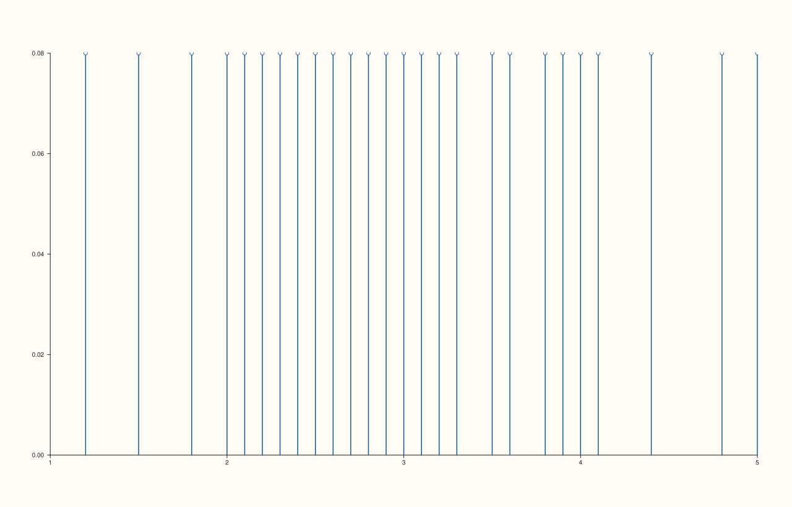
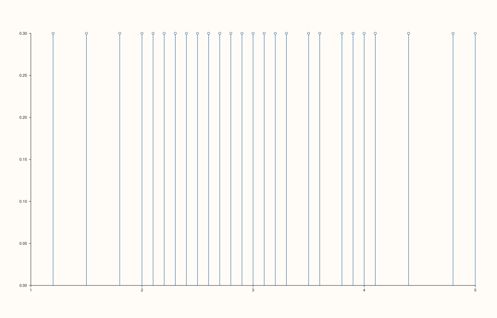

<!-- pluss-hand-authored -->

# flash::rugplot

[Back to flash API Reference](../../flash_api_reference)

## Signatures

```cpp
template <class Values>
Trace& flash::rugplot(Pane& pane, Values&& values, double height = 0.08)
```

## What It Does

Draws a "rug" — one short vertical tick mark per observation, at its `x` position, all
starting from `y = 0` — via [`Pane::spike`](../pane/spike.md). Often layered underneath a
histogram or KDE curve to show the exact raw observation positions the smoothed/binned
view was computed from. There is only one overload.

```{important} height is clamped to a minimum of 1e-4, not silently accepted as-is
Passing height <= 0.0 does not produce zero-height (invisible) or negative-height
ticks -- it's clamped up to a floor of 1e-4 before being used
(std::max(height, 1e-4)), so every tick is always at least minimally visible.
Directly verified: both height = 0.0 and height = -5.0 produced identical
tick-height data (1e-4) in the resulting trace's payload. This is a different
validation style from most Trace-level setters documented elsewhere in this
reference (which silently no-op and leave the PREVIOUS value unchanged) --
here, an out-of-range height is silently CLAMPED to a specific floor value
instead.
```

## Parameters

**pane** (`Pane&`)
    The target pane. Must be `Planar` (2D) — this wraps `Pane::spike`, which requires it.

**values** (series-convertible)
    The raw observation positions.

**height** (`double`, default `0.08`)
    The tick marks' height, in y-axis units. Clamped to a minimum of `1e-4` — see the
    important callout above.

## Returns

`Trace&`
    A reference to the newly created (spike) trace.

## Examples

Example 1. The default `height = 0.08`.

```cpp
using namespace pluss::pl;

auto fig = studio("flash_rugplot_default_height");
auto& pane = fig.pane2();
std::vector<double> raw{1.2, 1.5, 1.8, 2.1, 2.3, 2.5, 2.6, 2.8, 3.0, 3.2, 3.5, 3.9, 4.1,
                         4.4, 4.8, 5.0, 2.0, 2.2, 2.9, 3.1, 3.3, 2.7, 2.4, 3.6, 3.8, 4.0};
flash::rugplot(pane, raw);
fig.show();
```



Example 2. A taller `height`. Verified via direct SVG diff to render genuinely different
tick heights from Example 1.

```cpp
using namespace pluss::pl;

auto fig = studio("flash_rugplot_tall_height");
auto& pane = fig.pane2();
std::vector<double> raw{1.2, 1.5, 1.8, 2.1, 2.3, 2.5, 2.6, 2.8, 3.0, 3.2, 3.5, 3.9, 4.1,
                         4.4, 4.8, 5.0, 2.0, 2.2, 2.9, 3.1, 3.3, 2.7, 2.4, 3.6, 3.8, 4.0};
flash::rugplot(pane, raw, 0.3);
fig.show();
```



Example 3 (edge case). `height = 0.0` and `height = -5.0` both clamp to the same floor
value, verified by inspecting each trace's underlying spike-height data directly.

```cpp
using namespace pluss::pl;

auto fig1 = studio("flash_rugplot_zero_height");
auto& pane1 = fig1.pane2();
Trace& t1 = flash::rugplot(pane1, std::vector<double>{1.0, 2.0, 3.0}, 0.0);
const auto& d1 = std::get<SpikeData>(t1.payload());
std::cout << "height=0.0 actual y[0]: " << d1.y.to(pluss::ScalarType::Float64).host<double>().front() << "\n";

auto fig2 = studio("flash_rugplot_negative_height");
auto& pane2 = fig2.pane2();
Trace& t2 = flash::rugplot(pane2, std::vector<double>{1.0, 2.0, 3.0}, -5.0);
const auto& d2 = std::get<SpikeData>(t2.payload());
std::cout << "height=-5.0 actual y[0]: " << d2.y.to(pluss::ScalarType::Float64).host<double>().front() << "\n";
```

Output:

```text
height=0.0 actual y[0]: 0.0001
height=-5.0 actual y[0]: 0.0001
```

## Notes

- Not `noexcept`.
- Every tick shares the identical `height` — there is no way to vary tick height per
  observation through `rugplot()`.
- See the important callout above for the clamping behavior — a genuinely different
  validation style from most other setters in this reference.

## See Also

- [`Pane::spike`](../pane/spike.md): the method this wraps.
- [`flash::histplot`](histplot.md), [`flash::kdeplot`](kdeplot.md): commonly layered
  above a `rugplot()` to show the raw observations a binned/smoothed view was computed
  from.

<div class="pluss-inline-prev-next">
  <a class="prev-link" href="areaplot.html">
    <span class="label">Previous</span>
    <span class="title">areaplot</span>
  </a>
  <a class="next-link" href="stripplot.html">
    <span class="label">Next</span>
    <span class="title">stripplot</span>
  </a>
</div>
