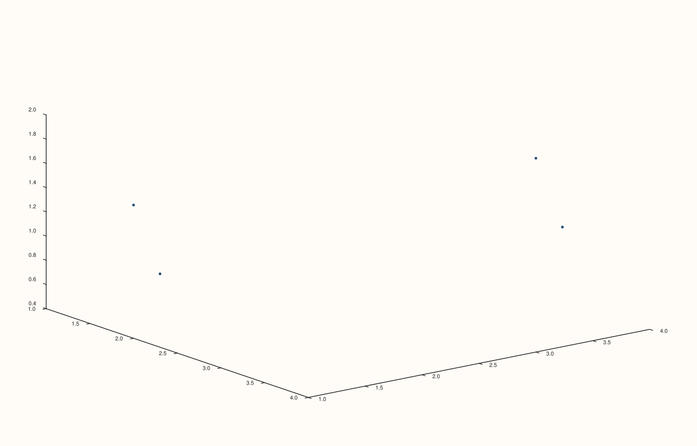

<!-- pluss-hand-authored -->

# flash::scatter3D

[Back to flash API Reference](../../flash_api_reference)

## Signature

```cpp
Trace& flash::scatter3D(Pane& pane, Series x, Series y, Series z)
```

## What It Does

A pure, one-line rename of [`flash::cloud3`](cloud3.md)'s bare `(x, y, z)` overload —
`scatter3D(pane, x, y, z)` is exactly `cloud3(pane, x, y, z)`, nothing more. Exists purely
to offer a shorter, more familiar name some callers already expect. Directly
identical. Note only the bare-arity overload is aliased —
[`flash::cloud3`](cloud3.md)'s `size` and `size`-plus-`color` overloads have no
`scatter3D` equivalent.

## Parameters

**pane** (`Pane&`)
    The target pane. Must be `Volumetric`.

**x**, **y**, **z** (series-convertible, must each be rank ≤ 3)
    The point coordinates — identical requirements to [`flash::cloud3`](cloud3.md)'s bare
    overload.

## Returns

`Trace&`
    A reference to the newly created trace, for chaining.

## Examples

Example 1. Same data as [`flash::cloud3`](cloud3.md)'s own first example.

```cpp
using namespace pluss::pl;

auto fig = studio("flash_scatter3D");
auto& pane = fig.pane3();
std::vector<double> x{1.0, 2.0, 3.0, 4.0};
std::vector<double> y{2.0, 1.0, 4.0, 3.0};
std::vector<double> z{0.5, 1.5, 1.0, 2.0};
flash::scatter3D(pane, x, y, z);
fig.show();
```



Example 2 (a comparison, not a new picture). `flash::scatter3D` renders
identical to `flash::cloud3`'s bare overload given the same arguments.

```cpp
using namespace pluss::pl;

std::vector<double> x{1.0, 2.0, 3.0, 4.0};
std::vector<double> y{2.0, 1.0, 4.0, 3.0};
std::vector<double> z{0.5, 1.5, 1.0, 2.0};

auto fig1 = studio("flash_scatter3D_cmp1");
auto& pane1 = fig1.pane3();
flash::scatter3D(pane1, x, y, z);

auto fig2 = studio("flash_scatter3D_cmp2");
auto& pane2 = fig2.pane3();
flash::cloud3(pane2, x, y, z);

std::cout << "scatter3D == cloud3: " << (fig1.to_svg() == fig2.to_svg()) << "\n";
```

Output:

```text
scatter3D == cloud3: 1
```

## Notes

- Not `noexcept`.
- No `size`/`color` equivalent overloads — use [`flash::cloud3`](cloud3.md) directly for
  per-point marker size/color.

## See Also

- [`flash::cloud3`](cloud3.md): the function this is a pure rename of (bare overload
  only).
- [`flash::plot3D`](plot3D.md), [`flash::plot_surface`](plot_surface.md),
  [`flash::plot_wireframe`](plot_wireframe.md), [`flash::contour3D`](contour3D.md),
  [`flash::bar3d`](bar3d.md): the other familiar-naming aliases in this family.

<div class="pluss-inline-prev-next">
  <a class="prev-link" href="plot3D.html">
    <span class="label">Previous</span>
    <span class="title">plot3D</span>
  </a>
  <a class="next-link" href="plot_surface.html">
    <span class="label">Next</span>
    <span class="title">plot_surface</span>
  </a>
</div>
