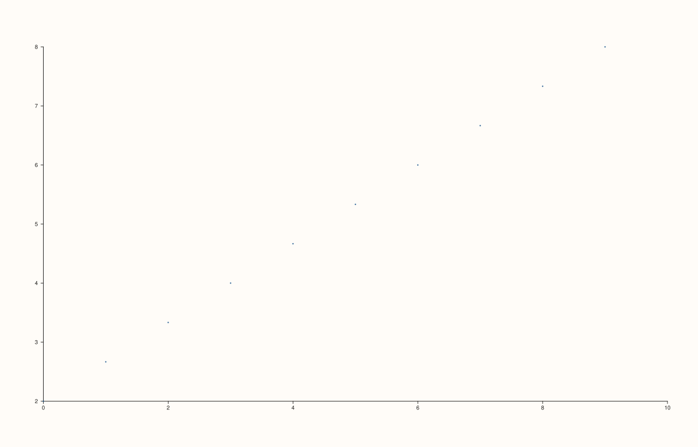
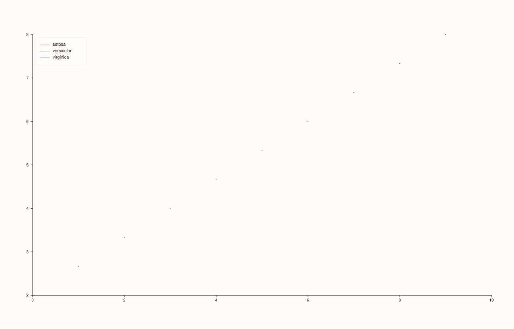
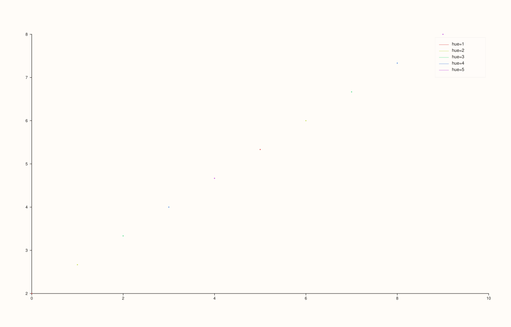
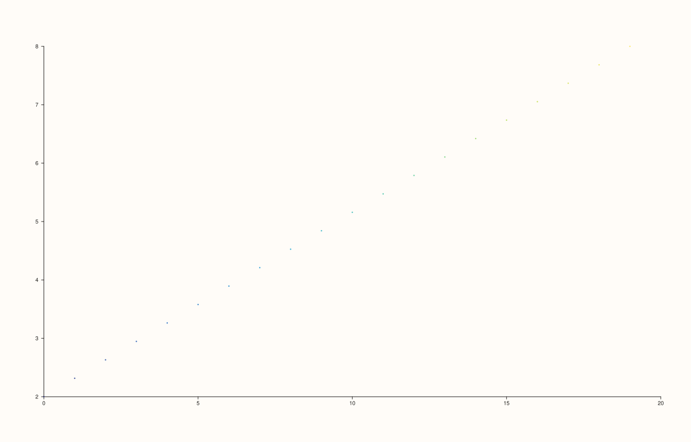

<!-- pluss-hand-authored -->

# flash::scatterplot

[Back to flash API Reference](../../flash_api_reference)

## Signatures

```cpp
template <class X, class Y>
Trace& flash::scatterplot(Pane& pane, X&& x, Y&& y)

template <class X, class Y>
Trace& flash::scatterplot(Pane& pane, X&& x, Y&& y, const Note& hue)

template <class X, class Y, class Hue>
Trace& flash::scatterplot(Pane& pane, X&& x, Y&& y, Hue&& hue)
```

## What It Does

The high-level entry point for a scatter plot: a thin, convenience-oriented wrapper
around [`Pane::cloud`](../pane/cloud.md) that adds one capability `cloud()` doesn't have on
its own — **automatic hue grouping**, coloring and legending points by a third variable
without the caller having to split the data into groups by hand. Three overloads, split on
whether (and how) a `hue` variable is supplied:

- **`scatterplot(pane, x, y)`** — a single, ungrouped scatter trace. Equivalent to
  `pane.cloud(x, y)`.
- **`scatterplot(pane, x, y, hue)`** where `hue` is a `Note`
  (Pluss's text/categorical labeling type) — **categorical** hue. Every distinct label in
  `hue` becomes its own colored, legended `Trace`, drawn via repeated
  [`Pane::cloud`](../pane/cloud.md) calls, one per group.
- **`scatterplot(pane, x, y, hue)`** where `hue` is any other series-convertible value —
  **numeric** hue, which behaves differently depending on how many *distinct* values `hue`
  actually contains, established by direct compiled verification below:
  - **10 or fewer unique values** — treated exactly like a small categorical variable:
    one colored, legended `Trace` per distinct value (labeled `"hue=<value>"`).
  - **More than 10 unique values** — falls back to a **single** trace: a plain
    `pane.cloud(x, y, {marker_area}, hue)` call with a continuous
    `PaletteRamp::lagoon()` gradient instead of discrete groups/legend entries.

```{important} scatterplot's numeric-hue threshold (10) is NOT the same as lineplot's (8)
flash::lineplot(pane, x, y, hue) applies the identical two-branch numeric-hue
logic (small integer count -> discrete groups, otherwise a fallback), but its
threshold is 8, not 10 -- and its fallback strategy is different too (binning
into 6 groups, rather than a single continuous-palette trace). Directly
verified: 9 unique hue values render as 9 discrete grouped traces under
scatterplot() (9 <= 10) but as only 6 (already binned) under lineplot() (9 > 8)
on otherwise identical data. Do not assume the two functions share a threshold
or an overflow strategy just because their hue-dispatch code looks similar --
see flash::lineplot for its own verified numbers.
```

```{important} The hue overloads return only the LAST group's Trace&
When hue produces multiple grouped traces, the function's Trace& return value points at
whichever trace was drawn last (the final distinct hue level, in first-seen order for
Note, in ascending numeric order for a numeric hue) -- not a handle to "the whole
plot." Chaining a style call like .width(3.0F) onto the return value only restyles
that last group; the earlier groups keep scatterplot()'s own internal styling. If you
need to restyle every group, iterate pane.traces() afterward instead of chaining off
the return value.
```

Every hue overload also has a documented side effect: if the pane's legend isn't already
placed somewhere (`legend_place() == KeyPlace::None`, the constructor default), a hue call
turns it on at `KeyPlace::Auto` automatically — so grouped points always come with a
legend unless you'd already set one up (or explicitly turned it off) yourself.

## Parameters

**pane** (`Pane&`)
    The target pane. Must be `Planar` (2D) — this wraps `Pane::cloud`, which requires it.

**x**, **y** (series-convertible)
    The point coordinates.

**hue** (`const Note&`, or any series-convertible value, third overload group only)
    The grouping/coloring variable, paired with `x`/`y` by index. A `Note` is always
    treated as categorical; anything else is treated as numeric, with the branching
    behavior described above.

## Returns

`Trace&`
    A reference to the newly created trace — the *only* trace for the no-hue overload, or
    the *last-drawn group's* trace for either hue overload (see the important callout
    above).

## Examples

Example 1. Plain, ungrouped scatter.

```cpp
using namespace pluss::pl;

auto fig = studio("flash_scatterplot_plain");
auto& pane = fig.pane2();
flash::scatterplot(pane, pluss::series::linspace(0.0, 9.0, 10, pluss::ScalarType::Float64),
                    pluss::series::linspace(2.0, 8.0, 10, pluss::ScalarType::Float64));
fig.show();
```



Example 2. Categorical hue via a `Note` — three species
labels, three colored/legended groups.

```cpp
using namespace pluss::pl;

auto fig = studio("flash_scatterplot_note_hue");
auto& pane = fig.pane2();
auto species = pluss::note::make({"setosa", "setosa", "setosa", "versicolor", "versicolor",
                                   "versicolor", "virginica", "virginica", "virginica", "virginica"});
flash::scatterplot(pane, pluss::series::linspace(0.0, 9.0, 10, pluss::ScalarType::Float64),
                    pluss::series::linspace(2.0, 8.0, 10, pluss::ScalarType::Float64), species);
fig.show();
```



Example 3. Numeric hue with 5 unique values — at or under the 10-value threshold, so it
renders as 5 discrete, legended groups (verified via `Pane::trace_count()`, not just the
image).

```cpp
using namespace pluss::pl;

auto fig = studio("flash_scatterplot_numeric_hue_discrete");
auto& pane = fig.pane2();
std::vector<double> hue{1.0, 2.0, 3.0, 4.0, 5.0, 1.0, 2.0, 3.0, 4.0, 5.0};
flash::scatterplot(pane, pluss::series::linspace(0.0, 9.0, 10, pluss::ScalarType::Float64),
                    pluss::series::linspace(2.0, 8.0, 10, pluss::ScalarType::Float64), hue);
std::cout << "trace_count: " << pane.trace_count() << "\n";
fig.show();
```

Output:

```text
trace_count: 5
```



Example 4. Numeric hue with 20 unique values — past the threshold, so it collapses to a
**single** continuously-colored trace instead of 20 groups.

```cpp
using namespace pluss::pl;

auto fig = studio("flash_scatterplot_numeric_hue_continuous");
auto& pane = fig.pane2();
auto hue = pluss::series::linspace(0.0, 19.0, 20, pluss::ScalarType::Float64);
flash::scatterplot(pane, pluss::series::linspace(0.0, 19.0, 20, pluss::ScalarType::Float64),
                    pluss::series::linspace(2.0, 8.0, 20, pluss::ScalarType::Float64), hue);
std::cout << "trace_count: " << pane.trace_count() << "\n";
fig.show();
```

Output:

```text
trace_count: 1
```



## Notes

- Not `noexcept` — constructs `Series`/`Note` data and may allocate; the hue overloads
  also validate `x`/`y`/`hue` have identical lengths, throwing `std::invalid_argument`
  ("... requires x, y, and hue to have identical lengths") on mismatch.
- Marker styling for hue-grouped traces is fixed internally: `width(0.55F)` per group (a
  thin marker outline), with colors drawn from an evenly-spaced HSL wheel
  (`saturation=0.68, lightness=0.50`) — not user-configurable through `scatterplot()`
  itself. Call [`Pane::cloud`](../pane/cloud.md) directly for full control over marker
  size/color per point.
- The 10-value numeric-hue threshold and its continuous-palette fallback are specific to
  `scatterplot()` — see the important callout above contrasting
  [`flash::lineplot`](lineplot.md)'s different threshold (8) and different fallback
  (binning, not a continuous palette).
- `flash::relplot(..., kind="scatter")` (the default `kind`) is a thin dispatcher that
  calls this exact function — see [`flash::relplot`](relplot.md).

## See Also

- [`Pane::cloud`](../pane/cloud.md): the lower-level method this wraps, for full control
  over per-point size and color without automatic hue grouping.
- [`flash::lineplot`](lineplot.md): the connected-line counterpart, sharing the same
  three-overload hue-dispatch shape but with different numeric thresholds/fallback.
- [`flash::relplot`](relplot.md): a `kind`-dispatched wrapper choosing between this and
  `lineplot()`.

<div class="pluss-inline-prev-next">
  <a class="next-link" href="lineplot.html">
    <span class="label">Next</span>
    <span class="title">lineplot</span>
  </a>
</div>
