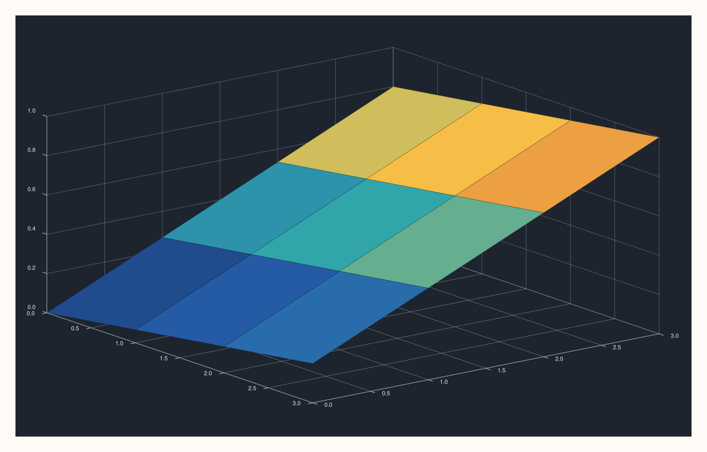
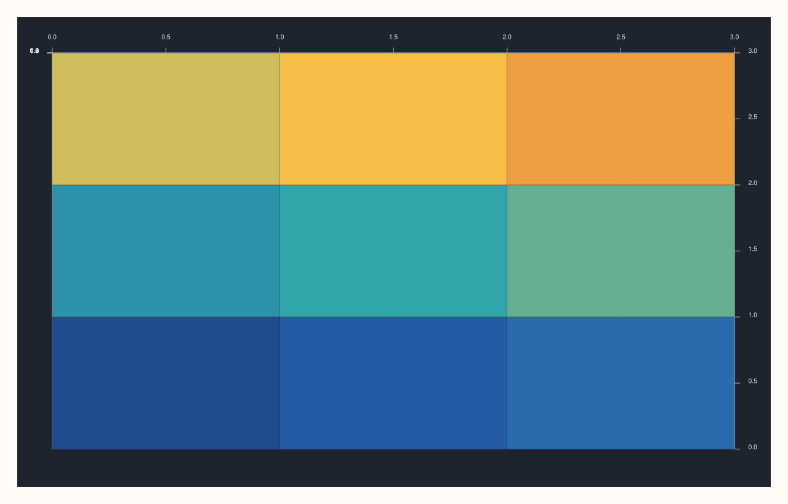
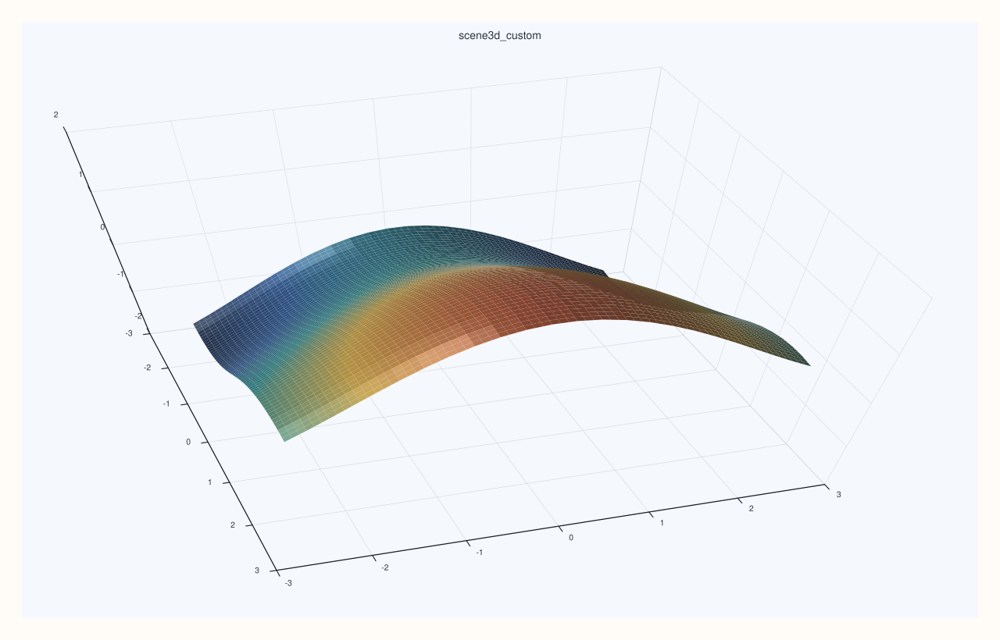

<!-- pluss-hand-authored -->

# flash::scene3d

[Back to flash API Reference](../../flash_api_reference)

## Signature

```cpp
Pane& flash::scene3d(Pane& pane, const Scene3DOptions& options)
```

## What It Does

The fully composable sibling of [`flash::scene_preset3d`](scene_preset3d.md): every
field is a `std::optional`, applied — in this fixed order — only when set:
`preset` ([`scene_preset3d`](scene_preset3d.md)) → `theme`
([`theme_preset3d`](theme_preset3d.md)) → `grid_style`
([`Pane::grid`](../pane/grid.md)) → `camera_preset`
([`camera_preset3d`](camera_preset3d.md)) → `camera`
([`camera3d`](camera3d.md)) → `lighting` ([`lighting3d`](lighting3d.md)).

```{important} preset is applied FIRST -- every later field silently overrides pieces of it
Because `preset` runs before every other field, setting BOTH `preset` and one of
`theme`/`camera_preset`/`camera`/`lighting`/`grid_style` lets you start from a named
scene and then override just the pieces you want changed -- the preset is not
"replaced," only partially superseded. Directly verified: `Scene3DOptions{.preset =
Studio}` alone renders byte-identical to a direct
`flash::scene_preset3d(pane, ScenePreset3D::Studio)` call; adding `.camera_preset =
CameraPreset3D::TopDown` on top of the same `preset = Studio` renders genuinely
differently (only the camera changes, theme/lighting/grid stay Studio's).
```

## Parameters

**pane** (`Pane&`)
    The target pane — whichever of its `Theme`, grid style, `Lens`, and `LightRig` are
    covered by the options set.

**options** (`const Scene3DOptions&`)
    See the field table below.

## `Scene3DOptions` fields

| Field | Type and default | Description |
|---|---|---|
| `preset` | `std::optional<ScenePreset3D>`, default `std::nullopt` | Applies [`flash::scene_preset3d`](scene_preset3d.md) first, when set. See the important callout above. |
| `theme` | `std::optional<ThemePreset3D>`, default `std::nullopt` | Applies [`flash::theme_preset3d`](theme_preset3d.md) when set — after `preset`. |
| `camera_preset` | `std::optional<CameraPreset3D>`, default `std::nullopt` | Applies [`flash::camera_preset3d`](camera_preset3d.md) when set — after `theme` and `grid_style`. |
| `camera` | `std::optional<Camera3DOptions>`, default `std::nullopt` | Applies [`flash::camera3d`](camera3d.md) when set — after `camera_preset`, so setting both `camera_preset` and `camera` lets `camera` win (it's applied later). |
| `lighting` | `std::optional<Lighting3DOptions>`, default `std::nullopt` | Applies [`flash::lighting3d`](lighting3d.md) when set — applied last. |
| `grid_style` | `std::optional<GridStyle>`, default `std::nullopt` | Applies [`Pane::grid`](../pane/grid.md) directly when set — applied third, after `preset`/`theme`, before `camera_preset`/`camera`/`lighting`. |

## Returns

`Pane&`
    A reference to the same pane, for chaining.

## Examples

Example 1 (verification, not a distinct rendering). `Scene3DOptions{.preset = Studio}`
alone renders byte-identical to `flash::scene_preset3d(pane, ScenePreset3D::Studio)`.

```cpp
using namespace pluss::pl;

auto fig1 = studio("flash_scene3d_preset");
auto& pane1 = fig1.pane3();
pane1.sheet(std::vector<double>{0.0, 1.0, 2.0, 3.0}, std::vector<double>{0.0, 1.0, 2.0, 3.0}, pluss::series::linspace(0.0, 1.0, 16, pluss::ScalarType::Float64).reshape({4, 4}));
flash::Scene3DOptions opts;
opts.preset = flash::ScenePreset3D::Studio;
flash::scene3d(pane1, opts);

auto fig2 = studio("flash_scene3d_cmp");
auto& pane2 = fig2.pane3();
pane2.sheet(std::vector<double>{0.0, 1.0, 2.0, 3.0}, std::vector<double>{0.0, 1.0, 2.0, 3.0}, pluss::series::linspace(0.0, 1.0, 16, pluss::ScalarType::Float64).reshape({4, 4}));
flash::scene_preset3d(pane2, flash::ScenePreset3D::Studio);

std::cout << "scene3d(preset=Studio) == scene_preset3d(Studio): " << (fig1.to_svg() == fig2.to_svg()) << "\n";
fig1.show();
```

Output:

```text
scene3d(preset=Studio) == scene_preset3d(Studio): 1
```



Example 2. `preset = Studio` plus `camera_preset = TopDown` — the preset's theme/
lighting/grid carry over, only the camera changes.

```cpp
using namespace pluss::pl;

auto fig = studio("flash_scene3d_override");
auto& pane = fig.pane3();
pane.sheet(std::vector<double>{0.0, 1.0, 2.0, 3.0}, std::vector<double>{0.0, 1.0, 2.0, 3.0}, pluss::series::linspace(0.0, 1.0, 16, pluss::ScalarType::Float64).reshape({4, 4}));
flash::Scene3DOptions opts;
opts.preset = flash::ScenePreset3D::Studio;
opts.camera_preset = flash::CameraPreset3D::TopDown;
flash::scene3d(pane, opts);
std::cout << "scene3d(Studio preset + TopDown camera override) rendered\n";
fig.show();
```



Example 3. Start from a preset, then override several pieces at once. This is the main
reason `scene3d(...)` exists: keep the preset ergonomics, but still let individual parts
win later in the application order.

```cpp
using namespace pluss::pl;

auto fig = studio("flash_scene3d_custom");
auto& pane = fig.pane3();
auto gx = pluss::series::linspace(-2.5, 2.5, 24, pluss::ScalarType::Float64);
auto gy = pluss::series::linspace(-2.5, 2.5, 24, pluss::ScalarType::Float64);
auto gz = gx.reshape({1, 24}).tile({24, 1}).mul(0.6).sin()
            .add(gy.reshape({24, 1}).tile({1, 24}).mul(0.7).cos());

flash::Scene3DOptions opts;
opts.preset = flash::ScenePreset3D::Studio;
opts.theme = flash::ThemePreset3D::Mist;
opts.camera = flash::Camera3DOptions{
    .azimuth_deg = -18.0,
    .elevation_deg = 52.0,
    .view_angle_deg = 30.0,
    .projection = ProjectionKind::Perspective,
};
opts.grid_style = GridStyle::Major;
opts.lighting = flash::Lighting3DOptions{
    .clear_first = true,
    .headlight = false,
    .lamp_left = true,
    .lamp_right = true,
    .sun_key = true,
};
flash::scene3d(pane, opts);
auto& trace = pane.sheet(gx, gy, gz);
flash::trace3d(trace, flash::Trace3DOptions{.preset = flash::TracePreset3D::Surface});
fig.show();
```



## Notes

- Not `noexcept`.
- With every field left `std::nullopt` (a default-constructed `Scene3DOptions{}`), this
  function is a no-op — no piece of the pane's `Theme`/grid/`Lens`/`LightRig` is
  touched.
- See the important callout above for the fixed application order — it determines which
  field "wins" when both a preset and an individual override target the same underlying
  state (e.g. `camera_preset` and `camera` both configure the `Lens`; `camera` runs
  later and wins).

## See Also

- [`flash::scene_preset3d`](scene_preset3d.md): the fixed, non-composable sibling this
  function's `preset` field applies.
- [`flash::theme_preset3d`](theme_preset3d.md), [`flash::camera3d`](camera3d.md),
  [`flash::camera_preset3d`](camera_preset3d.md),
  [`flash::lighting3d`](lighting3d.md): the individual pieces this function composes.
- [`Pane::grid`](../pane/grid.md): the native method `grid_style` calls directly.

<div class="pluss-inline-prev-next">
  <a class="prev-link" href="scene_preset3d.html">
    <span class="label">Previous</span>
    <span class="title">scene_preset3d</span>
  </a>
  <a class="next-link" href="trace_preset3d.html">
    <span class="label">Next</span>
    <span class="title">trace_preset3d</span>
  </a>
</div>
